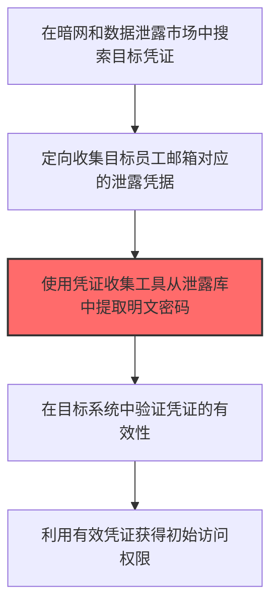
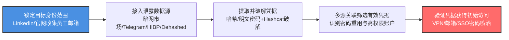

# 凭证收集 (T1589.001)

## 一句话通俗理解

> **收集用户名、密码等登录凭据，比如从暗网买泄露的密码库**

## 30秒速查卡

| 维度 | 你需要知道的 |
|------|-------------|
| 这是什么？ | 从暗网、泄露数据库或公开资源中收集用户名、密码等登录凭据 |
| 为什么危险？ | 泄露的凭证可以直接用来登录目标系统，绕过密码验证 |
| 谁需要关心？ | 安全运维、SOC分析师 |
| 你的第一步防御 | 监控暗网和泄露数据库中是否出现本组织的凭证 |
| 如果只做一件事 | 强制所有员工使用多因素认证（MFA） |

## 难度等级

⭐⭐ 中级 - 需要一定的技术基础和经验

## 前置知识检查

**读这个文件需要什么？**

- [ ] 互联网搜索基础、DNS/子域名概念、搜索引擎高级语法dork
- [ ] 网络协议基础（HTTP/DNS/TCP）
- [ ] 信息源分类能力（OSINT vs 商业情报）

## 技术描述

**凭证收集**（T1589.001）是 **收集受害者身份信息**（T1589）的一个具体变体，属于 **侦察** 阶段的攻击技术。

> 🕵️ **打个比方**：就像私家侦探在案发前先打听目标的姓名、住址和习惯，攻击者也要先收集目标的身份信息，才能精准下手。

### 具体怎么理解？

收集用户名、密码等登录凭据，比如从暗网买泄露的密码库

攻击者使用这种技术时，通常是在侦察阶段，想要达到特定的攻击目标。与父技术 T1589 相比，T1589.001 有自己独特的特点和使用场景。

### 为什么有效？

这种技术之所以有效，是因为：
1. **隐蔽性**：利用了正常系统功能或常见协议，不容易被发现
2. **技术门槛适中**：不需要特别高深的技术知识就能实施
3. **广泛适用**：可以在多种环境和系统中使用

**过渡段：** 不要误以为网络侦察只是简单的'谷歌搜索'——在攻击者手中，这是系统化的情报收集过程。

## 真实攻击流程



**步骤详解：**

1. **暗网搜索** - 在暗网市场和数据泄露论坛搜索目标组织的泄露数据包
2. **定向收集** - 针对目标员工邮箱从泄露数据库中提取对应的登录凭证
3. **密码提取** - 使用Hashcat等工具破解密码哈希，获取明文密码
4. **凭证验证** - 在目标VPN、邮箱或业务系统中测试凭证是否有效
5. **初始访问** - 利用验证有效的凭证登录目标系统完成突破

### 典型场景

攻击者在 **侦察** 阶段使用 凭证收集 技术，以下是典型的攻击步骤：

## 攻击流程



**关键步骤说明：**

1. **锁定目标身份范围** - 攻击者通过LinkedIn、企业官网、GitHub提交记录等公开渠道收集目标组织员工邮箱清单与用户名格式，作为后续在泄露数据库中筛选凭据的索引；同时识别IT管理员、DevOps工程师等高价值账户。
2. **接入泄露数据源** - 通过暗网市场（如RAMP、Exploit.in）、Telegram数据交易群组、商业泄露查询服务（Dehashed、Snusbase、Have I Been Pwned）以及公开的Combination Lists等渠道，搜索目标邮箱在历史泄露事件中暴露的凭据记录。
3. **提取并破解凭据** - 从泄露数据包中提取NTLM哈希、bcrypt哈希或明文密码，对加密哈希使用Hashcat配合rockyou.txt字典与规则集进行离线破解；对信息窃取木马导出的浏览器保存密码和会话Cookie则直接提取复用。
4. **多源关联筛选有效凭据** - 将多个泄露源数据按员工身份关联去重，识别密码重用模式（同一员工在不同站点使用相似密码）和近期仍活跃的账户；优先标记管理员账户、Service Account和未启用MFA的账户作为高价值目标。
5. **验证凭据获得初始访问** - 使用自动化脚本对目标VPN、Outlook Web Access、SSO门户、代码仓库（GitHub/GitLab）等登录入口进行低速率密码喷洒验证，规避账户锁定策略；对验证有效的凭据登录系统，完成从侦察到初始访问的闭环。

## 真实案例

### 案例1：LAPSUS$利用信息窃取木马收集凭证入侵Okta和NVIDIA

- **时间**: 2022年1-3月
- **目标**: Okta、NVIDIA、Samsung、Microsoft、Uber等多家科技巨头
- **攻击组织**: LAPSUS$（也称为 DEV-0537）
- **手法**: LAPSUS$通过购买或获取REDLINE、VIDAR等信息窃取木马窃取的凭证，从暗网市场和Telegram群组中收集目标组织员工的有效登录凭据。这些凭证来源于员工个人设备感染信息窃取木马后泄露的浏览器保存密码和会话Cookie。攻击者使用这些凭证直接登录目标的VPN、身份提供商（如Okta）和代码仓库，绕过MFA验证（通过窃取的会话Cookie实现会话劫持）
- **影响**: Okta的第三方支持工程师账户被入侵，影响36,000个客户；NVIDIA约1TB数据被窃取并遭勒索；Samsung Galaxy设备源代码和生物识别数据泄露
- **参考链接**: [Mandiant: LAPSUS$ Group Analysis](https://www.mandiant.com/resources/blog/lapsus-actor-takedown)

### 案例2：UNC5537利用历史窃取凭证攻击Snowflake云平台客户

- **时间**: 2024年4-5月
- **目标**: Ticketmaster（Live Nation）、Santander Bank、AT&T等165个Snowflake客户
- **攻击组织**: UNC5537（Mandiant命名，部分成员据信与Scattered Spider有关联）
- **手法**: UNC5537利用此前通过信息窃取木马（REDLINE、VIDAR、MARS等）收集的Snowflake客户凭证，登录未启用MFA的Snowflake账户。这些凭证有些是在2020-2023年间就被窃取并流通于暗网市场，攻击者使用自动化脚本批量验证凭证有效性后，从Snowflake数据仓库中窃取大量客户数据并进行勒索
- **影响**: Ticketmaster 5.6亿客户信息泄露；AT&T 1.09亿客户通话记录泄露；Santander 3000万客户数据泄露
- **参考链接**: [Mandiant: UNC5537 Snowflake Investigation](https://cloud.google.com/blog/topics/threat-intelligence/unc5537-snowflake-data-theft-extortion)

### 案例3：APT28利用泄露凭证攻击乌克兰军方邮箱

- **时间**: 2022年2月-2023年
- **目标**: 乌克兰军方和政府机构
- **攻击组织**: APT28（Fancy Bear，俄罗斯GRU 26165部队）
- **手法**: APT28从历史数据泄露事件中收集乌克兰军方人员在第三方网站（如招聘平台、论坛）注册时使用的邮箱和密码。利用密码复用习惯，攻击者在军方Outlook Web Access和邮件服务器上尝试这些凭证，成功获取多名军官邮箱访问权限后投递恶意附件，进一步渗透军事情报系统
- **影响**: 多个乌克兰军方邮件账户被入侵，部分作战通信内容被窃取
- **参考链接**: [CERT-UA: APT28 Activity Report](https://cert.gov.ua/article/3760625)

### 案例4：2025年AI辅助的凭证收集攻击

- **时间**: 2025年
- **目标**: 全球各行业组织
- **攻击组织**: 多个AI增强的威胁行为者（包括APT29、Kimsuky等）
- **手法**: 根据CrowdStrike 2026全球威胁报告，攻击者使用LLM自动化分析暗网泄露数据，从海量泄露数据库中快速筛选出目标组织的高价值凭证（管理员账户、特权账户）。AI辅助技术使凭证筛选效率提升10倍以上，并能自动关联多源数据识别密码重用模式
- **影响**: 从侦察到凭证利用的周期从数月缩短到数天
- **参考链接**: [CrowdStrike 2026 Global Threat Report](https://www.crowdstrike.com/global-threat-report/)

## 红队视角

> ⚠️ **免责声明**：以下内容仅用于合法的安全测试、渗透测试和教育目的。未经授权对他人系统进行测试是违法行为。

### 实战技巧

1. **深入理解原理**：在实战应用前，充分理解凭证收集的技术原理和适用场景
2. **环境适配**：根据目标系统的操作系统版本、安全配置等因素调整攻击策略
3. **组合使用**：将该技术与其他技术组合使用，构建完整的攻击链
4. **隐蔽性考虑**：注意操作痕迹的清理，避免被安全设备检测

### 常用工具

| 工具名称 | 用途 | 平台 | 链接 |
| -------- | ---- | ---- | ---- |
| Dehashed | 数据泄露数据库搜索引擎，可查询邮箱、用户名、密码哈希 | Web | [Dehashed](https://dehashed.com/) |
| Have I Been Pwned | 查询邮箱/域名是否出现在已知数据泄露中 | Web | [HIBP](https://haveibeenpwned.com/) |
| Hashcat | 密码哈希破解工具，支持GPU加速 | 全平台 | [Hashcat](https://hashcat.net/hashcat/) |
| Snusbase | 数据泄露记录付费搜索平台 | Web | [Snusbase](https://snusbase.com/) |
| theHarvester | 从公开来源收集邮箱、子域名、凭证 | Linux | [GitHub](https://github.com/laramies/theHarvester) |

### 注意事项

- 在授权的测试环境中使用这些技术
- 注意操作安全（OPSEC），避免被检测系统发现
- 使用匿名化技术和代理隐藏真实身份

## 蓝队视角

### 检测要点

1. **系统日志监控**：关注与凭证收集相关的系统日志和审计记录
2. **异常行为检测**：监控系统中与该技术相关的异常进程、网络连接和文件操作
3. **工具特征识别**：识别攻击者可能使用的工具在系统中的运行特征

### 监控建议

- 部署端点检测和响应（EDR）系统，监控与凭证收集相关的异常行为
- 配置SIEM规则，关联分析来自多个来源的告警
- 定期进行安全评估和渗透测试，验证检测规则的有效性

## 避坑指南

新手常犯的错误：过度依赖单一信息源。专业的侦察需要多个来源交叉验证。

## 检测建议

### 检测思路

检测 凭证收集 的关键是识别异常行为模式。以下是三个层面的检测方法：

### 网络层检测

**方法**：监控网络流量中的异常模式

```bash
# 检测异常的网络连接和数据传输
# 根据具体协议和端口设置检测规则
```

### 主机层检测

**Windows事件ID**：
- 事件ID 4688：进程创建（监控可疑进程）
- 事件ID 4104：PowerShell执行（监控可疑脚本）

**Linux日志**：
- /var/log/auth.log：认证日志
- /var/log/syslog：系统日志

```bash
# 检测异常进程和命令执行
grep -i "suspicious" /var/log/auth.log
```

### 应用层检测

**用人话说：** 攻击者像在垃圾堆里翻找别人丢弃的账单和信件——他们从暗网市场、数据泄露论坛和密码共享网站上收集目标员工的登录凭据。他们会用Have I Been Pwned、LeakCheck等工具搜索哪些邮箱地址曾在历史泄露事件中暴露过密码，然后用Hashcat破解密码哈希。如果你发现自己的员工邮箱出现在暗网叫卖帖子里，或者有人在尝试用泄露的密码登录公司VPN，这就是凭证被收集的铁证。正常员工不会去暗网买自己公司的密码库，所以一旦检测到这类行为，几乎可以断定是攻击者在做准备。

**Sigma规则示例**：

```yaml
title: 检测凭证收集
status: experimental
description: 检测可能的凭证收集活动
logsource:
    category: process_creation
    product: windows
detection:
    selection:
        EventID: 4688
    condition: selection
level: medium
tags:
    - attack.T1589001
```

## 缓解措施

### 优先级1：关键措施

**限制攻击面**：减少暴露的服务和端口，降低被利用的风险

```bash
# 防火墙规则示例：只允许必要的出站连接
iptables -A OUTPUT -p tcp --dport 443 -j ACCEPT  # 允许HTTPS
iptables -A OUTPUT -p tcp --dport 80 -j ACCEPT   # 允许HTTP
iptables -A OUTPUT -p tcp -j DROP                 # 阻止其他TCP
```

### 优先级2：重要措施

**加强监控**：部署EDR和SIEM系统，实时监控异常行为

### 优先级3：建议措施

**安全意识培训**：教育员工识别相关攻击手法

## 动手实验

> ⚠️ **所有实验必须在隔离的实验室环境中进行**

### 实验1：理解基本原理（初级）

**目标**：理解 凭证收集 的工作原理

**步骤**：
1. 在隔离环境中搭建测试系统
2. 使用基础工具模拟攻击行为
3. 观察系统日志和网络流量

**学习要点**：理解该技术的核心机制

### 实验2：实际操作（中级）

**目标**：掌握 凭证收集 的实际使用方法

**步骤**：
1. 使用专业工具进行攻击模拟
2. 尝试不同的绕过技术
3. 分析检测日志的特征

**学习要点**：掌握工具使用和日志分析

### 实验3：防御验证（高级）

**目标**：验证检测规则的有效性

**步骤**：
1. 部署检测规则
2. 执行攻击模拟
3. 验证检测告警是否触发

**学习要点**：理解攻防对抗的实际效果

## 术语解释

| 术语 | 通俗解释 |
|------|---------|
| **ATT&CK** | MITRE公司维护的攻击技术知识库，像一本"黑客手法百科全书" |
| **凭证收集** | T1589.001，ATT&CK框架中定义的一种具体攻击技术 |
| **收集受害者身份信息** | T1589，凭证收集所属的父技术类别 |
| **侦察** | 攻击链中的一个阶段，攻击者在这个阶段的目标 |
| **C2** | 命令与控制，攻击者用来远程控制被入侵系统的"遥控器" |
| **EDR** | 端点检测与响应，部署在电脑上的安全监控软件 |

## 被引用情况

以下父技术文档引用了本子技术：

- [T1589 - 收集受害者身份信息](../T1589-Gather-Victim-Identity-Information.md)

## 参考资料

### 📚 官方文档（深入了解）

- [MITRE ATT&CK - 凭证收集 (T1589.001)](https://attack.mitre.org/techniques/T1589/001/)
- [MITRE ATT&CK - 收集受害者身份信息 (T1589)](https://attack.mitre.org/techniques/T1589/)

### 📰 安全报告（真实攻击）

- [MITRE ATT&CK 官方文档](https://attack.mitre.org/) - ATT&CK 框架官方资源

### 🔧 工具与资源（动手试试）

- [Atomic Red Team](https://github.com/redcanaryco/atomic-red-team) - 检测规则测试框架
- [MITRE ATT&CK Navigator](https://mitre-attack.github.io/attack-navigator/) - ATT&CK 可视化工具

### 📚 学习资料（深入了解）

- [MITRE ATT&CK 知识库](https://attack.mitre.org/resources/) - ATT&CK 官方资源中心
