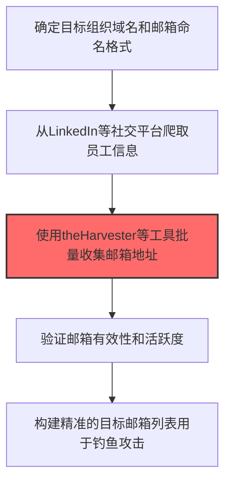
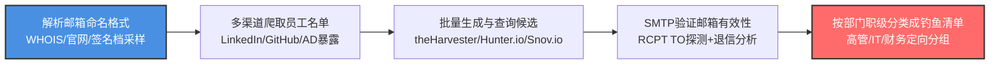

# 电子邮件地址收集 (T1589.002)

## 一句话通俗理解

> **收集员工的邮箱地址，用于后续发钓鱼邮件**

## 30秒速查卡

| 维度 | 你需要知道的 |
|------|-------------|
| 这是什么？ | 从公开渠道收集目标组织员工的邮箱地址 |
| 为什么危险？ | 邮箱地址是钓鱼邮件的起点，有了邮箱就能发起针对性钓鱼 |
| 谁需要关心？ | 安全团队、IT管理员 |
| 你的第一步防御 | 限制员工邮箱在公开渠道的暴露 |
| 如果只做一件事 | 监控针对本组织的钓鱼邮件尝试 |

## 难度等级

⭐⭐ 中级 - 需要一定的技术基础和经验

## 前置知识检查

**读这个文件需要什么？**

- [ ] 互联网搜索基础、DNS/子域名概念、搜索引擎高级语法dork
- [ ] 网络协议基础（HTTP/DNS/TCP）
- [ ] 信息源分类能力（OSINT vs 商业情报）

## 技术描述

**电子邮件地址收集**（T1589.002）是 **收集受害者身份信息**（T1589）的一个具体变体，属于 **侦察** 阶段的攻击技术。

> 📧 **打个比方**：就像骗子在发诈骗短信前，先在网上搜你的名字和手机号——知道得越多，骗术越逼真。

### 具体怎么理解？

收集员工的邮箱地址，用于后续发钓鱼邮件

攻击者使用这种技术时，通常是在侦察阶段，想要达到特定的攻击目标。与父技术 T1589 相比，T1589.002 有自己独特的特点和使用场景。

### 为什么有效？

这种技术之所以有效，是因为：
1. **隐蔽性**：利用了正常系统功能或常见协议，不容易被发现
2. **技术门槛适中**：不需要特别高深的技术知识就能实施

**过渡段：** 不要误以为网络侦察只是简单的'谷歌搜索'——在攻击者手中，这是系统化的情报收集过程。
3. **广泛适用**：可以在多种环境和系统中使用

## 真实攻击流程



**步骤详解：**

1. **命名分析** - 分析目标组织邮箱命名规则（如 firstname.lastname@company.com）
2. **社交爬取** - 从LinkedIn、公司官网等渠道获取员工名单
3. **批量收集** - 使用theHarvester、Hunter.io等工具批量收集和验证邮箱
4. **邮箱验证** - 通过SMTP确认邮箱是否存在并可接收邮件
5. **构建列表** - 将验证通过的邮箱按部门和职级分类形成攻击清单

### 典型场景

攻击者在 **侦察** 阶段使用 电子邮件地址收集 技术，以下是典型的攻击步骤：

## 攻击流程



**关键步骤说明：**

1. **解析邮箱命名格式** - 攻击者从目标组织官网"联系我们"页面、员工签名档、WHOIS注册记录、PGP密钥服务器等公开位置采样少量已知邮箱，反推命名规则（如 firstname.lastname@、flast@、first_initial+employee_id@），作为后续批量生成候选邮箱的模板。
2. **多渠道爬取员工名单** - 通过LinkedIn Sales Navigator、Apollo.io、ZoomInfo等商业职场数据库爬取目标组织员工姓名与职位；同时从GitHub提交记录、公司新闻稿、会议演讲名单、Slack/Discord公开频道等渠道补全员工清单，识别高价值岗位（IT管理员、财务、高管助理）。
3. **批量生成与查询候选** - 使用theHarvester、Hunter.io、Snov.io、EmailRep等工具按命名规则批量生成候选邮箱并查询其在外部数据源中的曝光情况；结合Google Dork（site:linkedin.com "@company.com"）和Pastebin泄露记录交叉补全邮箱列表。
4. **SMTP验证邮箱有效性** - 通过直连目标邮件服务器执行SMTP RCPT TO命令或VRFY/EXPN命令探测邮箱是否存在；对批量验证产生退信的邮箱进行清洗，保留有效地址并标注其邮件网关类型（Exchange Online、Google Workspace、on-prem Exchange）以便后续选择钓鱼投递方式。
5. **按部门职级分类成钓鱼清单** - 将验证通过的邮箱按部门（IT/财务/HR/法务）、职级（高管/中层/普通员工）、是否启用MFA进行分类，形成定向钓鱼清单；高价值账户走定制化鱼叉邮件，普通账户走批量钓鱼，最大化钓鱼投资回报率并支撑后续凭证收集与初始访问。

## 真实案例

### 案例1：APT29在SolarWinds供应链攻击前收集员工邮箱

- **时间**: 2019-2020年
- **目标**: SolarWinds及其客户组织（包括美国财政部、国务院、商务部）
- **攻击组织**: APT29（Cozy Bear，俄罗斯SVR）
- **手法**: APT29在发动SolarWinds供应链攻击前，使用theHarvester、LinkedIn爬虫和WHOIS查询，系统性收集目标组织员工的邮箱地址。他们结合公司邮箱命名规则（firstname.lastname@solarwinds.com）批量生成候选邮箱，通过SMTP验证确认有效邮箱，再针对IT管理员和SRE角色发起高度定制化的鱼叉式钓鱼，最终通过恶意更新服务器入侵目标
- **影响**: 18,000个SolarWinds Orion客户被植入SUNBURST后门，9个联邦机构被入侵
- **参考链接**: [CISA: APT29 Joint Advisory AA21-008A](https://www.cisa.gov/news-events/cybersecurity-advisories/aa21-008a)

### 案例2：Scattered Spider使用LinkedIn和theHarvester收集员工邮箱

- **时间**: 2022-2023年
- **目标**: MGM Resorts、Caesars Entertainment、Twilio、Coinbase等
- **攻击组织**: Scattered Spider（也称为 UNC3944、0ktapus）
- **手法**: Scattered Spider通过LinkedIn Sales Navigator批量搜索目标公司员工，使用theHarvester和Hunter.io收集员工邮箱地址和电话号码，再通过短信钓鱼（伪装为Okta/MFA通知）诱导员工泄露凭证。攻击者特别关注IT运维、客服和 privileged users 的邮箱与联系方式
- **影响**: MGM Resorts系统中断10天，损失约1亿美元；Caesars支付1500万美元赎金
- **参考链接**: [Mandiant: Scattered Spider Investigation](https://cloud.google.com/blog/topics/threat-intelligence/unc3944-targeted-data-extortion)

### 案例3：TA505大规模企业邮箱收集用于 phishing 活动

- **时间**: 2021-2022年
- **目标**: 全球金融机构、零售企业
- **攻击组织**: TA505（FIN11，NobleBaron开发组）
- **手法**: TA505通过批量爬取LinkedIn和公司官网收集员工邮箱地址，使用Email-format.com查询目标公司邮箱命名规则，再用Mailsploit构建大规模邮箱列表。这些邮箱被用于发送附带恶意附件（SDBbot、FlawedAmmyy RAT）的钓鱼邮件，每周发送量达数十万封
- **影响**: 全球数百家企业被入侵，损失估计超1亿美元
- **参考链接**: [Proofpoint: TA505 Threat Analysis](https://www.proofpoint.com/us/blog/threat-insight/ta505-exploits-pandemic-themed-phishing)

### 案例4：Kimsuky针对韩国智库收集研究员邮箱

- **时间**: 2023年
- **目标**: 韩国智库、大学研究机构、外交政策研究机构
- **攻击组织**: Kimsuky（APT43，朝鲜侦察总局）
- **手法**: Kimsuky通过韩国学术数据库、研究机构官网和会议演讲名单收集目标研究员的邮箱地址，针对这些邮箱发起 HIDDEN COBRA 风格的鱼叉式钓鱼，邮件伪装成韩国外交部门或知名学者，附件中包含BabyShark恶意宏文档，旨在窃取朝核问题研究资料
- **影响**: 多名智库研究员的邮箱和OneDrive账户被入侵，部分敏感研究资料外泄
- **参考链接**: [ASEC: Kimsuky Phishing Campaign](https://asec.ahnlab.com/ko/56963/)

## 红队视角

> ⚠️ **免责声明**：以下内容仅用于合法的安全测试、渗透测试和教育目的。未经授权对他人系统进行测试是违法行为。

### 实战技巧

1. **深入理解原理**：在实战应用前，充分理解电子邮件地址收集的技术原理和适用场景
2. **环境适配**：根据目标系统的操作系统版本、安全配置等因素调整攻击策略
3. **组合使用**：将该技术与其他技术组合使用，构建完整的攻击链
4. **隐蔽性考虑**：注意操作痕迹的清理，避免被安全设备检测

### 常用工具

| 工具名称 | 用途 | 平台 | 链接 |
| -------- | ---- | ---- | ---- |
| theHarvester | 从多个公开来源收集邮箱、子域名和IP | Linux | [GitHub](https://github.com/laramies/theHarvester) |
| Hunter.io | 企业邮箱发现和验证平台 | Web | [Hunter.io](https://hunter.io/) |
| Phonebook.cz | 按域名批量查找邮箱地址的免费搜索引擎 | Web | [Phonebook](https://phonebook.cz/) |
| Email-format | 查询企业邮箱命名规则 | Web | [Email-format](https://email-format.com/) |
| Snov.io | 邮箱发现和自动化外联平台 | Web | [Snov.io](https://www.snov.io/) |

### 注意事项

- 在授权的测试环境中使用这些技术
- 注意操作安全（OPSEC），避免被检测系统发现
- 使用匿名化技术和代理隐藏真实身份

## 蓝队视角

### 检测要点

1. **系统日志监控**：关注与电子邮件地址收集相关的系统日志和审计记录
2. **异常行为检测**：监控系统中与该技术相关的异常进程、网络连接和文件操作
3. **工具特征识别**：识别攻击者可能使用的工具在系统中的运行特征

### 监控建议

- 部署端点检测和响应（EDR）系统，监控与电子邮件地址收集相关的异常行为
- 配置SIEM规则，关联分析来自多个来源的告警
- 定期进行安全评估和渗透测试，验证检测规则的有效性

## 避坑指南

新手常犯的错误：过度依赖单一信息源。专业的侦察需要多个来源交叉验证。

## 检测建议

### 检测思路

检测 电子邮件地址收集 的关键是识别异常行为模式。以下是三个层面的检测方法：

### 网络层检测

**方法**：监控网络流量中的异常模式

```bash
# 检测异常的网络连接和数据传输
# 根据具体协议和端口设置检测规则
```

### 主机层检测

**Windows事件ID**：
- 事件ID 4688：进程创建（监控可疑进程）
- 事件ID 4104：PowerShell执行（监控可疑脚本）

**Linux日志**：
- /var/log/auth.log：认证日志
- /var/log/syslog：系统日志

```bash
# 检测异常进程和命令执行
grep -i "suspicious" /var/log/auth.log
```

### 应用层检测

**用人话说：** 攻击者像推销员一样在网上搜罗目标公司员工的邮箱地址——但他们不是为了发广告，而是为了发钓鱼邮件。他们用theHarvester、Hunter.io等工具，从LinkedIn扒员工姓名，结合公司邮箱命名规则（如firstname.lastname@company.com）批量生成邮箱，再用SMTP验证哪些真实存在。正常业务往来中，偶尔会有人查你公司邮箱，但如果某个IP在短时间内对你们公司的邮箱服务器发起了大量验证请求，或者有人在LinkedIn上批量爬取你公司员工的联系方式，那就是攻击者在建立钓鱼目标清单。

**Sigma规则示例**：

```yaml
title: 检测电子邮件地址收集
status: experimental
description: 检测可能的电子邮件地址收集活动
logsource:
    category: process_creation
    product: windows
detection:
    selection:
        EventID: 4688
    condition: selection
level: medium
tags:
    - attack.T1589002
```

## 缓解措施

### 优先级1：关键措施

**限制攻击面**：减少暴露的服务和端口，降低被利用的风险

```bash
# 防火墙规则示例：只允许必要的出站连接
iptables -A OUTPUT -p tcp --dport 443 -j ACCEPT  # 允许HTTPS
iptables -A OUTPUT -p tcp --dport 80 -j ACCEPT   # 允许HTTP
iptables -A OUTPUT -p tcp -j DROP                 # 阻止其他TCP
```

### 优先级2：重要措施

**加强监控**：部署EDR和SIEM系统，实时监控异常行为

### 优先级3：建议措施

**安全意识培训**：教育员工识别相关攻击手法

## 动手实验

> ⚠️ **所有实验必须在隔离的实验室环境中进行**

### 实验1：理解基本原理（初级）

**目标**：理解 电子邮件地址收集 的工作原理

**步骤**：
1. 在隔离环境中搭建测试系统
2. 使用基础工具模拟攻击行为
3. 观察系统日志和网络流量

**学习要点**：理解该技术的核心机制

### 实验2：实际操作（中级）

**目标**：掌握 电子邮件地址收集 的实际使用方法

**步骤**：
1. 使用专业工具进行攻击模拟
2. 尝试不同的绕过技术
3. 分析检测日志的特征

**学习要点**：掌握工具使用和日志分析

### 实验3：防御验证（高级）

**目标**：验证检测规则的有效性

**步骤**：
1. 部署检测规则
2. 执行攻击模拟
3. 验证检测告警是否触发

**学习要点**：理解攻防对抗的实际效果

## 术语解释

| 术语 | 通俗解释 |
|------|---------|
| **ATT&CK** | MITRE公司维护的攻击技术知识库，像一本"黑客手法百科全书" |
| **电子邮件地址收集** | T1589.002，ATT&CK框架中定义的一种具体攻击技术 |
| **收集受害者身份信息** | T1589，电子邮件地址收集所属的父技术类别 |
| **侦察** | 攻击链中的一个阶段，攻击者在这个阶段的目标 |
| **C2** | 命令与控制，攻击者用来远程控制被入侵系统的"遥控器" |
| **EDR** | 端点检测与响应，部署在电脑上的安全监控软件 |

## 被引用情况

以下父技术文档引用了本子技术：

- [T1589 - 收集受害者身份信息](../T1589-Gather-Victim-Identity-Information.md)

## 参考资料

### 📚 官方文档（深入了解）

- [MITRE ATT&CK - 电子邮件地址收集 (T1589.002)](https://attack.mitre.org/techniques/T1589/002/)
- [MITRE ATT&CK - 收集受害者身份信息 (T1589)](https://attack.mitre.org/techniques/T1589/)

### 📰 安全报告（真实攻击）

- [MITRE ATT&CK 官方文档](https://attack.mitre.org/) - ATT&CK 框架官方资源

### 🔧 工具与资源（动手试试）

- [Atomic Red Team](https://github.com/redcanaryco/atomic-red-team) - 检测规则测试框架
- [MITRE ATT&CK Navigator](https://mitre-attack.github.io/attack-navigator/) - ATT&CK 可视化工具

### 📚 学习资料（深入了解）

- [MITRE ATT&CK 知识库](https://attack.mitre.org/resources/) - ATT&CK 官方资源中心
