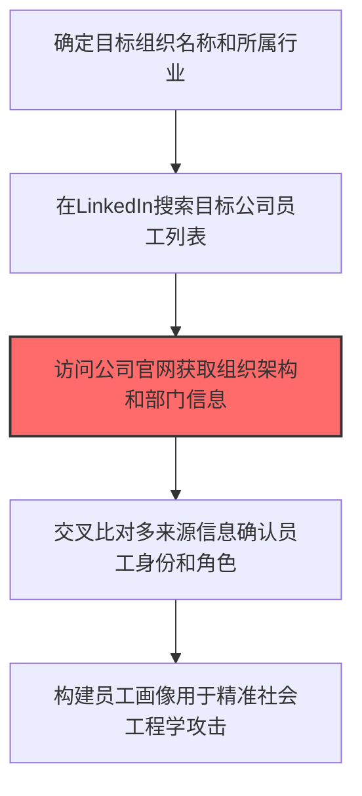
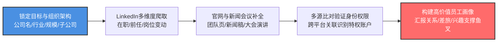

# 员工姓名收集 (T1589.003)

## 一句话通俗理解

> **收集员工姓名、职位、部门等信息，用于伪装成熟人**

## 30秒速查卡

| 维度 | 你需要知道的 |
|------|-------------|
| 这是什么？ | 收集目标组织员工的姓名、职位、部门等信息 |
| 为什么危险？ | 有了员工姓名和职位信息，攻击者可以伪装成熟人发起社工攻击 |
| 谁需要关心？ | 安全团队、HR部门 |
| 你的第一步防御 | 审查员工信息在社交媒体和公开渠道的暴露情况 |
| 如果只做一件事 | 对员工进行社会工程攻击防范培训 |

## 难度等级

⭐⭐ 中级 - 需要一定的技术基础和经验

## 前置知识检查

**读这个文件需要什么？**

- [ ] 互联网搜索基础、DNS/子域名概念、搜索引擎高级语法dork
- [ ] 网络协议基础（HTTP/DNS/TCP）
- [ ] 信息源分类能力（OSINT vs 商业情报）

## 技术描述

**员工姓名收集**（T1589.003）是 **收集受害者身份信息**（T1589）的一个具体变体，属于 **侦察** 阶段的攻击技术。

> 👤 **打个比方**：就像小偷踩点前先查物业登记表，知道谁住在哪栋楼，才能决定从哪家下手。

### 具体怎么理解？

收集员工姓名、职位、部门等信息，用于伪装成熟人

攻击者使用这种技术时，通常是在侦察阶段，想要达到特定的攻击目标。与父技术 T1589 相比，T1589.003 有自己独特的特点和使用场景。

### 为什么有效？

这种技术之所以有效，是因为：
1. **隐蔽性**：利用了正常系统功能或常见协议，不容易被发现
2. **技术门槛适中**：不需要特别高深的技术知识就能实施

**过渡段：** 不要误以为网络侦察只是简单的'谷歌搜索'——在攻击者手中，这是系统化的情报收集过程。
3. **广泛适用**：可以在多种环境和系统中使用

## 真实攻击流程



**步骤详解：**

1. **目标确定** - 明确要攻击的目标组织名称、行业和规模
2. **社交搜索** - 利用LinkedIn搜索该公司的在职员工列表
3. **官网验证** - 访问公司团队页面交叉验证员工姓名和职位
4. **信息比对比** - 结合多个社交平台信息确认员工角色和职责
5. **画像构建** - 为高价值目标建立完整的个人信息档案用于精准钓鱼

### 典型场景

攻击者在 **侦察** 阶段使用 员工姓名收集 技术，以下是典型的攻击步骤：

## 攻击流程



**关键步骤说明：**

1. **锁定目标与组织架构** - 攻击者通过企查查、Crunchbase、SEC年报、公司官网"关于我们"页面确定目标组织的法人主体、子公司、分支机构、所属行业和总体规模，作为后续员工身份收集的范围边界，并识别CISO、CIO、CFO等关键岗位是否存在。
2. **LinkedIn多维度爬取** - 使用LinkedIn Sales Navigator或第三方爬虫（ScrapingBee、Phantombuster）按公司名搜索在职员工列表，并通过"过去在此工作"过滤识别近期离职员工（离职员工账户权限常被忽略、口令重置流程松散）；同时记录岗位变动轨迹识别新晋升的管理员。
3. **官网与新闻会议补全** - 从目标公司官网团队介绍页、新闻稿、招聘JD、行业大会演讲名单、专业认证机构（CISSP/CISA）公开名册、GitHub组织成员页等渠道补全LinkedIn未覆盖的员工姓名与职位，特别关注研发、运维、SRE等不易在社交平台活跃的技术岗位。
4. **多源比对验证身份权限** - 将LinkedIn、GitHub、公司新闻等多源数据按姓名+邮箱+手机号关联去重，识别IT管理员、Domain Admin、DevOps工程师、财务审批人等高权限账户；通过GitHub提交记录、Jira/Confluence公开issue评论等技术痕迹验证其权限范围。
5. **构建高价值员工画像** - 为高价值员工建立完整画像：汇报关系、汇报对象、出差习惯（从社交媒体签到）、兴趣爱好、家庭状况、近期项目压力等，为后续鱼叉钓鱼邮件定制、BEC（商业邮件 compromise）伪装、深度伪造语音诈骗提供素材，最大化社会工程学攻击的成功率。

## 真实案例

### 案例1：LAPSUS$通过LinkedIn收集目标员工身份进行社工攻击

- **时间**: 2021年12月-2022年3月
- **目标**: Okta、NVIDIA、Microsoft、Samsung、Uber、T-Mobile
- **攻击组织**: LAPSUS$（DEV-0537）
- **手法**: LAPSUS$通过LinkedIn搜索目标公司IT运维、特权用户和系统管理员的姓名、职位和部门信息，识别出可被社会工程攻击的高价值目标。攻击者特别关注Okta的第三方支持工程师身份，伪装成Okta员工联系NVIDIA和Samsung的IT支持团队，通过电话和Slack诱骗他们批准密码重置和MFA重置请求
- **影响**: 成功入侵7家大型科技公司，造成Okta客户账户批量被入侵和NVIDIA 1TB数据泄露
- **参考链接**: [Microsoft: LAPSUS$ Threat Intelligence](https://www.microsoft.com/en-us/security/blog/2022/03/22/dev-0537-criminal-actor-targeting-organizations-for-data-exfiltration-and-destruction/)

### 案例2：APT41收集目标组织员工身份用于精准钓鱼

- **时间**: 2021年
- **目标**: 台湾、韩国、日本的游戏公司、电信运营商和政府机构
- **攻击组织**: APT41（BARIUM，Winnti Group，中国背景）
- **手法**: APT41首先入侵目标公司招聘网站的求职者数据库，收集HR系统中存储的员工姓名、部门和岗位信息。利用这些信息构建目标公司完整的组织架构图，针对研发部门负责人和IT管理员发起冒充CEO的BEC（商业邮件妥协）攻击，邮件中准确引用目标公司的内部业务术语和上级姓名
- **影响**: 多个游戏公司源代码被盗，部分电信运营商客户数据库被窃取
- **参考链接**: [Mandiant: APT41 Threat Report](https://www.mandiant.com/resources/blog/apt41-initiates-global-intrusion-campaign-using-multiple-exploits)

### 案例3：FIN7通过LinkedIn识别IT员工进行 pretext 攻击

- **时间**: 2017-2020年
- **目标**: 美国连锁餐厅、零售企业（如Chili's、Red Robin、Arby's）
- **攻击组织**: FIN7（Carbanak Group，后来重组为Carbon Spider）
- **手法**: FIN7通过LinkedIn搜索目标公司IT部门员工姓名和职位，识别出系统管理员和网络工程师。攻击者冒充安全厂商（如微软或赛门铁克）的技术支持人员，通过电话联系这些员工，以"系统漏洞修复"为名诱导他们运行伪装成安全补丁的恶意软件（Carbanak后门）
- **影响**: 窃取超过1500万张支付卡信息，造成损失超10亿美元
- **参考链接**: [US DOJ: FIN7 Indictment](https://www.justice.gov/opa/pr/three-members-notorious-international-cybercrime-group-fin7-cyber-organization)

### 案例4：Cozy Bear通过学术数据库收集外交政策研究员身份

- **时间**: 2023年
- **目标**: 北约成员国智库、大学国际关系学院
- **攻击组织**: APT29（Cozy Bear，俄罗斯SVR）
- **手法**: APT29通过Google Scholar、ResearchGate和SSRN收集研究方向为俄罗斯东欧事务的学者姓名、所属机构和邮箱地址。利用这些信息定制"俄罗斯军事研究论文"主题的钓鱼邮件，附件中携带EnvyScout恶意加载器，针对北约国家外交政策制定者发动定向攻击
- **影响**: 多个北约智库研究员账户被入侵，部分政策建议文件被窃取
- **参考链接**: [Mandiant: APT29 Diplomatic Phishing](https://cloud.google.com/blog/topics/threat-intelligence/unc3525-eye-spy)

## 红队视角

> ⚠️ **免责声明**：以下内容仅用于合法的安全测试、渗透测试和教育目的。未经授权对他人系统进行测试是违法行为。

### 实战技巧

1. **深入理解原理**：在实战应用前，充分理解员工姓名收集的技术原理和适用场景
2. **环境适配**：根据目标系统的操作系统版本、安全配置等因素调整攻击策略
3. **组合使用**：将该技术与其他技术组合使用，构建完整的攻击链
4. **隐蔽性考虑**：注意操作痕迹的清理，避免被安全设备检测

### 常用工具

| 工具名称 | 用途 | 平台 | 链接 |
| -------- | ---- | ---- | ---- |
| LinkedIn Sales Navigator | 按公司、职位、部门高级筛选员工 | Web | [LinkedIn](https://www.linkedin.com/sales) |
| theHarvester | 从公开来源收集员工姓名和邮箱 | Linux | [GitHub](https://github.com/laramies/theHarvester) |
| Maltego | OSINT情报可视化关联分析 | 全平台 | [Maltego](https://www.maltego.com/) |
| Recon-ng | 模块化OSINT侦察框架 | Linux | [GitHub](https://github.com/lanmaster53/recon-ng) |
| SpiderFoot | 自动化OSINT信息收集 | 全平台 | [SpiderFoot](https://www.spiderfoot.net/) |

### 注意事项

- 在授权的测试环境中使用这些技术
- 注意操作安全（OPSEC），避免被检测系统发现
- 使用匿名化技术和代理隐藏真实身份

## 蓝队视角

### 检测要点

1. **系统日志监控**：关注与员工姓名收集相关的系统日志和审计记录
2. **异常行为检测**：监控系统中与该技术相关的异常进程、网络连接和文件操作
3. **工具特征识别**：识别攻击者可能使用的工具在系统中的运行特征

### 监控建议

- 部署端点检测和响应（EDR）系统，监控与员工姓名收集相关的异常行为
- 配置SIEM规则，关联分析来自多个来源的告警
- 定期进行安全评估和渗透测试，验证检测规则的有效性

## 避坑指南

新手常犯的错误：过度依赖单一信息源。专业的侦察需要多个来源交叉验证。

## 检测建议

### 检测思路

检测 员工姓名收集 的关键是识别异常行为模式。以下是三个层面的检测方法：

### 网络层检测

**方法**：监控网络流量中的异常模式

```bash
# 检测异常的网络连接和数据传输
# 根据具体协议和端口设置检测规则
```

### 主机层检测

**Windows事件ID**：
- 事件ID 4688：进程创建（监控可疑进程）
- 事件ID 4104：PowerShell执行（监控可疑脚本）

**Linux日志**：
- /var/log/auth.log：认证日志
- /var/log/syslog：系统日志

```bash
# 检测异常进程和命令执行
grep -i "suspicious" /var/log/auth.log
```

### 应用层检测

**用人话说：** 攻击者像私家侦探一样，在LinkedIn、公司官网团队页面、行业会议演讲名单里拼凑目标公司的员工花名册。他们不仅收集名字，还注意每个人的职位、所属部门、工作年限和技术背景——这些信息能帮助他们在后续的钓鱼攻击中冒充同事或上级。比如知道张三在IT运维部、李四在财务部，攻击者就可以伪装成张三给李四发邮件"这个月的系统审计需要你提供报表"。正常招聘人员或猎头也会查看员工信息，但如果某个IP在短时间内浏览了大量你们公司员工的LinkedIn页面，或者用脚本批量爬取官网团队介绍，这就是侦察行为。

**Sigma规则示例**：

```yaml
title: 检测员工姓名收集
status: experimental
description: 检测可能的员工姓名收集活动
logsource:
    category: process_creation
    product: windows
detection:
    selection:
        EventID: 4688
    condition: selection
level: medium
tags:
    - attack.T1589003
```

## 缓解措施

### 优先级1：关键措施

**限制攻击面**：减少暴露的服务和端口，降低被利用的风险

```bash
# 防火墙规则示例：只允许必要的出站连接
iptables -A OUTPUT -p tcp --dport 443 -j ACCEPT  # 允许HTTPS
iptables -A OUTPUT -p tcp --dport 80 -j ACCEPT   # 允许HTTP
iptables -A OUTPUT -p tcp -j DROP                 # 阻止其他TCP
```

### 优先级2：重要措施

**加强监控**：部署EDR和SIEM系统，实时监控异常行为

### 优先级3：建议措施

**安全意识培训**：教育员工识别相关攻击手法

## 动手实验

> ⚠️ **所有实验必须在隔离的实验室环境中进行**

### 实验1：理解基本原理（初级）

**目标**：理解 员工姓名收集 的工作原理

**步骤**：
1. 在隔离环境中搭建测试系统
2. 使用基础工具模拟攻击行为
3. 观察系统日志和网络流量

**学习要点**：理解该技术的核心机制

### 实验2：实际操作（中级）

**目标**：掌握 员工姓名收集 的实际使用方法

**步骤**：
1. 使用专业工具进行攻击模拟
2. 尝试不同的绕过技术
3. 分析检测日志的特征

**学习要点**：掌握工具使用和日志分析

### 实验3：防御验证（高级）

**目标**：验证检测规则的有效性

**步骤**：
1. 部署检测规则
2. 执行攻击模拟
3. 验证检测告警是否触发

**学习要点**：理解攻防对抗的实际效果

## 术语解释

| 术语 | 通俗解释 |
|------|---------|
| **ATT&CK** | MITRE公司维护的攻击技术知识库，像一本"黑客手法百科全书" |
| **员工姓名收集** | T1589.003，ATT&CK框架中定义的一种具体攻击技术 |
| **收集受害者身份信息** | T1589，员工姓名收集所属的父技术类别 |
| **侦察** | 攻击链中的一个阶段，攻击者在这个阶段的目标 |
| **C2** | 命令与控制，攻击者用来远程控制被入侵系统的"遥控器" |
| **EDR** | 端点检测与响应，部署在电脑上的安全监控软件 |

## 被引用情况

以下父技术文档引用了本子技术：

- [T1589 - 收集受害者身份信息](../T1589-Gather-Victim-Identity-Information.md)

## 参考资料

### 📚 官方文档（深入了解）

- [MITRE ATT&CK - 员工姓名收集 (T1589.003)](https://attack.mitre.org/techniques/T1589/003/)
- [MITRE ATT&CK - 收集受害者身份信息 (T1589)](https://attack.mitre.org/techniques/T1589/)

### 📰 安全报告（真实攻击）

- [MITRE ATT&CK 官方文档](https://attack.mitre.org/) - ATT&CK 框架官方资源

### 🔧 工具与资源（动手试试）

- [Atomic Red Team](https://github.com/redcanaryco/atomic-red-team) - 检测规则测试框架
- [MITRE ATT&CK Navigator](https://mitre-attack.github.io/attack-navigator/) - ATT&CK 可视化工具

### 📚 学习资料（深入了解）

- [MITRE ATT&CK 知识库](https://attack.mitre.org/resources/) - ATT&CK 官方资源中心
