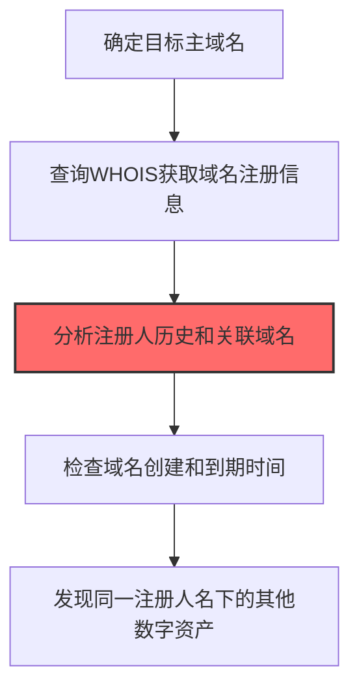
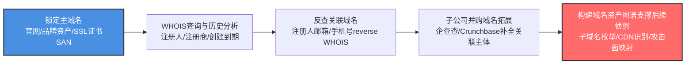

# 域名属性 (T1590.001)

## 一句话通俗理解

> **查询目标域名的注册信息，如注册人、注册时间、到期时间**

## 30秒速查卡

| 维度 | 你需要知道的 |
|------|-------------|
| 这是什么？ | 查询目标域名的注册信息，如注册人、注册时间、到期时间 |
| 为什么危险？ | 域名注册信息暴露了组织的技术栈和基础设施细节 |
| 谁需要关心？ | 安全团队、域名管理员 |
| 你的第一步防御 | 使用隐私保护服务隐藏域名注册信息 |
| 如果只做一件事 | 启用WHOIS隐私保护 |

## 难度等级

⭐⭐ 中级 - 需要一定的技术基础和经验

## 前置知识检查

**读这个文件需要什么？**

- [ ] 互联网搜索基础、DNS/子域名概念、搜索引擎高级语法dork
- [ ] 网络协议基础（HTTP/DNS/TCP）
- [ ] 信息源分类能力（OSINT vs 商业情报）

## 技术描述

**域名属性**（T1590.001）是 **收集受害者网络信息**（T1590）的一个具体变体，属于 **侦察** 阶段的攻击技术。

> 🌐 **打个比方**：就像小偷先查小区的保安配置、围墙高度和监控布局——摸清网络架构，才知道从哪突破。

### 具体怎么理解？

查询目标域名的注册信息，如注册人、注册时间、到期时间

攻击者使用这种技术时，通常是在侦察阶段，想要达到特定的攻击目标。与父技术 T1590 相比，T1590.001 有自己独特的特点和使用场景。

### 为什么有效？

这种技术之所以有效，是因为：
1. **隐蔽性**：利用了正常系统功能或常见协议，不容易被发现
2. **技术门槛适中**：不需要特别高深的技术知识就能实施

**过渡段：** 不要误以为网络侦察只是简单的'谷歌搜索'——在攻击者手中，这是系统化的情报收集过程。
3. **广泛适用**：可以在多种环境和系统中使用

## 真实攻击流程



**步骤详解：**

1. **域名锁定** - 确定目标组织使用的主域名
2. **WHOIS查询** - 查询域名注册信息获取注册人、注册商和联系方式
3. **关联分析** - 通过注册人信息反查关联的其他域名
4. **时间分析** - 分析域名的创建、更新和到期时间了解基础设施周期
5. **资产拓展** - 发现注册人名下所有域名和服务，扩展攻击面

### 典型场景

攻击者在 **侦察** 阶段使用 域名属性 技术，以下是典型的攻击步骤：

## 攻击流程



**关键步骤说明：**

1. **锁定主域名** - 攻击者通过目标组织官网、品牌资产清单、SSL证书SAN字段（crt.sh查询）、企业年报等渠道确定目标主域名（如 company.com、company.cn、company-group.com），作为后续WHOIS查询和关联拓展的起点。
2. **WHOIS查询与历史分析** - 使用DomainTools、WhoisXML、whois.com查询主域名的注册人姓名、注册邮箱、注册商、创建时间、到期时间、最近更新时间；并通过WHOIS历史快照（DomainTools Whois History）观察注册人变更、隐私保护启用前后差异，识别真实联系人与IT运维团队邮箱。
3. **反查关联域名** - 利用注册人邮箱、手机号或注册人姓名在reverse WHOIS服务（DomainTools Reverse WHOIS、WhoisFreaks）中反查同一注册人名下的所有域名，发现目标组织未公开的测试环境、内部系统、子公司品牌域名和即将上线的项目域名。
4. **子公司并购域名拓展** - 通过企查查、Crunchbase、SEC 8-K并购公告、百度百科等渠道梳理目标组织的母公司、子公司、参股公司、历史上并购的公司清单，分别查询其主域名WHOIS并交叉关联，识别"小总公司"架构中容易被忽略的边缘域名（被并购公司旧域名常未下线、安全基线落后）。
5. **构建域名资产图谱支撑后续侦察** - 将所有关联域名按主体、用途、注册时间、到期时间、注册人归一化形成可视化的域名资产图谱，作为后续子域名枚举（T1590.002 DNS）、CDN节点识别、暴露面扫描（T1595）的输入；并标注即将到期或长期未续费的域名作为可能的抢注攻击目标。

## 真实案例

### 案例1：APT29在SolarWinds供应链攻击中收集域名属性信息

- **时间**: 2019年9月-2020年12月
- **目标**: SolarWinds及其18,000个客户（含美国财政部、国务院、商务部、国防部）
- **攻击组织**: APT29（Cozy Bear，俄罗斯SVR）
- **手法**: APT29在发动SUNBURST后门供应链攻击前，通过WHOIS查询收集SolarWinds公司及其子公司的域名注册信息，识别出域名注册人邮箱、技术联系邮箱和DNS服务器位置。这些信息帮助攻击者确定SolarWinds构建服务器（orionpmdb-srv）和更新分发服务器（downloads.solarwinds.com）的归属，为后续的代码签名证书盗用和更新包投递做准备
- **影响**: 18,000个客户安装了带后门的Orion更新包，9个美国联邦机构被入侵
- **参考链接**: [CISA: AA21-008A Joint Advisory](https://www.cisa.gov/news-events/cybersecurity-advisories/aa21-008a)

### 案例2：FIN7通过WHOIS收集餐厅连锁店域名资产

- **时间**: 2017-2019年
- **目标**: 美国连锁餐厅（Chili's、Red Robin、Arby's、Chipotle等）
- **攻击组织**: FIN7（Carbon Spider，Anunak）
- **手法**: FIN7通过WHOIS查询目标餐厅连锁店的母公司、子公司和加盟品牌的域名注册信息，发现许多餐厅使用同一注册邮箱管理多个品牌域名，从而识别出共享的IT基础设施。攻击者还查询域名历史WHOIS记录，找出历史注册邮箱用于BEC攻击冒充前IT管理员，针对餐厅总部财务部门发起定向钓鱼
- **影响**: 窃取超过1500万张支付卡信息，造成损失超10亿美元
- **参考链接**: [US DOJ: FIN7 Indictment 2018](https://www.justice.gov/opa/pr/three-members-notorious-international-cybercrime-group-fin7-cyber-organization)

### 案例3：Volt Typhoon通过域名注册信息识别关键基础设施运营商

- **时间**: 2021-2023年
- **目标**: 美国关岛和本土的关键基础设施（电力、水务、交通、通信）
- **攻击组织**: Volt Typhoon（Insidious Taurus，中国背景）
- **手法**: Volt Typhoon通过WHOIS查询收集美国关键基础设施运营商的域名注册信息，特别关注注册时间较长（说明运营稳定）和注册邮箱为机构域名（说明非个人所有）的资产。攻击者利用这些域名属性信息识别目标组织的IT边界，再通过SOHO路由器代理流量隐藏真实IP，对目标网络进行长期潜伏侦察
- **影响**: 美国CISA、FBI、NSA联合发布警告，称该组织在关键基础设施网络中潜伏长达5年
- **参考链接**: [CISA: AA24-038A Volt Typhoon Advisory](https://www.cisa.gov/news-events/cybersecurity-advisories/aa24-038a)

### 案例4：TA505通过域名注册模式识别金融机构 IT 边界

- **时间**: 2021-2022年
- **目标**: 全球银行、证券交易所、支付处理商
- **攻击组织**: TA505（FIN11，NobleBaron）
- **手法**: TA505通过DomainTools历史WHOIS查询，分析目标金融机构的域名注册模式——许多银行会将核心系统域名（如core.bank.com、swift.bank.com）注册给特定部门邮箱，攻击者据此推断组织架构和IT管理员身份。结合反向WHOIS查询同一注册人拥有的其他域名，扩展目标资产清单
- **影响**: 多家金融机构被入侵，BEC攻击造成数千万美元损失
- **参考链接**: [Proofpoint: TA505 Threat Analysis](https://www.proofpoint.com/us/blog/threat-insight/ta505-exploits-pandemic-themed-phishing)

## 红队视角

> ⚠️ **免责声明**：以下内容仅用于合法的安全测试、渗透测试和教育目的。未经授权对他人系统进行测试是违法行为。

### 实战技巧

1. **深入理解原理**：在实战应用前，充分理解域名属性的技术原理和适用场景
2. **环境适配**：根据目标系统的操作系统版本、安全配置等因素调整攻击策略
3. **组合使用**：将该技术与其他技术组合使用，构建完整的攻击链
4. **隐蔽性考虑**：注意操作痕迹的清理，避免被安全设备检测

### 常用工具

| 工具名称 | 用途 | 平台 | 链接 |
| -------- | ---- | ---- | ---- |
| WHOIS | 命令行域名注册信息查询 | 全平台 | 内置命令 |
| DomainTools | 域名情报与历史WHOIS查询平台 | Web | [DomainTools](https://www.domaintools.com/) |
| ViewDNS.info | 反向WHOIS、DNS记录聚合查询 | Web | [ViewDNS](https://viewdns.info/) |
| Amass | 子域名枚举与OSINT关联 | Linux | [GitHub](https://github.com/owasp-amass/amass) |
| Domain Dossier | 域名综合信息查询工具 | Web | [CentralOps](https://centralops.net/co/) |

### 注意事项

- 在授权的测试环境中使用这些技术
- 注意操作安全（OPSEC），避免被检测系统发现
- 使用匿名化技术和代理隐藏真实身份

## 蓝队视角

### 检测要点

1. **系统日志监控**：关注与域名属性相关的系统日志和审计记录
2. **异常行为检测**：监控系统中与该技术相关的异常进程、网络连接和文件操作
3. **工具特征识别**：识别攻击者可能使用的工具在系统中的运行特征

### 监控建议

- 部署端点检测和响应（EDR）系统，监控与域名属性相关的异常行为
- 配置SIEM规则，关联分析来自多个来源的告警
- 定期进行安全评估和渗透测试，验证检测规则的有效性

## 避坑指南

新手常犯的错误：过度依赖单一信息源。专业的侦察需要多个来源交叉验证。

## 检测建议

### 检测思路

检测 域名属性 的关键是识别异常行为模式。以下是三个层面的检测方法：

### 网络层检测

**方法**：监控网络流量中的异常模式

```bash
# 检测异常的网络连接和数据传输
# 根据具体协议和端口设置检测规则
```

### 主机层检测

**Windows事件ID**：
- 事件ID 4688：进程创建（监控可疑进程）
- 事件ID 4104：PowerShell执行（监控可疑脚本）

**Linux日志**：
- /var/log/auth.log：认证日志
- /var/log/syslog：系统日志

```bash
# 检测异常进程和命令执行
grep -i "suspicious" /var/log/auth.log
```

### 应用层检测

**用人话说：** 攻击者像查房产登记信息一样，通过WHOIS查询目标公司域名的注册详情——谁注册的、什么时候注册的、什么时候到期、注册人邮箱和电话是什么。这些信息暴露了公司的技术基础设施和可能的管理员联系方式。比如查到域名注册邮箱是admin@company.com，攻击者就知道了管理员邮箱；查到域名快到期了，就知道公司可能在这段时间更关注续费而非安全。正常IT人员也会查自己公司的域名信息，但如果有人在短时间内对你们公司的多个域名发起了大量WHOIS查询，或者注册信息中的隐私保护被特意绕过了，这就是侦察行为。

**Sigma规则示例**：

```yaml
title: 检测域名属性
status: experimental
description: 检测可能的域名属性活动
logsource:
    category: process_creation
    product: windows
detection:
    selection:
        EventID: 4688
    condition: selection
level: medium
tags:
    - attack.T1590001
```

## 缓解措施

### 优先级1：关键措施

**限制攻击面**：减少暴露的服务和端口，降低被利用的风险

```bash
# 防火墙规则示例：只允许必要的出站连接
iptables -A OUTPUT -p tcp --dport 443 -j ACCEPT  # 允许HTTPS
iptables -A OUTPUT -p tcp --dport 80 -j ACCEPT   # 允许HTTP
iptables -A OUTPUT -p tcp -j DROP                 # 阻止其他TCP
```

### 优先级2：重要措施

**加强监控**：部署EDR和SIEM系统，实时监控异常行为

### 优先级3：建议措施

**安全意识培训**：教育员工识别相关攻击手法

## 动手实验

> ⚠️ **所有实验必须在隔离的实验室环境中进行**

### 实验1：理解基本原理（初级）

**目标**：理解 域名属性 的工作原理

**步骤**：
1. 在隔离环境中搭建测试系统
2. 使用基础工具模拟攻击行为
3. 观察系统日志和网络流量

**学习要点**：理解该技术的核心机制

### 实验2：实际操作（中级）

**目标**：掌握 域名属性 的实际使用方法

**步骤**：
1. 使用专业工具进行攻击模拟
2. 尝试不同的绕过技术
3. 分析检测日志的特征

**学习要点**：掌握工具使用和日志分析

### 实验3：防御验证（高级）

**目标**：验证检测规则的有效性

**步骤**：
1. 部署检测规则
2. 执行攻击模拟
3. 验证检测告警是否触发

**学习要点**：理解攻防对抗的实际效果

## 术语解释

| 术语 | 通俗解释 |
|------|---------|
| **ATT&CK** | MITRE公司维护的攻击技术知识库，像一本"黑客手法百科全书" |
| **域名属性** | T1590.001，ATT&CK框架中定义的一种具体攻击技术 |
| **收集受害者网络信息** | T1590，域名属性所属的父技术类别 |
| **侦察** | 攻击链中的一个阶段，攻击者在这个阶段的目标 |
| **C2** | 命令与控制，攻击者用来远程控制被入侵系统的"遥控器" |
| **EDR** | 端点检测与响应，部署在电脑上的安全监控软件 |

## 被引用情况

以下父技术文档引用了本子技术：

- [T1590 - 网络信任依赖](../T1590-Gather-Victim-Network-Information.md)

## 参考资料

### 📚 官方文档（深入了解）

- [MITRE ATT&CK - 域名属性 (T1590.001)](https://attack.mitre.org/techniques/T1590/001/)
- [MITRE ATT&CK - 收集受害者网络信息 (T1590)](https://attack.mitre.org/techniques/T1590/)

### 📰 安全报告（真实攻击）

- [MITRE ATT&CK 官方文档](https://attack.mitre.org/) - ATT&CK 框架官方资源

### 🔧 工具与资源（动手试试）

- [Atomic Red Team](https://github.com/redcanaryco/atomic-red-team) - 检测规则测试框架
- [MITRE ATT&CK Navigator](https://mitre-attack.github.io/attack-navigator/) - ATT&CK 可视化工具

### 📚 学习资料（深入了解）

- [MITRE ATT&CK 知识库](https://attack.mitre.org/resources/) - ATT&CK 官方资源中心
