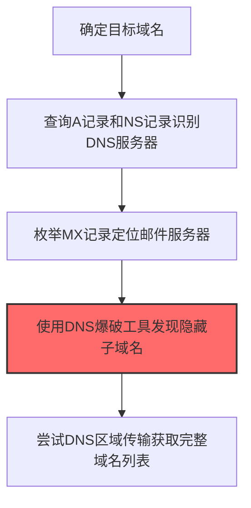
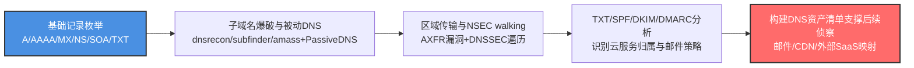

# DNS (T1590.002)

## 一句话通俗理解

> **DNS就是查询目标的DNS记录。**

## 30秒速查卡

| 维度 | 你需要知道的 |
|------|-------------|
| 这是什么？ | 查询目标的DNS记录，了解邮件服务器、子域名等配置 |
| 为什么危险？ | DNS记录暴露了组织的邮件服务器、子域名和服务架构 |
| 谁需要关心？ | 安全团队、网络管理员 |
| 你的第一步防御 | 监控DNS记录的异常查询和变更 |
| 如果只做一件事 | 定期审计DNS记录，移除不必要的记录 |

## 难度等级

⭐⭐ 中级 - 需要一定的技术基础和实践经验

## 前置知识检查

**读这个文件需要什么？**

- [ ] 互联网搜索基础、DNS/子域名概念、搜索引擎高级语法dork
- [ ] 网络协议基础（HTTP/DNS/TCP）
- [ ] 信息源分类能力（OSINT vs 商业情报）

## 技术描述

**通俗解释：**

**过渡段：** 不要误以为网络侦察只是简单的'谷歌搜索'——在攻击者手中，这是系统化的情报收集过程。每个公开信息源都可能泄露攻击者需要的关键数据，从子域名到技术栈版本，经过交叉验证后就能拼出完整的攻击面地图。
查询目标的DNS记录，了解邮件服务器、子域名等配置

> 📞 **打个比方**：就像拿到公司的电话簿，通过总机转接找到每个部门的位置——DNS就是网络的"电话簿"。

**技术原理：**
T1590.002 是 收集受害者网络信息（T1590）的子技术，专注于DNS这一特定方面。攻击者在侦察阶段，通过DNS来获取目标系统或组织的相关信息，为后续攻击步骤做准备。

**用途与影响：**
- 为后续攻击提供关键信息支撑
- 提高攻击的成功率和精准度
- 降低攻击被发现的概率

## 真实攻击流程



**步骤详解：**

1. **基础查询** - 确定目标域名，查询A、AAAA和NS记录获取基础DNS信息
2. **邮件定位** - 通过MX记录定位目标使用的邮件服务器和优先级
3. **子域枚举** - 使用dnsrecon、subfinder等工具进行子域名爆破
4. **区域传输** - 尝试DNS区域传输漏洞获取完整的DNS记录列表
5. **信息利用** - 汇总发现的子域名和邮件服务器用于后续攻击

### 典型场景

## 攻击流程



**关键步骤说明：**

1. **基础记录枚举** - 使用dig、nslookup、dnsutils对目标主域名查询A/AAAA记录（识别公网Web入口）、MX记录（识别邮件服务器与优先级，区分on-prem Exchange、Exchange Online、Google Workspace）、NS记录（识别DNS服务商如AWS Route53、Cloudflare、阿里云DNS）、SOA记录（识别主DNS服务器与管理员邮箱）、TXT记录（识别SPF/DKIM/DMARC与云服务所有权验证字段）。
2. **子域名爆破与被动DNS** - 使用subfinder、amass、dnsrecon配合rockyou子域字典、Assetfinder等工具对主域名进行子域名爆破；同时查询SecurityTrails、CIRCL Passive DNS、VirusTotal等被动DNS历史数据库，发现已下线但仍在内网使用的子域名、临时测试环境子域名和通过证书透明度日志暴露的子域名。
3. **区域传输与NSEC walking** - 对目标DNS服务器尝试AXFR区域传输请求（很多老旧 BIND/Windows DNS仍配置允许任意来源区域传输），获取完整DNS区域文件；对启用DNSSEC的域名利用NSEC/NSEC3记录遍历（NSEC walking）枚举所有已签名子域名，绕过子域名爆破的字典限制。
4. **TXT/SPF/DKIM/DMARC分析** - 通过TXT记录中的SPF识别目标授权的发信IP范围（含第三方邮件服务商如SendGrid、Mailchimp），DKIM记录识别邮件签名 selector，DMARC记录分析策略强度（p=none/quarantine/reject）；同时解析Microsoft 365、Google Workspace、Salesforce、Stripe等SaaS服务的所有权验证TXT记录，绘制目标外部SaaS依赖图。
5. **构建DNS资产清单支撑后续侦察** - 将所有DNS记录归一化为可视化资产清单：邮件服务器清单（用于T1589.001凭证收集与T1566钓鱼）、CDN/WAF节点（用于T1590.006识别安全设备）、云服务清单（用于T1078有效账户利用）、子域名清单（用于T1595主动扫描与T1190漏洞利用），为后续侦察与初始访问阶段提供精准攻击面输入。

## 真实案例

### 案例1：APT组织使用DNS进行攻击准备

- **时间**: 2023-2024年
- **目标**: 美国关岛和本土关键基础设施（电力、水务、通信、制造业）
- **攻击组织**: Volt Typhoon（Insidious Taurus）
- **手法**: Volt Typhoon在长期潜伏侦察中使用dig、nslookup等工具，系统性查询目标关键基础设施运营商的DNS记录，包括A记录（识别外网服务）、MX记录（识别邮件服务器）、NS记录（识别DNS服务器）、TXT记录（识别SPF/DKIM/DMARC配置和云服务归属）。攻击者还通过子域名爆破识别内部管理系统的边界，为后续利用Fortinet边缘设备漏洞和Living-off-the-Land技术做准备
- **影响**: 在多个美国关键基础设施网络中潜伏长达5年，CISA/FBI/NSA联合发布警告
- **参考链接**: [CISA: AA24-038A Volt Typhoon Advisory](https://www.cisa.gov/news-events/cybersecurity-advisories/aa24-038a)

### 案例2：APT28通过DNS侦察识别Microsoft 365租户攻击面

- **时间**: 2022-2023年
- **目标**: 乌克兰、北约成员国政府机构和军事单位
- **攻击组织**: APT28（Fancy Bear，俄罗斯GRU 26165部队）
- **手法**: APT28通过DNS查询目标域名的MX、TXT、CNAME记录，识别出使用Microsoft 365云邮箱的目标组织。攻击者查询 `*._domainkey.target.com` 和 `autodiscover.target.com` 的CNAME记录判断邮箱托管商，再针对识别出的O365租户发起密码喷洒和AitM（Adversary-in-the-Middle）钓鱼攻击，绕过MFA拦截会话Cookie
- **影响**: 多个北约国家政府邮箱被入侵，部分机密通信内容被窃取
- **参考链接**: [CERT-UA: APT28 Activity Report](https://cert.gov.ua/article/3760625)

### 案例3：APT29通过子域名爆破识别SolarWinds客户基础设施

- **时间**: 2019-2020年
- **目标**: SolarWinds Orion客户
- **攻击组织**: APT29（Cozy Bear，俄罗斯SVR）
- **手法**: APT29使用subfinder、amass等工具对目标客户域名进行子域名爆破，识别出 `orion.customer.com`、`swi.customer.com` 等内部SolarWinds管理界面。攻击者还通过DNS Zone Transfer（AXFR）尝试获取目标的完整DNS记录列表，针对配置错误的DNS服务器成功获取了部分目标的内部主机名清单
- **影响**: 锁定高价值SolarWinds客户进行精准供应链投毒
- **参考链接**: [CISA: AA21-008A Joint Advisory](https://www.cisa.gov/news-events/cybersecurity-advisories/aa21-008a)

### 案例4：Kimsuky针对韩国政府机构DNS子域名爆破

- **时间**: 2023年
- **目标**: 韩国外交部、统一部、国情院及智库研究机构
- **攻击组织**: Kimsuky（APT43，朝鲜侦察总局）
- **手法**: Kimsuky使用dnsrecon、sublist3r等工具对目标域名进行子域名爆破，重点关注 `mail.*`、`owa.*`、`vpn.*`、`git.*` 等命名模式。攻击者通过识别出的内部服务入口，发起针对Outlook Web Access的凭据喷洒攻击，并投递BabyShark恶意文档进行定向钓鱼
- **影响**: 多个韩国政府机构邮箱账户被入侵，部分朝核政策研究资料外泄
- **参考链接**: [ASEC: Kimsuky Phishing Campaign](https://asec.ahnlab.com/ko/56963/)

## 红队视角

> ⚠️ **免责声明**：以下内容仅用于合法的安全测试、渗透测试和教育目的。未经授权对他人系统进行测试是违法行为。

### 实战技巧

1. **隐蔽优先**：在侦察阶段使用被动方式收集信息，避免触发安全告警
2. **信息验证**：对收集到的信息进行交叉验证，确保准确性和时效性
3. **工具选择**：根据目标环境选择合适的工具，避免使用已被广泛检测的工具
4. **OPSEC意识**：使用匿名网络、临时环境进行操作，防止溯源

### 常用工具

| 工具名称 | 用途 | 平台 | 链接 |
| -------- | ---- | ---- | ---- |
| dig | 命令行DNS记录查询工具 | 全平台 | 内置命令 |
| dnsrecon | DNS枚举与Zone Transfer测试 | Linux | [GitHub](https://github.com/darkoperator/dnsrecon) |
| subfinder | 子域名被动枚举工具 | Linux | [GitHub](https://github.com/projectdiscovery/subfinder) |
| sublist3r | 子域名搜索引擎 | Linux | [GitHub](https://github.com/aboul3la/Sublist3r) |
| Amass | 综合OSINT子域名枚举 | Linux | [GitHub](https://github.com/owasp-amass/amass) |

### 注意事项

- 仅在授权范围内使用DNS技术
- 注意操作的隐蔽性，避免被蓝队发现
- 记录操作日志，用于后续分析和报告编写

## 蓝队视角

### 检测要点

1. **异常信息收集行为**：监控来自内部系统的异常数据查询和收集行为
2. **可疑工具使用**：检测与DNS相关的工具在内部网络中的使用
3. **异常网络流量**：监控对外部信息收集平台的可疑网络连接
4. **权限异常**：关注非授权用户的信息收集和查询行为

### 监控建议

- 部署信息收集行为的检测规则
- 建立基准行为模型，及时发现异常
- 定期审计敏感信息的访问记录

## 避坑指南

新手常犯的错误：过度依赖单一信息源。专业的侦察需要多个来源交叉验证。

## 检测建议

### 网络层检测

**检测方法：** 监控与DNS相关的网络流量特征

**具体规则/命令示例：**

```bash
# 监控异常DNS查询
tcpdump -i eth0 port 53 | grep -E "可疑域名"
```

### 主机层检测

**Windows事件ID：**

- 事件ID 4688：可疑进程创建
- 事件ID 4104：PowerShell脚本块日志

**Linux日志：**

- 日志文件：`/var/log/syslog`
- 关键字段：可疑命令执行

### 应用层检测

**用人话说：** 攻击者像翻阅公司电话簿一样，通过DNS查询来绘制目标组织的网络地图。他们会用nslookup、dig等工具查A记录找服务器IP，查MX记录找邮件服务器，查NS记录找DNS服务器，还会用dnsrecon、subfinder等工具爆破子域名——比如试mail.company.com、vpn.company.com、git.company.com等常见子域名。正常运维人员偶尔也会查DNS，但攻击者的查询模式不同：短时间内对同一个域名区域发起大量不同类型的记录查询，或者对不存在的子域名进行批量爆破探测。如果你的DNS日志显示同一个IP在几分钟内查询了几百个不同的子域名，那就是有人在踩点。

**Sigma规则示例：**

```yaml
title: Suspicious DNS Activity
status: experimental
description: Detects potential DNS behavior
logsource:
  category: process_creation
  product: windows
detection:
  selection:
    Image|endswith: '\\可疑工具.exe'
  condition: selection
level: medium
tags:
  - attack.T1590/002
```

## 缓解措施

### 优先级1：关键措施

**措施名称：** 敏感信息保护

**具体实施步骤：**

1. 识别和分类组织内的敏感信息
2. 对敏感信息实施访问控制和加密
3. 部署信息泄露防护（DLP）解决方案

### 优先级2：重要措施

**措施名称：** 员工安全意识培训

**具体实施步骤：**

1. 定期开展信息安全意识培训
2. 教育员工识别社交工程攻击
3. 建立信息报告和响应机制

### 优先级3：建议措施

**措施名称：** 安全配置加固

**具体实施步骤：**

1. 限制公开可访问的系统信息
2. 配置合适的日志记录和告警策略
3. 定期进行安全评估和渗透测试

## 动手实验

> ⚠️ **重要提示**：所有实验必须在隔离的实验室环境中进行，禁止对未授权的真实系统进行测试。

### 实验环境准备

**推荐靶场/实验平台：**

| 平台名称 | 类型 | 难度 | 链接 |
|---------|------|:----:|------|
| 本地虚拟机 | 虚拟环境 | 初级 | 本机搭建 |
| TryHackMe | 在线靶场 | 初级 | https://tryhackme.com |

**所需工具：**

- 根据具体技术需求准备相应工具

**环境搭建：**

```bash
# 准备隔离的实验环境
# 具体命令根据实验内容而定
```

### 实验1：基础实践（初级）

**实验目标：** 理解和练习DNS的基本操作

**实验步骤：**

1. 在隔离环境中搭建实验系统
2. 按照技术描述执行基本操作
3. 观察和记录实验现象

**预期结果：** 成功完成DNS的基本操作

**学习要点：** 理解DNS的原理和操作方法

## 术语解释

| 术语 | 英文原名 | 通俗解释 |
|-----|---------|---------|
| DNS | DNS | DNS的基本概念和操作方法 |
| 侦察 | Reconnaissance | 收集目标信息的过程，为后续攻击做准备 |
| OPSEC | Operational Security | 操作安全，保护行动信息不被对手发现 |

## 被引用情况

以下父技术文档引用了本子技术：

- [T1590 - 网络信任依赖](../T1590-Gather-Victim-Network-Information.md)

## 参考资料

### 📚 官方文档（深入了解）

- [MITRE ATT&CK - T1590](https://attack.mitre.org/techniques/T1590/)
- [MITRE ATT&CK - T1590.002](https://attack.mitre.org/techniques/T1590/002/)
- [MITRE ATT&CK - T1590.002 检测](https://attack.mitre.org/techniques/T1590/002/detections/)

### 📰 安全报告（真实攻击）

- [CISA Known Exploited Vulnerabilities](https://www.cisa.gov/known-exploited-vulnerabilities-catalog)
- [Microsoft Security Blog](https://www.microsoft.com/en-us/security/blog/)

### 学习资源

- [MITRE ATT&CK 官方文档](https://attack.mitre.org/)
- [ATT&CK STIX Data](https://github.com/mitre-attack/attack-stix-data)

