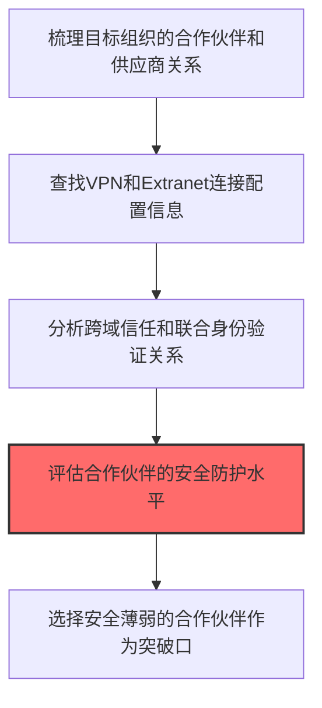
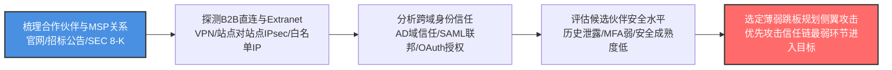

# 网络信任依赖 (T1590.003)

## 一句话通俗理解

> **了解目标与哪些合作伙伴有网络信任关系，可能通过合作伙伴入侵**

## 30秒速查卡

| 维度 | 你需要知道的 |
|------|-------------|
| 这是什么？ | 了解目标与哪些合作伙伴有网络信任关系 |
| 为什么危险？ | 攻击者可能通过信任关系较弱的合作伙伴作为跳板入侵 |
| 谁需要关心？ | 安全架构师、网络管理员 |
| 你的第一步防御 | 审查和限制跨组织的网络信任关系 |
| 如果只做一件事 | 建立第三方访问的风险评估机制 |

## 难度等级

⭐⭐ 中级 - 需要一定的技术基础和经验

## 前置知识检查

**读这个文件需要什么？**

- [ ] 互联网搜索基础、DNS/子域名概念、搜索引擎高级语法dork
- [ ] 网络协议基础（HTTP/DNS/TCP）
- [ ] 信息源分类能力（OSINT vs 商业情报）

## 技术描述

**网络信任依赖**（T1590.003）是 **收集受害者网络信息**（T1590）的一个具体变体，属于 **侦察** 阶段的攻击技术。

> 🔗 **打个比方**：就像搞清楚公司和哪些供应商有直接通道——知道信任关系，就能借道入侵。

### 具体怎么理解？

了解目标与哪些合作伙伴有网络信任关系，可能通过合作伙伴入侵

攻击者使用这种技术时，通常是在侦察阶段，想要达到特定的攻击目标。与父技术 T1590 相比，T1590.003 有自己独特的特点和使用场景。

### 为什么有效？

这种技术之所以有效，是因为：
1. **隐蔽性**：利用了正常系统功能或常见协议，不容易被发现
2. **技术门槛适中**：不需要特别高深的技术知识就能实施

**过渡段：** 不要误以为网络侦察只是简单的'谷歌搜索'——在攻击者手中，这是系统化的情报收集过程。
3. **广泛适用**：可以在多种环境和系统中使用

## 真实攻击流程



**步骤详解：**

1. **关系梳理** - 通过公开信息和业务往来分析目标组织的合作伙伴网络
2. **连接探测** - 查找目标与合作伙伴之间的VPN、Extranet和直连配置
3. **信任分析** - 分析AD域信任、SAML联合身份等跨组织信任关系
4. **安全评估** - 评估合作伙伴的安全成熟度和历史安全事件
5. **突破口选择** - 选择安全防护最弱的合作伙伴间接入侵目标

### 典型场景

攻击者在 **侦察** 阶段使用 网络信任依赖 技术，以下是典型的攻击步骤：

## 攻击流程



**关键步骤说明：**

1. **梳理合作伙伴与MSP关系** - 攻击者从目标组织官网"合作伙伴"页面、招标公告平台（中国政府采购网、SAM.gov）、SEC 8-K关联交易公告、行业大会赞助商名单、LinkedIn企业关联推荐等渠道梳理目标组织的供应商、MSP（托管服务提供商）、云集成商、外包开发团队、数据中心托管商、支付通道商等合作伙伴清单，并标注合作业务类型（数据互通、远程运维、联合开发）。
2. **探测B2B直连与Extranet** - 通过DNS反查、BGP路由查询、Shodan/Censys扫描识别目标边界防火墙上对合作伙伴开放的VPN网关、站点对站点IPsec隧道端点、Extranet Web应用入口；从SSL证书SAN字段、CDN配置中识别白名单IP段，推断跨组织数据通道的边界位置。
3. **分析跨域身份信任** - 通过SP元数据、SAML Federation元数据（InCommon、eduGAIN）、Azure AD Connect同步拓扑识别目标与合作伙伴之间的AD域信任（双向/单向/林信任）、SAML联邦身份（Okta-Azure AD B2B、ADFS联合）、OAuth应用授权（Slack/Teams集成、GitHub App授权）；标注跨域身份跳板路径与可能被滥用的Service Account。
4. **评估候选伙伴安全水平** - 对每个候选合作伙伴评估：是否有公开的历史安全事件（Have I Been Pwned、勒索软件受害者名单）、是否启用MFA（登录页是否含MFA字段）、员工邮箱是否大量出现在泄露库、安全团队规模（LinkedIn搜索）、是否使用过时VPN设备（Pulse Secure、FortiGate CVE历史）；优先标记安全成熟度低的中小MSP和区域性集成商。
5. **选定薄弱跳板规划侧翼攻击** - 综合信任链强度、合作伙伴安全水平、可触达目标系统的纵深程度，选定最薄弱且拥有目标高权限的合作伙伴作为侧翼攻击入口（如MSP的RMM工具被入侵后可直达所有客户网络，Kaseya VSA、SolarWinds Orion、CCleaner等供应链攻击模式）；制定从合作伙伴侧翼进入目标网络的横向移动路径，规避目标正面防御。

## 真实案例

### 案例1：REvil通过Kaseya VSA供应链信任关系入侵1,500家企业

- **时间**: 2021年7月
- **目标**: Kaseya VSA客户（MSPs及其下游客户，约1,500家企业）
- **攻击组织**: REvil（Sodinokibi，俄罗斯/东欧背景勒索软件团伙）
- **手法**: REvil利用MSP（管理服务提供商）与其客户之间的网络信任关系——MSP通过Kaseya VSA远程管理数千家客户网络。攻击者通过分析Kaseya的合作伙伴目录和客户案例页面，识别出依赖Kaseya VSA进行远程运维的MSP，再利用VSA中的零日漏洞（CVE-2021-30116）向MSP的所有客户推送伪装成软件更新的Sodinokibi勒索软件，借助既有的信任通道实现规模化分发
- **影响**: 1,500家企业被同时加密，瑞典Coop超市800家门店被迫关闭
- **参考链接**: [CISA: AA21-210A REvil/Kaseya Advisory](https://www.cisa.gov/news-events/cybersecurity-advisories/aa21-210a)

### 案例2：APT41利用供应链信任关系入侵游戏公司源代码仓库

- **时间**: 2019-2021年
- **目标**: 台湾、韩国游戏公司及其代码托管服务商
- **攻击组织**: APT41（BARIUM，Winnti Group）
- **手法**: APT41调查目标游戏公司与其第三方代码托管服务商、CI/CD平台供应商之间的信任关系，发现这些公司使用同一台湾本土代码托管商管理核心源代码。攻击者先攻破代码托管商，借助既有的SSH密钥信任和Git Hook机制，向下游游戏公司投毒源代码仓库，实现一次入侵影响多个目标
- **影响**: 多款知名游戏源代码、反作弊系统和服务器配置被窃取
- **参考链接**: [Mandiant: APT41 Threat Report](https://www.mandiant.com/resources/blog/apt41-initiates-global-intrusion-campaign-using-multiple-exploits)

### 案例3：Target通过HVAC供应商信任关系被入侵

- **时间**: 2013年11-12月
- **目标**: 美国Target零售连锁（1,800家门店）
- **攻击组织**: BlackPOS运营团伙（怀疑与APT1有关联）
- **手法**: 攻击者通过调查Target与HVAC供应商Fazio Mechanical Services之间的网络信任关系，发现Fazio拥有Target内部系统的远程访问权限用于账单系统对接。攻击者先窃取Fazio员工的钓鱼邮件凭证，再借助Fazio的凭证登录Target供应商门户，横向移动到POS系统管理服务器，向1,800家门店的收银机投递BlackPOS恶意软件
- **影响**: 4,000万张支付卡信息和7,000万客户个人数据泄露，Target损失超2.9亿美元
- **参考链接**: [KrebsOnSecurity: Target Breach Analysis](https://krebsonsecurity.com/2014/02/target-hack-2nd-u-s-card-processor-hit/)

### 案例4：Nobelium通过Cloud Service Provider信任关系入侵下游客户

- **时间**: 2021年5月
- **目标**: 美国政府机构和私营企业（通过 CSP 间接入侵）
- **攻击组织**: Nobelium（APT29，俄罗斯SVR）
- **手法**: Nobelium在SolarWinds事件后转向攻击云服务提供商（CSP），通过统计DLL引用和DNS查询分析哪些CSP代理了大量美国政府客户。攻击者入侵这些CSP后，利用CSP与客户之间的代理管理员（GA、Global Admin）信任关系，通过委派权限和OAuth授权滥用横向进入下游客户租户，绕过下游客户自身的MFA防护
- **影响**: 至少3个CSP被入侵，影响其服务的约22,000个下游客户
- **参考链接**: [CISA: AA21-148A Nobelium CSP Advisory](https://www.cisa.gov/news-events/cybersecurity-advisories/aa21-148a)

## 红队视角

> ⚠️ **免责声明**：以下内容仅用于合法的安全测试、渗透测试和教育目的。未经授权对他人系统进行测试是违法行为。

### 实战技巧

1. **深入理解原理**：在实战应用前，充分理解网络信任依赖的技术原理和适用场景
2. **环境适配**：根据目标系统的操作系统版本、安全配置等因素调整攻击策略
3. **组合使用**：将该技术与其他技术组合使用，构建完整的攻击链
4. **隐蔽性考虑**：注意操作痕迹的清理，避免被安全设备检测

### 常用工具

| 工具名称 | 用途 | 平台 | 链接 |
| -------- | ---- | ---- | ---- |
| BloodHound | AD域信任关系图谱分析 | Windows | [GitHub](https://github.com/BloodHoundAD/BloodHound) |
| PingCastle | AD域安全与信任评估 | Windows | [PingCastle](https://www.pingcastle.com/) |
| Maltego | OSINT关系可视化分析 | 全平台 | [Maltego](https://www.maltego.com/) |
| theHarvester | 从公开来源收集合作伙伴信息 | Linux | [GitHub](https://github.com/laramies/theHarvester) |
| PowerView | PowerShell AD枚举模块 | Windows | [GitHub](https://github.com/PowerShellMafia/PowerSploit) |

### 注意事项

- 在授权的测试环境中使用这些技术
- 注意操作安全（OPSEC），避免被检测系统发现
- 使用匿名化技术和代理隐藏真实身份

## 蓝队视角

### 检测要点

1. **系统日志监控**：关注与网络信任依赖相关的系统日志和审计记录
2. **异常行为检测**：监控系统中与该技术相关的异常进程、网络连接和文件操作
3. **工具特征识别**：识别攻击者可能使用的工具在系统中的运行特征

### 监控建议

- 部署端点检测和响应（EDR）系统，监控与网络信任依赖相关的异常行为
- 配置SIEM规则，关联分析来自多个来源的告警
- 定期进行安全评估和渗透测试，验证检测规则的有效性

## 避坑指南

新手常犯的错误：过度依赖单一信息源。专业的侦察需要多个来源交叉验证。

## 检测建议

### 检测思路

检测 网络信任依赖 的关键是识别异常行为模式。以下是三个层面的检测方法：

### 网络层检测

**方法**：监控网络流量中的异常模式

```bash
# 检测异常的网络连接和数据传输
# 根据具体协议和端口设置检测规则
```

### 主机层检测

**Windows事件ID**：
- 事件ID 4688：进程创建（监控可疑进程）
- 事件ID 4104：PowerShell执行（监控可疑脚本）

**Linux日志**：
- /var/log/auth.log：认证日志
- /var/log/syslog：系统日志

```bash
# 检测异常进程和命令执行
grep -i "suspicious" /var/log/auth.log
```

### 应用层检测

**用人话说：** 攻击者像研究谁家有后门互通一样，调查目标公司与哪些合作伙伴、供应商、客户之间存在网络信任关系。比如A公司和B公司之间有VPN直连、AD域信任、SAML联合身份认证等，攻击者发现B公司安全防护薄弱，就会先攻破B公司，再通过信任关系"借道"进入A公司。他们会查阅新闻稿中的合作伙伴公告、分析招聘信息中提到的技术平台（如"负责管理公司与X供应商的VPN连接"），甚至直接扫描跨组织的网络连接。正常商务往来不会涉及探测对方的网络安全配置，如果有人在对你们公司的合作伙伴关系进行系统性调查，这就是供应链攻击的前兆。

**Sigma规则示例**：

```yaml
title: 检测网络信任依赖
status: experimental
description: 检测可能的网络信任依赖活动
logsource:
    category: process_creation
    product: windows
detection:
    selection:
        EventID: 4688
    condition: selection
level: medium
tags:
    - attack.T1590003
```

## 缓解措施

### 优先级1：关键措施

**限制攻击面**：减少暴露的服务和端口，降低被利用的风险

```bash
# 防火墙规则示例：只允许必要的出站连接
iptables -A OUTPUT -p tcp --dport 443 -j ACCEPT  # 允许HTTPS
iptables -A OUTPUT -p tcp --dport 80 -j ACCEPT   # 允许HTTP
iptables -A OUTPUT -p tcp -j DROP                 # 阻止其他TCP
```

### 优先级2：重要措施

**加强监控**：部署EDR和SIEM系统，实时监控异常行为

### 优先级3：建议措施

**安全意识培训**：教育员工识别相关攻击手法

## 动手实验

> ⚠️ **所有实验必须在隔离的实验室环境中进行**

### 实验1：理解基本原理（初级）

**目标**：理解 网络信任依赖 的工作原理

**步骤**：
1. 在隔离环境中搭建测试系统
2. 使用基础工具模拟攻击行为
3. 观察系统日志和网络流量

**学习要点**：理解该技术的核心机制

### 实验2：实际操作（中级）

**目标**：掌握 网络信任依赖 的实际使用方法

**步骤**：
1. 使用专业工具进行攻击模拟
2. 尝试不同的绕过技术
3. 分析检测日志的特征

**学习要点**：掌握工具使用和日志分析

### 实验3：防御验证（高级）

**目标**：验证检测规则的有效性

**步骤**：
1. 部署检测规则
2. 执行攻击模拟
3. 验证检测告警是否触发

**学习要点**：理解攻防对抗的实际效果

## 术语解释

| 术语 | 通俗解释 |
|------|---------|
| **ATT&CK** | MITRE公司维护的攻击技术知识库，像一本"黑客手法百科全书" |
| **网络信任依赖** | T1590.003，ATT&CK框架中定义的一种具体攻击技术 |
| **收集受害者网络信息** | T1590，网络信任依赖所属的父技术类别 |
| **侦察** | 攻击链中的一个阶段，攻击者在这个阶段的目标 |
| **C2** | 命令与控制，攻击者用来远程控制被入侵系统的"遥控器" |
| **EDR** | 端点检测与响应，部署在电脑上的安全监控软件 |

## 被引用情况

以下父技术文档引用了本子技术：

- [T1590 - 网络信任依赖](../T1590-Gather-Victim-Network-Information.md)
- [T1590 - 网络信任依赖](../T1590-Network-Trust-Dependencies.md)

## 参考资料

### 📚 官方文档（深入了解）

- [MITRE ATT&CK - 网络信任依赖 (T1590.003)](https://attack.mitre.org/techniques/T1590/003/)
- [MITRE ATT&CK - 收集受害者网络信息 (T1590)](https://attack.mitre.org/techniques/T1590/)

### 📰 安全报告（真实攻击）

- [MITRE ATT&CK 官方文档](https://attack.mitre.org/) - ATT&CK 框架官方资源

### 🔧 工具与资源（动手试试）

- [Atomic Red Team](https://github.com/redcanaryco/atomic-red-team) - 检测规则测试框架
- [MITRE ATT&CK Navigator](https://mitre-attack.github.io/attack-navigator/) - ATT&CK 可视化工具

### 📚 学习资料（深入了解）

- [MITRE ATT&CK 知识库](https://attack.mitre.org/resources/) - ATT&CK 官方资源中心
