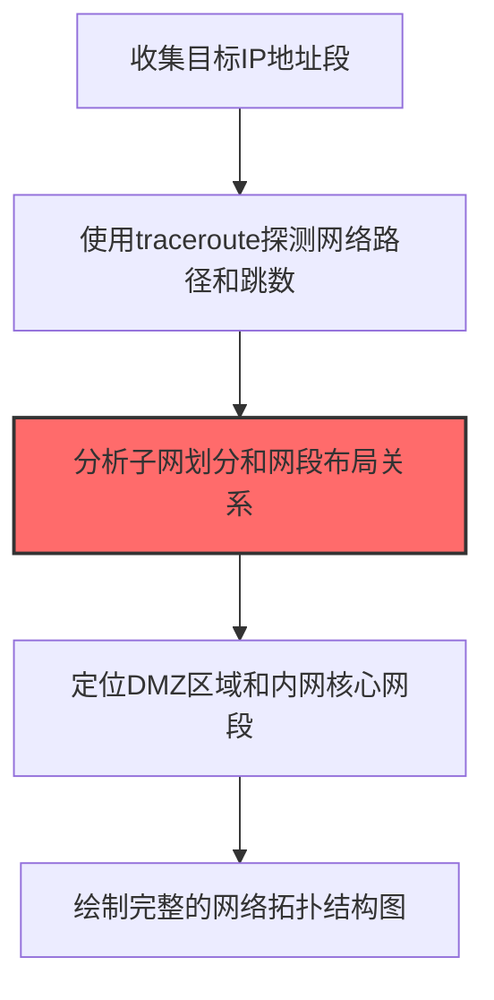

# 网络拓扑 (T1590.004)

## 一句话通俗理解

> **映射目标的网络结构，了解子网划分和关键系统位置**

## 30秒速查卡

| 维度 | 你需要知道的 |
|------|-------------|
| 这是什么？ | 映射目标的网络结构，了解子网划分和关键系统位置 |
| 为什么危险？ | 了解网络拓扑后，攻击者可以选择最优的横向移动路径 |
| 谁需要关心？ | 网络管理员、安全架构师 |
| 你的第一步防御 | 实施网络分段和微分段策略 |
| 如果只做一件事 | 限制内部网络信息的公开暴露 |

## 难度等级

⭐⭐ 中级 - 需要一定的技术基础和经验

## 前置知识检查

**读这个文件需要什么？**

- [ ] 互联网搜索基础、DNS/子域名概念、搜索引擎高级语法dork
- [ ] 网络协议基础（HTTP/DNS/TCP）
- [ ] 信息源分类能力（OSINT vs 商业情报）

## 技术描述

**网络拓扑**（T1590.004）是 **收集受害者网络信息**（T1590）的一个具体变体，属于 **侦察** 阶段的攻击技术。

> 🗺️ **打个比方**：就像拿到公司的楼层平面图，知道哪间是财务室、哪间是机房——网络拓扑图就是网络的"楼层平面图"。

### 具体怎么理解？

映射目标的网络结构，了解子网划分和关键系统位置

攻击者使用这种技术时，通常是在侦察阶段，想要达到特定的攻击目标。与父技术 T1590 相比，T1590.004 有自己独特的特点和使用场景。

### 为什么有效？

这种技术之所以有效，是因为：
1. **隐蔽性**：利用了正常系统功能或常见协议，不容易被发现
2. **技术门槛适中**：不需要特别高深的技术知识就能实施

**过渡段：** 不要误以为网络侦察只是简单的'谷歌搜索'——在攻击者手中，这是系统化的情报收集过程。
3. **广泛适用**：可以在多种环境和系统中使用

## 真实攻击流程



**步骤详解：**

1. **范围收集** - 汇总目标组织的所有IP地址段和域名解析记录
2. **路径探测** - 使用traceroute探测到各目标IP的网络路径和跳数
3. **子网分析** - 分析TTL值和路由路径推断子网划分和网段布局
4. **区域定位** - 识别DMZ区、内网区和核心服务器区的网络边界
5. **拓扑绘制** - 整合信息绘制目标网络拓扑图用于规划攻击路径

### 典型场景

攻击者在 **侦察** 阶段使用 网络拓扑 技术，以下是典型的攻击步骤：

## 攻击流程


**关键步骤说明：**

1. **汇总IP段与ASN归属** - 攻击者通过BGP Toolkit（Hurricane Electric）、RIPEstat、ARIN WHOIS、IPinfo等渠道查询目标组织拥有的ASN和IP段（CIDR块），识别目标自有的IP段与租用云厂商IP段（AWS/GCP/Azure/阿里云）的边界，并通过反向DNS解析（PTR记录）补全IP段对应的主机名清单。
2. **traceroute路径与跳数探测** - 使用MTR、traceroute、tcptraceroute对目标IP段中的代表性地址进行慢速、低频率的路径探测（避开IDS阈值），分析最后一跳前的网络路径，识别目标边界路由器、内部网关、运营商PE设备的位置；针对ICMP禁用的目标使用TCP SYN traceroute（端口80/443）或UDP traceroute绕过限制。
3. **TTL与路由路径推断子网边界** - 通过分析多个目标IP的traceroute路径汇合点、TTL跳数差异、最后一跳模式（同一跳数停止的IP群），推断目标内部的CIDR子网划分与VLAN分段边界；结合BGP路由宣告的CIDR前缀长度（/24 vs /16）和路由聚合点，识别DMZ区、办公区、生产区之间的网络分段。
4. **识别DMZ与核心网段** - 通过Shodan、Censys对目标IP段做端口暴露模式分析：暴露80/443/25/53端口的网段为DMZ区，暴露3389/22/445且仅对内可见的网段为生产服务器区，暴露VPN网关（443/500/4500）的IP为边界接入区；结合SSL证书SAN、HTTP响应头中的内部域名信息进一步验证网段用途。
5. **绘制拓扑图支撑横向路径规划** - 将IP段、ASN、traceroute路径、网段用途、端口暴露清单归一化为可视化拓扑图，标注跨网段访问控制弱点（如DMZ-生产区无ACL隔离）、可作跳板的双网卡主机、可作Pivot的VPN网关；为后续T1021远程服务、T1570横向移动、T1190漏洞利用提供精准的攻击路径规划输入。

## 真实案例

### 案例1：Volt Typhoon绘制美国关岛军事网络拓扑图

- **时间**: 2021-2023年
- **目标**: 美国关岛军事通信网络和电力调度系统
- **攻击组织**: Volt Typhoon（Insidious Taurus）
- **手法**: Volt Typhoon通过traceroute探测、TTL分析和路由跳数比对，绘制美国关岛军事基地的网络拓扑图。攻击者通过比较从不同IP段发起traceroute的路由路径差异，识别出DMZ区、核心服务器区和OT区边界。同时利用SOHO路由器作为跳板隐藏真实IP，长期潜伏侦察目标网络，为战时切断关岛通信和电力供应做情报准备
- **影响**: 美国CISA、FBI、NSA联合发布警告，称该攻击预演了潜在冲突场景
- **参考链接**: [CISA: AA24-038A Volt Typhoon Advisory](https://www.cisa.gov/news-events/cybersecurity-advisories/aa24-038a)

### 案例2：APT41在游戏公司入侵中映射内网拓扑

- **时间**: 2019-2021年
- **目标**: 台湾、韩国游戏公司
- **攻击组织**: APT41（BARIUM，Winnti Group）
- **手法**: APT41在通过供应链信任关系获得初始访问后，使用内网扫描工具（如 SharpHound、nmap）从被入侵主机发起内网扫描，绘制目标游戏公司的网络拓扑。攻击者识别出研发服务器群、反作弊系统服务器、数据库集群的网段分布，规划横向移动路径绕过分段防火墙，最终将核心源代码仓库纳入攻击范围
- **影响**: 多款游戏源代码和服务器配置被窃取
- **参考链接**: [Mandiant: APT41 Threat Report](https://www.mandiant.com/resources/blog/apt41-initiates-global-intrusion-campaign-using-multiple-exploits)

### 案例3：LockBit通过拓扑侦察规划勒索软件横向移动

- **时间**: 2022-2023年
- **目标**: 全球制造业、医疗、教育行业
- **攻击组织**: LockBit（俄罗斯背景勒索软件团伙）
- **手法**: LockBit affiliates在获得初始访问后，使用Advanced IP Scanner、SoftPerfect Network Scanner等工具快速扫描内网，绘制网络拓扑图识别出域控制器、备份服务器、文件服务器等高价值目标。攻击者通过分析交换机LLDP/CDP协议报文和路由表，理解VLAN分段，规划在加密阶段同时打击多个关键系统以最大化破坏
- **影响**: 全球超过2,000个组织被勒索，赎金支付总额超1亿美元
- **参考链接**: [CISA: Stop Ransomware LockBit 3.0](https://www.cisa.gov/news-events/cybersecurity-advisories/aa23-165a)

### 案例4：APT28通过路由追踪识别乌克兰军方网段边界

- **时间**: 2022年2-12月
- **目标**: 乌克兰军方网络
- **攻击组织**: APT28（Fancy Bear，俄罗斯GRU）
- **手法**: APT28从被入侵的乌克兰军方边缘设备发起traceroute，向不同内网IP段发送TTL递增的数据包。通过分析返回的ICMP超时报文，推断出军方网络的三层架构：外网防御区、办公网段和指挥控制区。攻击者据此规划横向移动路径，避免触发部署在网段边界的IDS检测
- **影响**: 多个乌克兰军方邮件账户被入侵，部分作战通信内容被窃取
- **参考链接**: [CERT-UA: APT28 Activity Report](https://cert.gov.ua/article/3760625)

## 红队视角

> ⚠️ **免责声明**：以下内容仅用于合法的安全测试、渗透测试和教育目的。未经授权对他人系统进行测试是违法行为。

### 实战技巧

1. **深入理解原理**：在实战应用前，充分理解网络拓扑的技术原理和适用场景
2. **环境适配**：根据目标系统的操作系统版本、安全配置等因素调整攻击策略
3. **组合使用**：将该技术与其他技术组合使用，构建完整的攻击链
4. **隐蔽性考虑**：注意操作痕迹的清理，避免被安全设备检测

### 常用工具

| 工具名称 | 用途 | 平台 | 链接 |
| -------- | ---- | ---- | ---- |
| traceroute | 路由跳数与路径分析 | 全平台 | 内置命令 |
| Nmap | 主机发现与拓扑扫描 | 全平台 | [Nmap](https://nmap.org/) |
| Advanced IP Scanner | Windows网络扫描工具 | Windows | [Advanced IP Scanner](https://www.advanced-ip-scanner.com/) |
| Zenmap | Nmap可视化拓扑图生成 | 全平台 | [Nmap Zenmap](https://nmap.org/zenmap/) |
| SharpHound | AD域拓扑枚举 | Windows | [GitHub](https://github.com/BloodHoundAD/SharpHound) |

### 注意事项

- 在授权的测试环境中使用这些技术
- 注意操作安全（OPSEC），避免被检测系统发现
- 使用匿名化技术和代理隐藏真实身份

## 蓝队视角

### 检测要点

1. **系统日志监控**：关注与网络拓扑相关的系统日志和审计记录
2. **异常行为检测**：监控系统中与该技术相关的异常进程、网络连接和文件操作
3. **工具特征识别**：识别攻击者可能使用的工具在系统中的运行特征

### 监控建议

- 部署端点检测和响应（EDR）系统，监控与网络拓扑相关的异常行为
- 配置SIEM规则，关联分析来自多个来源的告警
- 定期进行安全评估和渗透测试，验证检测规则的有效性

## 避坑指南

新手常犯的错误：过度依赖单一信息源。专业的侦察需要多个来源交叉验证。

## 检测建议

### 检测思路

检测 网络拓扑 的关键是识别异常行为模式。以下是三个层面的检测方法：

### 网络层检测

**方法**：监控网络流量中的异常模式

```bash
# 检测异常的网络连接和数据传输
# 根据具体协议和端口设置检测规则
```

### 主机层检测

**Windows事件ID**：
- 事件ID 4688：进程创建（监控可疑进程）
- 事件ID 4104：PowerShell执行（监控可疑脚本）

**Linux日志**：
- /var/log/auth.log：认证日志
- /var/log/syslog：系统日志

```bash
# 检测异常进程和命令执行
grep -i "suspicious" /var/log/auth.log
```

### 应用层检测

**用人话说：** 攻击者像获取建筑蓝图一样，通过traceroute、TTL分析等手段绘制目标公司的网络拓扑结构。他们要知道：哪些IP在DMZ区、哪些在内网、核心服务器在哪个网段、网络有几层跳转。比如向你们公司不同IP段发起traceroute探测，通过比较路由跳数和路径差异，就能推断出网络的分段布局——发现某个IP段只需要1跳（说明在同一子网），另一个需要5跳（说明跨了多层防火墙）。正常网络运维也会做拓扑发现，但如果从外网IP对你们公司多个网段同时发起traceroute探测，且探测模式具有系统性（按IP顺序逐个扫描），这就是攻击者在规划横向移动路径。

**Sigma规则示例**：

```yaml
title: 检测网络拓扑
status: experimental
description: 检测可能的网络拓扑活动
logsource:
    category: process_creation
    product: windows
detection:
    selection:
        EventID: 4688
    condition: selection
level: medium
tags:
    - attack.T1590004
```

## 缓解措施

### 优先级1：关键措施

**限制攻击面**：减少暴露的服务和端口，降低被利用的风险

```bash
# 防火墙规则示例：只允许必要的出站连接
iptables -A OUTPUT -p tcp --dport 443 -j ACCEPT  # 允许HTTPS
iptables -A OUTPUT -p tcp --dport 80 -j ACCEPT   # 允许HTTP
iptables -A OUTPUT -p tcp -j DROP                 # 阻止其他TCP
```

### 优先级2：重要措施

**加强监控**：部署EDR和SIEM系统，实时监控异常行为

### 优先级3：建议措施

**安全意识培训**：教育员工识别相关攻击手法

## 动手实验

> ⚠️ **所有实验必须在隔离的实验室环境中进行**

### 实验1：理解基本原理（初级）

**目标**：理解 网络拓扑 的工作原理

**步骤**：
1. 在隔离环境中搭建测试系统
2. 使用基础工具模拟攻击行为
3. 观察系统日志和网络流量

**学习要点**：理解该技术的核心机制

### 实验2：实际操作（中级）

**目标**：掌握 网络拓扑 的实际使用方法

**步骤**：
1. 使用专业工具进行攻击模拟
2. 尝试不同的绕过技术
3. 分析检测日志的特征

**学习要点**：掌握工具使用和日志分析

### 实验3：防御验证（高级）

**目标**：验证检测规则的有效性

**步骤**：
1. 部署检测规则
2. 执行攻击模拟
3. 验证检测告警是否触发

**学习要点**：理解攻防对抗的实际效果

## 术语解释

| 术语 | 通俗解释 |
|------|---------|
| **ATT&CK** | MITRE公司维护的攻击技术知识库，像一本"黑客手法百科全书" |
| **网络拓扑** | T1590.004，ATT&CK框架中定义的一种具体攻击技术 |
| **收集受害者网络信息** | T1590，网络拓扑所属的父技术类别 |
| **侦察** | 攻击链中的一个阶段，攻击者在这个阶段的目标 |
| **C2** | 命令与控制，攻击者用来远程控制被入侵系统的"遥控器" |
| **EDR** | 端点检测与响应，部署在电脑上的安全监控软件 |

## 被引用情况

以下父技术文档引用了本子技术：

- [T1590 - 网络信任依赖](../T1590-Gather-Victim-Network-Information.md)

## 参考资料

### 📚 官方文档（深入了解）

- [MITRE ATT&CK - 网络拓扑 (T1590.004)](https://attack.mitre.org/techniques/T1590/004/)
- [MITRE ATT&CK - 收集受害者网络信息 (T1590)](https://attack.mitre.org/techniques/T1590/)

### 📰 安全报告（真实攻击）

- [MITRE ATT&CK 官方文档](https://attack.mitre.org/) - ATT&CK 框架官方资源

### 🔧 工具与资源（动手试试）

- [Atomic Red Team](https://github.com/redcanaryco/atomic-red-team) - 检测规则测试框架
- [MITRE ATT&CK Navigator](https://mitre-attack.github.io/attack-navigator/) - ATT&CK 可视化工具

### 📚 学习资料（深入了解）

- [MITRE ATT&CK 知识库](https://attack.mitre.org/resources/) - ATT&CK 官方资源中心
