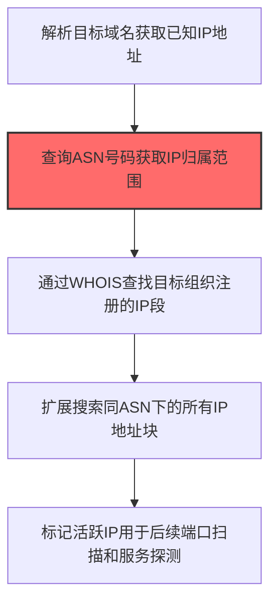
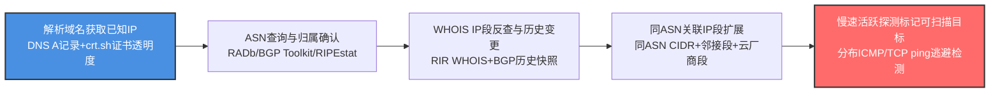

# IP地址 (T1590.005)

## 一句话通俗理解

> **收集目标的公网和内网IP地址范围**

## 30秒速查卡

| 维度 | 你需要知道的 |
|------|-------------|
| 这是什么？ | 收集目标的公网和内网IP地址范围 |
| 为什么危险？ | 知道IP范围后，攻击者可以进行定向扫描和攻击 |
| 谁需要关心？ | 网络管理员、安全团队 |
| 你的第一步防御 | 使用VPN和零信任网络架构 |
| 如果只做一件事 | 在防火墙上限制对内部IP段的直接访问 |

## 难度等级

⭐⭐ 中级 - 需要一定的技术基础和经验

## 前置知识检查

**读这个文件需要什么？**

- [ ] 互联网搜索基础、DNS/子域名概念、搜索引擎高级语法dork
- [ ] 网络协议基础（HTTP/DNS/TCP）
- [ ] 信息源分类能力（OSINT vs 商业情报）

## 技术描述

**IP地址**（T1590.005）是 **收集受害者网络信息**（T1590）的一个具体变体，属于 **侦察** 阶段的攻击技术。

> 🏠 **打个比方**：就像小偷先记下小区的门牌号范围——知道IP地址段，才能确定攻击目标范围。

### 具体怎么理解？

收集目标的公网和内网IP地址范围

攻击者使用这种技术时，通常是在侦察阶段，想要达到特定的攻击目标。与父技术 T1590 相比，T1590.005 有自己独特的特点和使用场景。

### 为什么有效？

这种技术之所以有效，是因为：
1. **隐蔽性**：利用了正常系统功能或常见协议，不容易被发现
2. **技术门槛适中**：不需要特别高深的技术知识就能实施

**过渡段：** 不要误以为网络侦察只是简单的'谷歌搜索'——在攻击者手中，这是系统化的情报收集过程。
3. **广泛适用**：可以在多种环境和系统中使用

## 真实攻击流程



**步骤详解：**

1. **域名解析** - 通过DNS解析获取目标域名的IP地址
2. **ASN查询** - 查询IP所属的ASN号码，确定IP分配机构
3. **段范围获取** - 通过WHOIS和RADb查询目标组织注册的IP段
4. **范围扩展** - 扫描同ASN下所有关联的IP地址块
5. **活跃筛选** - 使用Ping扫描标记在线主机供后续渗透使用

### 典型场景

攻击者在 **侦察** 阶段使用 IP地址 技术，以下是典型的攻击步骤：

## 攻击流程



**关键步骤说明：**

1. **解析域名获取已知IP** - 攻击者通过dig nslookup解析目标主域名和已发现子域名的A/AAAA记录获取已知公网IP；同时查询crt.sh证书透明度日志、SPKI哈希反查、Shodan CNAME历史，获取历史上绑定过目标域名的全部IP（含CDN回源IP、云负载均衡IP、已迁移下线的旧IP），作为ASN查询的种子。
2. **ASN查询与归属确认** - 使用RADb、BGP Toolkit（Hurricane Electric）、RIPEstat、IPinfo查询已知IP所属的ASN号码、AS名称、AS持有机构，确认目标组织自有AS（如AS4134电信、AS4837联通骨干）还是租用云厂商AS（AS15169 Google、AS16509 Amazon、AS8075 Microsoft）；通过PeeringDB了解AS的互联对等伙伴。
3. **WHOIS IP段反查与历史变更** - 通过ARIN/APNIC/RIPE/RIR WHOIS查询目标组织作为持有者注册的IP段（CIDR块），获取注册联系人、netname、描述、国家、最近变更时间；通过BGP历史快照（BGP Toolkit Historical Routes、RIPEstat RIS）观察目标AS在过去12个月宣告的CIDR前缀变更，识别新增IP段（新建数据中心、新区域上线）和撤回IP段（已下线但可能仍存在未注销服务）。
4. **同ASN关联IP段扩展** - 在目标AS下枚举所有宣告的CIDR块（如目标组织在AS4134下宣告多个/24）；同时检查邻接IP段（如已知/24，检查邻接/24是否归属同一组织但未公开声明）；对云厂商托管的IP段，通过反向DNS解析、HTTP Host头、SSL证书SAN识别目标在AWS/GCP/阿里云中使用的弹性IP段和负载均衡后端IP段。
5. **慢速活跃探测标记可扫描目标** - 使用Nmap list scan（-sL）、fping、Masscan低速率模式对扩展后的IP段进行ICMP ping和TCP端口80/443/22探测，识别在线活跃IP；探测采用分布式源IP、随机化目标顺序、长间隔（每秒数包）逃避 IDS 阈值检测；最终输出按"在线+开放端口+反向DNS"标注的活跃IP清单，作为T1595主动扫描与T1590.004拓扑绘制的输入。

## 真实案例

### 案例1：Volt Typhoon收集美国关岛关键基础设施IP段

- **时间**: 2021-2023年
- **目标**: 美国关岛及本土的电力、水务、通信IP段
- **攻击组织**: Volt Typhoon（Insidious Taurus）
- **手法**: Volt Typhoon通过BGP路由表查询、ARIN/RIR数据库查询和Shodan扫描，系统收集美国关岛及本土关键基础设施运营商的公网IP段。攻击者重点关注RFC 1918私有IP段对应的边缘设备（如Fortinet、SonicWall）的真实外网IP，识别未及时打补丁的边缘设备作为初始访问入口
- **影响**: 在美国关键基础设施网络中潜伏长达5年，CISA/FBI/NSA联合警告
- **参考链接**: [CISA: AA24-038A Volt Typhoon Advisory](https://www.cisa.gov/news-events/cybersecurity-advisories/aa24-038a)

### 案例2：APT29识别SolarWinds客户外网管理IP

- **时间**: 2019-2020年
- **目标**: SolarWinds Orion客户（含美国财政部、国务院等9个联邦机构）
- **攻击组织**: APT29（Cozy Bear，俄罗斯SVR）
- **手法**: APT29通过SolarWinds官网公开的客户案例、合作伙伴目录，识别出部分SolarWinds客户组织。再通过BGP查询、证书透明度日志（crt.sh）和被动DNS（Passive DNS）记录，收集这些客户暴露在外网的Orion管理界面IP。攻击者据此在SUNBURST后门激活后，针对高价值客户的Orion管理IP发起C2回连验证
- **影响**: 18,000个SolarWinds客户安装后门更新包，9个美国联邦机构被入侵
- **参考链接**: [CISA: AA21-008A Joint Advisory](https://www.cisa.gov/news-events/cybersecurity-advisories/aa21-008a)

### 案例3：LockBit通过Shodan批量收集暴露RDP服务的IP

- **时间**: 2022-2023年
- **目标**: 全球暴露RDP（3389端口）的Windows服务器
- **攻击组织**: LockBit（俄罗斯背景勒索软件团伙）
- **手法**: LockBit affiliates通过Shodan、Censys等平台批量收集全球暴露RDP服务的IP地址，特别是未启用NLA或弱密码策略的目标。攻击者利用这些IP列表进行自动化密码喷洒和漏洞利用（如BlueKeep CVE-2019-0708），获得初始访问后向企业内网横向移动并部署勒索软件
- **影响**: 全球超过2,000个组织被勒索，赎金总额超1亿美元
- **参考链接**: [CISA: Stop Ransomware LockBit 3.0](https://www.cisa.gov/news-events/cybersecurity-advisories/aa23-165a)

### 案例4：APT28收集乌克兰军方IP段进行精准打击

- **时间**: 2022年2-12月
- **目标**: 乌克兰军方网络IP段
- **攻击组织**: APT28（Fancy Bear，俄罗斯GRU 26165部队）
- **手法**: APT28通过RIPE数据库查询乌克兰军方注册的IP段，结合被动DNS记录识别出 `*.mil.gov.ua` 域名对应的IP。攻击者针对这些IP发起定向扫描，识别暴露的Outlook Web Access、VPN网关和远程桌面服务，再发起密码喷洒和零日漏洞利用
- **影响**: 多个乌克兰军方邮箱账户和VPN账户被入侵
- **参考链接**: [CERT-UA: APT28 Activity Report](https://cert.gov.ua/article/3760625)

## 红队视角

> ⚠️ **免责声明**：以下内容仅用于合法的安全测试、渗透测试和教育目的。未经授权对他人系统进行测试是违法行为。

### 实战技巧

1. **深入理解原理**：在实战应用前，充分理解IP地址的技术原理和适用场景
2. **环境适配**：根据目标系统的操作系统版本、安全配置等因素调整攻击策略
3. **组合使用**：将该技术与其他技术组合使用，构建完整的攻击链
4. **隐蔽性考虑**：注意操作痕迹的清理，避免被安全设备检测

### 常用工具

| 工具名称 | 用途 | 平台 | 链接 |
| -------- | ---- | ---- | ---- |
| Shodan | 互联网设备与服务搜索引擎 | Web | [Shodan](https://www.shodan.io/) |
| Censys | 互联网扫描数据查询平台 | Web | [Censys](https://search.censys.io/) |
| RIPE Stat | IP段归属与BGP路由查询 | Web | [RIPE Stat](https://stat.ripe.net/) |
| ARIN WHOIS | 北美IP段注册查询 | Web | [ARIN](https://www.arin.net/) |
| Nmap | IP段批量扫描与存活检测 | 全平台 | [Nmap](https://nmap.org/) |

### 注意事项

- 在授权的测试环境中使用这些技术
- 注意操作安全（OPSEC），避免被检测系统发现
- 使用匿名化技术和代理隐藏真实身份

## 蓝队视角

### 检测要点

1. **系统日志监控**：关注与IP地址相关的系统日志和审计记录
2. **异常行为检测**：监控系统中与该技术相关的异常进程、网络连接和文件操作
3. **工具特征识别**：识别攻击者可能使用的工具在系统中的运行特征

### 监控建议

- 部署端点检测和响应（EDR）系统，监控与IP地址相关的异常行为
- 配置SIEM规则，关联分析来自多个来源的告警
- 定期进行安全评估和渗透测试，验证检测规则的有效性

## 避坑指南

新手常犯的错误：过度依赖单一信息源。专业的侦察需要多个来源交叉验证。

## 检测建议

### 检测思路

检测 IP地址 的关键是识别异常行为模式。以下是三个层面的检测方法：

### 网络层检测

**方法**：监控网络流量中的异常模式

```bash
# 检测异常的网络连接和数据传输
# 根据具体协议和端口设置检测规则
```

### 主机层检测

**Windows事件ID**：
- 事件ID 4688：进程创建（监控可疑进程）
- 事件ID 4104：PowerShell执行（监控可疑脚本）

**Linux日志**：
- /var/log/auth.log：认证日志
- /var/log/syslog：系统日志

```bash
# 检测异常进程和命令执行
grep -i "suspicious" /var/log/auth.log
```

### 应用层检测

**用人话说：** 攻击者像确认目标住址范围一样，收集目标公司拥有的所有公网IP地址段。他们会通过DNS解析获取几个已知IP，然后查这些IP所属的ASN号码，再从WHOIS和RADb数据库中拉出整个IP段——比如发现目标公司在"203.0.113.0/24"这个段里有200多个IP。有了这些IP范围，攻击者就能进行后续的端口扫描、漏洞探测。正常云服务商或ISP也会查询IP归属，但如果有人在短时间内通过多个渠道（DNS、WHOIS、ASN查询）交叉验证你们公司的IP范围，并且查询模式是系统性的（先解析域名→查ASN→拉整个IP段），这就是扫描的前奏。

**Sigma规则示例**：

```yaml
title: 检测IP地址
status: experimental
description: 检测可能的IP地址活动
logsource:
    category: process_creation
    product: windows
detection:
    selection:
        EventID: 4688
    condition: selection
level: medium
tags:
    - attack.T1590005
```

## 缓解措施

### 优先级1：关键措施

**限制攻击面**：减少暴露的服务和端口，降低被利用的风险

```bash
# 防火墙规则示例：只允许必要的出站连接
iptables -A OUTPUT -p tcp --dport 443 -j ACCEPT  # 允许HTTPS
iptables -A OUTPUT -p tcp --dport 80 -j ACCEPT   # 允许HTTP
iptables -A OUTPUT -p tcp -j DROP                 # 阻止其他TCP
```

### 优先级2：重要措施

**加强监控**：部署EDR和SIEM系统，实时监控异常行为

### 优先级3：建议措施

**安全意识培训**：教育员工识别相关攻击手法

## 动手实验

> ⚠️ **所有实验必须在隔离的实验室环境中进行**

### 实验1：理解基本原理（初级）

**目标**：理解 IP地址 的工作原理

**步骤**：
1. 在隔离环境中搭建测试系统
2. 使用基础工具模拟攻击行为
3. 观察系统日志和网络流量

**学习要点**：理解该技术的核心机制

### 实验2：实际操作（中级）

**目标**：掌握 IP地址 的实际使用方法

**步骤**：
1. 使用专业工具进行攻击模拟
2. 尝试不同的绕过技术
3. 分析检测日志的特征

**学习要点**：掌握工具使用和日志分析

### 实验3：防御验证（高级）

**目标**：验证检测规则的有效性

**步骤**：
1. 部署检测规则
2. 执行攻击模拟
3. 验证检测告警是否触发

**学习要点**：理解攻防对抗的实际效果

## 术语解释

| 术语 | 通俗解释 |
|------|---------|
| **ATT&CK** | MITRE公司维护的攻击技术知识库，像一本"黑客手法百科全书" |
| **IP地址** | T1590.005，ATT&CK框架中定义的一种具体攻击技术 |
| **收集受害者网络信息** | T1590，IP地址所属的父技术类别 |
| **侦察** | 攻击链中的一个阶段，攻击者在这个阶段的目标 |
| **C2** | 命令与控制，攻击者用来远程控制被入侵系统的"遥控器" |
| **EDR** | 端点检测与响应，部署在电脑上的安全监控软件 |

## 被引用情况

以下父技术文档引用了本子技术：

- [T1590 - 网络信任依赖](../T1590-Gather-Victim-Network-Information.md)

## 参考资料

### 📚 官方文档（深入了解）

- [MITRE ATT&CK - IP地址 (T1590.005)](https://attack.mitre.org/techniques/T1590/005/)
- [MITRE ATT&CK - 收集受害者网络信息 (T1590)](https://attack.mitre.org/techniques/T1590/)

### 📰 安全报告（真实攻击）

- [MITRE ATT&CK 官方文档](https://attack.mitre.org/) - ATT&CK 框架官方资源

### 🔧 工具与资源（动手试试）

- [Atomic Red Team](https://github.com/redcanaryco/atomic-red-team) - 检测规则测试框架
- [MITRE ATT&CK Navigator](https://mitre-attack.github.io/attack-navigator/) - ATT&CK 可视化工具

### 📚 学习资料（深入了解）

- [MITRE ATT&CK 知识库](https://attack.mitre.org/resources/) - ATT&CK 官方资源中心
