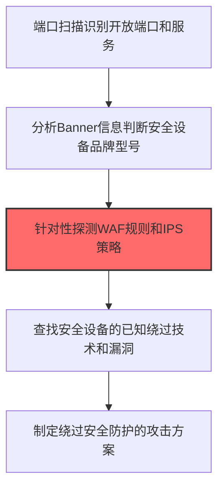
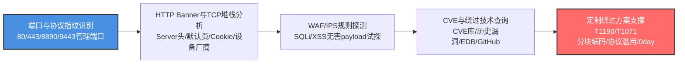

# 网络安全设备 (T1590.006)

## 一句话通俗理解

> **识别目标使用的防火墙、IDS/IPS、WAF等安全设备**

## 30秒速查卡

| 维度 | 你需要知道的 |
|------|-------------|
| 这是什么？ | 识别目标使用的防火墙、IDS/IPS、WAF等安全设备 |
| 为什么危险？ | 了解安全设备类型后，攻击者可以针对性地绕过检测 |
| 谁需要关心？ | 安全架构师、安全运维 |
| 你的第一步防御 | 保持安全设备配置的保密性 |
| 如果只做一件事 | 使用非标准端口和配置安全设备 |

## 难度等级

⭐⭐ 中级 - 需要一定的技术基础和经验

## 前置知识检查

**读这个文件需要什么？**

- [ ] 互联网搜索基础、DNS/子域名概念、搜索引擎高级语法dork
- [ ] 网络协议基础（HTTP/DNS/TCP）
- [ ] 信息源分类能力（OSINT vs 商业情报）

## 技术描述

**网络安全设备**（T1590.006）是 **收集受害者网络信息**（T1590）的一个具体变体，属于 **侦察** 阶段的攻击技术。

> 🚨 **打个比方**：就像入室行窃前先摸清保安的巡逻路线和换班时间——知道有哪些安全设备，才能绕过监控。

### 具体怎么理解？

识别目标使用的防火墙、IDS/IPS、WAF等安全设备

攻击者使用这种技术时，通常是在侦察阶段，想要达到特定的攻击目标。与父技术 T1590 相比，T1590.006 有自己独特的特点和使用场景。

### 为什么有效？

这种技术之所以有效，是因为：
1. **隐蔽性**：利用了正常系统功能或常见协议，不容易被发现
2. **技术门槛适中**：不需要特别高深的技术知识就能实施

**过渡段：** 不要误以为网络侦察只是简单的'谷歌搜索'——在攻击者手中，这是系统化的情报收集过程。
3. **广泛适用**：可以在多种环境和系统中使用

## 真实攻击流程



**步骤详解：**

1. **服务识别** - 扫描目标端口，识别提供服务的应用和协议
2. **设备指纹** - 分析HTTP Banner、TCP/IP堆栈指纹判断安全设备型号
3. **策略探测** - 通过恶意但无害的请求试探WAF的规则和IPS检测策略
4. **绕过查阅** - 查阅该型号安全设备的已知绕过技术和CVE漏洞
5. **方案定制** - 制定能绕过目标安全设备的攻击方案

### 典型场景

攻击者在 **侦察** 阶段使用 网络安全设备 技术，以下是典型的攻击步骤：

## 攻击流程



**关键步骤说明：**

1. **端口与协议指纹识别** - 攻击者使用Nmap服务版本探测（-sV）、Masscan对目标IP段进行端口扫描，重点识别安全设备常见管理端口：防火墙/VPN网关（443/8443/9443/8890/10443）、WAF（80/443/8000/8080）、IDS/IDS管理口（22/443/514）、负载均衡（443/15672）；通过端口组合模式（如443+10443同时开放推断为FortiGate）初步判断设备类型。
2. **HTTP Banner与TCP堆栈分析** - 通过curl -I、wafw00f、IdentYwaf分析HTTP响应中的Server header、X-Powered-By、Set-Cookie名称（如F5 BIG-IP的BIGipServer、Citrix Netscaler的NSC_）、默认登录页HTML特征、favicon.ico哈希；使用Nmap OS指纹（-O）、p0f分析TCP/IP堆栈指纹（TTL初始值、窗口大小、TCP选项顺序）识别设备厂商与型号版本（Fortinet FortiOS、Palo Alto PAN-OS、Cisco ASA、F5 BIG-IP）。
3. **WAF/IPS规则探测** - 通过发送恶意但无害的探测payload（如 `' OR 1=1--`、`<script>alert(1)</script>`、`../../etc/passwd`、SQLi/XSS/路径穿越各一组）观察响应状态码、拦截页面、阻断延迟，识别WAF规则集类型（ModSecurity OWASP CRS、Cloudflare、阿里云WAF）；通过SQLmap --identify-waf、wafw00f自动化识别；同时观察IPS对Nmap扫描特征（-sS -O）的阻断响应判断IDS灵敏度。
4. **CVE与绕过技术查询** - 针对识别到的设备厂商与版本号，查询NIST NVD、Exploit-DB、CVE Details、GitHub PoC仓库、Packet Storm安全公告，梳理该型号设备的已知CVE漏洞（如FortiOS CVE-2024-21762未授权RCE、PAN-OS CVE-2024-3400 GlobalProtect命令注入、Ivanti CVE-2024-21893 SSRF）；同时查阅厂商安全公告与第三方安全研究博客确认补丁状态和野外利用情况。
5. **定制绕过方案支撑T1190/T1071** - 综合设备指纹、规则探测、CVE清单制定绕过方案：针对WAF使用分块传输编码（chunked）、大小写混淆、Unicode编码、超长参数绕过规则匹配；针对IPS使用协议滥用（DNS over HTTPS、ICMP隧道）逃避深度包检测；针对存在未修复CVE的边缘设备直接准备N-day利用链（如FortiGate SSL VPN未授权RCE），为后续T1190漏洞利用与T1071应用层协议隧道提供具体技术路径。

## 真实案例

### 案例1：Volt Typhoon识别美国关岛Fortinet边缘设备

- **时间**: 2022-2023年
- **目标**: 美国关岛和本土的关键基础设施边缘设备
- **攻击组织**: Volt Typhoon（Insidious Taurus）
- **手法**: Volt Typhoon通过Shodan、Censys查询美国关岛关键基础设施运营商的IP段，识别暴露在公网的Fortinet FortiGate防火墙、FortiOS SSL VPN设备。攻击者特别关注运行已知漏洞版本（CVE-2022-42475、CVE-2023-27997）的设备，以及未启用MFA的SSL VPN入口。识别后通过漏洞利用获得初始访问，再利用这些设备作为跳板进入内部网络
- **影响**: 多个关键基础设施网络被长期潜伏，CISA/FBI/NSA联合发布警告
- **参考链接**: [CISA: AA24-038A Volt Typhoon Advisory](https://www.cisa.gov/news-events/cybersecurity-advisories/aa24-038a)

### 案例2：APT29识别SolarWinds客户Okta身份提供商

- **时间**: 2020年
- **目标**: SolarWinds客户的Okta、Azure AD身份基础设施
- **攻击组织**: APT29（Cozy Bear，俄罗斯SVR）
- **手法**: APT29在被入侵的SolarWinds客户网络中，通过被动DNS查询和HTTP响应头分析（Server、X-Powered-By字段），识别出客户使用的身份提供商类型（Okta vs Azure AD vs On-Prem ADFS）。攻击者据此规划后续攻击路径——对使用Okta的客户，针对Okta管理员API发起Golden SAML攻击；对使用ADFS的客户，利用SAML Token Signing证书伪造实现持久化
- **影响**: 9个美国联邦机构身份系统被入侵
- **参考链接**: [CISA: AA21-008A Joint Advisory](https://www.cisa.gov/news-events/cybersecurity-advisories/aa21-008a)

### 案例3：BlackCat通过暴露VPN设备识别勒索目标

- **时间**: 2022-2024年
- **目标**: 全球医疗、能源、制造业VPN入口
- **攻击组织**: BlackCat/ALPHV（俄罗斯背景勒索软件团伙）
- **手法**: BlackCat affiliates通过Shodan批量查询暴露在公网的Pulse Secure、SonicWall、Fortinet VPN设备，识别运行漏洞版本（如CVE-2023-0669、CVE-2021-22893）的目标。攻击者据此筛选未及时打补丁的VPN入口，发起漏洞利用获得初始访问，再向内网部署勒索软件
- **影响**: 全球超过500个组织被勒索，赎金支付总额超3亿美元
- **参考链接**: [CISA: Stop Ransomware ALPHV Blackcat](https://www.cisa.gov/news-events/cybersecurity-advisories/aa23-353a)

### 案例4：APT28识别乌克兰军方边缘设备型号

- **时间**: 2022-2023年
- **目标**: 乌克兰军方网络边缘设备
- **攻击组织**: APT28（Fancy Bear，俄罗斯GRU）
- **手法**: APT28通过对乌克兰军方IP段进行主动指纹识别（nmap -sV、抓取HTTPS证书），识别出边缘部署的Cisco ASA防火墙、Juniper SRX网关型号和固件版本。攻击者据此匹配已知漏洞利用库，针对老旧固件版本的设备发起CVE-2018-0101、CVE-2022-22241等漏洞利用，绕过边缘防护进入内网
- **影响**: 多个乌克兰军方边缘设备被入侵
- **参考链接**: [CERT-UA: APT28 Activity Report](https://cert.gov.ua/article/3760625)

## 红队视角

> ⚠️ **免责声明**：以下内容仅用于合法的安全测试、渗透测试和教育目的。未经授权对他人系统进行测试是违法行为。

### 实战技巧

1. **深入理解原理**：在实战应用前，充分理解网络安全设备的技术原理和适用场景
2. **环境适配**：根据目标系统的操作系统版本、安全配置等因素调整攻击策略
3. **组合使用**：将该技术与其他技术组合使用，构建完整的攻击链
4. **隐蔽性考虑**：注意操作痕迹的清理，避免被安全设备检测

### 常用工具

| 工具名称 | 用途 | 平台 | 链接 |
| -------- | ---- | ---- | ---- |
| Metasploit | 渗透测试框架 | 全平台 | [Metasploit](https://www.metasploit.com/) |
| Cobalt Strike |  adversary模拟平台 | Windows | [Cobalt Strike](https://www.cobaltstrike.com/) |
| Atomic Red Team | 检测规则测试 | 全平台 | [Atomic Red Team](https://github.com/redcanaryco/atomic-red-team) |

### 注意事项

- 在授权的测试环境中使用这些技术
- 注意操作安全（OPSEC），避免被检测系统发现
- 使用匿名化技术和代理隐藏真实身份

## 蓝队视角

### 检测要点

1. **系统日志监控**：关注与网络安全设备相关的系统日志和审计记录
2. **异常行为检测**：监控系统中与该技术相关的异常进程、网络连接和文件操作
3. **工具特征识别**：识别攻击者可能使用的工具在系统中的运行特征

### 监控建议

- 部署端点检测和响应（EDR）系统，监控与网络安全设备相关的异常行为
- 配置SIEM规则，关联分析来自多个来源的告警
- 定期进行安全评估和渗透测试，验证检测规则的有效性

## 避坑指南

新手常犯的错误：过度依赖单一信息源。专业的侦察需要多个来源交叉验证。

## 检测建议

### 检测思路

检测 网络安全设备 的关键是识别异常行为模式。以下是三个层面的检测方法：

### 网络层检测

**方法**：监控网络流量中的异常模式

```bash
# 检测异常的网络连接和数据传输
# 根据具体协议和端口设置检测规则
```

### 主机层检测

**Windows事件ID**：
- 事件ID 4688：进程创建（监控可疑进程）
- 事件ID 4104：PowerShell执行（监控可疑脚本）

**Linux日志**：
- /var/log/auth.log：认证日志
- /var/log/syslog：系统日志

```bash
# 检测异常进程和命令执行
grep -i "suspicious" /var/log/auth.log
```

### 应用层检测

**用人话说：** 攻击者像摸清保安的装备和巡逻路线一样，识别目标公司使用的防火墙品牌、WAF类型、IDS/IPS型号和版本。他们通过分析HTTP响应头（看Server字段、X-Security-*头）、发送特殊探测包（看返回的TCP/IP指纹）、或者尝试触发已知的WAF错误页面来判断安全设备类型。比如发一个包含明显SQL注入特征的请求，如果返回的是ModSecurity的拒绝页面，就知道WAF是ModSecurity。知道了设备型号和版本，攻击者就能查找对应的绕过技术或已知漏洞。正常的渗透测试也会做这类识别，但如果从外网IP对你们的Web应用发送大量带有测试Payload的请求，并且响应分析具有自动化特征，这就是攻击者在做战前侦察。

**Sigma规则示例**：

```yaml
title: 检测网络安全设备
status: experimental
description: 检测可能的网络安全设备活动
logsource:
    category: process_creation
    product: windows
detection:
    selection:
        EventID: 4688
    condition: selection
level: medium
tags:
    - attack.T1590006
```

## 缓解措施

### 优先级1：关键措施

**限制攻击面**：减少暴露的服务和端口，降低被利用的风险

```bash
# 防火墙规则示例：只允许必要的出站连接
iptables -A OUTPUT -p tcp --dport 443 -j ACCEPT  # 允许HTTPS
iptables -A OUTPUT -p tcp --dport 80 -j ACCEPT   # 允许HTTP
iptables -A OUTPUT -p tcp -j DROP                 # 阻止其他TCP
```

### 优先级2：重要措施

**加强监控**：部署EDR和SIEM系统，实时监控异常行为

### 优先级3：建议措施

**安全意识培训**：教育员工识别相关攻击手法

## 动手实验

> ⚠️ **所有实验必须在隔离的实验室环境中进行**

### 实验1：理解基本原理（初级）

**目标**：理解 网络安全设备 的工作原理

**步骤**：
1. 在隔离环境中搭建测试系统
2. 使用基础工具模拟攻击行为
3. 观察系统日志和网络流量

**学习要点**：理解该技术的核心机制

### 实验2：实际操作（中级）

**目标**：掌握 网络安全设备 的实际使用方法

**步骤**：
1. 使用专业工具进行攻击模拟
2. 尝试不同的绕过技术
3. 分析检测日志的特征

**学习要点**：掌握工具使用和日志分析

### 实验3：防御验证（高级）

**目标**：验证检测规则的有效性

**步骤**：
1. 部署检测规则
2. 执行攻击模拟
3. 验证检测告警是否触发

**学习要点**：理解攻防对抗的实际效果

## 术语解释

| 术语 | 通俗解释 |
|------|---------|
| **ATT&CK** | MITRE公司维护的攻击技术知识库，像一本"黑客手法百科全书" |
| **网络安全设备** | T1590.006，ATT&CK框架中定义的一种具体攻击技术 |
| **收集受害者网络信息** | T1590，网络安全设备所属的父技术类别 |
| **侦察** | 攻击链中的一个阶段，攻击者在这个阶段的目标 |
| **C2** | 命令与控制，攻击者用来远程控制被入侵系统的"遥控器" |
| **EDR** | 端点检测与响应，部署在电脑上的安全监控软件 |

## 被引用情况

以下父技术文档引用了本子技术：

- [T1590 - 网络信任依赖](../T1590-Gather-Victim-Network-Information.md)

## 参考资料

### 📚 官方文档（深入了解）

- [MITRE ATT&CK - 网络安全设备 (T1590.006)](https://attack.mitre.org/techniques/T1590/006/)
- [MITRE ATT&CK - 收集受害者网络信息 (T1590)](https://attack.mitre.org/techniques/T1590/)

### 📰 安全报告（真实攻击）

- [MITRE ATT&CK 官方文档](https://attack.mitre.org/) - ATT&CK 框架官方资源

### 🔧 工具与资源（动手试试）

- [Atomic Red Team](https://github.com/redcanaryco/atomic-red-team) - 检测规则测试框架
- [MITRE ATT&CK Navigator](https://mitre-attack.github.io/attack-navigator/) - ATT&CK 可视化工具

### 📚 学习资料（深入了解）

- [MITRE ATT&CK 知识库](https://attack.mitre.org/resources/) - ATT&CK 官方资源中心
