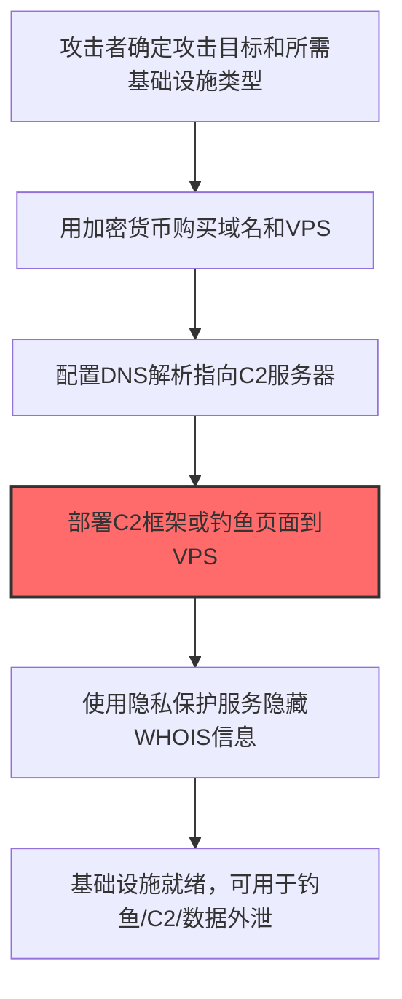
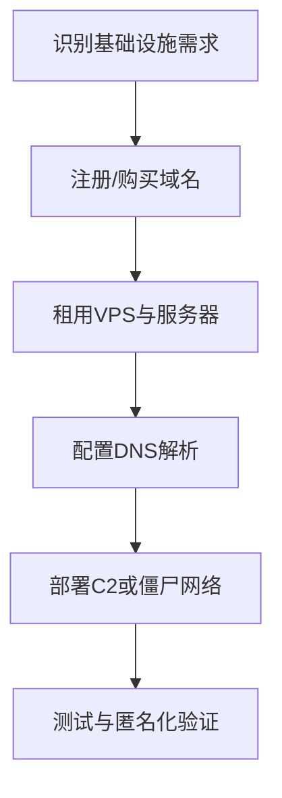

# 获取基础设施 (T1583)

## 一句话通俗理解

> **攻击者在发动攻击前，先买好/租好/搭好作案要用的"场地和工具"——域名、服务器、DNS服务器、僵尸网络等**

## 30秒速查卡

| 维度 | 你需要知道的 |
|------|-------------|
| 这是什么？ | 攻击者购买、租用或自行搭建用于支持攻击行动的基础设施（域名、服务器、VPS、DNS服务器、僵尸网络等） |
| 为什么危险？ | 这些基础设施是后续钓鱼、C2通信、数据外泄的"根据地"，没有它们攻击无法持续运转 |
| 谁需要关心？ | 威胁情报团队、安全运维团队、域名/云服务提供商的安全团队 |
| 你的第一步防御 | 建立域名和IP信誉库，对新注册域名和已知恶意ASN的流量进行标记和监控 |
| 如果只做一件事 | 对入站流量做威胁情报关联，拦截已知恶意域名和新注册域名（<30天）的访问 |

## 难度等级

⭐⭐ 中级 - 需要资金、匿名支付能力和基础设施运维经验

**前置知识要求**：了解域名注册流程、DNS工作原理、云服务器/VPS基本概念

## 前置知识检查

**读这个文件需要什么？**

- [ ] 域名注册和DNS解析的基本原理
- [ ] 云服务器/VPS的概念和用途
- [ ] 僵尸网络的基本概念
- [ ] 匿名支付方式（加密货币等）

## 技术描述

**获取基础设施**（T1583）是 **资源开发**（TA0042）战术下的技术，指攻击者在发动攻击之前，购买、租用或自行搭建用于支持攻击行动的基础设施。

> 📡 **打个比方**：就像骗子在行骗之前要先租一间办公室、装一部电话、印一盒名片——这些"硬件准备"就是获取基础设施。攻击者也需要提前准备好域名（伪装门面）、服务器（作案据点）、DNS服务器（指路牌）、僵尸网络（打手团）等。

### 具体怎么理解？

攻击者获取基础设施的方式主要有三种：

1. **购买**：用加密货币或窃取的信用卡购买域名、VPS、云服务
2. **租用**：短期租用服务器、CDN等服务，用完即弃
3. **自行搭建**：利用已入侵的设备组建僵尸网络，或自行架设DNS服务器

这些基础设施在攻击链中的作用：
- **域名** → 用于钓鱼网站、C2通信、恶意软件下载
- **VPS/服务器** → 托管C2服务端、钓鱼页面、数据中转
- **DNS服务器** → 实现DNS隧道、C2域名解析、隐蔽通信
- **僵尸网络** → 发动DDoS、分布式扫描、大规模垃圾邮件
- **Web服务** → 利用合法平台（GitHub、Pastebin、云存储）托管恶意内容，借助合法域名信誉绕过检测

**过渡段：** 不要误以为获取基础设施只是一次性的"买域名"动作——在成熟的APT组织中，基础设施获取是一个持续运营的过程，攻击者会不断轮换IP、域名和服务器来规避封锁和追踪。

### 为什么有效？

这种技术之所以有效，是因为：
1. **匿名性**：攻击者可以通过隐私保护服务、虚假注册信息、加密货币支付来隐藏真实身份
2. **合法性外衣**：域名注册和云服务器租用本身是合法行为，难以在获取阶段就阻断
3. **可替换性**：即使某个域名或服务器被发现并封锁，攻击者可以快速获取新的替代品
4. **基础设施规模可扩展**：从单个域名到上千个C2节点的僵尸网络，攻击者可以按需扩展

## 真实攻击流程



**步骤详解：**

1. **需求评估** - 攻击者根据攻击目标确定需要什么类型的基础设施：钓鱼需要相似域名，C2需要稳定服务器，DDoS需要僵尸网络
2. **采购部署** - 通过域名注册商购买域名，通过云服务商租用VPS，使用加密货币或窃取的信用卡支付以保持匿名
3. **DNS配置** - 将域名解析指向C2服务器IP，可能使用CDN或域名前置（Domain Fronting）来隐藏真实C2地址
4. **服务部署** - 在VPS上部署C2框架（如Cobalt Strike Team Server、Covenant）、钓鱼页面或恶意软件托管站点
5. **匿名化处理** - 启用WHOIS隐私保护，使用代理注册商，配置SSL证书增加合法性外观
6. **投入运营** - 基础设施就绪后用于实际攻击行动，持续监控可用性并准备备用节点

## 攻击流程

### 典型攻击流程

```
识别基础设施需求 --> 注册/购买域名 --> 租用VPS与服务器 --> 配置DNS解析 --> 部署C2或僵尸网络 --> 测试与匿名化验证
```



**步骤详解：**

1. **识别基础设施需求**
   - 通俗描述：根据攻击目标确定需要买什么"装备"——钓鱼要伪装域名、C2要稳定服务器、DDoS要僵尸网络
   - 技术细节：依据侦察阶段掌握的目标技术栈、员工邮箱域名、外部服务依赖，决定基础设施类型、规模和地理分布
   - 常用工具：无（基于侦察报告的需求规划）

2. **注册/购买域名**
   - 通俗描述：在域名注册商买下与目标品牌相似的域名，比如把 `paypa1.com` 当成 `paypal.com`
   - 技术细节：选择同形异义字符（homoglyph）、增删字符、变更TLD（如 `.co`、`.io`、`.support`）构造钓鱼域名；使用隐私保护服务隐藏WHOIS；通过加密货币或窃取的信用卡支付
   - 常用工具：Namecheap、GoDaddy、Punycode转换工具、dnstwist

3. **租用VPS与服务器**
   - 通俗描述：在云服务商那里租几台服务器，用来托管C2服务端、钓鱼页面或恶意软件下载站
   - 技术细节：选择对滥用监管宽松的"子弹服务器托管"（bulletproof hosting）提供商；多区域分散部署规避单点封锁；使用虚假注册身份和加密货币结算
   - 常用工具：AWS、DigitalOcean、Vultr、Hetzner、匿名VPS服务商

4. **配置DNS解析**
   - 通俗描述：把刚买的域名"指路"到自己的C2服务器IP上，让别人访问域名时实际连到攻击者机器
   - 技术细节：设置A记录、CNAME、MX记录；利用域名前置（Domain Fronting）通过合法CDN域名套壳C2流量；配置短TTL加速域名轮换；使用DNS over HTTPS隐蔽查询
   - 常用工具：Cloudflare、BIND、PowerDNS、dnscontrol

5. **部署C2或僵尸网络**
   - 通俗描述：在租来的服务器上装好"指挥部"软件，或者通过已入侵设备组建可远程调度的"肉鸡"网络
   - 技术细节：部署C2框架（Cobalt Strike Team Server、Covenant、Sliver）并配置Malleable C2 Profile伪装合法流量；僵尸网络通过bot master下发指令，利用P2P或中心化拓扑增强韧性
   - 常用工具：Cobalt Strike、Sliver、Covenant、Mythic、Mirai变种

6. **测试与匿名化验证**
   - 通俗描述：上线前先自测通不通、快不快、能不能被溯源，确保"阵地"稳固不留把柄
   - 技术细节：从外部测试C2连通性与回包延迟；验证WHOIS隐私保护、SSL证书签发、支付链路无个人身份泄露；使用SSL证书（Let's Encrypt或偷来的证书）提升合法性外观；扫描自身基础设施确认无暴露的指纹特征
   - 常用工具：Let's Encrypt、certbot、censys.io（自查暴露面）、curl、openssl

## 真实案例

### 案例1：APT29（Cozy Bear）利用SolarWinds供应链攻击中的基础设施

- **时间**：2020年
- **目标**：美国多家政府机构和企业（通过SolarWinds供应链）
- **攻击组织**：APT29（俄罗斯对外情报局SVR背景）
- **手法**：APT29提前数月注册了 `avengerscloud[.]com` 等多个C2域名，租用AWS、GoDaddy等云服务搭建C2基础设施。攻击者使用了域名前置（Domain Fronting）技术，通过合法CDN域名（如 `cloudflare.com`）来隐蔽C2流量，使流量看起来像是访问合法云服务
- **影响**：约18,000个SolarWinds客户安装了后门更新，至少9个联邦机构受影响
- **参考链接**：[CISA Alert AA21-077A](https://www.cisa.gov/news-events/cybersecurity-advisories/aa21-077a)

### 案例2：FIN7购买域名和VPS搭建钓鱼基础设施

- **时间**：2015-2018年
- **目标**：美国多家餐饮连锁企业（Arby's、Chipotle等）
- **攻击组织**：FIN7（也称Carbanak Group，俄罗斯背景）
- **手法**：FIN7通过域名注册商大量购买与企业合法域名高度相似的域名（如将 `chipotle.com` 注册为 `chipotle-update.com`），租用廉价VPS托管钓鱼页面。攻击者还购买了SSL证书使钓鱼站点呈现HTTPS安全标识，增加可信度
- **影响**：窃取超过1500万张支付卡信息，造成数亿美元损失
- **参考链接**：[美国司法部起诉书](https://www.justice.gov/opa/pr/three-members-notorious-international-cybercrime-group-fin7-cybercriminal-organization)

### 案例3：Mirai僵尸网络利用IoT设备组建攻击基础设施

- **时间**：2016年
- **目标**：Dyn（DNS服务提供商）、Krebs on Security网站等
- **攻击组织**：Anna-senpai（Mirai作者）
- **手法**：Mirai恶意软件通过扫描互联网上的IoT设备（网络摄像头、路由器、DVR），利用默认密码和已知漏洞批量入侵，将被感染设备组成庞大的僵尸网络。峰值时控制超过60万台设备，这些设备成为攻击者可随时调用的DDoS基础设施
- **影响**：对Dyn的DDoS攻击导致美国东海岸Twitter、Netflix、PayPal等大量网站无法访问
- **参考链接**：[Krebs on Security分析](https://krebsonsecurity.com/2016/10/source-code-for-iot-botnet-mirai-released/)

## 子技术列表

| 子技术ID | 中文名称 | 通俗解释 |
|----------|----------|----------|
| T1583.001 | 域名 | 注册一个看起来很像正规网站的域名，比如"paypa1.com" |
| T1583.002 | DNS服务器 | 自己架设DNS服务器，想把用户导到哪里就导到哪里 |
| T1583.003 | 虚拟专用服务器 | 租一台云服务器，用完就扔，不留痕迹 |
| T1583.004 | 服务器 | 买一台物理服务器，长期运营C2基础设施 |
| T1583.005 | 僵尸网络 | 租一个僵尸网络，操控成千上万台"肉鸡" |
| T1583.006 | Web服务 | 利用合法平台（GitHub、Pastebin）托管恶意内容 |
| T1583.007 | 无服务器 | 用云函数运行恶意代码，无需维护服务器 |
| T1583.008 | 恶意广告 | 买广告位投放恶意广告，借合法广告网络传播 |

## 红队视角

> ⚠️ **免责声明**：以下内容仅用于合法的安全测试、渗透测试和教育目的。未经授权对他人系统进行测试是违法行为。

### 实战技巧

1. **域名选择策略**：选择与目标品牌高度相似的域名（typosquatting、homoglyph攻击），增加钓鱼成功率
2. **基础设施分层**：使用跳板机架构，第一层C2使用合法云服务，第二层使用自建VPS，增加溯源难度
3. **快速轮换**：准备好备用域名和IP池，一旦C2被封锁立即切换，保持攻击连续性
4. **合法外衣**：利用CDN、域名前置、云函数等合法服务作为中转，使恶意流量看起来像正常流量

### 常用工具

| 工具名称 | 用途 | 说明 |
| -------- | ---- | ---- |
| DomainTools Iris | 域名注册和信誉查询 | 用于侦察已有域名注册情况 |
| Namecheap / Porkbun | 域名注册商 | 支持加密货币支付和WHOIS隐私保护 |
| DigitalOcean / Vultr | VPS租用 | 廉价VPS，适合短期C2部署 |
| Cobalt Strike Team Server | C2框架部署 | 需部署在自建服务器上 |
| Cloudflare | CDN和DNS托管 | 可用于域名前置和流量中转 |

### 注意事项

- 在授权的测试环境中使用这些技术
- 所有基础设施采购和部署应记录在测试报告中
- 注意操作安全（OPSEC），避免基础设施关联暴露测试活动

## 蓝队视角

### 检测要点

1. **域名信誉监控**：监控新注册域名（<30天）、WHOIS隐私保护域名、与内部品牌相似的域名
2. **DNS异常检测**：检测组织内部主机对已知恶意DNS服务器的查询、DNS隧道特征
3. **基础设施关联分析**：将IP、域名、SSL证书、注册信息关联分析，识别攻击者基础设施集群

### 监控建议

- 订阅威胁情报源，获取已知恶意域名和IP列表
- 部署DNS监控（如PassiveDNS），记录所有DNS查询
- 对出站流量做威胁情报关联，检测对已知C2基础设施的连接
- 监控云服务API调用日志，检测异常的VPS/域名注册行为（如使用被盗账户）

## 避坑指南

防御者最痛苦的教训：只封锁已知恶意IP而不做基础设施关联分析。攻击者可以在数小时内更换IP，但域名注册信息、SSL证书指纹、ASN信息之间存在关联——不做好关联分析，就会陷入"打地鼠"式的被动封锁循环。

## 检测建议

### 检测思路

检测获取基础设施活动的关键是：攻击者虽然可以匿名获取基础设施，但在使用时会产生可观测的网络痕迹。

### 网络层检测

**用人话说：** 这条规则在检测"你的内网机器正在访问攻击者刚买好的C2域名"。攻击者买了域名、租了VPS、配好DNS后，下一步就是让被控的机器去连这个C2。你通过DNS日志和防火墙日志可以发现：内网某台机器突然开始解析一个以前从没访问过的新域名，而且这个域名注册不到30天、用了WHOIS隐私保护、解析到的IP在某个廉价VPS服务商的IP段——这些信号叠在一起，高度可疑。

**Sigma规则示例（DNS查询新注册域名）**：

```yaml
title: 检测对新注册域名的DNS查询
status: experimental
description: 检测内部主机对新注册域名（<30天）的DNS查询，可能是C2通信
logsource:
    category: dns
    product: any
detection:
    selection:
        query|re: '.*'
    filter_trusted:
        query|re:
            - '.*\.microsoft\.com$'
            - '.*\.google\.com$'
            - '.*\.windows\.com$'
    condition: selection and not filter_trusted
    timeframe: 24h
    # 需配合威胁情报源标注新注册域名
level: low
tags:
    - attack.t1583
    - attack.resource_development
```

**PassiveDNS关联检测**：

```bash
# 查找解析到同一IP的多个不同域名（可能属于同一攻击者）
# 假设PassiveDNS数据格式：timestamp,query,answer
awk -F',' '{print $3 "\t" $2}' passivedns.log | sort | uniq -c | sort -rn | head -20
```

### 主机层检测

**用人话说：** 这条规则在检测"你内网的机器正在和已知的恶意C2服务器通信"。攻击者的C2基础设施IP和域名一旦被威胁情报标记，你就可以在防火墙或EDR上做匹配——如果发现有机器在连这些已知的坏IP/域名，说明那台机器已经被攻陷了。

**检测异常C2连接（基于威胁情报）**：

```bash
# 从防火墙日志中匹配已知恶意IP
while read malicious_ip; do
    grep "$malicious_ip" firewall.log
done < known_malicious_ips.txt
```

### 基础设施关联分析

**用人话说：** 这条规则在检测"攻击者的一组基础设施"。攻击者通常会批量购买域名和VPS，这些资产之间往往共享相同的注册信息、SSL证书或IP段。你把一个已知恶意域名关联到的IP找出来，再看这个IP上还托管了哪些其他域名——这些域名很可能也属于同一攻击者，可以一并封锁。

## 缓解措施

### 优先级1：关键措施

**威胁情报驱动的访问控制**：在网络边界和DNS层面部署威胁情报过滤，拦截对已知恶意域名和IP的访问

```bash
# DNS黑洞配置示例（BIND）
# 将已知恶意域名解析到黑洞地址
zone "malicious-domain.com" {
    type master;
    file "/etc/namedb/blackhole.zone";
};
```

### 优先级2：重要措施

**新注册域名监控**：对新注册域名（<30天）的访问进行标记和延迟处理，降低新C2域名的影响

### 优先级3：建议措施

**供应商协同**：与域名注册商和云服务提供商合作，举报和关停恶意基础设施

## 动手实验

> ⚠️ **所有实验必须在隔离的实验室环境中进行**

### 实验1：域名侦察（初级）

**目标**：理解攻击者如何选择和注册欺骗性域名

**步骤**：
1. 使用DomainTools或WHOIS查询查看某品牌域名的注册信息
2. 检查是否存在typosquatting域名（如将 `google.com` 输入为 `gooogle.com`）
3. 查看新注册域名的WHOIS记录特征

**预期输出**：一份域名侦察报告，包含WHOIS信息、注册时间、隐私保护状态

### 实验2：基础设施关联分析（中级）

**目标**：掌握通过PassiveDNS关联分析攻击者基础设施集群的方法

**步骤**：
1. 获取一个已知恶意域名的解析IP
2. 通过PassiveDNS查询该IP上托管的其他域名
3. 检查这些域名的注册信息是否有共同特征

**学习要点**：掌握基础设施关联分析的思路和方法

### 实验3：C2检测规则验证（高级）

**目标**：验证C2基础设施检测规则的有效性

**步骤**：
1. 在实验环境中模拟C2域名解析和连接
2. 部署DNS监控和威胁情报过滤规则
3. 验证检测告警是否触发

**学习要点**：理解攻防对抗中基础设施检测的实际效果

## 术语解释

| 术语 | 通俗解释 |
|------|---------|
| **ATT&CK** | MITRE公司维护的攻击技术知识库，像一本"黑客手法百科全书" |
| **获取基础设施** | T1583，攻击者在攻击前购买/租用/搭建所需的域名、服务器等"作案工具" |
| **资源开发** | TA0042，获取基础设施所属的战术阶段 |
| **C2** | 命令与控制，攻击者用来远程控制被入侵系统的"遥控器" |
| **域名前置** | 利用合法CDN域名作为流量外衣，隐藏真实C2地址的技术 |
| **PassiveDNS** | 被动DNS，记录历史DNS解析关系的数据库，用于溯源分析 |
| **WHOIS** | 域名注册信息查询协议，可查到域名所有者、注册时间等 |
| **僵尸网络** | 大量被恶意软件感染并受攻击者远程控制的设备网络 |

## 被引用情况

本技术被以下文件引用：

- [02-Resource-Development/README.md](./README.md) - 资源开发战术索引

## 参考资料

### 📚 官方文档（深入了解）

- [MITRE ATT&CK - 获取基础设施 (T1583)](https://attack.mitre.org/techniques/T1583/) - 官方技术定义
- [MITRE ATT&CK Navigator](https://mitre-attack.github.io/attack-navigator/) - ATT&CK 可视化工具

### 🔧 工具与资源（动手试试）

- [DomainTools](https://www.domaintools.com/) - 域名情报和WHOIS查询
- [VirusTotal](https://www.virustotal.com/) - 域名和IP信誉查询
- [SecurityTrails](https://securitytrails.com/) - PassiveDNS和历史DNS数据查询

### 📰 安全报告（真实攻击）

- [CISA Alert AA21-077A - SolarWinds供应链攻击](https://www.cisa.gov/news-events/cybersecurity-advisories/aa21-077a) - APT29基础设施分析
- [Krebs on Security - Mirai僵尸网络分析](https://krebsonsecurity.com/2016/10/source-code-for-iot-botnet-mirai-released/) - Mirai僵尸网络基础设施
