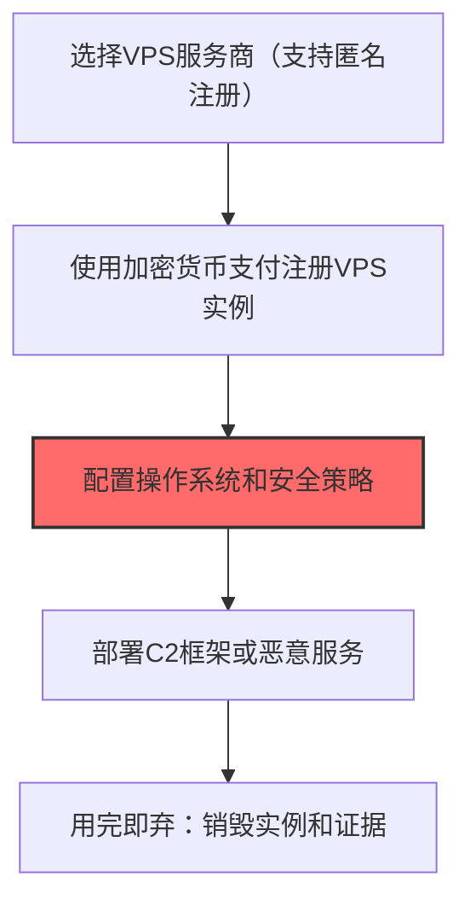

# 虚拟专用服务器(VPS) (T1583.003)

## 一句话通俗理解

> **租一台云服务器，用完就扔，不留痕迹**

## 30秒速查卡

| 项目 | 内容 |
|------|------|
| 攻击目标 | 租用云VPS部署攻击基础设施 |
| 典型手法 | 购买匿名VPS用于托管C2和恶意软件 |
| 关键检测点 | 监控VPS异常部署和新服务器的网络连接 |
| 难度等级 | ⭐⭐ |

## 难度等级

⭐⭐ 中级 - 需要一定的技术基础和经验

## 前置知识检查

**读这个文件需要什么？**

- [ ] 恶意软件开发流程基础
- [ ] C2基础设施概念
- [ ] 数字证书与代码签名基本原理

## 技术描述

**虚拟专用服务器(VPS)**（T1583.003）是 **获取基础设施**（T1583）的一个具体变体，属于 **资源开发** 阶段的攻击技术。

> 🎭 **打个比方**：就像骗子先买个虚拟号码来发诈骗短信——攻击者租用服务器也是为了让溯源更难。

### 具体怎么理解？

租一台云服务器，用完就扔，不留痕迹

攻击者使用这种技术时，通常是在资源开发阶段，想要达到特定的攻击目标。与父技术 T1583 相比，T1583.003 有自己独特的特点和使用场景。

### 为什么有效？

这种技术之所以有效，是因为：
1. **隐蔽性**：利用了正常系统功能或常见协议，不容易被发现
2. **技术门槛适中**：不需要特别高深的技术知识就能实施

**过渡段：** 不要以为资源开发只是'写恶意软件'——这是建立整个攻击作战体系的过程。
3. **广泛适用**：可以在多种环境和系统中使用

## 真实攻击流程



**步骤详解：**

1. **选择VPS服务商** - 攻击者选择支持匿名注册的VPS提供商，优先考虑隐私保护较好的服务商
2. **匿名注册实例** - 使用加密货币（比特币、门罗币）支付，使用虚假身份信息注册VPS实例
3. **配置运行环境** - 安装操作系统并配置安全策略，关闭不必要的端口，设置防火墙规则
4. **部署恶意服务** - 安装C2框架（Cobalt Strike、Metasploit）或恶意软件分发服务，这是核心攻击设施
5. **销毁证据** - 完成攻击任务后删除VPS实例，销毁所有操作痕迹，实现用完即弃

### 典型场景

攻击者在 **资源开发** 阶段使用 虚拟专用服务器(VPS) 技术，以下是典型的攻击步骤：

## 攻击流程

```
服务商筛选 --> 匿名采购 --> 环境加固 --> C2部署
```


**步骤详解：**
1. **服务商筛选** - 选择支持加密货币支付且隐私政策宽松的VPS提供商 | 评估日志保留策略、抗传票能力、地理位置 | Abacus、Njalla、Vultr、Shinjiru
2. **匿名采购** - 使用加密货币和虚拟身份完成VPS实例购买 | 通过Tor网络注册账户，使用Monero/XMR支付增强匿名性 | Monero钱包、ProtonMail、虚假KYC
3. **环境加固** - 配置操作系统安全策略降低被检测风险 | 禁用SSH密码登录、配置iptables白名单、清理命令历史 | SSH key、fail2ban、iptables
4. **C2部署** - 在VPS上部署命令控制框架和重定向器 | 安装Cobalt Strike团队服务器或自建C2，配置Malleable C2 profile | Cobalt Strike、Sliver、Havoc、Mythic

## 真实案例

### 案例1：APT29 -- 入侵合法网站植入Javascript脚本收集凭证（2020-2021）

- **时间**: 2020-2021年
- **目标**: 全球范围内的企业和政府机构
- **攻击组织**: APT29
- **手法**: 入侵合法网站植入Javascript脚本收集凭证
- **影响**: 数据窃取、横向移动、勒索或长期潜伏
- **参考链接**: CISA

### 案例2：DarkHotel -- 通过水坑攻击感染目标常访问的合法站点（2014-2018）

- **时间**: 2014-2018年
- **目标**: 全球范围内的企业和政府机构
- **攻击组织**: DarkHotel
- **手法**: 通过水坑攻击感染目标常访问的合法站点
- **影响**: 凭证窃取、横向移动、数据窃取
- **参考链接**: Kaspersky

## 红队视角

> ⚠️ **免责声明**：以下内容仅用于合法的安全测试、渗透测试和教育目的。未经授权对他人系统进行测试是违法行为。

### 实战技巧

1. **深入理解原理**：在实战应用前，充分理解虚拟专用服务器(VPS)的技术原理和适用场景
2. **环境适配**：根据目标系统的操作系统版本、安全配置等因素调整攻击策略
3. **组合使用**：将该技术与其他技术组合使用，构建完整的攻击链
4. **隐蔽性考虑**：注意操作痕迹的清理，避免被安全设备检测

### 常用工具

| 工具名称 | 用途 | 平台 | 链接 |
| -------- | ---- | ---- | ---- |
| 工具名称 | 用途 | 平台 | 链接 |
|----------|------|------|------|
| Whois | 域名注册信息查询 | 全平台 | [Whois](https://www.whois.com/) |
| GoDaddy/Namecheap | 域名注册 | Web | [GoDaddy](https://www.godaddy.com/) |
| Let's Encrypt | 免费SSL | Web | [Let's Encrypt](https://letsencrypt.org/) |
| Cloudflare | CDN/隐藏源IP | Web | [Cloudflare](https://www.cloudflare.com/) |

### 注意事项

- 在授权的测试环境中使用这些技术
- 注意操作安全（OPSEC），避免被检测系统发现
- 使用匿名化技术和代理隐藏真实身份

## 蓝队视角

### 检测要点

1. **系统日志监控**：关注与虚拟专用服务器(VPS)相关的系统日志和审计记录
2. **异常行为检测**：监控系统中与该技术相关的异常进程、网络连接和文件操作
3. **工具特征识别**：识别攻击者可能使用的工具在系统中的运行特征

### 监控建议

- 部署端点检测和响应（EDR）系统，监控与虚拟专用服务器(VPS)相关的异常行为
- 配置SIEM规则，关联分析来自多个来源的告警
- 定期进行安全评估和渗透测试，验证检测规则的有效性

## 避坑指南

关键误区：认为资源开发只是技术工作。

## 检测建议

### 检测思路

检测 虚拟专用服务器(VPS) 的关键是识别异常行为模式。以下是三个层面的检测方法：

### 网络层检测

**方法**：监控网络流量中的异常模式

```bash
# 检测异常的网络连接和数据传输
# 根据具体协议和端口设置检测规则
```

### 主机层检测

**Windows事件ID**：
- 事件ID 4688：进程创建（监控可疑进程）
- 事件ID 4104：PowerShell执行（监控可疑脚本）

**Linux日志**：
- /var/log/auth.log：认证日志
- /var/log/syslog：系统日志

```bash
# 检测异常进程和命令执行
grep -i "suspicious" /var/log/auth.log
```

### 应用层检测


**用人话说：**资源开发检测重点是发现攻击基础设施的建设痕迹——短期内大量域名注册、证书申请或代码仓库创建都是危险信号。
## 用人话说

> **检测解读**：租用VPS就像"租房作案"——用完就扔，难以追踪。监控云服务商的异常账户创建和资源部署是关键。
>
> **避坑指南**：很多云服务商提供免费试用期，攻击者利用这个窗口期作案。关注短时间内大量创建和销毁实例的行为。

**Sigma规则示例**：

```yaml
title: 检测虚拟专用服务器(VPS)
status: experimental
description: 检测可能的虚拟专用服务器(VPS)活动
logsource:
    category: process_creation
    product: windows
detection:
    selection:
        EventID: 4688
    condition: selection
level: medium
tags:
    - attack.T1583003
```

## 缓解措施

### 优先级1：关键措施

**限制攻击面**：减少暴露的服务和端口，降低被利用的风险

```bash
# 防火墙规则示例：只允许必要的出站连接
iptables -A OUTPUT -p tcp --dport 443 -j ACCEPT  # 允许HTTPS
iptables -A OUTPUT -p tcp --dport 80 -j ACCEPT   # 允许HTTP
iptables -A OUTPUT -p tcp -j DROP                 # 阻止其他TCP
```

### 优先级2：重要措施

**加强监控**：部署EDR和SIEM系统，实时监控异常行为

### 优先级3：建议措施

**安全意识培训**：教育员工识别相关攻击手法

## 动手实验

> ⚠️ **所有实验必须在隔离的实验室环境中进行**

### 实验1：理解基本原理（初级）

**目标**：理解 虚拟专用服务器(VPS) 的工作原理

**步骤**：
1. 在隔离环境中搭建测试系统
2. 使用基础工具模拟攻击行为
3. 观察系统日志和网络流量

**学习要点**：理解该技术的核心机制

### 实验2：实际操作（中级）

**目标**：掌握 虚拟专用服务器(VPS) 的实际使用方法

**步骤**：
1. 使用专业工具进行攻击模拟
2. 尝试不同的绕过技术
3. 分析检测日志的特征

**学习要点**：掌握工具使用和日志分析

### 实验3：防御验证（高级）

**目标**：验证检测规则的有效性

**步骤**：
1. 部署检测规则
2. 执行攻击模拟
3. 验证检测告警是否触发

**学习要点**：理解攻防对抗的实际效果

## 术语解释

| 术语 | 通俗解释 |
|------|---------|
| **ATT&CK** | MITRE公司维护的攻击技术知识库，像一本"黑客手法百科全书" |
| **虚拟专用服务器(VPS)** | T1583.003，ATT&CK框架中定义的一种具体攻击技术 |
| **获取基础设施** | T1583，虚拟专用服务器(VPS)所属的父技术类别 |
| **资源开发** | 攻击链中的一个阶段，攻击者在这个阶段的目标 |
| **C2** | 命令与控制，攻击者用来远程控制被入侵系统的"遥控器" |
| **EDR** | 端点检测与响应，部署在电脑上的安全监控软件 |

## 被引用情况

以下父技术文档引用了本子技术：

- [T1583 - 获取基础设施](../T1583-Acquire-Infrastructure.md)

## 参考资料

### 📚 官方文档（深入了解）

- [MITRE ATT&CK - 虚拟专用服务器(VPS) (T1583.003)](https://attack.mitre.org/techniques/T1583/003/)
- [MITRE ATT&CK - 获取基础设施 (T1583)](https://attack.mitre.org/techniques/T1583/)

### 📰 安全报告（真实攻击）

- [MITRE ATT&CK 官方文档](https://attack.mitre.org/) - ATT&CK 框架官方资源

### 🔧 工具与资源（动手试试）

- [Atomic Red Team](https://github.com/redcanaryco/atomic-red-team) - 检测规则测试框架
- [MITRE ATT&CK Navigator](https://mitre-attack.github.io/attack-navigator/) - ATT&CK 可视化工具

### 📚 学习资料（深入了解）

- [MITRE ATT&CK 知识库](https://attack.mitre.org/resources/) - ATT&CK 官方资源中心
