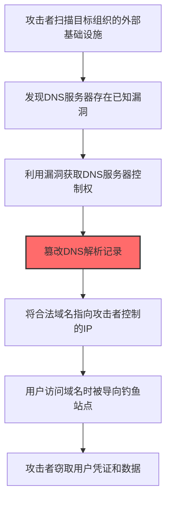
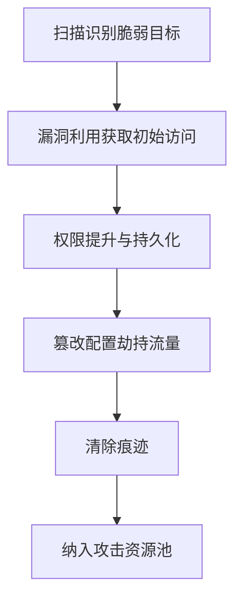

# 损害基础设施 (T1584)

## 一句话通俗理解

> **入侵别人已经建好的服务器、域名、DNS等基础设施，白嫖来用**

## 30秒速查卡

| 维度 | 你需要知道的 |
|------|-------------|
| 这是什么？ | 攻击者通过漏洞利用、暴力破解等手段，入侵合法组织已有的域名、DNS服务器、VPS、Web服务等基础设施，将其变为攻击跳板 |
| 为什么危险？ | 被入侵的基础设施带有合法身份，安全防护难以区分正常流量与恶意流量；且攻击者无需花钱购买，成本低、隐蔽性强 |
| 谁需要关心？ | 域名管理员、DNS运维、云服务管理员、Web服务运维、网络设备管理员 |
| 你的第一步防御 | 监控域名注册商账户的异常登录、DNS解析记录的未授权变更 |
| 如果只做一件事 | 对所有面向公网的基础设施（DNS、Web、邮件服务器）启用多因素认证（MFA）并监控配置变更 |

## 难度等级

⭐⭐⭐ 高级 - 需要漏洞利用、网络协议和系统入侵的扎实基础

## 前置知识检查

**读这个文件需要什么？**

- [ ] 域名系统（DNS）工作原理：A记录、NS记录、MX记录分别干什么
- [ ] VPS/云服务器的基本概念和远程管理方式（SSH/RDP）
- [ ] Web服务架构：CDN、负载均衡、反向代理
- [ ] 网络设备（路由器、防火墙）的基本配置方式

## 技术描述

**损害基础设施**（T1584）是 **资源开发**（TA0042）战术下的父技术。与 [T1583 获取基础设施](T1583-Acquire-Infrastructure.md)（花钱买/租/建）不同，T1584 是**入侵别人已有的基础设施**——偷来用。

> 📡 **打个比方**：T1583 是你自己花钱租一间办公室搞诈骗；T1584 是你撬锁闯进别人的办公室，用他的电话、他的地址寄诈骗信。出了事警察先找办公室主人，不是你。

### 具体怎么理解？

攻击者在资源开发阶段，通过以下方式入侵合法组织的基础设施：

1. **漏洞利用**：利用未修补的CVE漏洞入侵Web服务器、DNS服务器、路由器
2. **凭证窃取**：通过钓鱼、暴力破解获取域名注册商、云平台的管理凭证
3. **供应链攻击**：通过 compromised 的软件更新或第三方服务渗透目标基础设施
4. **社工接管**：通过伪造身份联系域名注册商，骗取域名控制权

入侵成功后，这些基础设施带有合法的IP声誉、域名信誉和SSL证书，攻击者的恶意流量混在正常流量中，极难被安全设备识别。

### 为什么有效？

1. **合法外衣**：被入侵的基础设施拥有合法域名、IP声誉和SSL证书，黑名单和威胁情报难以覆盖
2. **成本极低**：不需要花钱购买域名、租用服务器——偷比买便宜
3. **溯源困难**：攻击流量来自合法组织的IP，调查者会先找受害者而非攻击者
4. **信任链利用**：CDN、云服务、第三方Web服务的信任关系会被攻击者利用，绕过目标的安全策略

**过渡段：** 不要以为损害基础设施只是"黑掉一台服务器"——攻击者可以劫持一个域名、一台DNS服务器甚至一个无服务器函数，将这些合法资源编织成完整的攻击链。

## 真实攻击流程



**步骤详解：**

1. **侦察目标基础设施** - 攻击者通过OSINT和扫描，识别目标组织使用的域名、DNS服务器、Web服务版本信息
2. **漏洞利用** - 利用DNS软件（如BIND）或Web服务（如Apache/Nginx）的已知漏洞获取初始访问权限
3. **权限提升与持久化** - 在被入侵服务器上提权，植入后门维持访问
4. **篡改配置** - 修改DNS解析记录、Web服务配置或CDN设置，将合法流量重定向到攻击者控制的资源
5. **隐蔽利用** - 利用被入侵基础设施的合法身份发动后续攻击（钓鱼、C2通信、恶意软件分发）

## 攻击流程

### 典型攻击流程

```
扫描识别脆弱目标 --> 漏洞利用获取初始访问 --> 权限提升与持久化 --> 篡改配置劫持流量 --> 清除痕迹 --> 纳入攻击资源池
```



**步骤详解：**

1. **扫描识别脆弱目标**
   - 通俗描述：在互联网上"扫街"，找那些老旧没打补丁的DNS服务器、Web服务器或路由器，它们就是"破窗入室"的窗口
   - 技术细节：通过Shodan/Censys检索特定软件版本指纹（如旧版BIND、Apache、Outdated Router OS），交叉比对CVE库识别可利用漏洞；优先选择安全监管薄弱的"子弹托管"区域或供应链上下游节点
   - 常用工具：Shodan、Censys、Nmap、ZoomEye

2. **漏洞利用获取初始访问**
   - 通俗描述：拿着找到的漏洞"撬锁"进到目标服务器里，比如利用DNS软件RCE漏洞或Web应用注入漏洞
   - 技术细节：针对服务指纹匹配对应CVE的公开/私有EXP；针对DNS服务器利用TSIG密钥爆破、递归查询滥用；针对Web服务器利用反序列化、SSRF、未授权管理面板；必要时通过供应链攻击（如软件更新劫持）间接控制基础设施
   - 常用工具：Metasploit、CVE-2018-0101（Cisco ASA）PoC、DNS takeover工具（subjack、subzy）

3. **权限提升与持久化**
   - 通俗描述：进屋之后先把"门锁"换成自己能开的，再配一把备用钥匙藏在角落，方便以后随时进出
   - 技术细节：利用内核提权漏洞（如Dirty COW、Dirty Pipe）从普通用户升至root；植入Webshell、cron任务、systemd服务、SSH authorized_keys后门；在DNS服务器上植入恶意zone文件或修改named.conf；在路由器上刷入定制固件
   - 常用工具：linpeas、linux-exploit-suggester、Webshell（冰蝎、哥斯拉）、Pupy RAT

4. **篡改配置劫持流量**
   - 通俗描述：偷偷改掉"路标"，让原本要去找正主的访客都被引到攻击者这边来
   - 技术细节：修改DNS A记录/CNAME将目标域名解析指向攻击者IP（DNS劫持）；篡改CDN源站配置将静态资源替换为恶意JS；在Nginx/Apache配置中插入反向代理规则将特定路径流量转发至C2；植入中间人证书实现SSL解密
   - 常用工具：直接编辑 named.conf/nginx.conf、CDN管理面板（被盗凭证登录）、Resolvconf

5. **清除痕迹**
   - 通俗描述：擦掉指纹、清掉监控录像，让管理员看不出基础设施被动过手脚
   - 技术细节：清理 /var/log 下的auth、syslog、access日志；禁用或降级auditd、osquery等审计组件；通过 `history -c`、logrotate篡改、rootkit隐藏进程与网络连接；修改文件时间戳（touch -t）掩盖篡改行为
   - 常用工具：logrotate、logtamper、自查型rootkit（Reptile、Diamorphine）

6. **纳入攻击资源池**
   - 通俗描述：把"拿下"的合法服务器编入攻击者的作战序列，作为C2跳板、钓鱼落地页或恶意软件分发节点
   - 技术细节：将被控基础设施注册到内部C2调度系统；利用合法域名信誉绕过URL过滤、邮件SPF/DKIM校验；通过 compromised 路由器实施BGP劫持扩大影响范围；建立轮换机制，单个节点暴露后快速切换备用节点
   - 常用工具：Cobalt Strike（C2调度）、自研bot master、BGP hijack脚本

## 真实案例

### 案例1：APT29（Cozy Bear）利用SolarWinds供应链攻击入侵Orion平台

- **时间**：2020年
- **目标**：SolarWinds客户（包括美国政府机构、Fortune 500企业）
- **攻击组织**：APT29（俄罗斯对外情报局SVR背景）
- **手法**：APT29通过 compromised 的SolarWinds Orion软件更新，入侵了多达18,000个客户的IT基础设施。攻击者不仅控制了Orion平台本身，还通过它进一步入侵了受害者的Active Directory、邮件服务器和云服务，将这些合法基础设施作为C2通信和横向移动的跳板
- **影响**：美国国务院、财政部、商务部等多个联邦机构遭到渗透，被认为是史上最严重的供应链攻击之一
- **参考链接**：[CISA Alert AA21-131A](https://www.cisa.gov/news-events/cybersecurity-advisories/aa21-131a)

### 案例2：Sea Turtle（海龟组织）劫持DNS基础设施

- **时间**：2017-2019年
- **目标**：中东和北非的政府机构、情报组织、能源公司
- **攻击组织**：Sea Turtle（疑似伊朗背景）
- **手法**：攻击者通过钓鱼和凭证窃取，入侵了多个国家的域名注册商和DNS服务商。然后篡改DNS解析记录，将目标组织的合法域名指向攻击者控制的仿冒服务器，实施中间人攻击截获用户凭证
- **影响**：至少40个组织遭到DNS劫持攻击，包括国家情报机构和外交部
- **参考链接**：[Talos Sea Turtle Report](https://blog.talosintelligence.com/2019/04/seaturtle.html)

### 案例3：Mirai僵尸网络劫持IoT设备

- **时间**：2016年
- **目标**：全球IoT设备（摄像头、路由器、DVR）
- **攻击组织**：Mirai僵尸网络运营者
- **手法**：通过默认密码和已知漏洞，大规模入侵IoT设备组建僵尸网络。这些被入侵的网络设备（合法基础设施）被用于发动针对Dyn DNS的DDoS攻击，导致Twitter、Netflix、GitHub等主流服务大面积中断
- **影响**：史上最大规模DDoS攻击之一，峰值流量达1.2 Tbps，美国东海岸大面积网络瘫痪
- **参考链接**：[Krebs on Security - Mirai Analysis](https://krebsonsecurity.com/2016/10/source-code-for-iot-botnet-mirai-released/)

## 子技术列表

| 子技术ID | 中文名称 | 通俗解释 |
|----------|----------|----------|
| T1584.001 | Domains | 劫持别人的域名，把流量导到自己的恶意服务器 |
| T1584.002 | DNS Server | 入侵DNS服务器，篡改解析记录 |
| T1584.003 | Virtual Private Server | 入侵别人的VPS当跳板 |
| T1584.004 | Server | 入侵合法网站服务器托管恶意内容 |
| T1584.005 | Botnet | 控制已有的僵尸网络为己所用 |
| T1584.006 | Web Services | 入侵第三方Web服务用于恶意目的 |
| T1584.007 | Serverless | 入侵无服务器平台托管恶意函数 |
| T1584.008 | Network Devices | 入侵路由器、防火墙等网络设备 |

## 红队视角

> ⚠️ **免责声明**：以下内容仅用于合法的安全测试、渗透测试和教育目的。未经授权对他人系统进行测试是违法行为。

### 实战技巧

1. **域名接管检测**：检查目标组织子域名的DNS CNAME是否指向已失效的云服务（如过期的S3桶、Heroku应用），可实施子域名接管
2. **DNS劫持测试**：在授权测试中，验证DNS服务器的访问控制和变更监控是否到位
3. **CDN绕过**：通过历史DNS记录、SSL证书透明度日志发现目标真实IP，绕过CDN防护

### 常用工具

| 工具名称 | 用途 | 说明 |
| -------- | ---- | ---- |
| Subfinder | 子域名发现 | 通过多个公开数据源枚举子域名，发现可接管目标 |
| subjack | 子域名接管检测 | 自动检测可被接管的子域名（CNAME指向失效服务） |
| Fierce | DNS枚举 | DNS区域传送尝试和子域名爆破 |
| dnstwist | 域名仿冒检测 | 检测与目标域名相似的仿冒域名（同形异义字、typosquatting） |

### 注意事项

- 在授权的测试环境中使用这些技术
- 域名接管测试后必须清理CNAME记录，避免被真实攻击者利用
- DNS枚举会产生大量查询，注意避开目标WAF和DNS防火墙

## 蓝队视角

### 检测要点

1. **DNS监控**：关注A记录、NS记录、MX记录的未授权变更，启用DNS区域传送限制
2. **域名注册商监控**：监控Whois信息变更、注册商账户异常登录、域名转移请求
3. **基础设施配置变更**：对服务器、网络设备、云服务的配置文件启用版本控制和变更告警

### 监控建议

- 部署DNS监控工具（如PassiveDNS），记录所有DNS解析变更
- 对域名注册商账户启用MFA，并监控异常登录行为
- 使用证书透明度日志（如crt.sh）监控目标域名的新SSL证书签发

## 避坑指南

防御者最常犯的错误：**只监控生产服务器，忽略DNS和域名注册商的安全**。域名劫持不需要入侵你的服务器——只要骗过域名注册商的客服，就能把你的域名指向攻击者的IP。必须将域名注册商账户、DNS管理控制台纳入安全监控范围，与服务器同等对待。

## 检测建议

### 检测思路

检测损害基础设施的关键是建立基线——知道"正常情况下，DNS记录、服务器配置、网络设备应该长什么样"，任何偏离基线的变更都值得调查。

### 网络层检测

**方法**：监控DNS解析异常和出站流量模式

```bash
# 检测DNS解析记录异常变更：对比当前解析与历史基线
# 使用diff比对每日DNS快照
diff yesterday_dns_records.txt today_dns_records.txt

# 检测指向可疑IP的A记录（新出现的解析记录）
# PassiveDNS查询：最近7天新增的A记录
grep "first_seen:2026-07" passivedns.log | awk '{print $3, $5}'
```

### 主机层检测

**用人话说：** 这条规则在检测损害基础设施——攻击者入侵你的DNS服务器或Web服务器后，会修改配置文件来劫持流量。关键信号是：DNS服务配置文件（如named.conf、zone文件）被非授权修改、Web服务器配置（如nginx.conf、httpd.conf）出现异常的proxy_pass或rewrite规则、或者域名注册商账户出现异地登录。

**Sigma规则示例**：

```yaml
title: 检测DNS配置文件未授权修改
status: experimental
description: 检测DNS服务器配置文件的未授权修改，可能是DNS劫持攻击
logsource:
    category: file_event
    product: linux
detection:
    selection:
        TargetFilename|endswith:
            - '/etc/named.conf'
            - '/etc/bind/named.conf'
            - '/var/named/*.zone'
            - '/etc/bind/*.zone'
    filter:
        User|contains:
            - 'named'
            - 'bind'
            - 'root'
    condition: selection and not filter
level: high
tags:
    - attack.t1584
    - attack.t1584.002
    - attack.resource_development
```

### 应用层检测

**方法**：监控域名注册商API调用和Web服务管理后台操作

```bash
# 检测域名Whois信息异常变更
# 使用whois XML API定期检查域名注册信息
whois example.com | grep -E "Registrar|Updated|Name Server"

# 检测CDN/WAF配置变更（以Cloudflare为例）
# 通过API获取配置快照并对比
curl -X GET "https://api.cloudflare.com/client/v4/zones/{zone_id}/dns_records" \
  -H "Authorization: Bearer {token}" | jq '.result' > current_dns.json
diff baseline_dns.json current_dns.json
```

## 缓解措施

### 优先级1：关键措施

**域名与DNS安全**：对域名注册商账户启用MFA，锁定域名防止未授权转移，启用DNSSEC

```bash
# 检查域名是否启用DNSSEC
dig +dnssec example.com +short

# 检查域名锁定状态（registrarLock/clientTransferProhibited）
whois example.com | grep -i "status"
```

### 优先级2：重要措施

**基础设施配置管理**：对所有基础设施配置启用版本控制，任何变更必须通过审批流程

### 优先级3：建议措施

**第三方服务监控**：监控CDN、云DNS、Web服务的API调用日志，及时发现异常操作

## 动手实验

> ⚠️ **所有实验必须在隔离的实验室环境中进行**

### 实验1：理解DNS劫持原理（初级）

**目标**：理解DNS记录篡改如何影响流量走向

**步骤**：
1. 在本地搭建BIND DNS服务器
2. 修改zone文件中的A记录，将域名指向不同IP
3. 用dig命令观察解析结果变化

**预期输出**：
```
$ dig test.example.com @localhost +short
192.168.1.100   # 修改前
$ dig test.example.com @localhost +short
10.0.0.50       # 修改后，流量被重定向
```

### 实验2：子域名接管检测（中级）

**目标**：掌握子域名接管漏洞的发现方法

**步骤**：
1. 使用subfinder枚举目标域名（授权测试）的子域名
2. 检查每个子域名的CNAME记录
3. 识别指向失效云服务的CNAME（如herokuapp.com、s3.amazonaws.com的失效实例）

**学习要点**：理解CNAME悬垂引用如何导致子域名接管

### 实验3：防御验证（高级）

**目标**：验证DNS变更监控的有效性

**步骤**：
1. 部署DNS配置文件监控脚本（基于auditd或filebeat）
2. 模拟攻击者修改zone文件
3. 验证监控告警是否及时触发

**学习要点**：掌握DNS安全监控的落地方法

## 术语解释

| 术语 | 通俗解释 |
|------|---------|
| **ATT&CK** | MITRE公司维护的攻击技术知识库，像一本"黑客手法百科全书" |
| **损害基础设施** | T1584，入侵别人已有的基础设施（域名、服务器、DNS等）为己所用 |
| **获取基础设施** | T1583，与T1584对比——T1583是花钱买/租/建，T1584是偷/抢 |
| **DNS劫持** | 篡改DNS解析记录，把用户引导到错误的IP地址 |
| **子域名接管** | 利用CNAME指向已失效的云服务，注册该云服务实例接管子域名 |
| **CDN** | 内容分发网络，加速网站访问——攻击者入侵CDN可影响所有用户 |

## 被引用情况

本技术作为资源开发战术的核心父技术，被以下文档引用：

- [TA0042 - 资源开发](README.md)
- [T1583 - 获取基础设施](T1583-Acquire-Infrastructure.md)（对比技术）

## 参考资料

### 📚 官方文档（深入了解）

- [MITRE ATT&CK - Compromise Infrastructure (T1584)](https://attack.mitre.org/techniques/T1584/) - 官方技术定义
- [MITRE ATT&CK - Resource Development (TA0042)](https://attack.mitre.org/tactics/TA0042/) - 所属战术
- [MITRE ATT&CK Navigator](https://mitre-attack.github.io/attack-navigator/) - ATT&CK可视化工具

### 🔧 工具与资源（动手试试）

- [Subfinder](https://github.com/projectdiscovery/subfinder) - 子域名枚举工具
- [subjack](https://github.com/haccer/subjack) - 子域名接管检测工具
- [dnstwist](https://github.com/elceef/dnstwist) - 域名仿冒检测工具

### 📰 安全报告（真实攻击）

- [CISA Alert AA21-131A - SolarWinds Orion供应链攻击](https://www.cisa.gov/news-events/cybersecurity-advisories/aa21-131a) - APT29利用供应链攻击入侵基础设施
- [Cisco Talos - Sea Turtle DNS劫持分析](https://blog.talosintelligence.com/2019/04/seaturtle.html) - 国家级DNS基础设施攻击
- [Krebs on Security - Mirai分析](https://krebsonsecurity.com/2016/10/source-code-for-iot-botnet-mirai-released/) - IoT僵尸网络劫持基础设施
