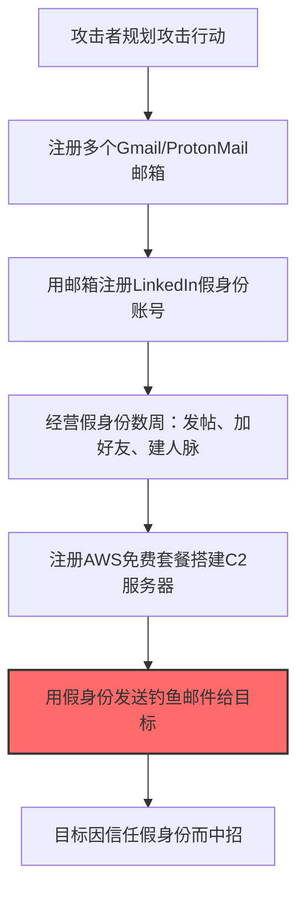
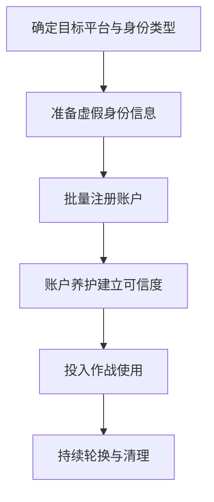

# 建立账户 (T1585)

## 一句话通俗理解

> **攻击者注册社交媒体、邮箱、云服务等账户，为自己的攻击行动搭建身份和资源**

## 30秒速查卡

| 维度 | 你需要知道的 |
|------|-------------|
| 这是什么？ | 攻击者用假身份在LinkedIn、Gmail、AWS等平台注册账户，为后续的钓鱼、C2通信、基础设施搭建做准备 |
| 为什么危险？ | 这些账户披着合法外衣，安全设备不会拦截来自Gmail或AWS的流量；攻击者可以长期潜伏和运营假身份 |
| 谁需要关心？ | 安全运营团队、反欺诈团队、云安全管理员、社交媒体安全团队 |
| 你的第一步防御 | 对云服务账户启用MFA，监控新注册API密钥的异常使用模式 |
| 如果只做一件事 | 监控云服务（AWS/Azure）新账户的API调用模式，识别自动化注册和异常资源创建 |

## 难度等级

⭐ 初级 - 只需能联网和注册邮箱即可操作

## 前置知识检查

**读这个文件需要什么？**

- [ ] 社交媒体OSINT基础：LinkedIn、Twitter上如何搜索和识别假账号
- [ ] 云服务计费模型：AWS/Azure的免费套餐和试用机制
- [ ] 邮箱验证流程：确认邮件、手机验证等反滥用机制

## 技术描述

**建立账户**（T1585）是 **资源开发**（TA0042）战术下的父技术。攻击者在攻击前的准备阶段，用虚假身份在公开服务平台注册账户，为后续攻击建立合法身份和资源基础。

> 📡 **打个比方**：就像诈骗犯先去办一张假身份证、开一个银行账户、注册一个微信号——这些"合法身份"让他在后续诈骗中不容易被怀疑。T1585就是攻击者办"假身份证"的过程。

### 具体怎么理解？

攻击者建立账户的典型场景：

1. **社交媒体账户**：在LinkedIn创建伪造的HR/猎头账号，添加目标员工为好友，建立信任后发送钓鱼链接
2. **邮箱账户**：批量注册Gmail/Outlook邮箱，用于发送钓鱼邮件或注册其他服务，避免使用真实身份
3. **云账户**：注册AWS/Azure/GCP的免费套餐账户，利用免费额度搭建C2服务器、钓鱼网站或存储恶意软件

与 [T1586 损害账户](T1586-Compromise-Accounts.md)（盗用已有账户）不同，T1585是**自己注册新账户**——合法注册、非法使用。

### 为什么有效？

1. **合法注册**：这些账户通过平台的正规注册流程创建，拥有合法身份，不会被默认拦截
2. **信任链利用**：来自Gmail、LinkedIn、AWS的流量天然受信任，安全设备不会轻易拦截
3. **免费资源**：多数平台提供免费套餐，攻击者零成本获取资源
4. **溯源困难**：注册信息为伪造，难以追溯至真实攻击者

**过渡段：** 不要以为建立账户只是"注册个邮箱"——攻击者会精心经营假身份数月甚至数年，在LinkedIn上发布行业内容、建立人脉网络，让目标员工完全相信这是一个真实同行。

## 真实攻击流程



**步骤详解：**

1. **注册基础邮箱** - 使用VPN和匿名身份在ProtonMail、Gmail等平台注册多个邮箱，作为后续注册其他服务的身份基础
2. **创建社交媒体身份** - 在LinkedIn、Twitter创建详细个人资料，包括工作经历、技能、头像（AI生成或盗用），建立可信的职业身份
3. **经营假身份** - 定期发布行业相关内容、添加目标组织员工为好友、参与讨论，建立数周至数月的信任关系
4. **搭建云基础设施** - 用注册的邮箱开通AWS/Azure免费套餐，创建EC2实例或Azure VM用于C2通信、钓鱼网站托管
5. **发起攻击** - 利用已建立的信任身份，发送钓鱼邮件或通过社交媒体私信诱导目标点击恶意链接

## 攻击流程

### 典型攻击流程

```
确定目标平台与身份类型 --> 准备虚假身份信息 --> 批量注册账户 --> 账户养护建立可信度 --> 投入作战使用 --> 持续轮换与清理
```



**步骤详解：**

1. **确定目标平台与身份类型**
   - 通俗描述：先想清楚要"装成谁"去"骗谁"——是冒充同行在LinkedIn上接近工程师，还是注册一批Gmail用于发钓鱼邮件
   - 技术细节：依据侦察阶段掌握的目标员工所属社交平台、邮件系统、云服务商、技术社区（GitHub/Stack Overflow），确定需要建立账号的平台清单与角色画像（猎头、同行、客户、技术专家）
   - 常用工具：无（基于侦察报告的平台选择）

2. **准备虚假身份信息**
   - 通俗描述：给"假人"造一份完整档案——名字、头像、工作履历、毕业院校，越像真人越好
   - 技术细节：使用合成头像（StyleGAN生成）避免反向图片搜索命中；虚构或盗用履历，与目标行业/地区匹配；准备一次性手机号用于短信验证；准备匿名邮箱接收注册确认；生成符合平台规则的虚拟身份（thispersondoesnotexist、fake-name-generator）
   - 常用工具：ThisPersonDoesNotExist、Fake Name Generator、receive-sms-online.io、pipedream

3. **批量注册账户**
   - 通俗描述：在选好的平台上把账号一个个开出来，注意绕过平台的反批量注册机制
   - 技术细节：使用住宅代理IP池分散注册来源，规避IP频次限制与ASN聚类检测；轮换设备指纹（User-Agent、Canvas、WebGL指纹）对抗无头浏览器检测；必要时人工半自动注册以通过行为验证（CAPTCHA、滑块）；对云账号使用盗刷的信用卡完成付费升级
   - 常用工具：Puppeteer/Playwright（自动化注册）、Bright Data（住宅代理）、2Captcha（验证码识别）

4. **账户养护建立可信度**
   - 通俗描述：新号"婴儿期"什么都不发，先养几个月——发帖子、加好友、点赞互动，让账号看起来像个真实活跃用户
   - 技术细节：模拟真实用户行为节奏（每日固定时段登录、渐进式增加互动）；建立社交图谱（与其他傀儡账号互关、加入行业群组）；发布与目标行业相关的内容、转发行业大V；积累足够的好友数和历史动态，让账号通过平台"年龄"与"信誉"校验
   - 常用工具：社交账号养护脚本（自研Selenium套件）、内容库（预制行业帖文）

5. **投入作战使用**
   - 通俗描述：账户"养肥"后开始执行真正的攻击任务——加好友、发私信、发钓鱼链接、冒充身份行骗
   - 技术细节：在LinkedIn上以猎头身份向目标员工发送带有恶意文档的"职位机会"；在Twitter/X上蹭行业话题投放带恶意链接的短链；在GitHub上以贡献者身份提交带后门的PR；邮件账户用于发送通过SPF/DKIM校验的钓鱼邮件
   - 常用工具：LinkedIn Sales Navigator、Twitter API、Gophish、EvilGinx

6. **持续轮换与清理**
   - 通俗描述：一旦某个账号被举报或暴露，立刻弃用换新号，保持"部队"始终有可用兵力
   - 技术细节：建立账户生命周期管理，监测账号是否被平台限流/封禁；准备备用账号池，被弃用账号的内容与好友关系迁移到新账号；定期清理与C2关联的注册手机号、邮箱、支付方式，切断溯源链路
   - 常用工具：自研账号管理系统、Hootsuite（多账号调度）

## 真实案例

### 案例1：APT29（Cozy Bear）利用LinkedIn假身份实施鱼叉式钓鱼

- **时间**：2019-2021年
- **目标**：美国政府机构、智库、国防承包商
- **攻击组织**：APT29（俄罗斯SVR背景）
- **手法**：APT29在LinkedIn上创建了多个伪造的学者和智库研究员账号，精心经营数月，发布学术内容和评论。随后通过LinkedIn私信和邮件，向目标发送伪装成学术会议邀请的钓鱼链接，诱导目标输入Microsoft 365凭证
- **影响**：成功入侵多个美国政府机构和智库的邮件系统
- **参考链接**：[Microsoft - Deep dive into NOBELIUM](https://www.microsoft.com/en-us/security/blog/2021/05/27/new-sophisticated-email-based-attack-from-nobelium/)

### 案例2：TA453（Charming Kitten）伪装记者实施钓鱼

- **时间**：2021-2022年
- **目标**：中东政策专家、学者、记者
- **攻击组织**：TA453（伊朗IRGC背景）
- **手法**：攻击者在LinkedIn和Twitter上创建伪造的记者和学者账号，声称来自英国智库Chatham House和环球时报。通过私信邀请目标参加虚假学术会议或采访，引导目标访问钓鱼网站输入Gmail/Outlook凭证
- **影响**：多个国际关系学者和政策专家的邮箱被入侵
- **参考链接**：[Proofpoint - TA453 Multi-Persona Impersonation](https://www.proofpoint.com/us/blog/threat-insight/ta453-uses-multi-persona-impersonation-exploit-high-value-targets)

### 案例3： cryptojacking团伙滥用AWS免费套餐挖矿

- **时间**：2021-2023年
- **目标**：AWS云平台
- **攻击组织**：多个加密劫持团伙（如TeamTNT）
- **手法**：攻击者批量注册AWS新账户，利用12个月免费套餐的750小时EC2运行时间，部署加密货币挖矿程序。当免费额度用尽后，丢弃旧账户、注册新账户继续挖矿
- **影响**：AWS官方报告显示，云滥用攻击中约30%涉及新注册账户的免费套餐滥用
- **参考链接**：[Sysdig 2023 Cloud Threat Report](https://sysdig.com/blog/cloud-security-threat-report-2023/)

## 子技术列表

| 子技术ID | 中文名称 | 通俗解释 |
|----------|----------|----------|
| T1585.001 | Social Media Accounts | 在LinkedIn、Facebook等平台创建假账号，经营假身份 |
| T1585.002 | Email Accounts | 注册Gmail、Outlook等邮箱，用于发送钓鱼邮件 |
| T1585.003 | Cloud Account | 注册AWS、Azure等云服务，用于搭建攻击基础设施 |

## 红队视角

> ⚠️ **免责声明**：以下内容仅用于合法的安全测试、渗透测试和教育目的。未经授权对他人系统进行测试是违法行为。

### 实战技巧

1. **假身份构建**：使用AI生成头像（ThisPersonDoesNotExist），配合虚构的简历和社交帖子，创建可信的LinkedIn身份
2. **信任建立**：先添加目标员工的同事为好友，再添加目标本人，降低被拒绝的概率
3. **多平台一致性**：在LinkedIn、Twitter、GitHub上创建同一假身份的关联账号，增强可信度

### 常用工具

| 工具名称 | 用途 | 说明 |
| -------- | ---- | ---- |
| ThisPersonDoesNotExist | AI头像生成 | 生成不存在的真实感人脸头像，用于假身份 |
| Hoaxy | 社交媒体假身份管理 | 管理多个假身份账号的发布和互动 |
| Temp Mail | 临时邮箱 | 用于批量注册服务，避免使用真实邮箱 |

### 注意事项

- 假身份运营需要长期投入，不能急于求成
- 注意注册时的IP和设备指纹，避免被平台风控识别
- 使用专门的浏览器指纹隔离工具（如Multilogin）管理多个身份

## 蓝队视角

### 检测要点

1. **社交媒体异常**：关注新创建的LinkedIn/Twitter账号突然与多个员工建立联系
2. **云账户滥用**：监控AWS/Azure新账户的API调用模式——批量创建EC2实例、异常区域部署
3. **邮箱信誉**：对来自新注册邮箱（注册时间<30天）的邮件提高风险评分

### 监控建议

- 使用LinkedIn Sales Navigator或第三方工具监控组织员工的LinkedIn好友新增情况
- 部署CASB（云访问安全代理）监控云服务的异常账户行为
- 配置邮件网关对新注册域名和邮箱发件人实施额外验证

## 避坑指南

防御者最常犯的错误：**只关注已被入侵的账户，忽略新注册的可疑账户**。攻击者的假账户通过正规注册流程创建，不会触发"账户被盗"的告警。必须建立新账户行为基线——如果一个LinkedIn新账号在3天内添加了20个同组织员工为好友，这本身就是异常信号。

## 检测建议

### 检测思路

检测建立账户的关键是识别"注册行为异常"和"使用模式异常"——合法用户的注册和使用是渐进式的，攻击者的注册和使用往往是批量化和即时化的。

### 网络层检测

**方法**：监控对云服务API和社交媒体平台的异常请求模式

```bash
# 检测云服务API异常调用（AWS CloudTrail日志）
# 识别新账户在短时间内创建大量资源
aws cloudtrail lookup-events --lookup-attributes AttributeKey=EventName,AttributeValue=RunInstances \
  --start-time 2026-07-01T00:00:00Z --end-time 2026-07-10T23:59:59Z \
  | jq '.Events[] | {time: .EventTime, user: .Username, ip: .CloudTrailEvent.sourceIPAddress}'

# 检测社交媒体平台批量注册（Web日志）
# 同一IP在短时间内注册多个账户
awk '{print $1}' access.log | sort | uniq -c | sort -rn | head -20
```

### 应用层检测

**用人话说：** 这条规则在检测建立账户——攻击者注册假账户时有两个关键信号：一是注册速度异常，一个新注册的LinkedIn账号在24小时内发送50个好友请求，正常人做不到；二是使用模式异常，新注册的AWS账户立刻创建10个EC2实例且都运行未知镜像，这不像正常试用。检测的关键是对比新账户的行为与正常用户的行为基线。

**Sigma规则示例**：

```yaml
title: 检测AWS新账户异常资源创建
status: experimental
description: 新创建的AWS账户在24小时内创建大量EC2实例，可能是攻击者滥用免费套餐
logsource:
    category: cloudtrail
    service: ec2
detection:
    selection:
        eventName: 'RunInstances'
    timeframe: 24h
    condition: selection | count() by userIdentity.arn > 5
level: medium
tags:
    - attack.t1585
    - attack.t1585.003
    - attack.resource_development
```

## 缓解措施

### 优先级1：关键措施

**云服务账户加固**：对新注册云账户实施延迟激活、信用卡验证和资源配额限制

### 优先级2：重要措施

**社交媒体监控**：定期检查组织员工的社交媒体好友列表，识别可疑的新增联系人

### 优先级3：建议措施

**邮件信誉评分**：对来自新注册域名和邮箱（注册时间<30天）的邮件实施额外验证和延迟投递

## 动手实验

> ⚠️ **所有实验必须在隔离的实验室环境中进行**

### 实验1：理解假身份构建（初级）

**目标**：理解攻击者如何构建可信的假身份

**步骤**：
1. 分析一个公开披露的APT假身份案例（如APT29的LinkedIn账号）
2. 列出该假身份的可信元素（工作经历、人脉、发帖内容）和可疑元素
3. 总结识别假身份的关键指标

**学习要点**：理解假身份的可信度构建逻辑

### 实验2：云账户行为基线（中级）

**目标**：建立云服务新账户的正常行为基线

**步骤**：
1. 在AWS创建测试账户，记录正常使用模式
2. 对比正常使用与攻击者滥用模式的差异（API调用频率、资源创建类型、区域分布）
3. 编写检测规则识别异常模式

**学习要点**：掌握云服务行为分析检测方法

## 术语解释

| 术语 | 通俗解释 |
|------|---------|
| **ATT&CK** | MITRE公司维护的攻击技术知识库，像一本"黑客手法百科全书" |
| **建立账户** | T1585，攻击者用假身份注册社交媒体、邮箱、云服务等公开平台账户 |
| **损害账户** | T1586，与T1585对比——T1585是自己注册新账户，T1586是盗用已有账户 |
| **OSINT** | 开源情报，通过公开渠道收集信息 |
| **C2** | 命令与控制，攻击者用来远程控制被入侵系统的"遥控器" |
| **CASB** | 云访问安全代理，监控和管理云服务使用安全 |

## 被引用情况

本技术作为资源开发战术的核心父技术，被以下文档引用：

- [TA0042 - 资源开发](README.md)
- [T1586 - 损害账户](T1586-Compromise-Accounts.md)（对比技术）

## 参考资料

### 📚 官方文档（深入了解）

- [MITRE ATT&CK - Establish Accounts (T1585)](https://attack.mitre.org/techniques/T1585/) - 官方技术定义
- [MITRE ATT&CK - Resource Development (TA0042)](https://attack.mitre.org/tactics/TA0042/) - 所属战术

### 🔧 工具与资源（动手试试）

- [ThisPersonDoesNotExist](https://thispersondoesnotexist.com/) - AI生成假头像
- [HaveIBeenPwned](https://haveibeenpwned.com/) - 检查邮箱是否在数据泄露中

### 📰 安全报告（真实攻击）

- [Microsoft - NOBELIUM LinkedIn钓鱼分析](https://www.microsoft.com/en-us/security/blog/2021/05/27/new-sophisticated-email-based-attack-from-nobelium/) - APT29假身份钓鱼
- [Proofpoint - TA453多身份伪装](https://www.proofpoint.com/us/blog/threat-insight/ta453-uses-multi-persona-impersonation-exploit-high-value-targets) - 伊朗APT假记者钓鱼
- [Sysdig 2023云威胁报告](https://sysdig.com/blog/cloud-security-threat-report-2023/) - 云账户滥用统计
