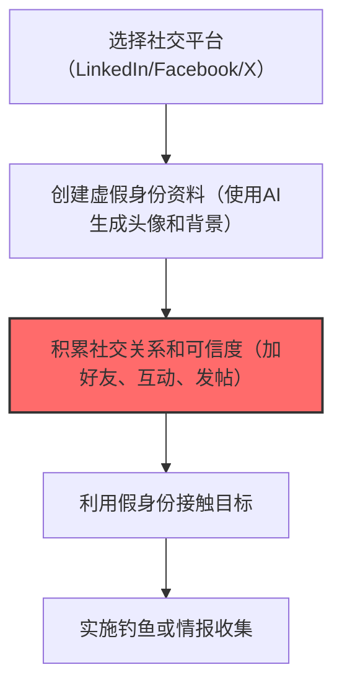

# 社交媒体账户 (T1585.001)

## 一句话通俗理解

> **在LinkedIn、Facebook等平台创建假账号，经营假身份**

## 30秒速查卡

| 项目 | 内容 |
|------|------|
| 攻击目标 | 注册社交媒体假账号 |
| 典型手法 | 在LinkedIn、Facebook等创建虚假身份 |
| 关键检测点 | 监控批量社交媒体账户创建和异常活跃模式 |
| 难度等级 | ⭐⭐ |

## 难度等级

⭐⭐ 中级 - 需要一定的技术基础和经验

## 前置知识检查

**读这个文件需要什么？**

- [ ] 恶意软件开发流程基础
- [ ] C2基础设施概念
- [ ] 数字证书与代码签名基本原理

## 技术描述

**社交媒体账户**（T1585.001）是 **建立账户**（T1585）的一个具体变体，属于 **资源开发** 阶段的攻击技术。

> 🪪 **打个比方**：就像办一张假身份证来开房——攻击者创建虚假的社交媒体账号，用来建立可信身份。

### 具体怎么理解？

在LinkedIn、Facebook等平台创建假账号，经营假身份

攻击者使用这种技术时，通常是在资源开发阶段，想要达到特定的攻击目标。与父技术 T1585 相比，T1585.001 有自己独特的特点和使用场景。

### 为什么有效？

这种技术之所以有效，是因为：
1. **隐蔽性**：利用了正常系统功能或常见协议，不容易被发现
2. **技术门槛适中**：不需要特别高深的技术知识就能实施

**过渡段：** 不要以为资源开发只是'写恶意软件'——这是建立整个攻击作战体系的过程。
3. **广泛适用**：可以在多种环境和系统中使用

## 真实攻击流程



**步骤详解：**

1. **选择社交平台** - 攻击者根据目标选择社交平台（LinkedIn用于商业钓鱼，Facebook用于社交工程）
2. **创建虚假身份** - 使用AI生成的人脸头像，编造逼真的职业经历和教育背景，注册假账号
3. **积累可信度** - 添加好友、点赞互动、发布行业相关内容，逐步建立账号的可信度，这是假身份运营的关键
4. **接触目标** - 以同行、猎头或合作伙伴的身份向目标发送好友请求或私信
5. **实施攻击** - 通过信任关系发送钓鱼链接、索要敏感信息或收集目标的情报

### 典型场景

攻击者在 **资源开发** 阶段使用 社交媒体账户 技术，以下是典型的攻击步骤：

## 攻击流程

```
平台选择 --> 虚假身份构建 --> 可信度培养 --> 目标接触
```


**步骤详解：**
1. **平台选择** - 根据目标群体选择最有效的社交平台建立假身份 | LinkedIn针对企业高管、Facebook/Twitter针对普通用户、Discord针对技术社区 | LinkedIn、Facebook、X、Discord
2. **虚假身份构建** - 使用AI生成头像和编造职业背景创建逼真的虚假人物画像 | 使用GAN生成不存在的人脸、伪造教育和工作经历、创建交叉验证的社交足迹 | ThisPersonDoesNotExist、AI头像生成器、虚假简历
3. **可信度培养** - 通过持续社交互动积累粉丝和连接建立账号可信度 | 添加共同好友、发布行业内容、参与群组讨论、互赞互评 | 自动化互动工具、内容策划工具
4. **目标接触** - 以同行、猎头或合作伙伴身份向目标发送好友请求建立联系 | 利用共同好友背书、发送定制化连接请求、从公开渠道转向私信沟通 | LinkedIn InMail、Messenger、DM

## 真实案例

### 案例1：Scattered Spider -- 创建包含虚假工作经历和目标同事的LinkedIn伪装账号（2023）

- **时间**: 2023年
- **目标**: 全球范围内的企业和政府机构
- **攻击组织**: Scattered Spider
- **手法**: 创建包含虚假工作经历和目标同事的LinkedIn伪装账号
- **影响**: 数据窃取、横向移动、勒索或长期潜伏
- **参考链接**: FBI

### 案例2：APT28 -- 创建伪造的社交媒体账号伪装成NGO安全研究人员（2016）

- **时间**: 2016年
- **目标**: 全球范围内的企业和政府机构
- **攻击组织**: APT28
- **手法**: 创建伪造的社交媒体账号伪装成NGO安全研究人员
- **影响**: 凭证窃取、横向移动、数据窃取
- **参考链接**: FBI

## 红队视角

> ⚠️ **免责声明**：以下内容仅用于合法的安全测试、渗透测试和教育目的。未经授权对他人系统进行测试是违法行为。

### 实战技巧

1. **深入理解原理**：在实战应用前，充分理解社交媒体账户的技术原理和适用场景
2. **环境适配**：根据目标系统的操作系统版本、安全配置等因素调整攻击策略
3. **组合使用**：将该技术与其他技术组合使用，构建完整的攻击链
4. **隐蔽性考虑**：注意操作痕迹的清理，避免被安全设备检测

### 常用工具

| 工具名称 | 用途 | 平台 | 链接 |
| -------- | ---- | ---- | ---- |
| 工具名称 | 用途 | 平台 | 链接 |
|----------|------|------|------|
| Selenium | 浏览器自动化 | 全平台 | [Selenium](https://www.selenium.dev/) |
| Temporary Email API | 临时邮箱服务 | Web | [Temp Mail](https://temp-mail.org/) |
| VPN/代理工具 | IP伪装 | 全平台 | - |
| Fake Persona Generator | 虚假身份生成 | 全平台 | - |

### 注意事项

- 在授权的测试环境中使用这些技术
- 注意操作安全（OPSEC），避免被检测系统发现
- 使用匿名化技术和代理隐藏真实身份

## 蓝队视角

### 检测要点

1. **系统日志监控**：关注与社交媒体账户相关的系统日志和审计记录
2. **异常行为检测**：监控系统中与该技术相关的异常进程、网络连接和文件操作
3. **工具特征识别**：识别攻击者可能使用的工具在系统中的运行特征

### 监控建议

- 部署端点检测和响应（EDR）系统，监控与社交媒体账户相关的异常行为
- 配置SIEM规则，关联分析来自多个来源的告警
- 定期进行安全评估和渗透测试，验证检测规则的有效性

## 避坑指南

关键误区：认为资源开发只是技术工作。

## 检测建议

### 检测思路

检测 社交媒体账户 的关键是识别异常行为模式。以下是三个层面的检测方法：

### 网络层检测

**方法**：监控网络流量中的异常模式

```bash
# 检测异常的网络连接和数据传输
# 根据具体协议和端口设置检测规则
```

### 主机层检测

**Windows事件ID**：
- 事件ID 4688：进程创建（监控可疑进程）
- 事件ID 4104：PowerShell执行（监控可疑脚本）

**Linux日志**：
- /var/log/auth.log：认证日志
- /var/log/syslog：系统日志

```bash
# 检测异常进程和命令执行
grep -i "suspicious" /var/log/auth.log
```

### 应用层检测


**用人话说：**资源开发检测重点是发现攻击基础设施的建设痕迹——短期内大量域名注册、证书申请或代码仓库创建都是危险信号。
## 用人话说

> **检测解读**：创建社交媒体假账号是"培养间谍"——花时间经营假身份。监控批量社交媒体账户创建。
>
> **避坑指南**：攻击者会花数月时间让假账号看起来真实，单纯看账号表面信息很难分辨真假。

**Sigma规则示例**：

```yaml
title: 检测社交媒体账户
status: experimental
description: 检测可能的社交媒体账户活动
logsource:
    category: process_creation
    product: windows
detection:
    selection:
        EventID: 4688
    condition: selection
level: medium
tags:
    - attack.T1585001
```

## 缓解措施

### 优先级1：关键措施

**限制攻击面**：减少暴露的服务和端口，降低被利用的风险

```bash
# 防火墙规则示例：只允许必要的出站连接
iptables -A OUTPUT -p tcp --dport 443 -j ACCEPT  # 允许HTTPS
iptables -A OUTPUT -p tcp --dport 80 -j ACCEPT   # 允许HTTP
iptables -A OUTPUT -p tcp -j DROP                 # 阻止其他TCP
```

### 优先级2：重要措施

**加强监控**：部署EDR和SIEM系统，实时监控异常行为

### 优先级3：建议措施

**安全意识培训**：教育员工识别相关攻击手法

## 动手实验

> ⚠️ **所有实验必须在隔离的实验室环境中进行**

### 实验1：理解基本原理（初级）

**目标**：理解 社交媒体账户 的工作原理

**步骤**：
1. 在隔离环境中搭建测试系统
2. 使用基础工具模拟攻击行为
3. 观察系统日志和网络流量

**学习要点**：理解该技术的核心机制

### 实验2：实际操作（中级）

**目标**：掌握 社交媒体账户 的实际使用方法

**步骤**：
1. 使用专业工具进行攻击模拟
2. 尝试不同的绕过技术
3. 分析检测日志的特征

**学习要点**：掌握工具使用和日志分析

### 实验3：防御验证（高级）

**目标**：验证检测规则的有效性

**步骤**：
1. 部署检测规则
2. 执行攻击模拟
3. 验证检测告警是否触发

**学习要点**：理解攻防对抗的实际效果

## 术语解释

| 术语 | 通俗解释 |
|------|---------|
| **ATT&CK** | MITRE公司维护的攻击技术知识库，像一本"黑客手法百科全书" |
| **社交媒体账户** | T1585.001，ATT&CK框架中定义的一种具体攻击技术 |
| **建立账户** | T1585，社交媒体账户所属的父技术类别 |
| **资源开发** | 攻击链中的一个阶段，攻击者在这个阶段的目标 |
| **C2** | 命令与控制，攻击者用来远程控制被入侵系统的"遥控器" |
| **EDR** | 端点检测与响应，部署在电脑上的安全监控软件 |

## 被引用情况

以下父技术文档引用了本子技术：

- [T1585 - 建立账户](../T1585-Establish-Accounts.md)

## 参考资料

### 📚 官方文档（深入了解）

- [MITRE ATT&CK - 社交媒体账户 (T1585.001)](https://attack.mitre.org/techniques/T1585/001/)
- [MITRE ATT&CK - 建立账户 (T1585)](https://attack.mitre.org/techniques/T1585/)

### 📰 安全报告（真实攻击）

- [MITRE ATT&CK 官方文档](https://attack.mitre.org/) - ATT&CK 框架官方资源

### 🔧 工具与资源（动手试试）

- [Atomic Red Team](https://github.com/redcanaryco/atomic-red-team) - 检测规则测试框架
- [MITRE ATT&CK Navigator](https://mitre-attack.github.io/attack-navigator/) - ATT&CK 可视化工具

### 📚 学习资料（深入了解）

- [MITRE ATT&CK 知识库](https://attack.mitre.org/resources/) - ATT&CK 官方资源中心
