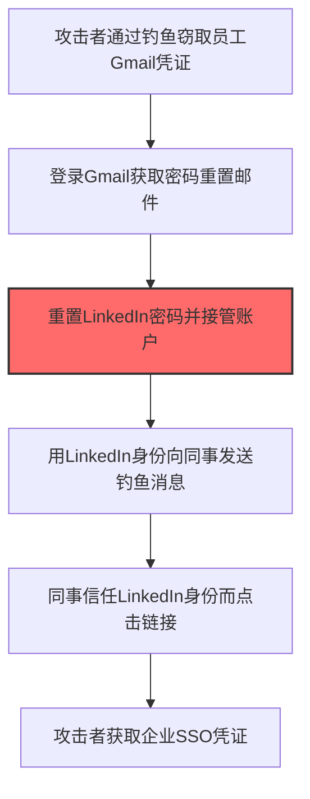
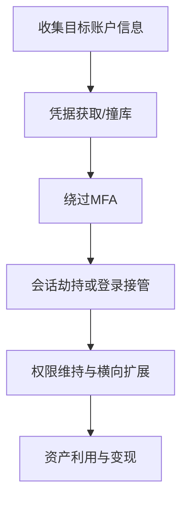

# 损害账户 (T1586)

## 一句话通俗理解

> **盗用别人已有的社交媒体、邮箱、云服务账户，借合法身份掩护攻击行动**

## 30秒速查卡

| 维度 | 你需要知道的 |
|------|-------------|
| 这是什么？ | 攻击者通过凭证窃取、会话劫持、密码喷洒等手段，获取他人已有的社交媒体、邮箱、云服务账户控制权 |
| 为什么危险？ | 被盗账户拥有真实的历史记录、人脉关系和信任度，攻击者的行为会被误认为是账户主人的合法操作 |
| 谁需要关心？ | 身份与访问管理团队、安全运营中心、云安全管理员、社交媒体安全团队 |
| 你的第一步防御 | 对所有关键账户启用MFA，监控异常登录（异常IP、异常时间、异常设备） |
| 如果只做一件事 | 监控云服务（AWS/Azure）API密钥的异常使用——新IP、新区域、新服务调用 |

## 难度等级

⭐⭐ 中级 - 需要凭证窃取和社会工程学基础

## 前置知识检查

**读这个文件需要什么？**

- [ ] 账户认证机制：密码、MFA、OAuth令牌、会话Cookie
- [ ] 凭证窃取方法：钓鱼、凭据填充、密码喷洒、会话劫持
- [ ] 云服务IAM模型：AWS IAM用户/角色、Azure AD服务主体

## 技术描述

**损害账户**（T1586）是 **资源开发**（TA0042）战术下的父技术。与 [T1585 建立账户](T1585-Establish-Accounts.md)（自己注册新账户）不同，T1586是**盗用已有账户**——偷别人的身份来用。

> 📡 **打个比方**：T1585 是你自己办一张假身份证；T1586 是你偷了别人的真身份证。真身份证上有真实信用记录、真实社交关系，比假身份证好用得多——但也更容易暴露，因为真正的主人可能会发现。

### 具体怎么理解？

攻击者损害账户的典型方式：

1. **凭证窃取**：通过钓鱼邮件、恶意软件（信息窃取器如RedLine、Raccoon）窃取用户的社交媒体、邮箱、云服务凭证
2. **凭据填充**：利用其他网站泄露的用户名/密码组合，自动化尝试登录目标平台（用户经常复用密码）
3. **会话劫持**：窃取用户的会话Cookie或OAuth令牌，无需密码即可冒充用户身份
4. **MFA绕过**：通过MFA疲劳攻击（反复推送MFA请求）、SIM交换或代理MFA服务绕过多因素认证

被盗账户拥有真实的历史发帖、人脉关系和使用模式，攻击者的操作混在其中极难被发现。

### 为什么有效？

1. **真实信任度**：被盗账户拥有真实的历史记录和人脉网络，比新注册的假账户可信度高得多
2. **绕过新账户检测**：安全系统对新注册账户有警惕，但对已有账户（尤其有长期使用历史的）默认信任
3. **权限继承**：被盗的云账户可能已经拥有目标组织的访问权限，攻击者无需提权
4. **检测困难**：攻击者使用合法凭证登录，不会触发"登录失败"告警

**过渡段：** 不要以为损害账户只是"猜密码"——现代攻击者会通过SIM交换接管高管的手机号、通过OAuth钓鱼窃取Microsoft 365的刷新令牌、通过信息窃取器一次性获取浏览器中保存的所有凭证。损害一个账户可能只需要一封精心设计的钓鱼邮件。

## 真实攻击流程



**步骤详解：**

1. **初始凭证窃取** - 攻击者通过钓鱼邮件或信息窃取器，获取目标员工的个人邮箱（Gmail/Outlook）凭证
2. **密码重置链式接管** - 登录个人邮箱后，利用"忘记密码"功能，接管与该邮箱关联的LinkedIn、Twitter、云服务等账户
3. **建立信任伪装** - 使用被盗LinkedIn账户（有真实工作经历和人脉）向目标同事发送消息，请求帮助或分享文件
4. **横向扩展** - 同事因信任LinkedIn身份而点击链接，输入企业SSO凭证，攻击者获取企业内网访问权限
5. **持久化** - 在被入侵的云账户中创建新的API密钥或服务主体，确保持久访问

## 攻击流程

### 典型攻击流程

```
收集目标账户信息 --> 凭据获取/撞库 --> 绕过MFA --> 会话劫持或登录接管 --> 权限维持与横向扩展 --> 资产利用与变现
```



**步骤详解：**

1. **收集目标账户信息**
   - 通俗描述：先摸清要"下手"的账户有哪些——员工邮箱、社交账号、云账号，以及它们的用户名、登录入口、关联身份
   - 技术细节：通过OSINT收集目标员工在LinkedIn、GitHub、邮件头中暴露的用户名；查询泄露数据库（Collection #1-5、COMB）获取历史明文/哈希密码；识别目标使用的IdP（Azure AD、Okta、Google Workspace）及登录入口；分析MFA策略与可绕过路径
   - 常用工具：theHarvester、haveibeenpwned、DeHashed、Snusbase、Maltego

2. **凭据获取/撞库**
   - 通俗描述：拿着泄露的"老密码"去各个网站挨个试，看哪个账户还在用同样的密码——这是最常见也最有效的"撞库"打法
   - 技术细节：将泄露库中的用户名/密码组合批量登录目标SSO、邮件系统、VPN；使用代理池与低速请求规避账户锁定与频次限制；针对云账号使用Password Spray（统一常见密码扫描大批账户）；针对企业AD使用Kerberoasting/AS-REP Roasting离线爆破
   - 常用工具：Atomic Airhammer、Spraykatz、Rubeus、kerbrute、Python imap-tools

3. **绕过MFA**
   - 通俗描述：现在大多数账户都有"二次验证"，攻击者得想办法让这第二道关卡失效——发疯一样推送MFA请求让用户烦到点确认，或者钓鱼拿到一次性验证码
   - 技术细节：MFA Fatigue（推送轰炸）反复触发推送通知诱导用户误点Approve；AiTM钓鱼（EvilGinx/Modlishka）实时代理登录页截取用户输入的OTP；SIM Swap接管短信验证码；滥用OAuth同意钓鱼获取刷新令牌绕过MFA；窃取浏览器Cookie/Session Token直接复用已认证会话
   - 常用工具：EvilGinx、Modlishka、Modlishka、Evilginx2、Modlishka、ADB-SMS劫持工具、OAuth应用钓鱼模板

4. **会话劫持或登录接管**
   - 通俗描述：拿到一次性验证码或会话Cookie后，攻击者就能"扮演"用户登录进去，根本不需要密码
   - 技术细节：将窃取的Session Cookie注入浏览器（通过Cookie Editor或DevTools）直接复用已认证会话，绕过MFA；使用刷新令牌（refresh_token）长期获取新访问令牌；对邮件账户接管后设置转发规则静默监听收件箱；对云账户创建后门服务账号或API Key
   - 常用工具：Cookie Editor、EditThisCookie、AzureHound、MAAD Attack Framework

5. **权限维持与横向扩展**
   - 通俗描述：登进来只是第一步，接下来要把"门"换成自己人能开的，再顺着账户之间的关系往别的系统渗透
   - 技术细节：在被接管邮箱中新增邮件转发规则、隐藏收件夹、植入OAuth应用持久化访问；在云租户中创建新Service Principal、授予Global Admin角色、生成API Key；利用邮件账户信任关系向同事发起BEC钓鱼；通过SSO令牌横向移动到SaaS应用、VPN、代码仓库
   - 常用工具：AADInternals、Microsoft Graph API、BEC钓鱼模板、ScoutSuite

6. **资产利用与变现**
   - 通俗描述：账户接管完成后，攻击者会从里面捞"好处"——偷数据、转移资金、植入勒索软件、把账号卖给下一个攻击者
   - 技术细节：从邮箱/云盘导出敏感文档、合同、财务报表；冒充高管发起BEC欺诈诱导财务转账；将云账号算力用于挖矿或注册新资源；将访问权挂到Initial Access Broker市场变现；为后续勒索软件团伙投递Payload提供初始立足点
   - 常用工具：rclone、megasync（数据外泄）、BEC钓鱼模板、挖矿软件（XMRig）

## 真实案例

### 案例1：MFA Fatigue攻击——APT29入侵Uber和Cisco

- **时间**：2022年
- **目标**：Uber、Cisco、Twitter等科技公司
- **攻击组织**：APT29（Cozy Bear / UNC2452 / Lapsus$风格的MFA疲劳战术）
- **手法**：攻击者首先通过凭据填充获取员工密码，然后连续向员工手机发送数十次MFA推送请求。当员工不堪其扰点击"批准"时，攻击者获得VPN访问权限，进而接管企业内网和云服务账户
- **影响**：Uber内部系统（Slack、AWS、GCP）被全面接管，Cisco源代码和工程数据泄露
- **参考链接**：[Cisco Talos - MFA Fatigue Analysis](https://blog.talosintelligence.com/2022/09/mfa-fatigue-attacks.html)

### 案例2：Lapsus$通过SIM交换接管Okta管理员账户

- **时间**：2022年
- **目标**：Okta、Microsoft、NVIDIA、三星
- **攻击组织**：Lapsus$（疑似巴西青少年黑客组织）
- **手法**：攻击者通过社工说服电信运营商客服，将目标高管的手机号转移到自己控制的SIM卡上。然后利用手机号接收短信验证码，重置高管的企业账户密码，接管Okta管理员权限，进而影响Okta的36,000+客户
- **影响**：Okta客户（包括Cloudflare、Microsoft等）的身份管理系统受到波及
- **参考链接**：[Okta - Lapsus$ Incident Report](https://sec.okta.com/lapsus)

### 案例3：SolarWinds攻击中APT29窃取Azure AD服务主体凭证

- **时间**：2020年
- **目标**：SolarWinds Orion客户
- **攻击组织**：APT29（俄罗斯SVR背景）
- **手法**：攻击者通过SolarWinds后门，窃取目标组织Azure AD中的服务主体凭证和SAML令牌签名证书。使用这些被盗的云身份，攻击者以合法应用身份访问Exchange Online和Microsoft 365，读取高管邮件
- **影响**：美国国务院、司法部的邮件系统被入侵
- **参考链接**：[CISA Alert AA21-131A](https://www.cisa.gov/news-events/cybersecurity-advisories/aa21-131a)

## 子技术列表

| 子技术ID | 中文名称 | 通俗解释 |
|----------|----------|----------|
| T1586.001 | Social Media Accounts | 盗用LinkedIn、Facebook等社交媒体账号 |
| T1586.002 | Email Accounts | 盗用邮箱账号，用于发送钓鱼邮件或接管邮件对话 |
| T1586.003 | Cloud Account | 盗用AWS、Azure等云服务账号，用于数据外泄或托管恶意内容 |

## 红队视角

> ⚠️ **免责声明**：以下内容仅用于合法的安全测试、渗透测试和教育目的。未经授权对他人系统进行测试是违法行为。

### 实战技巧

1. **凭证复用检测**：使用DeHashed或HaveIBeenPwned查询目标组织员工的泄露凭证，尝试凭据填充
2. **会话Cookie窃取**：通过Evilginx2等中间人钓鱼框架，窃取目标的会话Cookie，绕过MFA
3. **API密钥扫描**：使用TruffleHog扫描GitHub公开仓库和Pastebin，寻找泄露的云服务API密钥

### 常用工具

| 工具名称 | 用途 | 说明 |
| -------- | ---- | ---- |
| Evilginx2 | 中间人钓鱼框架 | 窃取会话Cookie绕过MFA，是钓鱼攻击的利器 |
| DeHashed | 凭证泄露查询 | 搜索泄露数据库中的用户名/邮箱/密码 |
| TruffleHog | 密钥扫描 | 扫描代码仓库和文件中的API密钥和凭证 |
| Raccoon Stealer | 信息窃取器 | 从浏览器窃取保存的密码、Cookie、加密钱包 |

### 注意事项

- 在授权的测试环境中使用这些技术
- 凭据填充测试需控制请求速率，避免触发账户锁定
- 会话Cookie有时效性，需及时使用

## 蓝队视角

### 检测要点

1. **异常登录检测**：监控来自新IP、新地理位置、新设备的登录；关注"不可能旅行"（短时间内从不同大洲登录）
2. **API密钥监控**：监控云服务API密钥的异常使用——新调用IP、新服务、异常高频调用
3. **MFA异常**：监控MFA推送的高频请求（MFA疲劳攻击信号）；关注MFA设备变更

### 监控建议

- 部署UEBA（用户实体行为分析），建立每个账户的正常行为基线
- 对云服务API调用启用详细日志记录（AWS CloudTrail、Azure Activity Log）
- 配置条件访问策略，限制非信任IP的登录和API调用

## 避坑指南

防御者最常犯的错误：**以为启用了MFA就万无一失**。MFA疲劳攻击、SIM交换、会话Cookie窃取、OAuth令牌钓鱼都能绕过MFA。必须配合条件访问策略（限制IP、设备状态、登录时间）和异常行为监控，才能有效防御损害账户攻击。

## 检测建议

### 检测思路

检测损害账户的关键是建立"正常行为基线"——每个账户都有正常的使用模式（登录时间、IP位置、调用的服务、操作频率），任何偏离基线的行为都值得调查。

### 网络层检测

**方法**：监控云服务API调用和认证日志的异常模式

```bash
# 检测AWS API密钥异常IP使用（CloudTrail日志）
# 对比API密钥的历史使用IP和新出现IP
aws cloudtrail lookup-events --lookup-attributes AttributeKey=EventName,AttributeValue=GetCallerIdentity \
  | jq '.Events[].CloudTrailEvent | fromjson | {user: .userIdentity.arn, ip: .sourceIPAddress, time: .eventTime}'

# 检测Azure AD异常登录（Microsoft Graph API）
# 筛选"不可能旅行"和异常IP登录
Get-AzureADAuditSignInLogs -Top 1000 | Where-Object {
    $_.Location -notin $trustedLocations -and $_.Status.ErrorCode -eq 0
}
```

### 应用层检测

**用人话说：** 这条规则在检测损害账户——攻击者用偷来的凭证登录时，会露出三个马脚：一是登录位置异常，一个从不在北京登录的账户突然从莫斯科登录；二是登录时间异常，一个9-5工作的账户凌晨3点登录；三是操作模式异常，一个只读邮件的账户突然开始创建IAM用户或导出大量数据。检测的关键是将每次登录和操作与该账户的历史基线对比。

**Sigma规则示例**：

```yaml
title: 检测AWS API密钥异常区域使用
status: experimental
description: AWS API密钥从一个新地理区域被使用，可能是凭证泄露
logsource:
    category: cloudtrail
detection:
    selection:
        eventType: 'AwsApiCall'
    filter_baseline:
        sourceIPAddress|cidr:
            - '10.0.0.0/8'    # 内网
            - '203.0.113.0/24' # 已知办公IP段
    condition: selection and not filter_baseline
level: medium
tags:
    - attack.t1586
    - attack.t1586.003
    - attack.resource_development
```

## 缓解措施

### 优先级1：关键措施

**MFA与条件访问**：对所有账户启用MFA（优先使用FIDO2硬件密钥），配合条件访问策略限制非信任IP

### 优先级2：重要措施

**凭证泄露监控**：订阅HaveIBeenPwned或DeHashed，监控组织邮箱是否在数据泄露中出现

### 优先级3：建议措施

**API密钥管理**：定期轮换云服务API密钥，使用短期STS令牌替代长期Access Key

## 动手实验

> ⚠️ **所有实验必须在隔离的实验室环境中进行**

### 实验1：理解凭据填充攻击（初级）

**目标**：理解凭据填充的原理和检测方法

**步骤**：
1. 在测试环境中创建多个测试账户
2. 使用一个泄露的密码字典模拟凭据填充
3. 分析认证日志中的失败模式（同一IP大量失败、用户名枚举）

**学习要点**：掌握凭据填充的日志特征

### 实验2：会话Cookie钓鱼模拟（中级）

**目标**：理解MFA绕过的原理

**步骤**：
1. 在隔离环境中部署Evilginx2
2. 针对测试账户进行中间人钓鱼
3. 分析窃取的会话Cookie如何绕过MFA

**学习要点**：理解会话劫持绕过MFA的机制

### 实验3：UEBA基线构建（高级）

**目标**：建立用户行为基线用于异常检测

**步骤**：
1. 收集测试账户的正常使用日志（登录时间、IP、操作）
2. 构建行为基线模型
3. 模拟攻击者异常行为，验证检测效果

**学习要点**：掌握UEBA在损害账户检测中的应用

## 术语解释

| 术语 | 通俗解释 |
|------|---------|
| **ATT&CK** | MITRE公司维护的攻击技术知识库，像一本"黑客手法百科全书" |
| **损害账户** | T1586，盗用他人已有的社交媒体、邮箱、云服务账户 |
| **建立账户** | T1585，与T1586对比——T1585是自己注册新账户，T1586是盗用已有账户 |
| **凭据填充** | 用泄露的用户名/密码组合批量尝试登录其他平台 |
| **MFA疲劳攻击** | 反复推送MFA请求，等用户不耐烦点击"批准" |
| **SIM交换** | 骗过电信运营商，把受害者手机号转到攻击者SIM卡上 |
| **UEBA** | 用户实体行为分析，通过机器学习建立用户行为基线 |

## 被引用情况

本技术作为资源开发战术的核心父技术，被以下文档引用：

- [TA0042 - 资源开发](README.md)
- [T1585 - 建立账户](T1585-Establish-Accounts.md)（对比技术）

## 参考资料

### 📚 官方文档（深入了解）

- [MITRE ATT&CK - Compromise Accounts (T1586)](https://attack.mitre.org/techniques/T1586/) - 官方技术定义
- [MITRE ATT&CK - Resource Development (TA0042)](https://attack.mitre.org/tactics/TA0042/) - 所属战术

### 🔧 工具与资源（动手试试）

- [Evilginx2](https://github.com/kgretzky/evilginx2) - 中间人钓鱼框架（绕过MFA）
- [DeHashed](https://dehashed.com/) - 凭证泄露查询平台
- [TruffleHog](https://github.com/trufflesecurity/trufflehog) - 密钥扫描工具

### 📰 安全报告（真实攻击）

- [Cisco Talos - MFA疲劳攻击分析](https://blog.talosintelligence.com/2022/09/mfa-fatigue-attacks.html) - MFA绕过实战案例
- [Okta Lapsus$事件报告](https://sec.okta.com/lapsus) - SIM交换接管管理员账户
- [CISA SolarWinds警报](https://www.cisa.gov/news-events/cybersecurity-advisories/aa21-131a) - APT29窃取云服务凭证
