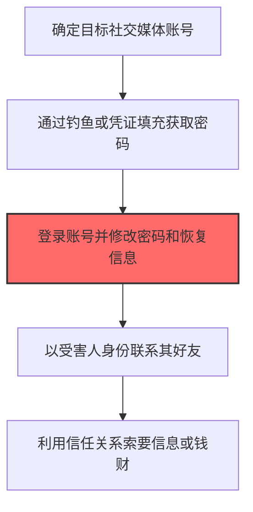
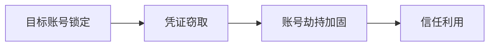

# 社交媒体账户 (T1586.001)

## 一句话通俗理解

> **盗用LinkedIn、Facebook等社交媒体账号**

## 30秒速查卡

| 项目 | 内容 |
|------|------|
| 攻击目标 | 盗用社交媒体账号 |
| 典型手法 | 接管他人LinkedIn等社交媒体账户 |
| 关键检测点 | 监控社交媒体账户异常登录和内容发布 |
| 难度等级 | ⭐⭐⭐ |

## 难度等级

⭐⭐⭐ 高级 - 需要深入的技术知识和实践

## 前置知识检查

**读这个文件需要什么？**

- [ ] 恶意软件开发流程基础
- [ ] C2基础设施概念
- [ ] 数字证书与代码签名基本原理

## 技术描述

**社交媒体账户**（T1586.001）是 **破坏账户**（T1586）的一个具体变体，属于 **资源开发** 阶段的攻击技术。

> 🔓 **打个比方**：就像破解了别人的社交账号来冒充他——攻陷社交媒体账号让受害者更信任攻击者。

### 具体怎么理解？

盗用LinkedIn、Facebook等社交媒体账号

攻击者使用这种技术时，通常是在资源开发阶段，想要达到特定的攻击目标。与父技术 T1586 相比，T1586.001 有自己独特的特点和使用场景。

### 为什么有效？

这种技术之所以有效，是因为：
1. **隐蔽性**：利用了正常系统功能或常见协议，不容易被发现
2. **技术门槛适中**：不需要特别高深的技术知识就能实施

**过渡段：** 不要以为资源开发只是'写恶意软件'——这是建立整个攻击作战体系的过程。
3. **广泛适用**：可以在多种环境和系统中使用

## 真实攻击流程



**步骤详解：**

1. **确定目标账号** - 攻击者根据攻击需求选择高价值目标的高管、技术人员或客服的社交媒体账号
2. **获取登录凭证** - 通过钓鱼邮件、凭证填充攻击或数据泄露获取密码
3. **劫持账号** - 登录账号后立即修改密码、绑定邮箱和手机号码，锁定原用户，这是账户控制的关键步骤
4. **冒充身份联系** - 以账号所有者的身份向其好友列表中的联系人发送消息，利用信任关系
5. **实施欺诈** - 索要敏感信息、发送钓鱼链接或直接要求转账汇款

### 典型场景

攻击者在 **资源开发** 阶段使用 社交媒体账户 技术，以下是典型的攻击步骤：

## 攻击流程

```
目标账号锁定 --> 凭证窃取 --> 账号劫持加固 --> 信任利用
```



**步骤详解：**
1. **目标账号锁定** - 识别高价值目标的社交媒体账号及其关联信息 | 收集目标用户名、关联邮箱、好友列表、发帖习惯 | OSINT工具、社交平台搜索、数据泄露库
2. **凭证窃取** - 通过钓鱼、凭证填充或会话劫持获取社交媒体登录凭证 | 发送OAuth钓鱼页面、利用泄露库凭证填充、窃取浏览器Cookie | Evilginx、SentryMBA、Cookie编辑器
3. **账号劫持加固** - 登录后立即修改密码、绑定邮箱和手机号锁定原用户 | 修改恢复信息、启用2FA绑定攻击者设备、删除登录通知 | 平台安全设置、2FA App
4. **信任利用** - 以受害人身份联系其好友实施欺诈或情报收集 | 冒充身份发送紧急借款请求、分享"资源"链接、索取敏感信息 | 平台私信、Messenger、WhatsApp

## 真实案例

### 案例1：APT28 -- 通过VPS搭建Google OAuth伪造登录页面（2016）

- **时间**: 2016年
- **目标**: 全球范围内的企业和政府机构
- **攻击组织**: APT28
- **手法**: 通过VPS搭建Google OAuth伪造登录页面
- **影响**: 数据窃取、横向移动、勒索或长期潜伏
- **参考链接**: Mandiant

### 案例2：APT29 -- 在AWS和Azure购买VPS用于C2基础设施（2020）

- **时间**: 2020年
- **目标**: 全球范围内的企业和政府机构
- **攻击组织**: APT29
- **手法**: 在AWS和Azure购买VPS用于C2基础设施
- **影响**: 凭证窃取、横向移动、数据窃取
- **参考链接**: CISA

## 红队视角

> ⚠️ **免责声明**：以下内容仅用于合法的安全测试、渗透测试和教育目的。未经授权对他人系统进行测试是违法行为。

### 实战技巧

1. **深入理解原理**：在实战应用前，充分理解社交媒体账户的技术原理和适用场景
2. **环境适配**：根据目标系统的操作系统版本、安全配置等因素调整攻击策略
3. **组合使用**：将该技术与其他技术组合使用，构建完整的攻击链
4. **隐蔽性考虑**：注意操作痕迹的清理，避免被安全设备检测

### 常用工具

| 工具名称 | 用途 | 平台 | 链接 |
| -------- | ---- | ---- | ---- |
| 工具名称 | 用途 | 平台 | 链接 |
|----------|------|------|------|
| VPS提供商(AWS/Azure/DO) | VPS租用 | Web | [AWS](https://aws.amazon.com/) |
| Let's Encrypt | 免费HTTPS证书 | Web | [Let's Encrypt](https://letsencrypt.org/) |
| GoDaddy/Namecheap | 域名注册 | Web | [GoDaddy](https://www.godaddy.com/) |
| Cloudflare | CDN隐藏源服务器IP | Web | [Cloudflare](https://www.cloudflare.com/) |

### 注意事项

- 在授权的测试环境中使用这些技术
- 注意操作安全（OPSEC），避免被检测系统发现
- 使用匿名化技术和代理隐藏真实身份

## 蓝队视角

### 检测要点

1. **系统日志监控**：关注与社交媒体账户相关的系统日志和审计记录
2. **异常行为检测**：监控系统中与该技术相关的异常进程、网络连接和文件操作
3. **工具特征识别**：识别攻击者可能使用的工具在系统中的运行特征

### 监控建议

- 部署端点检测和响应（EDR）系统，监控与社交媒体账户相关的异常行为
- 配置SIEM规则，关联分析来自多个来源的告警
- 定期进行安全评估和渗透测试，验证检测规则的有效性

## 避坑指南

关键误区：认为资源开发只是技术工作。

## 检测建议

### 检测思路

检测 社交媒体账户 的关键是识别异常行为模式。以下是三个层面的检测方法：

### 网络层检测

**方法**：监控网络流量中的异常模式

```bash
# 检测异常的网络连接和数据传输
# 根据具体协议和端口设置检测规则
```

### 主机层检测

**Windows事件ID**：
- 事件ID 4688：进程创建（监控可疑进程）
- 事件ID 4104：PowerShell执行（监控可疑脚本）

**Linux日志**：
- /var/log/auth.log：认证日志
- /var/log/syslog：系统日志

```bash
# 检测异常进程和命令执行
grep -i "suspicious" /var/log/auth.log
```

### 应用层检测


**用人话说：**资源开发检测重点是发现攻击基础设施的建设痕迹——短期内大量域名注册、证书申请或代码仓库创建都是危险信号。
## 用人话说

> **检测解读**：社交媒体账号被盗用是"身份盗用"——攻击者冒充你与他人交流。监控社交媒体账户异常登录。
>
> **避坑指南**：被盗账号的典型特征是突然改变了发布内容的风格和主题，或者开始大量发送好友请求。

**Sigma规则示例**：

```yaml
title: 检测社交媒体账户
status: experimental
description: 检测可能的社交媒体账户活动
logsource:
    category: process_creation
    product: windows
detection:
    selection:
        EventID: 4688
    condition: selection
level: medium
tags:
    - attack.T1586001
```

## 缓解措施

### 优先级1：关键措施

**限制攻击面**：减少暴露的服务和端口，降低被利用的风险

```bash
# 防火墙规则示例：只允许必要的出站连接
iptables -A OUTPUT -p tcp --dport 443 -j ACCEPT  # 允许HTTPS
iptables -A OUTPUT -p tcp --dport 80 -j ACCEPT   # 允许HTTP
iptables -A OUTPUT -p tcp -j DROP                 # 阻止其他TCP
```

### 优先级2：重要措施

**加强监控**：部署EDR和SIEM系统，实时监控异常行为

### 优先级3：建议措施

**安全意识培训**：教育员工识别相关攻击手法

## 动手实验

> ⚠️ **所有实验必须在隔离的实验室环境中进行**

### 实验1：理解基本原理（初级）

**目标**：理解 社交媒体账户 的工作原理

**步骤**：
1. 在隔离环境中搭建测试系统
2. 使用基础工具模拟攻击行为
3. 观察系统日志和网络流量

**学习要点**：理解该技术的核心机制

### 实验2：实际操作（中级）

**目标**：掌握 社交媒体账户 的实际使用方法

**步骤**：
1. 使用专业工具进行攻击模拟
2. 尝试不同的绕过技术
3. 分析检测日志的特征

**学习要点**：掌握工具使用和日志分析

### 实验3：防御验证（高级）

**目标**：验证检测规则的有效性

**步骤**：
1. 部署检测规则
2. 执行攻击模拟
3. 验证检测告警是否触发

**学习要点**：理解攻防对抗的实际效果

## 术语解释

| 术语 | 通俗解释 |
|------|---------|
| **ATT&CK** | MITRE公司维护的攻击技术知识库，像一本"黑客手法百科全书" |
| **社交媒体账户** | T1586.001，ATT&CK框架中定义的一种具体攻击技术 |
| **破坏账户** | T1586，社交媒体账户所属的父技术类别 |
| **资源开发** | 攻击链中的一个阶段，攻击者在这个阶段的目标 |
| **C2** | 命令与控制，攻击者用来远程控制被入侵系统的"遥控器" |
| **EDR** | 端点检测与响应，部署在电脑上的安全监控软件 |

## 被引用情况

以下父技术文档引用了本子技术：

- [T1586 - 破坏账户](../T1586-Compromise-Accounts.md)

## 参考资料

### 📚 官方文档（深入了解）

- [MITRE ATT&CK - 社交媒体账户 (T1586.001)](https://attack.mitre.org/techniques/T1586/001/)
- [MITRE ATT&CK - 破坏账户 (T1586)](https://attack.mitre.org/techniques/T1586/)

### 📰 安全报告（真实攻击）

- [MITRE ATT&CK 官方文档](https://attack.mitre.org/) - ATT&CK 框架官方资源

### 🔧 工具与资源（动手试试）

- [Atomic Red Team](https://github.com/redcanaryco/atomic-red-team) - 检测规则测试框架
- [MITRE ATT&CK Navigator](https://mitre-attack.github.io/attack-navigator/) - ATT&CK 可视化工具

### 📚 学习资料（深入了解）

- [MITRE ATT&CK 知识库](https://attack.mitre.org/resources/) - ATT&CK 官方资源中心
