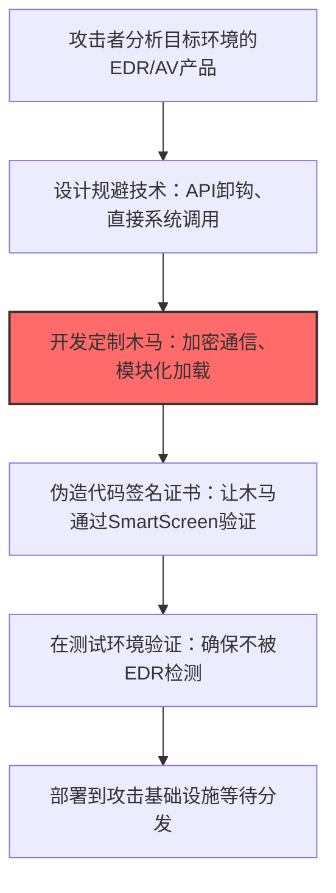
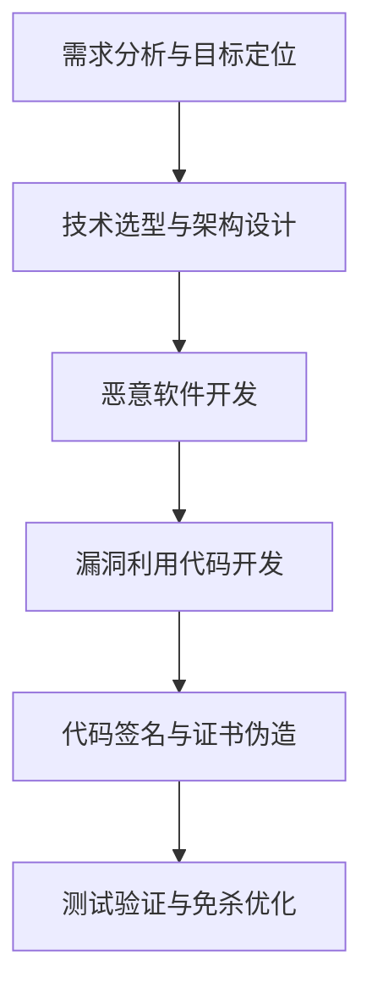

# 开发能力 (T1587)

## 一句话通俗理解

> **攻击者自己编写恶意软件、伪造证书、挖掘漏洞——DIY攻击武器**

## 30秒速查卡

| 维度 | 你需要知道的 |
|------|-------------|
| 这是什么？ | 攻击者自行开发恶意软件、代码签名证书、数字证书和漏洞利用代码，为攻击行动定制武器 |
| 为什么危险？ | 自主开发的恶意软件没有已知特征签名，传统杀毒软件无法检测；定制漏洞利用代码可以绕过现有补丁 |
| 谁需要关心？ | 威胁狩猎团队、恶意软件分析师、漏洞研究团队、PKI/证书管理团队 |
| 你的第一步防御 | 部署行为分析型EDR（不只依赖签名），监控代码签名证书的异常签发行为 |
| 如果只做一件事 | 对所有签发的代码签名证书启用时间戳和透明日志，监控异常签发模式 |

## 难度等级

⭐⭐⭐⭐ 高级 - 需要逆向工程、漏洞研究、恶意软件开发和密码学的深厚功底

## 前置知识检查

**读这个文件需要什么？**

- [ ] 编程基础：C/C++、Python、汇编语言
- [ ] 恶意软件分析基础：PE文件结构、API Hooking、进程注入原理
- [ ] 漏洞利用基础：内存布局、ROP链、漏洞类型（栈溢出/堆溢出/UAF）
- [ ] 证书体系：PKI、代码签名、SSL/TLS证书链

## 技术描述

**开发能力**（T1587）是 **资源开发**（TA0042）战术下的父技术。与 [T1588 获取能力](T1588-Obtain-Capabilities.md)（花钱买/租）不同，T1587是**自己开发**——攻击者从零编写恶意软件、伪造证书和挖掘漏洞。

> 📡 **打个比方**：T1588 是去黑市买一把枪；T1587 是自己在车库里造一把枪。自己造的枪没有序列号（已知特征），警察查不到来源。但造枪需要技术、时间和设备——不是每个犯罪分子都能做到。

### 具体怎么理解？

攻击者开发能力的四个维度：

1. **恶意软件开发**（T1587.001）：编写定制化的木马、后门、勒索软件，避免使用公开恶意软件的特征
2. **代码签名证书**（T1587.002）：伪造或滥合法代码签名证书，让恶意软件看起来由可信开发商签发
3. **数字证书**（T1587.003）：创建自签名SSL/TLS证书或伪造CA证书，用于C2通信加密和中间人攻击
4. **漏洞利用代码**（T1587.004）：研究未公开漏洞（0day）并编写利用代码，绕过现有防护

### 为什么有效？

1. **无已知特征**：自主开发的恶意软件没有公开的hash、IOCs或YARA规则，传统杀毒软件无法识别
2. **定制化能力**：攻击者可以针对特定目标的环境（特定AV/EDR、特定网络架构）定制规避技术
3. **0day优势**：自主挖掘的漏洞利用代码没有公开补丁，防御者无法通过打补丁防护
4. **长期可用**：自己开发的工具不会被供应商撤销或失效（购买的MaaS可能被执法机构查封）

**过渡段：** 不要以为开发能力只是"写个病毒"——高级APT组织（如方程式组织、APT29）拥有专业级的开发团队，使用混淆框架、多态代码、虚拟机检测等高级技术，开发出的恶意软件复杂度堪比商业软件。

## 真实攻击流程



**步骤详解：**

1. **目标环境分析** - 研究目标组织使用的EDR/AV产品、网络架构和安全策略，确定需要规避的检测机制
2. **规避技术开发** - 针对目标EDR开发规避技术：API卸钩（unhooking）、直接系统调用（Direct Syscalls）、进程注入（Process Dopping）
3. **恶意软件开发** - 编写模块化木马：加密C2通信、内存加载、反调试反虚拟机
4. **签名伪造** - 使用窃取或伪造的代码签名证书对恶意软件签名，绕过SmartScreen和Gatekeeper
5. **测试验证** - 在模拟目标环境的测试环境中运行恶意软件，验证不触发EDR告警

## 攻击流程

### 典型攻击流程

```
需求分析与目标定位 --> 技术选型与架构设计 --> 恶意软件开发 --> 漏洞利用代码开发 --> 代码签名与证书伪造 --> 测试验证与免杀优化
```



**步骤详解：**

1. **需求分析与目标定位**
   - 通俗描述：先想清楚要造什么"武器"——是要个能潜伏半年的后门，还是能突破某款EDR的提权EXP，或者是绕过最新Windows Defender的Loader
   - 技术细节：依据侦察阶段掌握的目标操作系统版本、补丁状态、EDR/AV产品、网络架构，确定能力需求清单（RAT、Loader、Implant、Exploit、Rootkit）；明确作战目标（持久化、横向移动、数据外泄）和约束（隐蔽性优先/破坏性优先）
   - 常用工具：无（基于侦察报告的需求规划）

2. **技术选型与架构设计**
   - 通俗描述：决定"武器"用什么材料、什么结构——选C++追求底层稳定，选Rust对抗内存扫描，选.NET适配Windows环境
   - 技术细节：选择开发语言（C/C++、Rust、Go、.NET、Nim、Assembly）权衡检测规避与开发效率；设计模块化架构（Stager/Implant/Beacon分离）；规划C2协议（HTTP/S、DNS、ICMP、SMB命名管道）；选择加密方案（AES、ChaCha20、RSA密钥协商）保证通信与落地样本的可逆性
   - 常用工具：Visual Studio、CLion、Cargo、YARA（自查规则匹配）

3. **恶意软件开发**
   - 通俗描述：开始写"病毒代码"——这部分是实现远程控制、文件窃取、键盘记录、横向移动等核心功能的"主力代码"
   - 技术细节：使用直接系统调用（Direct Syscalls）绕过用户态Hook；通过进程注入（Process Hollowing、Reflective DLL Injection）实现内存执行；利用NTFS Alternate Data Streams、WMI事件订阅实现无文件持久化；使用sleep obfuscation（Ekko、Zilean）在内存中加密自身规避扫描；模块化设计便于按需加载功能插件
   - 常用工具：Visual Studio、Cobalt Strike Aggressor Script、Magic Unicorn、Shellcode Compiler

4. **漏洞利用代码开发**
   - 通俗描述：如果是用0day/1day作为突破口，攻击者要自己挖漏洞、写EXP——这是技术含量最高的一步
   - 技术细节：通过Fuzzing（AFL、libFuzzer）发现内存破坏漏洞；逆向分析补丁差异定位1day漏洞；编写Reliability exploits处理堆布局、ASLR/DEP/CFG绕过；针对内核漏洞开发Token Stealing提权链；针对Web应用开发RCE/SQL注入利用链
   - 常用工具：IDA Pro、Ghidra、WinDbg、Frida、AFL、libFuzzer、PEiD

5. **代码签名与证书伪造**
   - 通俗描述：给"病毒"办一张"身份证"——伪造或盗用代码签名证书，让杀毒软件以为是合法软件
   - 技术细节：从泄露或被盗企业证书库获取合法代码签名证书（EV证书优先）；使用自签名证书并配合时间戳服务提升欺骗性；滥用被盗内核驱动签名（Driver Blocklist绕过）；创建伪造的SSL/TLS证书用于C2通信伪装
   - 常用工具：sigthief、CarbonCopy、OpenSSL、osslsigncode、osslsigncode

6. **测试验证与免杀优化**
   - 通俗描述："武器"出厂前要做"靶场测试"——在沙箱、各种AV/EDR眼皮底下试运行，确保不被发现
   - 技术细节：使用AntiVM/AntiSandbox技术（检测CPU核心数、内存大小、用户交互）规避自动分析；通过熵值降低、分段加载、内存中解密规避静态特征匹配；使用AMSI Bypass、ETW Patch绕过运行时检测；在多款AV/EDR（Defender、CrowdStrike、SentinelOne）环境下做"红蓝对抗"式测试；用YARA自查规则确保无公开特征命中
   - 常用工具：PEStudio、Detect It Easy、YARA、AMSI Bypass脚本、InnoSetup Loader

## 真实案例

### 案例1：APT29开发SUNSPOT后门（SolarWinds供应链攻击）

- **时间**：2019-2020年
- **目标**：SolarWinds Orion平台
- **攻击组织**：APT29（Cozy Bear / SVR）
- **手法**：APT29自主开发了SUNSPOT后门植入程序，通过监控SolarWinds的构建流程，在Orion软件更新包中植入SUNBURST后门。SUNSPOT精心设计了规避机制：等待特定构建进程启动、使用随机文件名、清理日志痕迹。SUNBURST后门本身使用了域名生成算法、延迟执行（2周等待期）和合法HTTPS通信，完全规避了SolarWinds的安全检测
- **影响**：18,000+客户安装了后门版本，包括美国多个联邦机构
- **参考链接**：[CrowdStrike SUNSPOT分析](https://www.crowdstrike.com/blog/sunspot-malware-technical-analysis/)

### 案例2：方程式组织（Equation Group）开发USB Worm武器

- **时间**：2008-2016年（被Shadow Brokers泄露后曝光）
- **目标**：全球目标（重点为伊朗核设施、俄罗斯军事网络）
- **攻击组织**：方程式组织（疑似NSA Tailored Access Operations）
- **手法**：方程式组织自主开发了包括STUXNET、DUQU、REGIN、TRIGGERSHARK在内的多套高级恶意软件。这些恶意软件使用了0day漏洞利用、RPC后门、磁盘固件植入等技术。其中STUXNET使用了4个0day漏洞和伪造的合法证书（来自台湾瑞昱和智微科技），复杂度前所未有
- **影响**：STUXNET破坏了伊朗约1,000台铀浓缩离心机，被认为改变了网络安全历史
- **参考链接**：[Kaspersky - Equation Group分析](https://securelist.com/equation-the-death-star-of-malware-war/69291/)

### 案例3：Conti勒索软件团伙开发定制勒索软件

- **时间**：2020-2022年
- **目标**：全球医疗机构、政府机构、关键基础设施
- **攻击组织**：Conti勒索软件团伙
- **手法**：Conti团伙拥有专业开发团队，自主开发了Conti勒索软件（基于Ry源码改进），包括：多线程加密引擎（提高加密速度）、Windows域传播模块、Linux/ESXi版本。他们还开发了专属的Cobalt Strike修改版（Conti C2）和自动化攻击工具包
- **影响**：攻击了1,000+组织，勒索金额超1.8亿美元，直到2022年内部聊天泄露后解散
- **参考链接**：[FBI Conti Flash Report](https://www.ic3.gov/Media/News/2021/210921)

## 子技术列表

| 子技术ID | 中文名称 | 通俗解释 |
|----------|----------|----------|
| T1587.001 | Malware | 编写木马、后门、勒索软件等恶意程序 |
| T1587.002 | Code Signing Certificates | 伪造代码签名证书，让恶意软件看起来合法 |
| T1587.003 | Digital Certificates | 创建SSL/TLS证书用于加密通信 |
| T1587.004 | Exploits | 挖掘和利用软件漏洞的代码 |

## 红队视角

> ⚠️ **免责声明**：以下内容仅用于合法的安全测试、渗透测试和教育目的。未经授权对他人系统进行测试是违法行为。

### 实战技巧

1. **EDR规避设计**：使用直接系统调用（HellsGate/HalosGate）绕过用户态API Hook；使用NTFS Alternate Data Streams隐藏payload
2. **模块化架构**：将恶意软件设计为模块化加载——核心loader仅负责加载加密的插件模块，降低整体被检测概率
3. **证书链利用**：窃取合法开发者的代码签名证书（而非自签名），使恶意软件通过证书链验证

### 常用工具

| 工具名称 | 用途 | 说明 |
| -------- | ---- | ---- |
| Shellcode Studio | Shellcode开发 | 可视化编写和调试shellcode |
| SysWhispers2 | 直接系统调用生成 | 自动生成直接系统调用代码，绕过EDR Hook |
| Donut | .NET注入框架 | 将.NET程序集转换为shellcode，用于内存加载 |
| sRDI | DLL转Shellcode | 将标准DLL转换为位置无关代码 |

### 注意事项

- 开发的恶意软件必须在实际目标环境中测试，模拟环境可能不包含所有EDR检测规则
- 代码签名证书有撤销风险，准备多个签名链
- 漏洞利用代码需控制稳定性，不稳定的exploit会导致目标崩溃暴露攻击

## 蓝队视角

### 检测要点

1. **行为分析**：不依赖签名，关注恶意软件的行为特征——内存注入、异常系统调用、C2通信模式
2. **证书监控**：监控代码签名证书的异常签发——新签发证书对未知可执行文件签名、签名证书被撤销
3. **漏洞利用检测**：监控异常进程崩溃、内存访问违规、ROP gadget执行模式

### 监控建议

- 部署基于行为分析的EDR（如CrowdStrike Falcon、Microsoft Defender for Endpoint）
- 启用证书透明度日志（CT Logs）监控新签发的代码签名证书
- 配置ETW（Event Tracing for Windows）监控底层系统调用异常

## 避坑指南

防御者最常犯的错误：**过度依赖已知IoC和签名检测**。自主开发的恶意软件没有公开hash、域名或IP——你的YARA规则和IoC列表对它完全无效。必须转向行为分析：关注"这个进程在做什么"而非"这个文件叫什么"。

## 检测建议

### 检测思路

检测开发能力产物的关键是关注行为特征而非静态特征——恶意软件在执行时会表现出内存注入、异常系统调用、加密通信等行为模式，这些行为模式比hash更难规避。

### 主机层检测

**用人话说：** 这条规则在检测开发能力的产物——攻击者自研的恶意软件没有已知签名，但它的行为会暴露身份：一个Word文档启动后注入到explorer.exe进程、一个签名的可执行文件发出大量DNS查询到随机生成的域名、一个PowerShell脚本直接调用ntdll.dll的系统函数而不是走正常API。检测的关键是监控行为链——而不是单个文件。

**Sigma规则示例**：

```yaml
title: 检测直接系统调用行为（EDR规避）
status: experimental
description: 进程通过直接系统调用绕过用户态API Hook，可能是自研恶意软件的规避技术
logsource:
    category: process_creation
    product: windows
detection:
    selection:
        ParentImage|endswith:
            - '\winword.exe'
            - '\excel.exe'
            - '\outlook.exe'
        Image|endswith:
            - '\rundll32.exe'
            - '\regsvr32.exe'
            - '\mshta.exe'
    filter_legitimate:
        CommandLine|contains:
            - 'normal.dll'  # 已知合法调用
    condition: selection and not filter_legitimate
level: high
tags:
    - attack.t1587
    - attack.t1587.001
    - attack.resource_development
```

### 证书层检测

```bash
# 检测新签发的代码签名证书（证书透明度日志）
# 使用crt.sh监控特定组织的新证书
curl -s "https://crt.sh/?q=%.example.com&output=json" | jq '.[] | select(.entry_timestamp > "2026-07-01")'

# 检测被签名的未知可执行文件（Windows事件日志）
# 事件ID 3076：CNG审计事件——代码签名证书使用
Get-WinEvent -FilterHashtable @{LogName='Microsoft-Windows-CodeIntegrity/Operational'; ID=3076} |
  Select-Object TimeCreated, Message | Format-List
```

## 缓解措施

### 优先级1：关键措施

**行为分析型EDR**：部署不依赖签名的行为分析EDR，检测内存注入、异常系统调用和C2通信模式

### 优先级2：重要措施

**证书透明度监控**：订阅证书透明度日志，监控组织域名的新证书签发；对代码签名证书启用HSM保护

### 优先级3：建议措施

**漏洞缓解**：启用 exploit mitigations（如Windows Exploit Guard、Linux内核保护），减少0day漏洞的可利用性

## 动手实验

> ⚠️ **所有实验必须在隔离的实验室环境中进行**

### 实验1：理解EDR规避原理（中级）

**目标**：理解直接系统调用如何绕过EDR Hook

**步骤**：
1. 使用SysWhispers2生成直接系统调用代码
2. 编写简单的shellcode loader对比API调用和直接系统调用
3. 在EDR环境中测试检测差异

**学习要点**：理解EDR用户态Hook的原理和规避方法

### 实验2：恶意软件行为分析（高级）

**目标**：掌握自研恶意软件的行为检测方法

**步骤**：
1. 在隔离环境中运行一个自定义恶意软件样本
2. 使用Process Monitor和ETW记录所有行为
3. 提取行为特征编写检测规则

**学习要点**：掌握行为分析检测方法

## 术语解释

| 术语 | 通俗解释 |
|------|---------|
| **ATT&CK** | MITRE公司维护的攻击技术知识库，像一本"黑客手法百科全书" |
| **开发能力** | T1587，攻击者自行开发恶意软件、证书和漏洞利用代码 |
| **获取能力** | T1588，与T1587对比——T1587是自己开发，T1588是购买 |
| **直接系统调用** | 绕过用户态API Hook，直接调用内核系统函数 |
| **代码签名证书** | 用于对可执行文件签名，证明软件来源可信 |
| **0day漏洞** | 未公开、无补丁的漏洞，攻击者有先发优势 |
| **EDR** | 端点检测与响应，部署在电脑上的安全监控软件 |

## 被引用情况

本技术作为资源开发战术的核心父技术，被以下文档引用：

- [TA0042 - 资源开发](README.md)
- [T1588 - 获取能力](T1588-Obtain-Capabilities.md)（对比技术）

## 参考资料

### 📚 官方文档（深入了解）

- [MITRE ATT&CK - Develop Capabilities (T1587)](https://attack.mitre.org/techniques/T1587/) - 官方技术定义
- [MITRE ATT&CK - Resource Development (TA0042)](https://attack.mitre.org/tactics/TA0042/) - 所属战术

### 🔧 工具与资源（动手试试）

- [SysWhispers2](https://github.com/jthuraisamy/SysWhispers2) - 直接系统调用代码生成
- [Donut](https://github.com/TheWover/donut) - .NET注入框架
- [sRDI](https://github.com/monoxgas/sRDI) - DLL转Shellcode工具

### 📰 安全报告（真实攻击）

- [CrowdStrike - SUNSPOT技术分析](https://www.crowdstrike.com/blog/sunspot-malware-technical-analysis/) - APT29自研供应链后门
- [Kaspersky - 方程式组织分析](https://securelist.com/equation-the-death-star-of-malware-war/69291/) - NSA级恶意软件开发
- [FBI Conti报告](https://www.ic3.gov/Media/News/2021/210921) - Conti勒索软件开发运营
