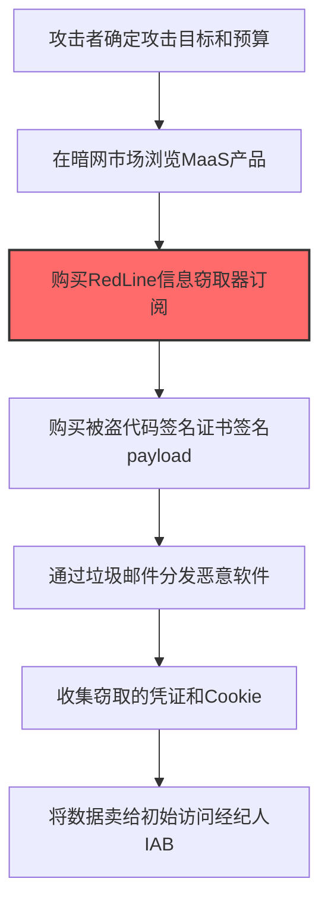
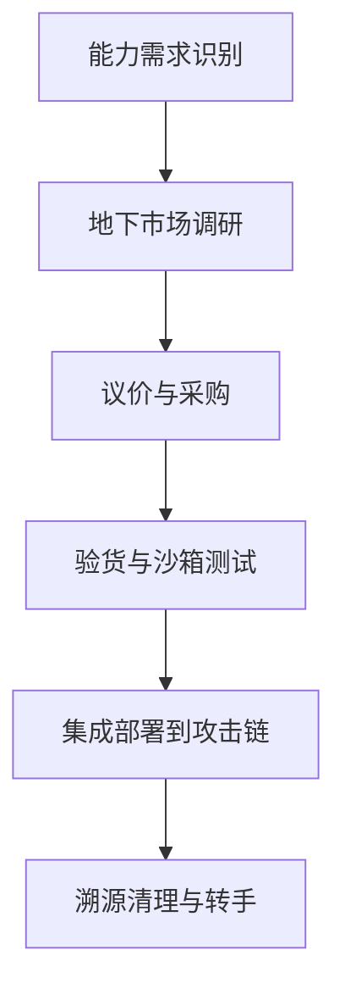

# 获取能力 (T1588)

## 一句话通俗理解

> **攻击者花钱买恶意软件、租渗透工具、购漏洞利用代码——直接购买现成攻击武器**

## 30秒速查卡

| 维度 | 你需要知道的 |
|------|-------------|
| 这是什么？ | 攻击者通过暗网市场、论坛、Telegram渠道购买恶意软件、工具、代码签名证书、漏洞利用代码、漏洞信息和AI能力 |
| 为什么危险？ | 购买现成工具降低了攻击门槛——不懂技术的犯罪分子也能发动复杂攻击；MaaS模式让攻击可规模化 |
| 谁需要关心？ | 威胁情报团队、暗网监控团队、恶意软件分析师、证书管理团队 |
| 你的第一步防御 | 订阅暗网监控服务，监控组织相关凭证、证书和数据在暗网的交易 |
| 如果只做一件事 | 监控公开代码签名证书的滥用——被撤销的证书签名的可执行文件是高威胁信号 |

## 难度等级

⭐⭐ 中级 - 需要暗网导航能力、加密货币支付和基本的工具配置能力

## 前置知识检查

**读这个文件需要什么？**

- [ ] 暗网基础：Tor浏览器、暗网市场、加密货币支付
- [ ] 恶意软件即服务（MaaS）模式：订阅制恶意软件、 affiliates推广模式
- [ ] 漏洞市场：0day漏洞定价、漏洞利用工具包（Exploit Kit）

## 技术描述

**获取能力**（T1588）是 **资源开发**（TA0042）战术下的父技术。与 [T1587 开发能力](T1587-Develop-Capabilities.md)（自己开发）不同，T1588是**购买现成**——花钱买工具和能力。

> 📡 **打个比方**：T1587 是自己在车库里造枪；T1588 是去黑市买枪。买枪快、便宜、不需要技术——但你买到的枪可能被警察追踪（已知特征），卖枪的也可能是个骗子（MaaS跑路）。

### 具体怎么理解？

攻击者获取能力的七个维度：

1. **恶意软件**（T1588.001）：购买现成的信息窃取器、RAT、勒索软件（如RedLine Stealer、Raccoon、LockBit）
2. **工具**（T1588.002）：购买Cobalt Strike、Metasploit Pro、Brute Ratel等红队工具的破解版或正版授权
3. **代码签名证书**（T1588.003）：购买被盗的合法代码签名证书，让恶意软件通过签名验证
4. **数字证书**（T1588.004）：购买合法SSL/TLS证书或EV证书，为钓鱼网站提供HTTPS信任标识
5. **漏洞利用代码**（T1588.005）：购买漏洞利用工具包（RIG、Fallout）或单个漏洞利用代码
6. **漏洞信息**（T1588.006）：购买未公开的0day漏洞信息（零日漏洞市场），用于自主开发利用代码
7. **人工智能**（T1588.007）：购买或利用AI模型生成钓鱼邮件、深度伪造视频、自动化攻击代码

### 为什么有效？

1. **降低门槛**：不需要技术能力——购买MaaS后，通过Web面板即可管理和分发恶意软件
2. **快速部署**：购买后立即可用，无需数月的开发周期
3. **成本可控**：MaaS订阅制（$100-500/月），远低于自主开发成本
4. **专业化分工**：每个环节都有专业供应商——漏洞猎人卖漏洞、MaaS供应商卖恶意软件、初始访问经纪人(IAB)卖访问权

**过渡段：** 不要以为获取能力只是"在暗网买个木马"——现代网络犯罪已经形成了完整的供应链经济：漏洞猎人挖漏洞卖给Exploit Kit开发商、开发商打包成工具包卖给MaaS运营商、运营商提供SaaS面板给affiliates推广、affiliates发动攻击后与运营商分成。整个链条分工明确、效率极高。

## 真实攻击流程



**步骤详解：**

1. **需求评估** - 攻击者根据目标环境和预算，确定需要购买的能力类型（恶意软件/工具/证书/漏洞利用）
2. **市场调研** - 在暗网市场（如MGM Grand Market、Crystal Palace）或Telegram渠道对比不同MaaS产品的功能、价格和口碑
3. **购买订阅** - 使用加密货币（比特币/门罗币）购买MaaS订阅，获取管理面板访问权限
4. **证书获取** - 购买被盗的代码签名证书，对恶意payload进行签名，绕过SmartScreen/Gatekeeper
5. **分发运营** - 通过垃圾邮件、恶意广告或drive-by下载分发恶意软件，收集窃取的数据
6. **数据变现** - 将窃取的凭证和访问权限卖给初始访问经纪人（IAB），形成犯罪生态闭环

## 攻击流程

### 典型攻击流程

```
能力需求识别 --> 地下市场调研 --> 议价与采购 --> 验货与沙箱测试 --> 集成部署到攻击链 --> 溯源清理与转手
```



**步骤详解：**

1. **能力需求识别**
   - 通俗描述：先想清楚自己缺什么"武器"——是不会写勒索软件？还是没有现成的0day？或者缺一个能绕过最新EDR的Loader
   - 技术细节：依据攻击目标与团队技术能力短板，确定需要外部采购的能力清单（MaaS恶意软件、RaaS勒索即服务、Exploit Kit、代码签名证书、Initial Access）；明确预算上限、可用加密货币种类、交付时效要求
   - 常用工具：无（基于作战规划的需求清单）

2. **地下市场调研**
   - 通俗描述：去暗网论坛、Telegram群组、Tor隐藏服务"逛市场"，比对不同卖家的产品、口碑、价格
   - 技术细节：在Russian Market、Exploit.in、XSS.is、RAMP等地下论坛检索目标能力；通过Telegram渠道（如LockBit、BlackCat的官方频道）联系RaaS运营方；使用Escrow（第三方担保）服务降低被骗风险；交叉比对卖家历史交易记录、社区评价、售后承诺
   - 常用工具：Tor Browser、Telegram、I2P、Monero（匿名支付）

3. **议价与采购**
   - 通俗描述：和卖家讨价还价，最后用加密货币付款——优先用门罗币这种难追踪的
   - 技术细节：通过PGP加密邮件或论坛私信议价；使用Monero（XMR）支付以最大化匿名性，必要时通过混币器（Tornado Cash、Wasabi Wallet）清洗比特币；签订地下"SLA"约定更新频率、检测规避维护、技术支持
   - 常用工具：Monero GUI Wallet、Electrum、Tornado Cash、PGP（Gpg4win）

4. **验货与沙箱测试**
   - 通俗描述：货到手不能直接用，先在隔离环境里试运行，确认功能正常、没后门、能过杀软
   - 技术细节：在隔离VM/物理机沙箱中运行样本，验证C2连通性、功能完整性、稳定性；使用多款AV/EDR（Defender、Kaspersky、CrowdStrike）测试免杀效果；逆向分析样本确认卖家未植入"call-home"后门或额外窃密逻辑；测试代码签名证书能否通过SmartScreen、Authenticode校验
   - 常用工具：VMware/VirtualBox、Cuckoo Sandbox、IDA Pro、Ghidra、Any Run

5. **集成部署到攻击链**
   - 通俗描述：把买来的"武器"装进自己的攻击流程里——比如用买的Loader投递自研RAT，或者用买的Initial Access作为入侵起点
   - 技术细节：将采购的恶意软件集成到自研分发框架（Loader → Stage 1 → Stage 2）；配置C2 Profile适配目标网络环境；将购买的Exploit集成到Exploit Kit或钓鱼文档中；将购买的代码签名证书用于签名自研Payload；将IAB提供的访问权作为勒索软件横向移动的起点
   - 常用工具：Cobalt Strike、Mythic、Empire、自研分发脚本

6. **溯源清理与转手**
   - 通俗描述：行动结束后擦掉"军火交易"痕迹，把用过的工具降价转手或销毁，避免被反查到货源
   - 技术细节：清理地下论坛私信、PGP密钥、交易钱包地址；销毁测试沙箱与中间环境；将已暴露的恶意样本降价转售给低水平团伙转移注意力；轮换C2基础设施与证书避免与采购工具关联；通过Monero混币切断支付链路
   - 常用工具：BleachBit、srm（安全删除）、Monero混币池

## 真实案例

### 案例1：LockBit勒索软件即服务运营

- **时间**：2019-2023年
- **目标**：全球企业（重点为制造业、医疗、政府）
- **攻击组织**：LockBit团伙（MaaS运营商 + affiliates）
- **手法**：LockBit采用 affiliates 模式——运营商负责开发勒索软件和构建平台，affiliates负责入侵目标并部署勒索软件。affiliates可以通过暗网论坛购买LockBit订阅（$1,000-2,000入会费），成功勒索后与运营商按2:8分成。LockBit还提供专属的StealBit数据窃取工具和支持Linux/ESXi的加密器
- **影响**：截至2023年被执法机构打击前，LockBit发动了2,000+次攻击，累计勒索金额超5亿美元
- **参考链接**：[CISA LockBit Advisory](https://www.cisa.gov/news-events/cybersecurity-advisories/aa23-165a)

### 案例2：RedLine Stealer信息窃取器黑市交易

- **时间**：2020-2024年
- **目标**：全球个人和企业用户
- **攻击组织**：RedLine运营团队 + 大量affiliates
- **手法**：RedLine Stealer是一款信息窃取恶意软件，在暗网以订阅制销售（$100-200/月或$800终身授权）。它可以从浏览器窃取保存的密码、Cookie、自动填充数据、加密货币钱包。affiliates通过伪装成Cracked软件的YouTube视频引导下载，或通过钓鱼邮件分发。窃取的数据在暗网以$10-50/1000条的价格出售
- **影响**：成为2022-2023年最流行的信息窃取器，感染了数百万台设备，导致大量企业VPN/SSO凭证泄露
- **参考链接**：[Cisco Talos - RedLine Analysis](https://blog.talosintelligence.com/2022/01/redline-stealer.html)

### 案例3：Brokers trade zero-day漏洞——Log4Shell漏洞交易

- **时间**：2021年（Log4Shell公开前）
- **目标**：全球Java应用
- **攻击组织**：漏洞经纪人（Brokers，如Zerodium、Crowdfense等公开收购平台）+ 多个国家级APT组织（包括APT28、APT29、Sandworm等俄罗斯背景组织，以及Lazarus Group、APT41等）
- **手法**：Log4Shell（CVE-2021-44228）在2021年11月被阿里云安全团队发现并报告Apache。但在公开披露前，漏洞信息可能已被零日漏洞经纪人获取并在暗网交易。零日漏洞的价格从数万到数百万美元不等（iOS远程代码执行漏洞可达$2,000,000+）。多个国家级APT组织长期通过经纪人渠道采购漏洞利用代码，避免自行研发的风险
- **影响**：Log4Shell公开后，全球数十万系统在补丁部署前被攻击者利用
- **参考链接**：[Zerodium漏洞收购价格表](https://zerodium.com/program.html)

## 子技术列表

| 子技术ID | 中文名称 | 通俗解释 |
|----------|----------|----------|
| T1588.001 | Malware | 从暗网购买木马、勒索软件、信息窃取器等 |
| T1588.002 | Tools | 购买Cobalt Strike、Metasploit等渗透测试工具 |
| T1588.003 | Code Signing Certificates | 购买或窃取代码签名证书，让恶意软件看起来合法 |
| T1588.004 | Digital Certificates | 购买SSL/TLS证书用于加密C2通信 |
| T1588.005 | Exploits | 购买漏洞利用代码或漏洞利用工具包 |
| T1588.006 | Vulnerability Information | 购买未公开的漏洞信息（零日漏洞） |
| T1588.007 | Artificial Intelligence | 购买或利用AI模型用于恶意目的 |

## 红队视角

> ⚠️ **免责声明**：以下内容仅用于合法的安全测试、渗透测试和教育目的。未经授权对他人系统进行测试是违法行为。

### 实战技巧

1. **MaaS选型**：对比不同信息窃取器的功能、检测率和价格，选择适合目标的工具
2. **证书链管理**：购买被盗的代码签名证书后，尽快使用并轮换——证书一旦被撤销就失效
3. **漏洞利用工具包**：购买Exploit Kit时关注其支持的漏洞列表和浏览器/插件覆盖范围

### 常用工具

| 工具名称 | 用途 | 说明 |
| -------- | ---- | ---- |
| RedLine Stealer | 信息窃取器 | 暗网最流行的窃取器之一，窃取浏览器凭证和加密钱包 |
| Cobalt Strike | 红队模拟框架 | 被破解版广泛流传，是APT和红队的标配工具 |
| Brute Ratel | 红队模拟框架 | 专为绕过EDR设计，是Cobalt Strike的替代品 |

### 注意事项

- 暗网交易有诈骗风险，MaaS运营商可能跑路
- 购买的恶意软件可能被执法机构监控（如FBI运营的HiveService）
- 破解版工具可能包含后门

## 蓝队视角

### 检测要点

1. **暗网监控**：订阅暗网情报服务，监控组织相关凭证、证书、数据在暗网的交易
2. **MaaS特征检测**：跟踪主流MaaS工具的C2通信特征、配置文件格式和加密方式
3. **证书滥用监控**：监控被撤销的代码签名证书签名的可执行文件

### 监控建议

- 订阅暗网情报平台（如Flare、ZeroFox、Recorded Future），监控组织品牌和数据在暗网的出现
- 部署YARA规则检测已知MaaS工具的特征字符串和配置结构
- 启用Windows Defender Application Control，阻止未签名或签名被撤销的可执行文件运行

## 避坑指南

防御者最常犯的错误：**只关注APT级别的自研恶意软件，忽略MaaS工具的广泛威胁**。实际上，90%以上的勒索软件攻击使用的是购买的MaaS工具，而非自研。必须跟踪主流MaaS工具的IoC更新——C2域名、配置文件特征、加密密钥——这些信息比自研恶意软件更容易获取和检测。

## 检测建议

### 检测思路

检测获取能力产物的关键是跟踪MaaS生态——每个MaaS工具都有特定的C2通信特征、配置文件格式和行为模式，这些特征比自研恶意软件更稳定、更容易检测。

### 网络层检测

**方法**：监控已知MaaS工具的C2通信特征

```bash
# 检测RedLine Stealer的C2通信（特征HTTP POST请求）
# RedLine使用特定的POST格式和User-Agent
grep -E "POST /panel/api/API\.php" proxy.log | grep "User-Agent: Mozilla/4.0"

# 检测Cobalt Strike默认证书特征
# CS默认使用自签名证书，Common Name为特定值
openssl s_client -connect $IP:443 2>/dev/null | openssl x509 -noout -subject 2>/dev/null
# 检查CN是否为常见CS默认值（如: Major Cobalt Strike, cobaltstrike）
```

### 主机层检测

**用人话说：** 这条规则在检测获取能力的产物——攻击者购买的MaaS工具有固有的特征：RedLine Stealer会创建特定名称的临时文件收集浏览器数据；Cobalt Strike的Beacon会以特定间隔（默认60秒）发送心跳包；被撤销的代码签名证书签名的可执行文件会触发Windows的CRL检查失败。检测的关键是跟踪MaaS工具的已知特征——它们被广泛使用，特征也更容易公开获取。

**Sigma规则示例**：

```yaml
title: 检测被撤销证书签名的可执行文件
status: experimental
description: 可执行文件使用被撤销的代码签名证书签名，可能是攻击者购买的被盗证书
logsource:
    category: process_creation
    product: windows
detection:
    selection:
        SignatureStatus: 'Revoked'
    condition: selection
level: high
tags:
    - attack.t1588
    - attack.t1588.003
    - attack.resource_development
falsepositives:
    - 合法证书被误撤销（需核实）
```

### 暗网监控

```bash
# 使用Flare或Recorded Future API监控暗网
# 搜索组织域名、邮箱、IP在暗网市场的出现
curl -X POST "https://api.flare.io/v2/leaks/search" \
  -H "Authorization: Bearer {token}" \
  -d '{"query": "example.com OR @example.com", "sources": ["dark_web", "paste_sites"]}'
```

## 缓解措施

### 优先级1：关键措施

**暗网监控**：订阅暗网情报服务，实时监控组织相关凭证、证书和数据在暗网的交易

### 优先级2：重要措施

**应用控制**：启用Windows Defender Application Control（WDAC），仅允许受信任发布者签名的可执行文件运行

### 优先级3：建议措施

**MaaS IoC跟踪**：订阅威胁情报源，持续更新主流MaaS工具的C2域名、配置特征和加密密钥

## 动手实验

> ⚠️ **所有实验必须在隔离的实验室环境中进行**

### 实验1：理解MaaS运营模式（初级）

**目标**：理解恶意软件即服务的商业模式和生态

**步骤**：
1. 研究一个已关闭的MaaS案例（如HiveService FBI行动）
2. 分析其订阅模式、分成比例和affiliates管理方式
3. 总结MaaS模式对网络犯罪门槛的影响

**学习要点**：理解网络犯罪供应链经济

### 实验2：MaaS特征检测（中级）

**目标**：掌握主流MaaS工具的特征检测方法

**步骤**：
1. 获取一个公开的MaaS样本（如RedLine Stealer的公开样本）
2. 在沙箱中运行，提取C2通信特征和配置文件结构
3. 编写YARA规则和Snort/Sigma检测规则

**学习要点**：掌握MaaS工具的特征提取和检测

### 实验3：暗网情报收集（高级）

**目标**：掌握暗网情报收集方法（合法授权范围内）

**步骤**：
1. 使用Tor浏览器访问公开的暗网情报聚合站点
2. 分析暗网市场的商品分类和定价模式
3. 总结组织防护的优先级建议

**学习要点**：理解暗网情报的收集和应用方法

## 术语解释

| 术语 | 通俗解释 |
|------|---------|
| **ATT&CK** | MITRE公司维护的攻击技术知识库，像一本"黑客手法百科全书" |
| **获取能力** | T1588，购买现成的恶意软件、工具、证书和漏洞利用代码 |
| **开发能力** | T1587，与T1588对比——T1587是自己开发，T1588是购买 |
| **MaaS** | 恶意软件即服务，以订阅制提供恶意软件和管理面板 |
| **Affiliates** | MaaS推广者，负责发动攻击并与运营商分成 |
| **IAB** | 初始访问经纪人，专门出售已入侵系统的访问权限 |
| **Exploit Kit** | 漏洞利用工具包，打包多个漏洞利用代码的自动化工具 |

## 被引用情况

本技术作为资源开发战术的核心父技术，被以下文档引用：

- [TA0042 - 资源开发](README.md)
- [T1587 - 开发能力](T1587-Develop-Capabilities.md)（对比技术）

## 参考资料

### 📚 官方文档（深入了解）

- [MITRE ATT&CK - Obtain Capabilities (T1588)](https://attack.mitre.org/techniques/T1588/) - 官方技术定义
- [MITRE ATT&CK - Resource Development (TA0042)](https://attack.mitre.org/tactics/TA0042/) - 所属战术

### 🔧 工具与资源（动手试试）

- [AbuseIPDB](https://www.abuseipdb.com/) - 恶意IP信誉查询
- [URLhaus](https://urlhaus.abuse.ch/) - 恶意URL数据库
- [MalwareBazaar](https://bazaar.abuse.ch/) - 恶意软件样本共享平台

### 📰 安全报告（真实攻击）

- [CISA - LockBit勒索软件咨询](https://www.cisa.gov/news-events/cybersecurity-advisories/aa23-165a) - MaaS运营模式分析
- [Cisco Talos - RedLine Stealer分析](https://blog.talosintelligence.com/2022/01/redline-stealer.html) - 信息窃取器黑市交易
- [Zerodium漏洞收购价格表](https://zerodium.com/program.html) - 零日漏洞市场定价
