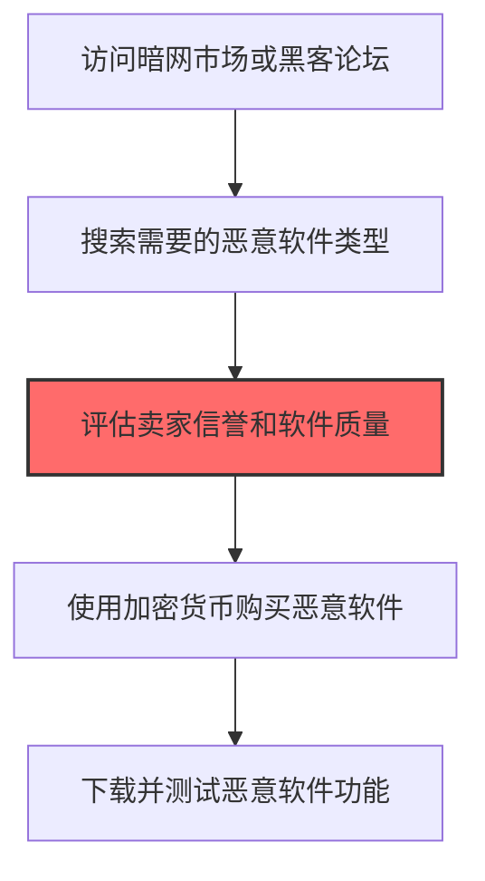
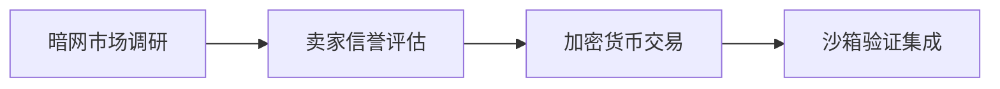

# 恶意软件 (T1588.001)

## 一句话通俗理解

> **从暗网购买木马、勒索软件、信息窃取器等**

## 30秒速查卡

| 项目 | 内容 |
|------|------|
| 攻击目标 | 购买现成恶意软件 |
| 典型手法 | 从暗网购买木马、勒索软件和信息窃取器 |
| 关键检测点 | 监控已知恶意软件特征和暗网交易关联IP |
| 难度等级 | ⭐⭐ |

## 难度等级

⭐⭐ 中级 - 需要一定的技术基础和经验

## 前置知识检查

**读这个文件需要什么？**

- [ ] 恶意软件开发流程基础
- [ ] C2基础设施概念
- [ ] 数字证书与代码签名基本原理

## 技术描述

**恶意软件**（T1588.001）是 **获取能力**（T1588）的一个具体变体，属于 **资源开发** 阶段的攻击技术。

> 🛒 **打个比方**：就像在暗网上买一把万能钥匙——攻击者可以直接购买现成的恶意软件，不需要自己开发。

### 具体怎么理解？

从暗网购买木马、勒索软件、信息窃取器等

攻击者使用这种技术时，通常是在资源开发阶段，想要达到特定的攻击目标。与父技术 T1588 相比，T1588.001 有自己独特的特点和使用场景。

### 为什么有效？

这种技术之所以有效，是因为：
1. **隐蔽性**：利用了正常系统功能或常见协议，不容易被发现
2. **技术门槛适中**：不需要特别高深的技术知识就能实施

**过渡段：** 不要以为资源开发只是'写恶意软件'——这是建立整个攻击作战体系的过程。
3. **广泛适用**：可以在多种环境和系统中使用

## 真实攻击流程



**步骤详解：**

1. **访问暗网市场** - 攻击者通过Tor浏览器访问暗网市场（如Russian Market、Exploit.in等）
2. **搜索恶意软件** - 查找所需的恶意软件类型：RAT（远程访问木马）、窃密软件、勒索软件等
3. **评估卖家信誉** - 查看卖家评分、历史交易记录和用户评价，确保交易可靠性，这是避免受骗的关键步骤
4. **购买恶意软件** - 使用比特币或门罗币支付，完成交易获取恶意软件下载链接
5. **测试验证** - 在隔离环境中测试购买的恶意软件功能是否完整、是否存在后门

### 典型场景

## 攻击流程

```
暗网市场调研 --> 卖家信誉评估 --> 加密货币交易 --> 沙箱验证集成
```



**步骤详解：**

1. **暗网市场调研** - 通过Tor访问Exploit.in、Russian Market等暗网论坛，搜索RAT、窃密器、勒索软件等现成恶意软件 | 浏览暗网市场分类、对比不同MaaS家族功能与价格 | Tor Browser, Exploit.in, Russian Market
2. **卖家信誉评估** - 查看卖家历史交易评分、用户反馈和样本截图，识别骗子卖家 | 验证卖家提供的技术支持响应、查看历史交易量、确认样本真实可用 | 暗网论坛评分系统, Telegram群组
3. **加密货币交易** - 使用门罗币或比特币支付（门罗币更难追踪），完成交易获取下载链接 | 通过混币器清洗资金、使用多重托管交易避免被骗 | Monero (XMR), Bitcoin (BTC), Wasabi Wallet
4. **沙箱验证集成** - 在隔离环境中运行购买的恶意软件，验证功能完整性、检查后门并将其集成到攻击工作流 | 检测恶意软件是否含卖家后门、测试C2通信、配置免杀打包 | ANY.RUN, Cuckoo Sandbox, Cobalt Strike

## 真实案例

### 案例1：UNC5537 -- 从暗网论坛购买凭证转储工具用于Snowflake攻击（2023-2024）

- **时间**: 2023-2024年
- **目标**: 全球范围内的企业和政府机构
- **攻击组织**: UNC5537
- **手法**: 从暗网论坛购买凭证转储工具用于Snowflake攻击
- **影响**: 数据窃取、横向移动、勒索或长期潜伏
- **参考链接**: Mandiant

### 案例2：FIN7 -- 从俄罗斯论坛购买PoS漏洞利用代码和C2框架（2017）

- **时间**: 2017年
- **目标**: 全球范围内的企业和政府机构
- **攻击组织**: FIN7
- **手法**: 从俄罗斯论坛购买PoS漏洞利用代码和C2框架
- **影响**: 凭证窃取、横向移动、数据窃取
- **参考链接**: DOJ

## 红队视角

> ⚠️ **免责声明**：以下内容仅用于合法的安全测试、渗透测试和教育目的。未经授权对他人系统进行测试是违法行为。

### 实战技巧

1. **深入理解原理**：在实战应用前，充分理解恶意软件的技术原理和适用场景
2. **环境适配**：根据目标系统的操作系统版本、安全配置等因素调整攻击策略
3. **组合使用**：将该技术与其他技术组合使用，构建完整的攻击链
4. **隐蔽性考虑**：注意操作痕迹的清理，避免被安全设备检测

### 常用工具

| 工具名称 | 用途 | 平台 | 链接 |
| -------- | ---- | ---- | ---- |
| 工具名称 | 用途 | 平台 | 链接 |
|----------|------|------|------|
| Exploit-DB | 漏洞利用数据库 | Web | [Exploit-DB](https://www.exploit-db.com/) |
| GitHub PoC搜索 | 公开利用代码 | Web | [GitHub](https://github.com/) |
| VirusTotal | 恶意软件样本查询 | Web | [VirusTotal](https://www.virustotal.com/) |
| 暗网论坛(Exploit/XSS) | 凭证和工具购买 | Web | - |

### 注意事项

- 在授权的测试环境中使用这些技术
- 注意操作安全（OPSEC），避免被检测系统发现
- 使用匿名化技术和代理隐藏真实身份

## 蓝队视角

### 检测要点

1. **系统日志监控**：关注与恶意软件相关的系统日志和审计记录
2. **异常行为检测**：监控系统中与该技术相关的异常进程、网络连接和文件操作
3. **工具特征识别**：识别攻击者可能使用的工具在系统中的运行特征

### 监控建议

- 部署端点检测和响应（EDR）系统，监控与恶意软件相关的异常行为
- 配置SIEM规则，关联分析来自多个来源的告警
- 定期进行安全评估和渗透测试，验证检测规则的有效性

## 避坑指南

关键误区：认为资源开发只是技术工作。

## 检测建议

### 检测思路

检测 恶意软件 的关键是识别异常行为模式。以下是三个层面的检测方法：

### 网络层检测

**方法**：监控网络流量中的异常模式

```bash
# 检测异常的网络连接和数据传输
# 根据具体协议和端口设置检测规则
```

### 主机层检测

**Windows事件ID**：
- 事件ID 4688：进程创建（监控可疑进程）
- 事件ID 4104：PowerShell执行（监控可疑脚本）

**Linux日志**：
- /var/log/auth.log：认证日志
- /var/log/syslog：系统日志

```bash
# 检测异常进程和命令执行
grep -i "suspicious" /var/log/auth.log
```

### 应用层检测


**用人话说：**资源开发检测重点是发现攻击基础设施的建设痕迹——短期内大量域名注册、证书申请或代码仓库创建都是危险信号。
## 用人话说

> **检测解读**：购买恶意软件是"买枪"——从暗网获取现成的攻击工具。监控已知恶意软件特征。
>
> **避坑指南**：购买的恶意软件通常会被重新打包以绕过检测，关注行为特征比文件特征更可靠。

**Sigma规则示例**：

```yaml
title: 检测恶意软件
status: experimental
description: 检测可能的恶意软件活动
logsource:
    category: process_creation
    product: windows
detection:
    selection:
        EventID: 4688
    condition: selection
level: medium
tags:
    - attack.T1588001
```

## 缓解措施

### 优先级1：关键措施

**限制攻击面**：减少暴露的服务和端口，降低被利用的风险

```bash
# 防火墙规则示例：只允许必要的出站连接
iptables -A OUTPUT -p tcp --dport 443 -j ACCEPT  # 允许HTTPS
iptables -A OUTPUT -p tcp --dport 80 -j ACCEPT   # 允许HTTP
iptables -A OUTPUT -p tcp -j DROP                 # 阻止其他TCP
```

### 优先级2：重要措施

**加强监控**：部署EDR和SIEM系统，实时监控异常行为

### 优先级3：建议措施

**安全意识培训**：教育员工识别相关攻击手法

## 动手实验

> ⚠️ **所有实验必须在隔离的实验室环境中进行**

### 实验1：理解基本原理（初级）

**目标**：理解 恶意软件 的工作原理

**步骤**：
1. 在隔离环境中搭建测试系统
2. 使用基础工具模拟攻击行为
3. 观察系统日志和网络流量

**学习要点**：理解该技术的核心机制

### 实验2：实际操作（中级）

**目标**：掌握 恶意软件 的实际使用方法

**步骤**：
1. 使用专业工具进行攻击模拟
2. 尝试不同的绕过技术
3. 分析检测日志的特征

**学习要点**：掌握工具使用和日志分析

### 实验3：防御验证（高级）

**目标**：验证检测规则的有效性

**步骤**：
1. 部署检测规则
2. 执行攻击模拟
3. 验证检测告警是否触发

**学习要点**：理解攻防对抗的实际效果

## 术语解释

| 术语 | 通俗解释 |
|------|---------|
| **ATT&CK** | MITRE公司维护的攻击技术知识库，像一本"黑客手法百科全书" |
| **恶意软件** | T1588.001，ATT&CK框架中定义的一种具体攻击技术 |
| **获取能力** | T1588，恶意软件所属的父技术类别 |
| **资源开发** | 攻击链中的一个阶段，攻击者在这个阶段的目标 |
| **C2** | 命令与控制，攻击者用来远程控制被入侵系统的"遥控器" |
| **EDR** | 端点检测与响应，部署在电脑上的安全监控软件 |

## 被引用情况

以下父技术文档引用了本子技术：

- [T1588 - 获取能力](../T1588-Obtain-Capabilities.md)

## 参考资料

### 📚 官方文档（深入了解）

- [MITRE ATT&CK - 恶意软件 (T1588.001)](https://attack.mitre.org/techniques/T1588/001/)
- [MITRE ATT&CK - 获取能力 (T1588)](https://attack.mitre.org/techniques/T1588/)

### 📰 安全报告（真实攻击）

- [MITRE ATT&CK 官方文档](https://attack.mitre.org/) - ATT&CK 框架官方资源

### 🔧 工具与资源（动手试试）

- [Atomic Red Team](https://github.com/redcanaryco/atomic-red-team) - 检测规则测试框架
- [MITRE ATT&CK Navigator](https://mitre-attack.github.io/attack-navigator/) - ATT&CK 可视化工具

### 📚 学习资料（深入了解）

- [MITRE ATT&CK 知识库](https://attack.mitre.org/resources/) - ATT&CK 官方资源中心
