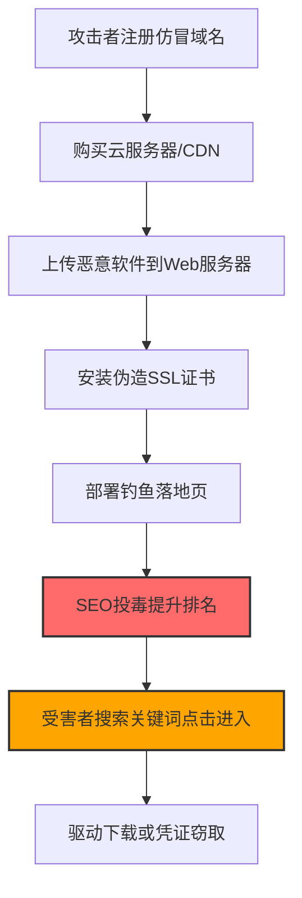
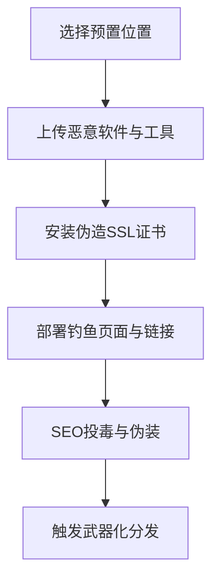

# 预置能力 (T1608)

## 一句话通俗理解

> **攻击者在正式发起攻击前，把"武器弹药"提前运到攻击阵地——上传木马、配置钓鱼网站、安装伪造证书、操纵搜索结果**

## 30秒速查卡

| 维度 | 你需要知道的 |
|------|-------------|
| 这是什么？ | 攻击者在资源开发阶段把恶意软件、工具、伪造证书、钓鱼网页等"武器"提前部署到他们将控制的基础设施上，为后续投递做准备 |
| 为什么危险？ | 预置完成后，攻击者只需一个触发动作（发链接、引流量）就能立即发动攻击，防御方几乎没有反应窗口 |
| 谁需要关心？ | 安全运维团队、威胁情报分析师、Web管理员、SOC分析师 |
| 你的第一步防御 | 监控自有服务器和云存储上的异常文件上传，对新注册的相似域名进行告警 |
| 如果只做一件事 | 对公司品牌的近似域名和SSL证书签发进行持续监控，发现仿冒立即响应 |

## 难度等级

⭐⭐⭐ 高级 - 需要Web服务部署、证书管理、SEO机制的基础知识

## 前置知识检查

**读这个文件需要什么？**

- [ ] Web服务器（Nginx/Apache）的基础配置
- [ ] SSL/TLS证书的签发与验证流程
- [ ] 搜索引擎优化（SEO）的基本原理
- [ ] 钓鱼攻击的投递链路

## 技术描述

**预置能力**（T1608）是资源开发战术中的关键技术，攻击者在正式发起攻击**之前**，将恶意软件、渗透工具、伪造证书、钓鱼网页、恶意广告等"武器"提前上传/部署到他们控制的基础设施上。

> 📡 **打个比方**：就像小偷在动手前先把撬棍、假身份证、逃跑用的车都准备好放在据点——真正作案时拎包就走，不用临时找工具。

### 具体怎么理解？

预置能力与"获取基础设施"（T1583）和"获取能力"（T1588）的区别在于**时机和目的**：

- **T1583/T1588**：买武器、买工具、买场地（采购阶段）
- **T1608**：把武器运到现场、装好瞄准镜、布置好退路（部署阶段）

攻击者在这个阶段做的事包括：
1. **上传恶意软件到Web服务器**（T1608.001）——为drive-by攻击或直接下载做准备
2. **上传渗透工具到跳板机**（T1608.002）——为入侵后的横向移动做准备
3. **安装伪造的SSL证书**（T1608.003）——让恶意网站看起来合法
4. **准备drive-by落地页**（T1608.004）——用户访问即中招的网页
5. **准备钓鱼链接目标页**（T1608.005）——仿冒登录页面
6. **SEO投毒**（T1608.006）——操纵搜索结果让恶意网站排前面

### 为什么有效？

这种技术之所以有效，是因为：
1. **缩短攻击窗口**：所有准备工作提前完成，触发攻击只需毫秒级操作
2. **降低暴露风险**：预置阶段使用合法云服务（GitHub、AWS S3、Cloudflare），与正常流量混杂
3. **提高可信度**：伪造的SSL证书让钓鱼网站在浏览器里显示"安全"绿锁
4. **绕过检测**：SEO投毒让用户主动访问恶意网站，不依赖邮件钓鱼等易被拦截的渠道

**过渡段：** 理解了"预置"的概念后，我们来看看真实的攻击者是怎么把这些准备动作落到实处的。

## 真实攻击流程



**步骤详解：**

1. **基础设施准备** - 攻击者注册与目标品牌相似的域名，购买云服务器或使用免费CDN服务
2. **武器上传** - 将恶意软件、钓鱼页面模板、C2工具上传到Web服务器，配置好目录结构
3. **证书安装** - 通过Let's Encrypt等免费CA签发证书，或使用盗取的合法证书，让网站显示HTTPS
4. **落地页部署** - 部署仿冒登录页或drive-by攻击页，配置好恶意脚本和重定向逻辑
5. **SEO投毒** - 通过黑帽SEO技术（关键词堆砌、垃圾外链、寄生虫页面）提升恶意网站在搜索结果中的排名
6. **触发攻击** - 受害者通过搜索引擎点击进入，或收到包含该链接的钓鱼邮件，攻击立即生效

## 攻击流程

### 典型攻击流程

```
选择预置位置 --> 上传恶意软件与工具 --> 安装伪造SSL证书 --> 部署钓鱼页面与链接 --> SEO投毒与伪装 --> 触发武器化分发
```



**步骤详解：**

1. **选择预置位置**
   - 通俗描述：先选好"弹药库"——是放在自己租的VPS上，还是塞进被入侵的合法网站里，或者借用CDN/云存储平台借壳上市
   - 技术细节：评估候选位置的域名信誉、TLS证书合法性、地理分布、吞吐能力；优先选择高信誉合法网站（被入侵的政府/教育/媒体站点）作为托管点，借其域名信誉绕过URL过滤；考虑使用GitHub、Pastebin、AWS S3、Discord CDN等合法平台托管Payload，利用其合法域名规避检测
   - 常用工具：Shodan（识别脆弱托管点）、AWS S3、GitHub Releases、Discord CDN

2. **上传恶意软件与工具**
   - 通俗描述：把准备好的"武器"运到弹药库里——木马、Loader、渗透工具包都要提前放好，等需要时立刻能用
   - 技术细节：将Payload上传至Web服务器隐藏路径（如 `/wp-content/uploads/.cache/`）；通过Steganography将Shellcode藏在图片/视频文件中规避静态检测；使用多阶段下载（Dropper → Loader → Implant）减少单点暴露；在合法云平台（S3、Azure Blob）上传加密Payload，运行时动态拉取解密
   - 常用工具：Cobalt Strike Stager、PowerShell Empire、Invoke-Obfuscation、Steghide

3. **安装伪造SSL证书**
   - 通俗描述：给"假网站"装上一把"安全锁"，让浏览器显示绿色小锁，受害者就更不容易起疑
   - 技术细节：通过Let's Encrypt免费签发合法SSL证书；使用被盗企业EV代码签名证书为Payload签名；通过BGP劫持或DNS缓存投毒配合CA验证流程获取目标域名的合法证书；配置C2服务器使用与目标合法服务一致的国密/SM2证书指纹
   - 常用工具：certbot、Let's Encrypt、Certify The Web、osslsigncode、osslsigncode

4. **部署钓鱼页面与链接**
   - 通俗描述：搭好"诱饵阵地"——克隆目标登录页、伪造软件下载页、设置短链跳转，让用户一不留神就踩进来
   - 技术细节：使用GoPhish/evilginx克隆目标登录页，配置AiTM代理实时代理凭据与OTP；注册同形异义域名（`micros0ft-login.com`）；使用URL Shortener（bit.ly、t.co）隐藏真实跳转目标；在合法网站注入iframe或JS重定向到钓鱼页
   - 常用工具：GoPhish、EvilGinx、Modlishka、Social Engineer Toolkit（SET）

5. **SEO投毒与伪装**
   - 通俗描述：让自己的恶意网站在搜索结果里"排到前面"，受害者一搜关键词就先看到攻击者的陷阱
   - 技术细节：通过Doorway Pages和Cloaking技术为搜索引擎爬虫展示合法内容，为真实用户跳转恶意页面；购买高权重过期域名（Expired Domain）注入恶意内容快速提升排名；针对热点事件（CVE披露、新产品发布）快速注册相关关键词域名；利用Google Dorking构造精准投放关键词
   - 常用工具：Google Search Console、Doorway Page生成器、过期域名检索平台（Expireddomains.net）

6. **触发武器化分发**
   - 通俗描述：所有"弹药"就位后，等待或主动触发攻击——发钓鱼邮件引诱用户点击、利用水坑攻击让访问者自动中招
   - 技术细节：通过钓鱼邮件投递短链/附件引诱用户访问预置Payload；在被入侵合法网站植入Drive-by Download脚本，访问者浏览器自动触发漏洞利用链；利用Malvertising在广告网络投毒，用户点击广告即被重定向至Exploit Kit；监测各预置点的下载量、C2回连数，动态调整投放节奏
   - 常用工具：Gophish（邮件投递）、Malvertising平台、Exploit Kit（RIG、Fallout）

## 真实案例

### 案例1：SolarWinds供应链攻击中的SUNSPOT预置（APT29）

- **时间**：2019-2020年
- **目标**：SolarWinds公司及其18000+客户（包括美国政府机构）
- **攻击组织**：APT29（Cozy Bear，俄罗斯SVR背景）
- **手法**：APT29提前在SolarWinds的构建环境中部署了SUNSPOT恶意软件，将合法的Orion更新包替换为包含SUNBURST后门的版本。整个预置过程持续数月，攻击者耐心等待合法更新周期触发分发
- **影响**：导致包括美国财政部、商务部、国土安全部在内的多个政府机构被入侵
- **参考链接**：[Mandiant SUNBURST分析](https://www.mandiant.com/resources/blog/sunburst-additional-technical-details)

### 案例2：SEO投毒攻击仿冒软件下载站（GootLoader）

- **时间**：2021-2024年持续活跃
- **目标**：搜索合法软件/文档的各类企业用户
- **攻击组织**：GootLoader运营团伙（疑似东欧背景）
- **手法**：攻击者入侵合法网站，植入SEO投毒代码，当用户搜索特定关键词（如"员工合同模板"）时，被重定向到恶意网站。该网站预置了伪造的JavaScript文件，用户下载执行后即感染GootLoader加载器，最终投放勒索软件
- **影响**：每月感染数千个组织，多个勒索软件家族通过此渠道传播
- **参考链接**：[Sophos GootLoader分析](https://www.sophos.com/en-us/press-office/press-releases/2021/04/sophos-reveals-how-the-gootloader-malware-is-built-to-evade-detection)

### 案例3：伪造证书钓鱼攻击（TA453针对研究人员）

- **时间**：2022年
- **目标**：中东政策研究人员、智库学者
- **攻击组织**：TA453（Charming Kitten，伊朗APT）
- **手法**：TA453预置了多个仿冒学术会议网站，使用Let's Encrypt签发的合法SSL证书，在搜索结果中排名靠前。研究人员访问后，被引导至伪造的登录页面，凭证被窃取后用于入侵其所在机构的邮箱和云存储
- **影响**：多个智库和研究机构凭证泄露
- **参考链接**：[Proofpoint TA453分析](https://www.proofpoint.com/us/blog/threat-insight/ta453-spoofsscholars)

## 子技术列表

| 子技术ID | 中文名称 | 通俗解释 |
|----------|----------|----------|
| T1608.001 | 上传恶意软件 | 把木马上传到Web服务器，等用户访问时驱动下载 |
| T1608.002 | 上传工具 | 把渗透工具（如Cobalt Strike）上传到跳板机，入侵后直接使用 |
| T1608.003 | 安装数字证书 | 在恶意服务器上装SSL证书，让钓鱼网站显示HTTPS绿锁 |
| T1608.004 | Drive-by目标 | 部署带浏览器漏洞利用的网页，用户访问即中招 |
| T1608.005 | 链接目标 | 部署钓鱼登录页，诱导用户输入凭证 |
| T1608.006 | SEO投毒 | 操纵搜索结果让恶意网站排在前面，用户主动点击 |

## 红队视角

> ⚠️ **免责声明**：以下内容仅用于合法的安全测试、渗透测试和教育目的。未经授权对他人系统进行测试是违法行为。

### 实战技巧

1. **预置时机选择**：在目标组织的低峰期（如周末/节假日）完成预置，降低被发现概率
2. **基础设施伪装**：使用Cloudflare等CDN隐藏真实服务器IP，使用合法云服务（GitHub Pages、AWS S3）托管钓鱼页面
3. **证书策略**：优先使用Let's Encrypt签发的免费证书，比自签名证书更不容易被浏览器拦截
4. **SEO策略**：针对目标员工可能搜索的业务关键词（如"VPN登录"、"Outlook Web Access"）进行投毒

### 常用工具

| 工具名称 | 用途 | 平台 | 链接 |
| -------- | ---- | ---- | ---- |
| Evilginx2 | 中间人钓鱼框架，可绕过MFA | 全平台 | [Evilginx2](https://github.com/kgretzky/evilginx2) |
| Modlishka | 反向代理钓鱼工具 | Linux | [Modlishka](https://github.com/drk1wi/Modlishka) |
| Gophish | 钓鱼模拟平台，可托管钓鱼页面 | 全平台 | [Gophish](https://getgophish.com/) |
| certbot | Let's Encrypt证书自动签发 | 全平台 | [Certbot](https://certbot.eff.org/) |

### 注意事项

- 在授权的测试环境中使用这些技术
- 预置的钓鱼页面必须有明确的时间限制和日志记录
- 使用合法签发的证书进行测试，避免使用自签名证书

## 蓝队视角

### 检测要点

1. **文件上传监控**：关注Web服务器、云存储（S3/Azure Blob）上的异常文件上传，特别是可执行文件和脚本
2. **证书透明度日志**：监控CT日志中对公司品牌域名的证书签发，发现仿冒域名立即告警
3. **SEO异常**：监控公司品牌关键词的搜索结果排名变化，发现异常新网站
4. **DNS监控**：对新注册的相似域名进行告警，关注MX/TXT记录异常

### 监控建议

- 部署证书透明度监控服务（如CertSpotter、Censys），对公司品牌域名的证书签发实时告警
- 使用威胁情报平台监控相似域名注册
- 对Web服务器配置文件完整性监控（FIM），检测Nginx/Apache配置异常修改
- 部署WAF规则检测drive-by攻击页面特征

## 避坑指南

防御者最痛苦教训：只盯着邮件钓鱼，忽略SEO投毒。很多组织有成熟的邮件安全网关，但员工通过搜索引擎进入钓鱼网站时完全没有防护。

## 检测建议

### 检测思路

检测预置能力的关键是监控"攻击准备阶段"的异常行为。以下是三个层面的检测方法：

### 证书透明度检测

**用人话说：** 这条规则在监控"谁给你的品牌域名签了证书"——攻击者要做一个逼真的钓鱼网站，必须先搞一张SSL证书让浏览器显示HTTPS绿锁。证书透明度日志（CT Log）是公开的，所有人都能查。你只需要设置一个监控：只要有人对包含你公司名字的域名（比如"microsoft-login.com"、"apple-id-verify.net"）签发证书，立即告警。CertSpotter和Censys都提供这种服务，免费版每天扫描一次，付费版实时告警。

**操作命令：**

```bash
# 使用crt.sh查询包含特定关键词的证书签发记录
curl -s "https://crt.sh/?q=%25.yourcompany.com&output=json" | jq -r '.[].name_value' | sort -u

# 使用CertSpotter监控新签发证书
# 注册后自动监控，发现匹配立即邮件告警
```

### Web服务器文件监控

**用人话说：** 这条规则在监控"你的服务器上突然多了什么文件"——攻击者预置武器时，必然要往Web服务器上传东西。正常情况下Web目录的文件变化应该是有规律的（如日志轮转、缓存文件），如果突然出现.exe、.dll、.ps1或者陌生的PHP文件，基本就是被预置了恶意内容。用文件完整性监控（FIM）工具持续校验Web根目录的文件哈希，任何新增或修改都告警。

**Sigma规则示例：**

```yaml
title: 检测Web目录异常文件上传
status: experimental
description: 监控Web服务器根目录下的可执行文件和脚本文件创建
logsource:
    category: file_event
    product: linux
detection:
    selection:
        TargetFilename|contains:
            - '/var/www/'
            - '/usr/share/nginx/html/'
            - '/opt/lampp/htdocs/'
        TargetFilename|endswith:
            - '.exe'
            - '.dll'
            - '.ps1'
            - '.sh'
            - '.php'
    filter_legitimate:
        Image|startswith:
            - '/usr/bin/apt'
            - '/usr/bin/dpkg'
    condition: selection and not filter_legitimate
level: high
tags:
    - attack.resource_development
    - attack.t1608
    - attack.t1608.001
```

### 域名相似度检测

**用人话说：** 这条规则在监控"有人注册了和你长得像的域名"——攻击者做钓鱼网站前必须先注册一个相似域名，比如你公司是"company.com"，他会注册"company-login.com"、"company-secure.net"、"cornpany.com"（用rn代替m）。这类域名注册后通常24-48小时内就会部署钓鱼网站。用域名相似度算法（Levenshtein距离）对你的品牌域名做模糊匹配监控，发现相似域名立即告警。

**操作命令：**

```bash
# 使用dnstwist检测相似域名（每天运行一次）
dnstwist --registered yourcompany.com | grep -v "^Original"

# 输出示例：
# homoglyph.company.com -> xn--compny-0za.com (已注册)
# insertion.company.com -> companyy.com (已注册)
```

## 缓解措施

### 优先级1：关键措施

**证书透明度监控**：对所有包含公司品牌关键词的域名证书签发进行实时监控

```bash
# 注册CertSpotter免费监控
# https://sslmate.com/certspotter/
# 配置告警邮箱和Webhook
```

### 优先级2：重要措施

**Web服务器加固**：限制Web目录写入权限，配置文件完整性监控

```bash
# Nginx Web目录设置为只读（除必要的缓存目录）
chown -R root:nginx /usr/share/nginx/html
chmod -R 755 /usr/share/nginx/html
# 配置auditd监控关键目录
auditctl -w /usr/share/nginx/html -p wa -k web_content_change
```

### 优先级3：建议措施

**品牌域名保护**：预防性注册常见变体域名（拼写错误、常见前缀后缀）

## 动手实验

> ⚠️ **所有实验必须在隔离的实验室环境中进行**

### 实验1：证书透明度查询（初级）

**目标**：理解证书透明度日志如何暴露攻击者的预置行为

**步骤**：
1. 访问 https://crt.sh/
2. 搜索你公司的域名，查看历史证书签发记录
3. 搜索一个已知钓鱼域名，查看其证书签发时间线
4. 对比合法证书和可疑证书的签发者

**预期输出**：一份包含域名、签发时间、签发CA的表格

### 实验2：搭建钓鱼页面并检测（中级）

**目标**：在实验室环境中模拟预置能力部署并验证检测规则

**步骤**：
1. 在隔离VM上搭建Nginx服务器
2. 使用certbot签发Let's Encrypt测试证书
3. 部署一个仿冒登录页面
4. 配置auditd文件监控规则
5. 模拟文件上传，观察告警

**预期输出**：auditd日志中的告警记录

### 实验3：SEO投毒检测（高级）

**目标**：理解SEO投毒的检测方法

**步骤**：
1. 使用Google Search Console监控品牌关键词排名
2. 设置Google Alerts对品牌名变体进行监控
3. 使用dnstwist定期扫描相似域名
4. 对新发现的相似域名进行WHOIS和DNS记录分析

**预期输出**：相似域名监控报告

## 术语解释

| 术语 | 通俗解释 |
|------|---------|
| **ATT&CK** | MITRE公司维护的攻击技术知识库，像一本"黑客手法百科全书" |
| **预置能力** | T1608，攻击者在正式攻击前把武器部署到基础设施上的技术 |
| **资源开发** | 攻击链中的一个阶段，攻击者在这个阶段准备攻击所需的一切资源 |
| **Drive-by** | 用户访问恶意网页即被感染，无需点击下载 |
| **SEO投毒** | 操纵搜索引擎结果，让恶意网站排在用户搜索的前列 |
| **证书透明度** | 公开的SSL证书签发日志，可用于发现仿冒证书 |
| **C2** | 命令与控制，攻击者用来远程控制被入侵系统的"遥控器" |

## 被引用情况

本技术属于资源开发战术（TA0042），被以下场景引用：

- 初始访问（TA0001）阶段的钓鱼攻击（T1566）依赖预置的钓鱼页面
- 初始访问阶段的drive-by攻击依赖预置的恶意网页
- 命令与控制（TA0011）阶段依赖预置的C2基础设施

## 参考资料

### 📚 官方文档（深入了解）

- [MITRE ATT&CK - Stage Capabilities (T1608)](https://attack.mitre.org/techniques/T1608/) - 官方技术定义
- [MITRE ATT&CK - Resource Development战术](https://attack.mitre.org/tactics/TA0042/) - 所属战术
- [证书透明度日志](https://certificate.transparency.dev/) - CT日志官方文档

### 🔧 工具与资源（动手试试）

- [crt.sh](https://crt.sh/) - 证书透明度查询
- [CertSpotter](https://sslmate.com/certspotter/) - 证书监控服务
- [dnstwist](https://github.com/elceef/dnstwist) - 域名相似度检测
- [Gophish](https://getgophish.com/) - 钓鱼模拟平台

### 📰 安全报告（真实攻击）

- [Mandiant SUNBURST分析](https://www.mandiant.com/resources/blog/sunburst-additional-technical-details) - SolarWinds供应链攻击
- [Sophos GootLoader分析](https://www.sophos.com/en-us/press-office/press-releases/2021/04/sophos-reveals-how-the-gootloader-malware-is-built-to-evade-detection) - SEO投毒攻击
- [Proofpoint TA453分析](https://www.proofpoint.com/us/blog/threat-insight/ta453-spoofsscholars) - 伪造证书钓鱼
