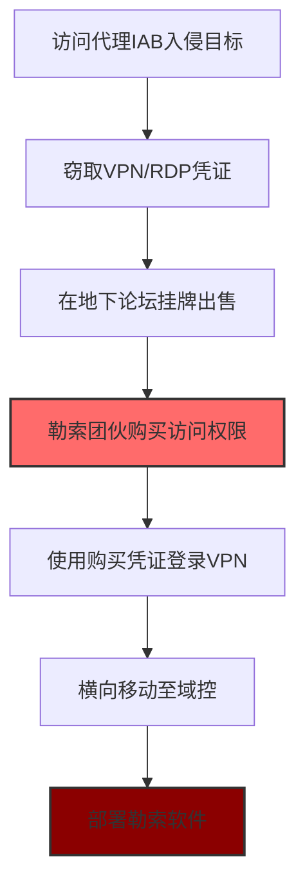
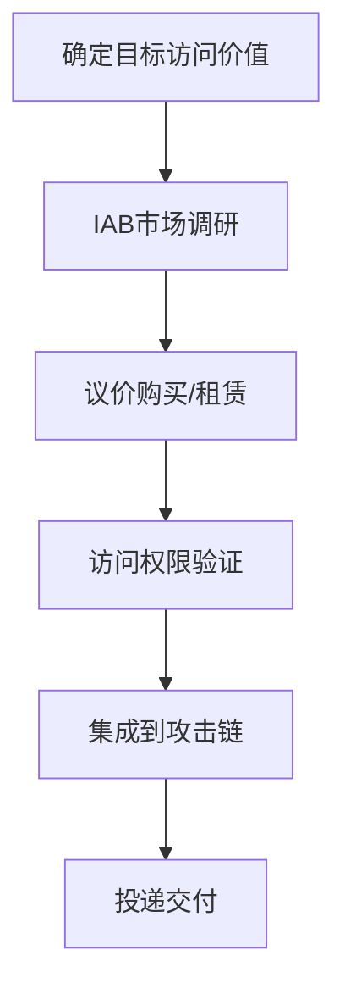

# 获取访问权限 (T1650)

## 一句话通俗理解

> **攻击者不走正门——直接从黑市买通已经"混进去"的人，或者买下已经拿到入场券的账户，省去自己突破的麻烦**

## 30秒速查卡

| 维度 | 你需要知道的 |
|------|-------------|
| 这是什么？ | 攻击者通过购买、租用或交易的方式，从第三方获取对目标系统的初始访问权限，而非自己动手入侵 |
| 为什么危险？ | 这种方式绕过了目标的外围防御（防火墙、WAF、邮件网关），攻击者直接拿到内部立足点 |
| 谁需要关心？ | 安全运维团队、威胁情报分析师、身份与访问管理团队 |
| 你的第一步防御 | 监控暗网和地下论坛中涉及公司名称的访问权限交易，对异地异常登录进行强认证 |
| 如果只做一件事 | 部署UEBA监控账户行为异常，对从未见过的登录地点/设备/IP强制MFA |

## 难度等级

⭐⭐⭐ 高级 - 需要了解地下经济生态、访问代理（IAB）运作模式、企业身份体系

## 前置知识检查

**读这个文件需要什么？**

- [ ] 企业身份体系（Active Directory、SSO、SAML）
- [ ] 地下论坛和暗网市场的基本运作
- [ ] 访问代理（Initial Access Broker）概念
- [ ] MFA和条件访问策略

## 技术描述

**获取访问权限**（T1650）是资源开发战术中的一种技术，攻击者通过**购买、租用或交易**的方式从第三方获取对目标系统的初始访问权限，而不是自己动手入侵。

> 📡 **打个比方**：就像小偷不自己撬锁，而是花钱雇一个已经混进大楼的保洁阿姨，让她从里面把门打开——省去了撬锁、躲避监控、绕过门禁的麻烦。

### 具体怎么理解？

T1650与"损害账户"（T1586）的区别在于**获取方式**：

- **T1586**：攻击者自己通过钓鱼、暴力破解等方式窃取账户凭证
- **T1650**：攻击者从第三方（通常是访问代理IAB）购买已经拿到的访问权限

访问代理（Initial Access Broker, IAB）是近年来兴起的职业黑客角色，他们专门负责入侵目标、拿到访问权限后，在地下论坛挂牌出售。购买方通常是勒索软件团伙，他们不愿意花时间做初始入侵，更愿意花钱买现成的。

常见交易形式：
1. **VPN/RDP凭证**：IAB入侵后窃取VPN或RDP凭证，打包出售
2. **域管理员权限**：高价值目标，价格可达数万美元
3. **云平台控制台**：AWS/Azure的root或管理员凭证
4. **邮件账户**：用于后续钓鱼和社会工程学
5. **持久化后门**：已部署C2的受控系统，可直接接手

### 为什么有效？

这种技术之所以有效，是因为：
1. **绕过外围防御**：访问权限已经是"内部"的，防火墙和WAF形同虚设
2. **缩短攻击链**：购买方跳过侦察和初始入侵阶段，直接进入横向移动
3. **降低暴露风险**：购买方不直接接触目标网络，溯源难度大
4. **专业化分工**：IAB专注入侵，勒索团伙专注勒索，效率更高

**过渡段：** 理解了"买访问权限"的概念后，我们来看看真实的IAB是怎么做生意的。

## 真实攻击流程



**步骤详解：**

1. **IAB入侵** - 访问代理通过钓鱼、漏洞利用等方式入侵目标组织的员工账户或边缘系统
2. **权限窃取** - 提取VPN凭证、RDP密码、域账户等，验证可用性和权限级别
3. **挂牌出售** - 在地下论坛（如RAMP、XSS.is）发布销售帖，标明目标行业、权限级别、价格
4. **交易完成** - 勒索团伙通过加密货币支付，获得凭证和访问指南
5. **使用凭证** - 购买方使用VPN/RDP凭证直接登录目标网络，绕过外围防御
6. **横向移动** - 从初始立足点向域控、关键服务器移动
7. **勒索部署** - 在足够多的系统上部署勒索软件，发动勒索攻击

## 攻击流程

### 典型攻击流程

```
确定目标访问价值 --> IAB市场调研 --> 议价购买/租赁 --> 访问权限验证 --> 集成到攻击链 --> 投递交付
```



**步骤详解：**

1. **确定目标访问价值**
   - 通俗描述：先想清楚要"买什么门钥匙"——是某个企业的VPN账号、域控管理员凭据，还是RDP直连权限，不同权限级别价格天差地别
   - 技术细节：评估目标组织的资产价值（行业、营收规模、数据敏感性）与攻击收益；明确所需权限类型（VPN/ Citrix/ RDP/ SSH/ Web应用后台/ 云控制台/ AD域账号）；确定权限级别（普通用户/特权用户/域管理员）；评估目标的防御能力（EDR、MFA、日志留存），MFA缺失或弱MFA的访问点溢价明显
   - 常用工具：OSINT情报（LinkedIn、Crunchbase）、Shodan、Censys、公开漏洞披露库

2. **IAB市场调研**
   - 通俗描述：去"黑市"逛一圈，比价找货——看看暗网论坛、Telegram渠道里有没有人卖目标的访问权限，谁家货真价实
   - 技术细节：浏览主流IAB交易市场（RAMP、Exploit.in、XSS.is、Genesis Market、Russian Market）寻找匹配listing；关注专门倒卖企业访问权限的IAB运营者（如Conti关联IAB、FIN7相关渠道）；使用Telegram bot实时监控新上架访问权限（如 `@access_market_bot` 类频道）；通过中间人（Broker）撮合大额交易，降低双方跑单风险
   - 常用工具：Tor Browser、Telegram、I2P、Genesis Marketplace、Russian Market

3. **议价购买/租赁**
   - 通俗描述：和卖家谈价——是直接买断还是按月租用，能不能先试后付，价格通常从几十美元到几万美元不等
   - 技术细节：根据权限级别、目标规模、地理位置、行业属性定价（普通VPN账号 $50-$500，域控权限 $5K-$50K+）；选择买断（永久）或订阅（按周/月续费）模式；约定支付方式（BTC、XMR、LTC，XMR因隐私性溢价10-20%）；通过Escrow（托管）服务保障交易，常见托管平台为论坛内置第三方担保
   - 常用工具：Monero Wallet、Bitcoin Mixer（ChipMixer、Whirlpool）、Escrow Service、PGP加密通信

4. **访问权限验证**
   - 通俗描述：拿到"钥匙"后先试开一下门——确认账号能登录、权限没过期、目标环境还没被攻防方接管，验货无误再付款
   - 技术细节：使用专属沙箱（独立VPS+VPN链路）测试登录，避免暴露真实身份；验证权限有效性（账号未禁用、密码未改、MFA状态）；检查目标EDR/SIEM是否存在异常告警或蜜罐迹象；枚举可访问资产（AD域信息、文件共享、内部应用），评估可横向移动范围；通过 `whoami /groups`、`net user`、BloodHound 等确认权限真实级别
   - 常用工具：RDP客户端、BloodHound、SharpHound、ADRecon、Cuckoo Sandbox

5. **集成到攻击链**
   - 通俗描述：把"钥匙"配到自己的工具链上——接入C2框架、部署持久化后门、准备好横向移动工具，让这把钥匙长期可用
   - 技术细节：将购买凭据导入C2框架（Cobalt Strike的Beacon、Sliver Implant）建立初始 foothold；部署持久化机制（计划任务、WMI订阅、注册表Run键、Golden Ticket）；使用购买的高权限账号创建隐蔽后门账号或修改GPO；规避账户所有者察觉（保持低频登录、复用现有session token、避免修改密码）
   - 常用工具：Cobalt Strike、Sliver、Metasploit、Empire、Mimikatz

6. **投递交付**
   - 通俗描述：完成"消费"——把访问权限转手给下游勒索团伙、APT组织，或者直接用于勒索软件投递、数据窃取等最终攻击
   - 技术细节：将访问权限连同目标情报（域结构、关键资产、备份位置）打包出售给RaaS运营商（按赎金分成15-30%）；直接触发勒索软件投递（PsExec批量推送、WMI远程执行）；执行数据窃取（rclone同步至Mega/云存储）为双重勒索铺垫；攻击完成后清除购买痕迹、销毁与IAB的通信记录，防止溯源
   - 常用工具：rclone、PsExec、PsExec、Cobalt Strike Execute-Assembly、LockerBat（勒索软件分发工具）

## 真实案例

### 案例1：Conti勒索软件购买访问权限（IAB生态）

- **时间**：2021-2022年
- **目标**：全球多个行业的中大型企业
- **攻击组织**：Conti勒索软件团伙 + 多个IAB供应商
- **手法**：Conti团伙长期从多个IAB购买VPN和RDP访问权限，价格从几百到数万美元不等。根据FBI泄露的Conti内部聊天记录，该团伙有专门的"采购人员"负责在地下论坛寻找合适的访问权限。一次典型交易：以3000美元购买某医疗公司的VPN凭证，2小时内完成勒索软件部署
- **影响**：攻击了超过1000个组织，造成数亿美元损失
- **参考链接**：[CISA Conti安全警报](https://www.cisa.gov/news-events/cybersecurity-advisories/aa21-265a)

### 案例2：LockBit通过Access Market购买初始访问（IAB生态）

- **时间**：2022-2023年
- **目标**：制造业、医疗、教育等行业
- **攻击组织**：LockBit勒索软件团伙
- **手法**：LockBit运营者在多个地下论坛（RAMP、Exploit.in）长期采购初始访问权限。一份泄露的Affiliate指南显示，LockBit建议新加入的成员优先购买访问权限而非自己入侵，因为"省时省力且成功率高"。他们偏好购买Citrix、Pulse Secure、Fortinet等VPN设备的凭证
- **影响**：截至2023年，攻击了超过2000个组织，是当时最活跃的勒索软件家族
- **参考链接**：[Cisco Talos LockBit分析](https://blog.talosintelligence.com/lockbit-3-0/)

### 案例3：ShinyHunters出售企业GitLab访问权限（IAB生态）

- **时间**：2020-2021年
- **目标**：多个科技企业（包括Adobe、Microsoft、Samsung）
- **攻击组织**：ShinyHunters（IAB角色）
- **手法**：黑客ShinyHunters利用配置错误的GitLab实例获取对多家企业的代码仓库访问权限，然后在暗网市场公开出售这些访问权限和数据。购买方可以利用这些权限进一步入侵企业网络，或直接利用泄露的源代码寻找漏洞
- **影响**：影响数十家企业，部分数据被用于后续勒索
- **参考链接**：[BleepingComputer ShinyHunters报道](https://www.bleepingcomputer.com/news/security/shinyhunters-hacker-sells-data-of-15-companies-stolen-from-gitlab/)

## 子技术列表

本技术无子技术。

## 红队视角

> ⚠️ **免责声明**：以下内容仅用于合法的安全测试、渗透测试和教育目的。未经授权对他人系统进行测试是违法行为。

### 实战技巧

1. **红队模拟IAB**：在授权测试中，模拟从"内部人员"获取访问权限的场景，验证内部检测能力
2. **凭证泄露监控**：测试组织在HIBP、DeHashed等平台的凭证泄露监控是否到位
3. **异地登录检测**：验证UEBA是否能检测到使用购买凭证从陌生IP/地理位置的登录
4. **权限提升路径**：拿到初始访问权限后，测试从普通用户到域管的提权路径

### 常用工具

| 工具名称 | 用途 | 平台 | 链接 |
| -------- | ---- | ---- | ---- |
| HaveIBeenPwned | 凭证泄露查询 | Web | [HIBP](https://haveibeenpwned.com/) |
| DeHashed | 凭证泄露数据库 | Web | [DeHashed](https://www.dehashed.com/) |
| BloodHound | AD攻击路径分析 | Windows | [BloodHound](https://github.com/BloodHoundAD/BloodHound) |
| Impacket | AD协议工具包 | Python | [Impacket](https://github.com/fortra/impacket) |

### 注意事项

- 在授权的测试环境中使用这些技术
- 模拟购买访问权限的场景需要法律部门审批
- 不要在真实地下论坛进行任何交易研究

## 蓝队视角

### 检测要点

1. **异地登录检测**：监控从未见过的地理位置、IP段、设备的登录行为
2. **UEBA异常行为**：分析账户行为基线，检测偏离正常模式的操作
3. **凭证泄露监控**：订阅HIBP等服务的API，监控企业邮箱是否出现在泄露数据库中
4. **地下论坛监控**：使用威胁情报服务监控暗网和地下论坛中涉及公司名称的帖子

### 监控建议

- 部署条件访问策略，对新IP/新设备的登录强制MFA
- 配置Azure AD/Okta的"风险登录"检测策略，对高风险登录自动阻断
- 订阅暗网监控服务（如ZeroFox、Flashpoint），监控公司品牌和域名的泄露
- 对VPN和RDP登录进行行为分析，检测异常使用模式（如凌晨登录、短时间多次登录）

## 避坑指南

防御者最痛苦教训：只盯着外围入侵，忽略"内部人卖了钥匙"。很多组织有成熟的边界防御和入侵检测，但完全没有监控账户的异常使用。当IAB把凭证卖给勒索团伙后，后者用合法凭证登录VPN，看起来就像正常员工，传统IDS/IPS根本不会告警。

## 检测建议

### 检测思路

检测获取访问权限的关键是识别"凭证换了主人"的异常行为。以下是三个层面的检测方法：

### 异地登录检测

**用人话说：** 这条规则在监控"员工账号从陌生地方登录"——访问权限被卖掉后，买方通常从与原用户不同的地理位置登录。比如一个北京的员工，凭证被卖给俄罗斯的勒索团伙，那从莫斯科IP的VPN登录就是重大告警信号。即使攻击者用VPN跳板，登录时的设备指纹、浏览器UA、时区信息也会与正常员工不同。

**Sigma规则示例：**

```yaml
title: 检测VPN异地异常登录
status: experimental
description: 监控VPN登录中的异地和异常时间登录
logsource:
    product: vpn
detection:
    selection_successful:
        action: 'login'
        result: 'success'
    filter_known_geo:
        SourceIP|geoip:
            country:
                - 'CN'  # 假设组织主要在中国
    filter_known_hours:
        TimeGenerated|timezone:
            start: '08:00'
            end: '20:00'
    condition: selection_successful and not filter_known_geo
level: high
falsepositives:
    - 员工出差
    - VPN服务商IP池变更
tags:
    - attack.resource_development
    - attack.t1650
    - attack.t1078
```

### 凭证泄露监控

**用人话说：** 这条规则在监控"你的员工密码出现在黑市数据库里"——IAB怎么拿到访问权限？很多情况就是员工在第三方网站用了和公司一样的密码，那个网站被脱库后密码就流入黑市。订阅HIBP的API，把企业邮箱列表上传，只要有一个邮箱出现在泄露数据库中，立即强制改密。这不是可选项，是每个组织都该做的基本动作。

**操作命令：**

```bash
# 使用HIBP API批量检查企业邮箱是否泄露
# 需要API Key（付费）
for email in $(cat employee_emails.txt); do
    result=$(curl -s -H "hibp-api-key: YOUR_KEY" \
        "https://haveibeenpwned.com/api/v3/breachedaccount/$email")
    if [ -n "$result" ]; then
        echo "[ALERT] $email found in breaches: $result"
    fi
done
```

### 行为异常检测（UEBA）

**用人话说：** 这条规则在监控"员工账号的行为不像他本人"——凭证被卖掉后，买方登录后会做正常员工不会做的事，比如凌晨3点大批量下载文件、访问平时不接触的共享目录、短时间尝试多个系统。UEBA（用户实体行为分析）会为每个用户建立行为基线，任何显著偏离都会告警。比如某财务员工突然开始访问研发代码仓库，这就是典型的"账号换人了"信号。

**Splunk SPL示例：**

```splunk
# 检测异常的文件访问行为
index=windows sourcetype=WinEventLog:Security EventCode=5145
[| inputlookup user_baseline | fields user]
| stats count as access_count, dc(ShareName) as unique_shares by user, src_ip
| where access_count > 100 OR unique_shares > 5
| lookup user_baseline user OUTPUT normal_access_count
| where access_count > normal_access_count * 3
```

## 缓解措施

### 优先级1：关键措施

**强制MFA和条件访问**：对所有远程访问强制多因素认证，对新设备/新IP强制二次验证

```bash
# Azure AD条件访问策略示例（PowerShell）
# 对所有非受信任位置的登录强制MFA
$conditions = New-Object -TypeName Microsoft.Open.MSGraph.Model.ConditionalAccessCondition
$conditions.Applications = New-Object Microsoft.Open.MSGraph.Model.ConditionalAccessApplication
$conditions.Applications.IncludeApplications = "All"
$conditions.Locations = New-Object Microsoft.Open.MSGraph.Model.ConditionalAccessLocation
$conditions.Locations.IncludeLocations = "All"
$conditions.Locations.ExcludeLocations = @("Trusted_IPs")
```

### 优先级2：重要措施

**凭证泄露监控**：订阅HIBP/DeHashed等服务的API，持续监控企业邮箱

### 优先级3：建议措施

**最小权限原则**：定期审查账户权限，移除不需要的管理员权限

## 动手实验

> ⚠️ **所有实验必须在隔离的实验室环境中进行**

### 实验1：凭证泄露查询（初级）

**目标**：理解凭证泄露如何成为IAB的"货源"

**步骤**：
1. 访问 https://haveibeenpwned.com/
2. 输入自己的个人邮箱查询是否泄露
3. 查看泄露事件详情，了解泄露了哪些信息
4. 思考：如果企业邮箱也这样泄露，风险有多大

**预期输出**：邮箱泄露历史报告

### 实验2：异地登录检测配置（中级）

**目标**：在实验室中配置异地登录检测规则

**步骤**：
1. 在实验室搭建OpenVPN服务器
2. 从不同IP段登录，记录日志
3. 配置Splunk/Elasticsearch的异地登录告警规则
4. 模拟异常登录，验证告警触发

**预期输出**：异地登录告警截图

### 实验3：UEBA基线建模（高级）

**目标**：理解用户行为基线的建立和异常检测

**步骤**：
1. 收集实验室用户一周的正常活动日志
2. 建立用户行为基线（登录时间、访问资源、使用频率）
3. 模拟异常行为（如凌晨访问、大量下载）
4. 验证基线偏离检测是否触发

**预期输出**：UEBA基线报告和异常告警

## 术语解释

| 术语 | 通俗解释 |
|------|---------|
| **ATT&CK** | MITRE公司维护的攻击技术知识库，像一本"黑客手法百科全书" |
| **获取访问权限** | T1650，攻击者通过购买或交易方式获取对目标系统的访问权限 |
| **资源开发** | 攻击链中的一个阶段，攻击者在这个阶段准备攻击所需的资源 |
| **IAB** | Initial Access Broker，初始访问代理，专门入侵目标然后出售访问权限的黑客 |
| **UEBA** | 用户实体行为分析，通过建立行为基线检测异常的技术 |
| **MFA** | 多因素认证，需要密码+手机验证码等多种身份验证 |
| **VPN** | 虚拟专用网络，远程接入企业内网的通道 |

## 被引用情况

本技术属于资源开发战术（TA0042），被以下场景引用：

- 初始访问（TA0001）阶段的有效账户使用（T1078）依赖购买到的凭证
- 勒索软件攻击通常以购买的访问权限作为起点
- 持久化（TA0003）阶段可以利用购买到的权限建立后门

## 参考资料

### 📚 官方文档（深入了解）

- [MITRE ATT&CK - Acquire Access (T1650)](https://attack.mitre.org/techniques/T1650/) - 官方技术定义
- [MITRE ATT&CK - Resource Development战术](https://attack.mitre.org/tactics/TA0042/) - 所属战术
- [CISA关于IAB的报告](https://www.cisa.gov/) - 政府机构对IAB生态的警示

### 🔧 工具与资源（动手试试）

- [HaveIBeenPwned](https://haveibeenpwned.com/) - 凭证泄露查询
- [DeHashed](https://www.dehashed.com/) - 凭证泄露数据库
- [BloodHound](https://github.com/BloodHoundAD/BloodHound) - AD攻击路径分析
- [Impacket](https://github.com/fortra/impacket) - AD协议工具包

### 📰 安全报告（真实攻击）

- [CISA Conti安全警报](https://www.cisa.gov/news-events/cybersecurity-advisories/aa21-265a) - Conti勒索软件IAB采购
- [Cisco Talos LockBit分析](https://blog.talosintelligence.com/lockbit-3-0/) - LockBit访问权限采购
- [BleepingComputer ShinyHunters报道](https://www.bleepingcomputer.com/news/security/shinyhunters-hacker-sells-data-of-15-companies-stolen-from-gitlab/) - IAB出售访问权限
