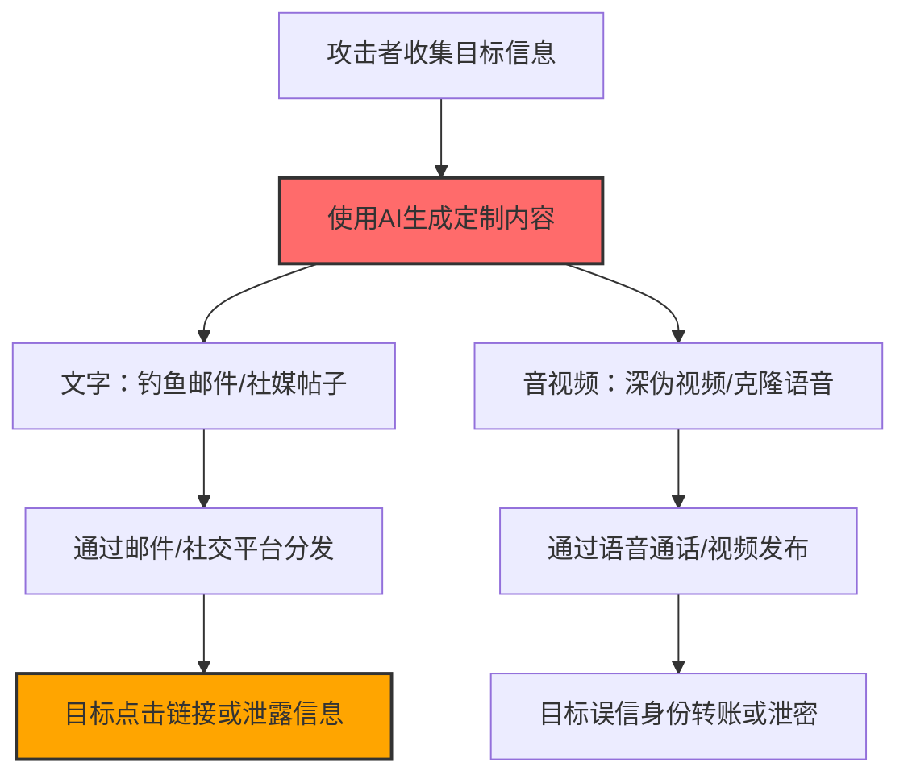
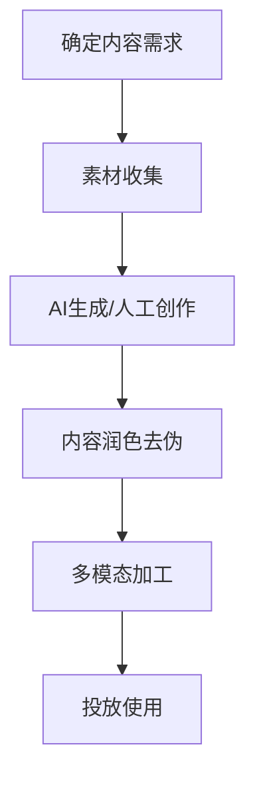

# 生成内容 (T1683)

## 一句话通俗理解

> **攻击者当起了"内容创作者"——写钓鱼文案、做深伪视频、生成假新闻，为社工攻击和虚假信息活动准备"弹药"**

## 30秒速查卡

| 维度 | 你需要知道的 |
|------|-------------|
| 这是什么？ | 攻击者创建文本、音频、视频等内容，用于钓鱼邮件、社交媒体操纵、虚假信息传播等目的 |
| 为什么危险？ | 高质量的内容让钓鱼和社会工程学攻击更逼真，AI工具让生成成本极低、数量极大 |
| 谁需要关心？ | 安全意识培训团队、品牌保护团队、威胁情报分析师 |
| 你的第一步防御 | 对员工进行深度伪造（Deepfake）识别培训，建立内容真伪验证流程 |
| 如果只做一件事 | 部署邮件安全网关的AI生成内容检测功能，对疑似AI生成的钓鱼邮件提高告警级别 |

## 难度等级

⭐⭐ 中级 - 需要内容创作能力和基础技术知识，AI工具降低了门槛

## 前置知识检查

**读这个文件需要什么？**

- [ ] 社会工程学攻击的基本原理
- [ ] AI内容生成工具（ChatGPT、Midjourney、ElevenLabs等）的基础使用
- [ ] 深度伪造（Deepfake）技术概念
- [ ] 钓鱼邮件的常见特征

## 技术描述

**生成内容**（T1683）是资源开发战术中的技术，攻击者创建**文本、音频、视频等内容**，用于钓鱼攻击、社交媒体操纵、虚假信息传播等目的。随着AI工具的普及，内容生成的门槛大幅降低，攻击者可以快速批量生成高质量内容。

> 📡 **打个比方**：就像诈骗团伙里专门负责写剧本的人——其他人负责打电话、收钱，而这个人负责把"我是秦始皇打钱"这种话术写得更有说服力，甚至用AI克隆领导声音录音。

### 具体怎么理解？

T1683与"预置能力"（T1608）的区别在于**输出物**：

- **T1608**：预置基础设施（上传木马、部署钓鱼页面）
- **T1683**：生成内容素材（写钓鱼文案、做深伪视频、生成假身份资料）

两种内容类型：
1. **文字内容**（T1683.001）：钓鱼邮件正文、社交媒体帖子、假新闻文章、虚假简历
2. **音视频内容**（T1683.002）：深度伪造视频、克隆语音录音、合成直播

### 为什么有效？

这种技术之所以有效，是因为：
1. **降低门槛**：AI工具让非专业人士也能生成逼真内容
2. **批量生产**：可以快速生成数百封定制化钓鱼邮件
3. **个性化**：根据目标信息定制内容，绕过通用模板检测
4. **可信度**：深度伪造可以冒充高管声音/视频，传统检测手段失效

**过渡段：** 理解了"生成内容"的概念后，我们来看看真实的攻击者是怎么把这些内容用在攻击中的。

## 真实攻击流程



**步骤详解：**

1. **目标信息收集** - 攻击者收集目标组织的内部用语、高管声音样本、业务流程等信息
2. **内容生成** - 使用AI工具生成定制化内容：钓鱼邮件模仿内部语气、深伪视频模仿高管讲话、克隆语音用于电话诈骗
3. **内容分发** - 通过邮件、社交媒体、电话、视频平台等渠道分发生成的内容
4. **目标响应** - 目标被逼真内容欺骗，点击链接、泄露信息或执行转账
5. **攻击达成** - 攻击者获得凭证、资金或敏感信息

## 攻击流程

### 典型攻击流程

```
确定内容需求 --> 素材收集 --> AI生成/人工创作 --> 内容润色去伪 --> 多模态加工 --> 投放使用
```



**步骤详解：**

1. **确定内容需求**
   - 通俗描述：先想清楚要"造什么假"——是模仿目标CEO的声音骗一笔转账，还是生成虚假新闻搅乱舆论，或是合成目标人物的虚假视频用于敲诈
   - 技术细节：明确攻击场景（社会工程学电话钓鱼、虚假新闻传播、敲诈勒索、身份冒充、虚假证据栽赃）；确定目标人物（公开人物音视频素材充足，合成效果好）和内容主题；评估所需内容格式（音频/视频/图像/文本）和时长；分析目标受众与可信度门槛（金融反诈模型、记者核查能力、家人识别能力）
   - 常用工具：OSINT调研（LinkedIn、Twitter、YouTube）、威胁建模工具、目标人物素材库

2. **素材收集**
   - 通俗描述：去"采集样本"——把目标人物的声音、视频、照片尽可能多地收集起来，AI学得越像，骗人的成功率越高
   - 技术细节：从社交媒体（YouTube演讲、Twitter视频、Instagram Story）、企业官网（CEO致辞视频）、新闻采访、播客音频收集目标样本；针对语音克隆需3秒-30分钟纯净音频（VALL-E仅需3秒，ElevenLabs需30分钟以上）；针对人脸合成需多角度高清照片和视频片段；提取文本风格样本（邮件、博客、公开声明）用于文本生成模型微调
   - 常用工具：yt-dlp、Wayback Machine、Sherlock（用户名跨平台检索）、Audacity（音频清洗）

3. **AI生成/人工创作**
   - 通俗描述：用AI"开动机器"——把素材喂给模型，几分钟就能生成一段几可乱真的语音或视频，或者让大语言模型写出以假乱真的钓鱼邮件
   - 技术细节：语音克隆使用VALL-E、ElevenLabs、Tacotron2、VITS、RVC（Real-Time Voice Cloning）训练目标音色模型；视频换脸使用DeepFaceLab、Roop、FaceSwap、SadTalker（口型同步）；文本生成使用GPT-4、Claude、DeepSeek配合Few-shot Prompt模仿目标写作风格；图像生成使用Stable Diffusion、Midjourney配合LoRA微调目标人物脸型
   - 常用工具：ElevenLabs、VALL-E、DeepFaceLab、Roop、SadTalker、Stable Diffusion、GPT-4、Claude

4. **内容润色去伪**
   - 通俗描述：给"AI作品"做精修——调一调语调不自然的地方，去掉视频中边界模糊的破绽，让它经得起一般人的肉眼和耳朵检验
   - 技术细节：修复语音克隆中的金属感、断句不自然（使用RVC后处理、Adobe Audition降噪、Equalizer APO调音）；视频换脸后处理边界融合、光照匹配、表情同步（After Effects、DaVinci Resolve）；对抗Deepfake检测器的对抗样本扰动（添加微小噪声干扰频域分析）；调整生成内容与真实素材的时间戳、设备元数据保持一致
   - 常用工具：Adobe Audition、DaVinci Resolve、After Effects、FFmpeg、ExifTool

5. **多模态加工**
   - 通俗描述：把"成品"组合起来——给假语音配上假来电显示，给假视频配上背景音乐和字幕，做成立体化的诈骗素材包
   - 技术细节：结合Caller ID Spoofing（通过SIP trunk伪造目标CEO来电号码）配合语音克隆进行电话钓鱼；将Deepfake视频嵌入虚假新闻网页框架，配合伪造媒体Logo和URL（如 `bbc-news.co`）；生成配套的虚假文档（PDF发票、邮件签名、企业公文）形成完整证据链；使用TTS+Lip Sync实现实时Deepfake视频通话（如2024年香港跨国公司欺诈案中的实时换脸会议）
   - 常用工具：Asterisk/SIP Server（来电伪造）、OBS Studio（实时直播合成）、Wav2Lip（实时口型同步）、HFaceFusion

6. **投放使用**
   - 通俗描述：把"陷阱"摆出去——打电话、发邮件、发社交媒体，等受害者上钩，钱到账、舆论起来、勒索对象就范
   - 技术细节：通过VoIP平台（Twilio、RingCentral）配合Caller ID Spoofing拨打目标财务人员电话实施CEO语音诈骗；通过钓鱼邮件投递Deepfake视频链接配合虚假新闻引导投资或声誉打击；通过Telegram/暗网论坛发布Deepfake敲诈素材勒索目标；监测受害者反应（转账记录、社交媒体讨论、舆情热度）动态调整策略；攻击完成后销毁中间素材和模型权重防止溯源
   - 常用工具：Twilio、RingCentral、GoPhish、Telegram Bot、Hootsuite（社交媒体投放）

## 真实案例

### 案例1：Deepfake语音诈骗冒充CEO（2019年英国能源公司案）

- **时间**：2019年3月
- **目标**：英国某能源公司德国子公司CEO
- **攻击组织**：未知（疑似有组织犯罪团伙）
- **手法**：攻击者使用AI语音克隆技术，模仿该公司母公司CEO的声音，打电话给德国子公司CEO，要求其紧急转账22万美元至匈牙利供应商账户。攻击者使用的语音克隆品质极高，连CEO的德国口音和语调都完美复制。电话中"CEO"以"需要紧急支付否则面临违约金"为由施压
- **影响**：德国CEO在1小时内完成转账，22万美元损失，资金被转移后无法追回
- **参考链接**：[WSJ Deepfake语音诈骗报道](https://www.wsj.com/articles/fraudsters-use-ai-to-mimic-ceos-voice-in-unusual-cybercrime-case-11567874154)

### 案例2：ChatGPT生成定制化钓鱼邮件（2023年多起案件）

- **时间**：2023年至今
- **目标**：多个行业的企业员工
- **攻击组织**：多个攻击团伙
- **手法**：攻击者使用ChatGPT等大语言模型生成高度定制化的钓鱼邮件。与传统钓鱼邮件的语法错误、模板化用语不同，AI生成的邮件语法完美、语气自然、甚至能模仿目标公司内部用语。部分攻击者还使用AI根据LinkedIn等公开信息为每个目标生成个性化邮件，使得传统的"模板匹配"检测完全失效
- **影响**：钓鱼邮件点击率显著上升，多个组织凭证泄露
- **参考链接**：[SlashNext AI钓鱼报告](https://slashnext.com/blog/slashnext-state-of-phishing-2023/)

### 案例3：深度伪造视频冒充乌克兰总统（2022年深伪视频事件）

- **时间**：2022年3月
- **目标**：乌克兰民众和国际社会
- **攻击组织**：疑似与俄罗斯相关的信息战团伙
- **手法**：攻击者制作了一段深度伪造视频，模仿乌克兰总统泽连斯基宣布"投降"并呼吁士兵放下武器。视频通过社交媒体和 hacked 的乌克兰新闻网站传播。虽然视频质量存在瑕疵（面部边缘不自然、嘴型不同步），但在传播初期造成了短暂混乱
- **影响**：视频在社交媒体获得数百万次播放，被辟谣前造成短暂恐慌
- **参考链接**：[BBC Deepfake泽连斯基报道](https://www.bbc.com/news/technology-60780142)

## 子技术列表

| 子技术ID | 中文名称 | 通俗解释 |
|----------|----------|----------|
| T1683.001 | 文字内容 | 撰写钓鱼邮件、社交媒体帖子、假新闻、虚假简历等文字素材 |
| T1683.002 | 音视频内容 | 制作深度伪造视频、克隆语音、合成直播等音视频素材 |

## 红队视角

> ⚠️ **免责声明**：以下内容仅用于合法的安全测试、渗透测试和教育目的。未经授权对他人系统进行测试是违法行为。

### 实战技巧

1. **个性化内容**：根据LinkedIn、公司官网等公开信息为每个目标定制邮件内容
2. **语气模仿**：使用AI分析目标公司内部邮件风格，生成符合内部用语的钓鱼邮件
3. **多模态组合**：先用AI生成文字邮件建立信任，再用深伪语音电话"确认"请求
4. **时机选择**：在目标组织的高管出差、财务月底结算等时机发起，降低质疑

### 常用工具

| 工具名称 | 用途 | 平台 | 链接 |
| -------- | ---- | ---- | ---- |
| ChatGPT/Claude | 文字内容生成 | Web | [OpenAI](https://openai.com/) |
| ElevenLabs | 语音克隆 | Web | [ElevenLabs](https://elevenlabs.io/) |
| HeyGen | 深度伪造视频 | Web | [HeyGen](https://www.heygen.com/) |
| Gophish | 钓鱼模拟分发 | 全平台 | [Gophish](https://getgophish.com/) |

### 注意事项

- 在授权的测试环境中使用这些技术
- 所有生成的内容必须明确标注"测试用途"
- 深度伪造测试必须获得被模仿者的书面授权

## 蓝队视角

### 检测要点

1. **AI内容检测**：部署AI生成内容检测工具，识别可疑的邮件和社交媒体内容
2. **多模态验证**：对涉及资金转账、敏感操作的请求，要求多渠道验证（邮件+电话+视频）
3. **流程管控**：建立明确的审批流程，任何转账、权限变更都必须双人确认
4. **员工培训**：定期进行深度伪造识别培训，建立"异常请求必须二次验证"的文化

### 监控建议

- 部署邮件安全网关的AI检测功能，对疑似AI生成的邮件提高告警级别
- 对高管声音/视频建立"声纹库"，用于识别深伪内容
- 建立内部多渠道验证流程，任何资金转账请求必须通过至少两个独立渠道确认
- 监控社交媒体上冒充公司官方账号的内容发布

## 避坑指南

防御者最痛苦教训：依赖"语法错误"识别钓鱼邮件。传统钓鱼邮件常有拼写错误、生硬表达，但AI生成的邮件语法完美、语气自然。如果安全培训还在教"看语法错误识别钓鱼"，面对AI钓鱼会完全失效。

## 检测建议

### 检测思路

检测生成内容的关键是识别"内容不像真人写的"或"身份不像真的"。以下是三个层面的检测方法：

### AI生成文字检测

**用人话说：** 这条规则在监控"邮件是不是AI写的"——AI生成的文字有些微妙特征：用词过于"完美"（没有人类常有的口语化表达）、句式结构高度统一、逻辑过于线性。可以用AI检测工具（如GPTZero、Originality.ai）分析邮件内容，判断是否为AI生成。对于高敏感场景（如高管邮件要求转账），即使检测工具说"可能是人类写的"，也应该进行二次验证。

**操作命令：**

```python
# 使用Python调用GPTZero API检测AI生成内容
import requests

def detect_ai_content(text):
    url = "https://api.gptzero.me/v2/predict/text"
    headers = {"x-api-key": "YOUR_API_KEY"}
    data = {"text": text}
    response = requests.post(url, json=data, headers=headers)
    result = response.json()
    # 关键字段：fully_generated_prob, overall_burstiness
    if result.get('documents', [{}])[0].get('completely_generated_prob', 0) > 0.5:
        return "[ALERT] 高概率AI生成内容"
    return "[OK] 可能是人类撰写"

# 检测邮件正文
email_body = "Dear colleague, I hope this email finds you well..."
print(detect_ai_content(email_body))
```

### 深度伪造视频检测

**用人话说：** 这条规则在监控"视频是不是AI合成的"——深度伪造视频虽然越来越逼真，但仍有破绽：眨眼频率异常、面部边缘模糊、嘴型与音频不同步、光照不一致。可以用专门的深伪检测工具（如Deepware、Sensity）分析视频。对于涉及高管讲话的视频，建立"基准声纹/人脸库"，任何偏离基准的视频都需要人工复核。

**Python检测示例：**

```python
# 使用开源深度伪造检测库
# pip install facenet-pytorch torch

import torch
from facenet_pytorch import MTCNN
import cv2

def detect_deepfake(video_path):
    mtcnn = MTCNN()
    cap = cv2.VideoCapture(video_path)
    blink_count = 0
    frame_count = 0
    
    while cap.isOpened():
        ret, frame = cap.read()
        if not ret: break
        frame_count += 1
        # 检测面部关键点，分析眨眼频率
        faces = mtcnn(frame)
        # 正常人每分钟眨眼15-20次
        # 深伪视频眨眼频率常异常（过少或不自然）
    
    cap.release()
    # 如果眨眼频率偏离正常范围，标记为可疑
    return blink_count, frame_count
```

### 语音克隆检测

**用人话说：** 这条规则在监控"电话那头的声音是不是克隆的"——克隆语音虽然能模仿音色，但在呼吸、停顿、情感波动等细节上仍有破绽。对于涉及资金转账的电话请求，建立"声纹验证"流程：系统要求来电者说出预设的验证短语，与登记的声纹库对比。如果通话中检测到异常（如没有呼吸声、停顿不自然），标记为可疑并强制要求视频验证。

**操作建议：**

```bash
# 部署声纹验证系统（如使用开源的SpeechBrain）
# 1. 为高管建立声纹库
python verify_voice.py --enroll --user ceo --audio baseline_samples/

# 2. 通话中实时验证
python verify_voice.py --verify --user ceo --audio live_call.wav
# 输出: 验证分数 0.32 (低于阈值0.5，可疑)
```

## 缓解措施

### 优先级1：关键措施

**建立多渠道验证流程**：任何涉及资金转账、权限变更的请求，必须通过至少两个独立渠道确认

```
# 转账审批流程示例
1. 收到邮件请求 → 不直接执行
2. 通过公司通讯录查找高管电话 → 通话确认（不使用邮件中的号码）
3. 如果金额超过阈值 → 要求视频确认
4. 两人授权 → 财务执行
```

### 优先级2：重要措施

**员工深度伪造识别培训**：定期进行AI钓鱼和深伪识别培训

### 优先级3：建议措施

**声纹/人脸基准库**：为高管建立声纹和人脸基准库，用于身份验证

## 动手实验

> ⚠️ **所有实验必须在隔离的实验室环境中进行**

### 实验1：AI钓鱼邮件识别（初级）

**目标**：理解AI生成内容与传统钓鱼的区别

**步骤**：
1. 使用ChatGPT生成一封钓鱼邮件（模拟授权测试）
2. 对比传统模板钓鱼邮件的语法错误
3. 使用GPTZero检测AI生成概率
4. 思考：传统检测规则能否识别AI钓鱼

**预期输出**：AI检测报告

### 实验2：深度伪造识别（中级）

**目标**：学习识别深度伪造视频的破绽

**步骤**：
1. 在授权条件下制作一段简单的深伪视频（使用HeyGen等工具）
2. 逐帧分析面部边缘、眨眼频率、嘴型同步
3. 总结深伪视频的常见破绽
4. 尝试使用检测工具识别

**预期输出**：深伪视频分析报告

### 实验3：多渠道验证流程设计（高级）

**目标**：设计防深伪的身份验证流程

**步骤**：
1. 分析组织现有的转账审批流程
2. 设计多渠道验证方案（邮件+电话+视频）
3. 定义异常处理规则
4. 编写流程文档和培训材料

**预期输出**：多渠道验证流程文档

## 术语解释

| 术语 | 通俗解释 |
|------|---------|
| **ATT&CK** | MITRE公司维护的攻击技术知识库，像一本"黑客手法百科全书" |
| **生成内容** | T1683，攻击者创建文字、音视频等内容用于攻击的技术 |
| **资源开发** | 攻击链中的一个阶段，攻击者在这个阶段准备攻击资源 |
| **深度伪造** | Deepfake，使用AI生成逼真的虚假视频或音频 |
| **语音克隆** | 使用AI复制特定人的声音特征 |
| **GPTZero** | AI生成内容检测工具 |
| **Burstiness** | 文本的"突发性"，AI生成文本通常突发性较低 |

## 被引用情况

本技术属于资源开发战术（TA0042），被以下场景引用：

- 初始访问（TA0001）阶段的钓鱼攻击（T1566）使用生成的内容
- 收集（TA0009）阶段通过生成的社媒内容诱导信息泄露
- 影响战术（TA0040）的虚假信息传播使用生成的音视频内容

## 参考资料

### 📚 官方文档（深入了解）

- [MITRE ATT&CK - Generate Content (T1683)](https://attack.mitre.org/techniques/T1683/) - 官方技术定义
- [MITRE ATT&CK - Resource Development战术](https://attack.mitre.org/tactics/TA0042/) - 所属战术
- [CISA深伪威胁报告](https://www.cisa.gov/) - 政府机构对深伪威胁的警示

### 🔧 工具与资源（动手试试）

- [GPTZero](https://gptzero.me/) - AI生成内容检测
- [Deepware Scanner](https://deepware.ai/) - 深伪视频检测
- [Gophish](https://getgophish.com/) - 钓鱼模拟平台
- [ElevenLabs](https://elevenlabs.io/) - 语音克隆（授权测试用）

### 📰 安全报告（真实攻击）

- [WSJ Deepfake语音诈骗](https://www.wsj.com/articles/fraudsters-use-ai-to-mimic-ceos-voice-in-unusual-cybercrime-case-11567874154) - CEO语音克隆诈骗
- [SlashNext AI钓鱼报告](https://slashnext.com/blog/slashnext-state-of-phishing-2023/) - AI生成钓鱼邮件
- [BBC Deepfake泽连斯基](https://www.bbc.com/news/technology-60780142) - 深伪视频信息战
