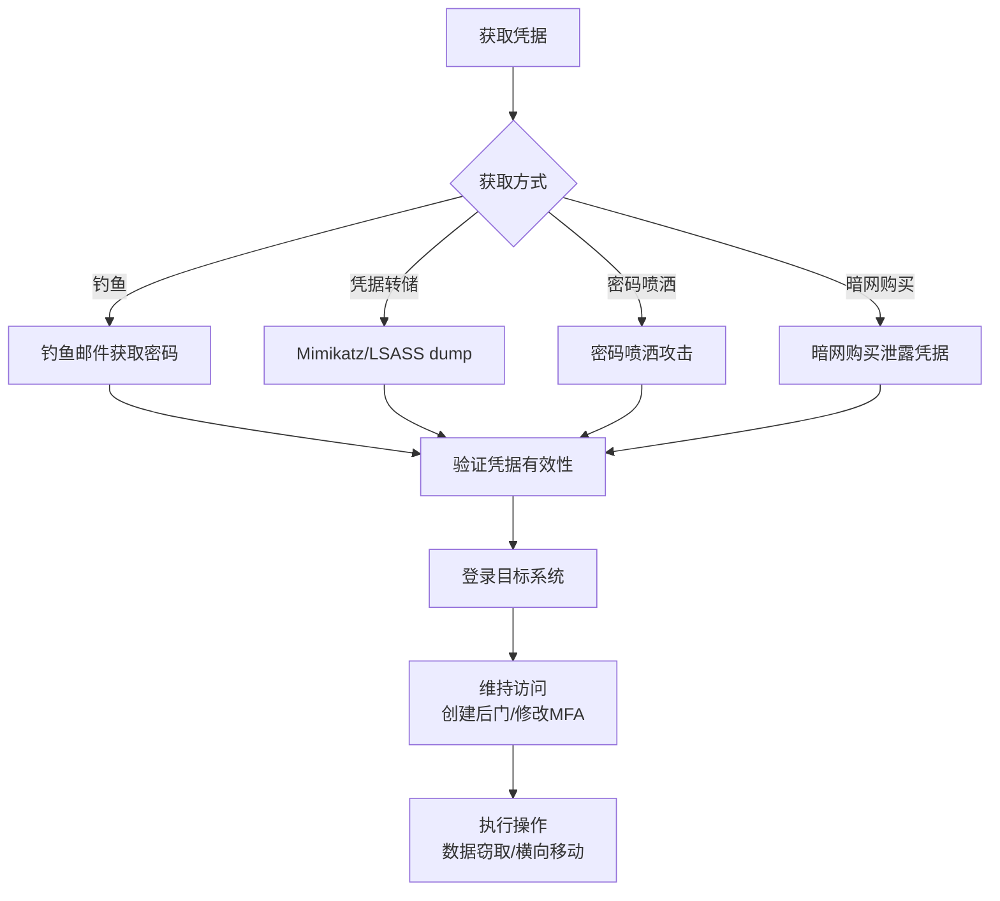

# 有效账户 (T1078)

## 一句话通俗理解

攻击者用偷来的钥匙开门——使用合法的账户凭据登录系统，因为"钥匙"是真的，门卫不会拦。

## 30秒速查卡

| 维度 | 你需要知道的 |
|------|-------------|
| 这是什么？ | 攻击者使用窃取的合法账户凭据登录系统，伪装成合法用户 |
| 为什么危险？ | 使用合法凭据登录不会触发安全告警，攻击者可以合法地访问系统资源 |
| 谁需要关心？ | IT运维、SOC分析师、身份管理团队 |
| 你的第一步防御 | 对所有重要账户强制启用MFA（多因素认证） |
| 如果只做一件事 | 监控异常登录行为（异常时间、异常地点、异常设备），对偏离基线的登录立即告警 |

## 难度等级

⭐⭐ 中级（需要凭据获取能力和对目标环境的了解）

**前置知识要求：**
- 身份认证机制（密码、MFA、SSO、OAuth）
- 账户管理基础（AD、LDAP、云IAM）
- 常见凭据窃取方法

## 前置知识检查

**读这个文件需要什么？**

- [ ] 身份认证基本概念（用户名/密码、令牌、MFA）
- [ ] Active Directory或云IAM的基本结构
- [ ] 常见凭据窃取方法（钓鱼、暴力破解、凭据转储）

## 技术描述

有效账户（T1078）是MITRE ATT&CK框架中隐蔽战术的一种技术，指攻击者使用窃取或获取的合法账户凭据登录系统，以合法用户身份进行操作，从而绕过基于身份的访问控制。

**通俗解释：**

想象一栋办公大楼，门卫检查每个人的工牌。如果你伪造工牌，门卫可能会发现是假的。但如果你偷了一个真实员工的工牌，用这个真工牌进去，门卫看到工牌是真的，就放你进去了——因为从他的角度，你就是一个合法员工。攻击者使用合法凭据登录系统就是同样的道理。

**过渡段：** 简单来说，系统的安全控制通常区分"合法用户"和"非法用户"。合法用户有密码、令牌或证书，可以正常登录。攻击者通过钓鱼、暴力破解或凭据窃取获取这些合法凭据后，就能以"合法用户"身份登录，安全系统不会拦截，因为凭据是正确的。

**技术原理：**

1. **凭据窃取**：通过钓鱼邮件、凭据转储（Mimikatz）、网络嗅探获取用户密码
2. **令牌窃取**：窃取Kerberos票据、NTLM哈希、OAuth令牌、Session Cookie
3. **凭据爆破**：使用获取的密码字典对登录接口进行密码喷洒
4. **默认账户利用**：使用未修改的默认账户密码（如admin/admin）
5. **云账户接管**：通过凭据填充攻击接管云平台账户

**用途与影响：**
有效账户是最常见的初始访问方式之一。使用合法凭据登录不会触发安全告警，攻击者可以合法地访问邮件、文件、应用和云资源。许多APT组织将凭据窃取作为首选的初始访问手段，因为它比漏洞利用更隐蔽。

## 子技术列表

| 子技术ID | 名称 | 说明 |
|----------|------|------|
| T1078.001 | 默认账户 | 使用厂商默认账户密码 |
| T1078.002 | 域账户 | 使用Active Directory域账户 |
| T1078.003 | 本地账户 | 使用本地系统账户 |
| T1078.004 | 云账户 | 使用云平台账户 |
| T1078.005 | 组账户 | 使用组共享账户 |

## 攻击流程

### 典型攻击流程

```
获取凭据 --> 验证凭据有效性 --> 登录系统 --> 维持访问 --> 执行操作
```



**步骤详解：**

1. **获取凭据**
   - 通俗描述：通过各种方式获取合法用户的密码或令牌
   - 技术细节：钓鱼邮件、Mimikatz转储LSASS、密码喷洒、暗网购买
   - 常用工具：Mimikatz、Hydra、自定义钓鱼页面

2. **验证凭据有效性**
   - 通俗描述：测试偷来的密码能不能用
   - 技术细节：使用VPN、OWA、RDP等入口验证凭据，注意避免触发账户锁定
   - 常用工具：自定义验证脚本

3. **登录系统**
   - 通俗描述：用合法凭据正常登录
   - 技术细节：通过VPN、RDP、SSH、Web邮箱等入口登录，行为与正常用户无异
   - 常用工具：标准远程访问工具

4. **维持访问**
   - 通俗描述：确保以后还能进来
   - 技术细节：修改MFA设置、添加新凭据、创建后门账户、注册新设备
   - 常用工具：MFA管理接口、AD管理工具

## 真实案例

### 案例1：APT29使用有效账户攻击SolarWinds供应链（2020年）

- **时间**：2020年
- **目标**：SolarWinds供应链攻击受害者
- **攻击组织**：APT29（Cozy Bear，俄罗斯SVR）
- **手法**：APT29在SolarWinds攻击中，通过SUNBURST后门窃取了目标组织的域账户凭据。随后使用这些合法凭据通过VPN和RDP登录受害者网络，行为完全合法。攻击者还窃取了SAML令牌，通过Golden SAML攻击伪造身份认证令牌，以合法用户身份访问云服务（如Office 365邮件）。由于使用的是合法凭据和令牌，传统的安全检测没有触发任何告警。
- **影响**：攻击者在受害者网络中潜伏9个月才被发现
- **参考链接**：[CISA Alert AA21-078A](https://www.cisa.gov/news-events/cybersecurity-advisories/aa21-078a)

### 案例2：LAPSUS$使用有效账户攻击大型科技公司（2022年）

- **时间**：2022年
- **目标**：Microsoft、NVIDIA、Samsung、Okta、Uber
- **攻击组织**：LAPSUS$（青少年黑客团伙）
- **手法**：LAPSUS$主要通过购买暗网泄露的员工凭据或通过社会工程学获取凭据。他们使用这些合法凭据登录目标的VPN和内部系统。对于启用了MFA的账户，LAPSUS$使用MFA疲劳攻击（MFA Fatigue Attack）——反复发送MFA推送通知，直到用户厌烦后点击"批准"。一旦获得访问权限，他们立即在Azure AD中注册新设备并添加自己的MFA认证方式。
- **影响**：成功入侵多家全球顶级科技公司，造成重大数据泄露
- **参考链接**：[Microsoft LAPSUS$ Analysis](https://www.microsoft.com/en-us/security/blog/2022/03/22/dev-0537-criminal-actor-targeting-organizations-for-data-exfiltration-and-destruction/)

### 案例3：APT41使用有效账户攻击云环境（2021年）

- **时间**：2021年
- **目标**：全球云环境用户
- **攻击组织**：APT41（双重间谍组织，中国背景）
- **手法**：APT41利用凭据填充攻击（Credential Stuffing），使用从数据泄露事件中获取的凭据字典对云平台登录接口进行批量测试。对于成功登录的账户，攻击者利用云平台的IAM权限创建后门账户、修改安全组规则、部署恶意实例。他们还窃取了云平台的临时安全令牌（STS Token），这些令牌有时效性但不需要MFA。
- **影响**：多个云环境被入侵，数据被窃取
- **参考链接**：[Google TAG APT41 Cloud Attack](https://blog.google/threat-analysis-group/new-campaign-targeting-security-researchers/)

## 红队视角

> ⚠️ **免责声明**：以下内容仅用于合法的安全测试、渗透测试和教育目的。未经授权对他人系统进行测试是违法行为。

### 实战技巧

1. **密码喷洒攻击**
   ```bash
   # 使用一个常用密码对多个账户尝试（避免账户锁定）
   # 工具示例：Ruler（Exchange）
   ruler —domain target.com —brute —users users.txt —passwords passwords.txt —delay 30
   ```

2. **MFA绕过**
   - MFA疲劳攻击：反复发送推送通知等待用户批准
   - SIM劫持：接管用户手机号接收短信验证码
   - Session Cookie窃取：通过Evilginx等中间人钓鱼获取已认证的Session Cookie

3. **令牌窃取**
   ```powershell
   # 窃取Kerberos票据
   Invoke-Mimikatz -Command '"kerberos::list /export"'
   # 窃取NTLM哈希
   Invoke-Mimikatz -Command '"sekurlsa::logonpasswords"'
   ```

### 常用工具

| 工具名称 | 用途 | 平台 | 链接 |
|----------|------|------|------|
| Mimikatz | 凭据转储 | Windows | https://github.com/gentilkiwi/mimikatz |
| Hydra | 密码爆破 | 跨平台 | https://github.com/vanhauser-thc/thc-hydra |
| Evilginx | 中间人钓鱼/绕过MFA | 跨平台 | https://github.com/kgretzky/evilginx2 |
| Ruler | Exchange密码喷洒 | 跨平台 | https://github.com/sensepost/ruler |

### 注意事项

- 密码喷洒注意频率，避免触发账户锁定
- 使用有效账户登录会留下登录日志，注意清理
- MFA是有效账户的主要障碍，需要专门的绕过技术
- 使用合法账户的操作仍可能被行为分析检测

## 蓝队视角

### 检测要点

1. **异常登录检测**
   - 日志来源：Windows Event ID 4624（登录成功）、Azure AD Sign-in logs
   - 关注字段：登录时间、来源IP、地理位置、设备信息、用户代理
   - 异常特征：非工作时间的登录、异常地理位置的登录、新设备的首次登录

2. **MFA异常检测**
   - 日志来源：MFA服务日志、Azure AD Conditional Access logs
   - 关注字段：MFA推送频率、MFA失败次数、MFA方式变更
   - 异常特征：短时间内大量MFA推送、MFA方式被修改、新MFA设备注册

3. **账户行为异常**
   - 日志来源：AD审计日志、云平台审计日志
   - 关注字段：权限提升、新账户创建、密码重置、安全组修改
   - 异常特征：账户突然访问大量资源、创建后门账户、修改安全配置

### 监控建议

- 对所有重要账户强制启用MFA
- 配置Conditional Access策略限制登录条件（地点、设备、风险等级）
- 监控异常登录行为（Impossible Travel、新设备、新位置）
- 对特权账户实施实时行为监控
- 监控MFA方式的修改和新设备注册

## 避坑指南

**常见误区：** 认为部署了MFA就万无一失。实际上，MFA疲劳攻击、中间人钓鱼、SIM劫持等技术可以绕过MFA。

**正确的蓝队做法：** MFA是必要但不充分的防护。需要结合行为分析、条件访问策略、设备合规检查来构建多层防御。

## 检测建议

### 网络层检测

**检测方法：** 监控异常的VPN/RDP/SSH登录来源，检测来自未知IP或异常地理位置的认证请求。

**用人话说：** 如果一个员工的账户突然从另一个国家登录，或者一个从来不加班的人凌晨3点登录了，那很可能凭据被盗了。

**具体命令/规则示例：**

```bash
# 检测异常SSH登录（Linux）
# 查找非工作时间的外部登录
grep 'sshd.*Accepted' /var/log/auth.log | awk '{print $1, $2, $3, $9, $11}' |
  awk '$3 ~ /^(0[0-9]|1[0-6]|2[3-9]):/'  # 非工作时间（23:00-09:00）
```

**Suricata规则示例：**
```
# 检测来自异常地区的VPN登录
alert tcp $EXTERNAL_NET any -> $HOME_NET 443 (
    msg:"T1078 - VPN登录来自异常IP地区";
    flow:established,to_server;
    # 需要配合威胁情报源
    classtype:trojan-activity;
    sid:10010781;
    rev:1;
)
```

### 主机层检测

**Windows事件ID：**
- Event ID 4624：登录成功（关注LogonType）
- Event ID 4625：登录失败（关注暴力破解模式）
- Event ID 4720：用户账户创建
- Event ID 4738：用户账户修改
- Event ID 4670：权限变更

**具体命令示例：**
```powershell
# 检测异常时间登录
Get-WinEvent -FilterHashtable @{LogName='Security'; ID=4624; StartTime=(Get-Date).AddHours(-24)} |
    Where-Object { $_.TimeCreated.Hour -lt 6 -or $_.TimeCreated.Hour -gt 22 } |
    Select-Object TimeCreated, @{N='User';E={$_.Properties[5].Value}},
    @{N='LogonType';E={$_.Properties[8].Value}}, @{N='SourceIP';E={$_.Properties[18].Value}}

# 检测新账户创建
Get-WinEvent -FilterHashtable @{LogName='Security'; ID=4720} |
    Select-Object TimeCreated, @{N='NewUser';E={$_.Properties[0].Value}},
    @{N='CreatedBy';E={$_.Properties[4].Value}}
```

### 应用层检测

**Sigma规则示例：**

**用人话说：** 有效账户检测的核心不是检测"登录"本身（因为凭据是合法的），而是检测"登录行为是否异常"——异常时间、异常地点、异常设备、异常频率。这需要建立用户行为基线。

```yaml
title: 异常时间登录检测
status: experimental
description: 检测非工作时间的用户登录，可能表示凭据被盗
logsource:
    product: windows
    service: security
detection:
    selection:
        EventID: 4624
        LogonType: 10  # RemoteInteractive (RDP)
    time_filter:
        TimeGenerated|re: 'T(0[0-9]|1[0-6]|2[3-9]):'  # 23:00-09:00
    condition: selection and time_filter
level: medium
tags:
    - attack.t1078
    - attack.defense_evasion
    - attack.stealth
    - attack.initial_access
```

## 缓解措施

### 优先级1：关键措施

**措施名称：** 强制MFA和条件访问

**具体实施步骤：**
1. 对所有用户账户强制启用MFA
2. 配置Conditional Access策略（基于设备合规性、位置、风险等级）
3. 对特权账户使用硬件令牌（FIDO2）

### 优先级2：重要措施

**措施名称：** 异常登录检测与响应

**具体实施步骤：**
1. 部署UEBA（用户实体行为分析）解决方案
2. 建立用户登录行为基线（时间、地点、设备）
3. 配置异常登录的自动响应（要求额外验证、临时锁定）

### 优先级3：建议措施

**措施名称：** 账户管理强化

**具体实施步骤：**
1. 实施最小权限原则
2. 定期审查账户和权限
3. 禁用不活跃账户
4. 使用PAW管理特权操作

### MITRE ATT&CK 缓解措施映射

| 缓解措施ID | 缓解措施名称 | 适用性 | 说明 |
|------------|-------------|--------|------|
| M1032 | 多因素认证 | 适用 | 强制所有账户启用MFA |
| M1031 | 网络隔离 | 部分适用 | 限制账户可访问的网络范围 |
| M1026 | 特权账户管理 | 适用 | 限制特权账户的使用范围 |
| M1018 | 用户账户管理 | 适用 | 定期审查和清理账户 |

## 动手实验

> ⚠️ **重要提示**：所有实验必须在隔离的实验室环境中进行，禁止对未授权的真实系统进行测试。

### 实验环境准备

**所需工具：**
- Windows Server VM（AD域控制器）
- Windows 10 VM（域成员）
- Kali Linux VM

### 实验1：密码喷洒攻击与检测（初级）

**实验目标：** 理解密码喷洒攻击的原理和检测方法

**实验步骤：**
1. 在AD中创建10个测试用户
2. 为所有用户设置同一个弱密码
3. 使用Hydra对域控制器进行密码喷洒
4. 在域控制器上查看Event ID 4624和4625
5. 编写检测规则

**预期结果：** 密码喷洒成功登录，安全日志记录登录事件

**学习要点：** 理解密码喷洒的日志特征和检测方法

### 实验2：异常登录检测（中级）

**实验目标：** 构建异常登录检测规则

**实验步骤：**
1. 在SIEM中导入AD登录日志
2. 建立各用户的正常登录时间基线
3. 模拟异常时间登录
4. 配置Sigma规则检测异常
5. 测试规则效果

**预期结果：** 异常时间登录被检测并告警

**学习要点：** 掌握基于行为基线的异常登录检测方法

## 术语解释

| 术语 | 英文原名 | 通俗解释 |
|------|----------|----------|
| MFA | Multi-Factor Authentication | 多因素认证，需要密码+额外验证 |
| 凭据填充 | Credential Stuffing | 使用泄露的凭据字典批量尝试登录 |
| 密码喷洒 | Password Spraying | 用一个密码对多个账户尝试，避免锁定 |
| SAML | Security Assertion Markup Language | 安全断言标记语言，用于SSO |
| 令牌 | Token | 身份认证令牌，如Kerberos票据、JWT |
| UEBA | User Entity Behavior Analytics | 用户实体行为分析 |
| Conditional Access | 条件访问 | 基于条件的访问控制策略 |

## 参考资料

### 📚 官方文档（深入了解）

- [MITRE ATT&CK - T1078 Valid Accounts](https://attack.mitre.org/techniques/T1078/)

### 📰 安全报告（真实攻击）

- [CISA - SolarWinds (APT29) 分析报告](https://www.cisa.gov/news-events/cybersecurity-advisories/aa21-078a)
- [Microsoft - LAPSUS$攻击分析](https://www.microsoft.com/en-us/security/blog/2022/03/22/dev-0537-criminal-actor-targeting-organizations-for-data-exfiltration-and-destruction/)
- [Google TAG - APT41云攻击分析](https://blog.google/threat-analysis-group/new-campaign-targeting-security-researchers/)

### 🔧 工具与资源（动手试试）

- [Mimikatz - 凭据转储工具](https://github.com/gentilkiwi/mimikatz)
- [Evilginx2 - MFA绕过工具](https://github.com/kgretzky/evilginx2)
- [Hydra - 密码爆破工具](https://github.com/vanhauser-thc/thc-hydra)
