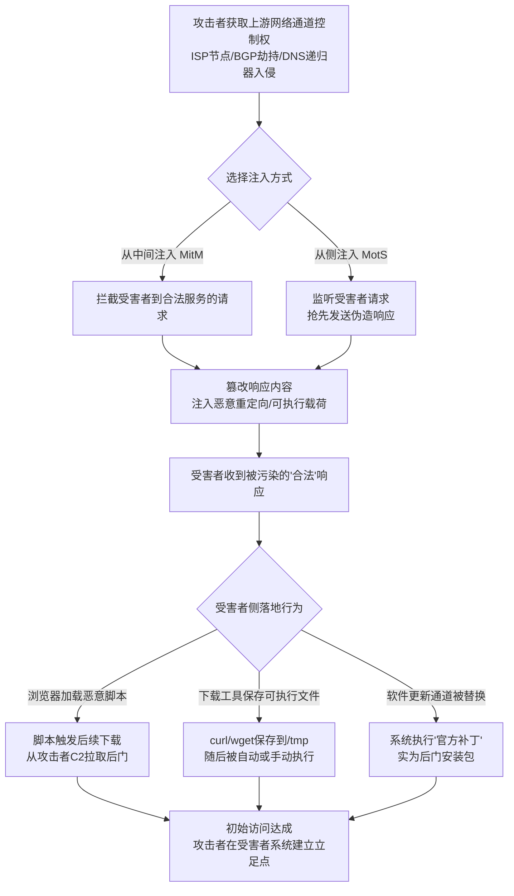

# 内容注入 (T1659)

## 一句话通俗理解

**攻击者站在你和合法网站之间的网络通道上，把恶意内容偷偷塞进你信任的更新或网页响应里——你以为是下载官方补丁，其实下载的是后门。**

## 30秒速查卡

| 字段 | 内容 |
|------|------|
| 技术ID | T1659 |
| 名称 | 内容注入 (Content Injection) |
| 战术 | TA0001 初始访问 |
| 平台 | Linux、Windows、macOS |
| 难度 | ⭐⭐⭐ 高级（需要网络位置与协议操纵能力） |
| 数据来源 | 网络流量、DNS日志、HTTP响应体、进程创建日志、文件创建日志、浏览器执行日志 |

| 维度 | 你需要知道的 |
|------|-------------|
| 这是什么？ | 攻击者通过被入侵的上游网络通道（如ISP、DNS解析链路、HTTP代理）向受害者合法请求的响应中注入恶意内容，从而获取初始访问 |
| 为什么危险？ | 受害者访问的是完全合法的域名（如 windowsupdate.com、github.com），证书、IP、域名信誉全部正常，基于黑名单和URL过滤的防御完全失效——恶意载荷来自"信任源" |
| 谁需要关心？ | 网络安全架构师、SOC分析师、远程办公安全负责人、云出口流量管理员 |
| 你的第一步防御 | 强制所有出网流量经过可信VPN加密通道，并对软件更新/可执行文件下载启用证书绑定（Certificate Pinning）与签名强制校验 |
| 如果只做一件事 | 监控浏览器或下载工具（curl/wget）触发可疑可执行文件创建与执行的链路——这是内容注入落地的最直接信号 |

## 难度等级

- ⭐⭐⭐ 高级（需要深入技术知识）

## 前置知识检查

**读这个文件需要什么？**

- [ ] 网络协议基础（TCP/IP、DNS、HTTP、TLS握手流程）
- [ ] 中间人攻击（MitM）与"从侧攻击"（MotS）的区别
- [ ] 软件更新机制与数字签名验证原理
- [ ] DNS解析链路与上游递归解析器的工作方式

## 技术描述

内容注入（Content Injection）是 MITRE ATT&CK v19.1 框架中**初始访问**战术下的一种技术，编号为 T1659。该技术同时归属于命令与控制战术（TA0011），本文聚焦其作为**初始访问入口**的维度（13-Command-and-Control 目录的同名文件覆盖 TA0011 视角）。

**通俗解释：**

**过渡段：** 不要把初始访问简单等同于"钓鱼邮件"或"漏洞利用"——在国家级 APT 行动中，攻击者更倾向于"污染水源"而非"逐个钓鱼"。当攻击者控制了受害者的上游网络通道（如 ISP 层面的"合法拦截"能力、被入侵的 DNS 递归解析器、被劫持的 BGP 路由），就可以在受害者主动请求合法服务时，把恶意响应"塞"进正常的网络流中。受害者根本不需要点击任何可疑链接——他只是像往常一样打开 Windows Update、刷新一个新闻网站，或者执行一次 `apt update`，恶意载荷就随着"合法响应"进入了他的系统。

**核心技术原理：**

内容注入与传统的"诱导受害者访问恶意网站"（如 T1566 钓鱼）有本质区别：攻击者不创造新的恶意目的地，而是**劫持或竞争**受害者与合法服务之间已有的通信通道。MITRE 官方定义了两种注入方式：

1. **从中间注入（Man-in-the-Middle，MitM）**：攻击者位于合法客户端与服务端通信路径之间，能够完整拦截并篡改双向流量。典型场景包括被入侵的 ISP 节点、被劫持的 BGP 路由、ARP 欺骗所在的二层网络。攻击者可以实时修改服务器返回的响应体，注入恶意脚本或替换下载链接。

2. **从侧注入（Man-on-the-Side，MotS）**：攻击者**不**位于通信路径上，但能与合法服务器"竞争"——当受害者发起请求时，攻击者以更快的速度发送伪造响应，赶在真实响应到达前被受害者接收。这种方式不需要完整流量劫持，常通过控制与受害者网络延迟更低的路由节点实现。MotS 在 ISP 层面的"合法拦截"场景中尤为常见。

**常见注入通道：**

- **DNS 响应注入**：篡改域名解析结果，将受害者重定向到攻击者控制的"合法外观"服务器（如伪造的 Windows Update 页面）
- **HTTP/SMB 响应注入**：在受害者请求软件更新或文件下载时，注入被篡改的响应包，替换其中的可执行内容
- **HTML 内容注入**：在合法网页响应体中插入隐藏的 `<iframe>`、恶意 JavaScript 或重定向指令，触发浏览器侧的进一步下载

**用途与影响：**

内容注入作为初始访问手段，其最危险的特性是**绕过受害者侧的所有"是否信任此来源"判断**。受害者访问的域名、TLS证书、IP信誉全部合法——恶意载荷披着合法来源的外衣。2023 年 Kaspersky 披露的 MoustachedBouncer 行动中，攻击者利用 ISP 层面的流量注入能力，在过去十年间持续向白俄罗斯互联网用户的 DNS/HTTP/SMB 响应中注入恶意内容，将受害者重定向到伪造的 Windows Update 页面下载后门。这种攻击对常规的"URL黑名单 + 证书校验"防御体系几乎完全免疫。

## 攻击流程



**步骤详解：**

1. **获取上游网络通道控制权**
   - 通俗描述：攻击者首先要"站"在受害者与合法服务之间的网络路径上，或者拥有更快响应的能力
   - 技术细节：通过入侵 ISP 的"合法拦截"（Lawful Intercept）接口、BGP 路由劫持、控制上游 DNS 递归解析器，或在受害者所在二层网络实施 ARP 欺骗
   - 常见场景：国家级 APT 与 ISP 合作、被入侵的企业出口网关、咖啡厅等公共 WiFi 的中间人位置

2. **监听并识别受害者请求**
   - 通俗描述：攻击者监控经过其控制节点的流量，识别出"值得注入"的请求模式
   - 技术细节：匹配特定域名（如 `windowsupdate.com`、`github.com`、`apt.example.com`）、特定 User-Agent、特定文件类型请求（`.exe`、`.deb`、`.pkg`）
   - 关键判断：只对目标受害者注入，对其他流量保持透明，避免被广泛检测

3. **注入恶意响应内容**
   - 通俗描述：在合法响应到达受害者前，发送被篡改的内容
   - 技术细节：
     - **DNS 注入**：返回伪造的 A 记录，将受害者重定向到攻击者控制的"合法外观"服务器
     - **HTTP 注入**：在 200 OK 响应体中插入恶意 `<iframe>` 或替换下载链接
     - **SMB 注入**：在受害者请求文件共享时返回被篡改的可执行文件
   - 竞争策略（MotS）：利用更低的网络延迟，确保伪造响应先于真实响应到达

4. **受害者侧载荷落地与执行**
   - 通俗描述：受害者的浏览器或下载工具接收到"看起来合法"的响应并执行其中内容
   - 技术细节：浏览器加载注入的 JavaScript 触发后台下载；`curl`/`wget` 将注入的可执行文件保存到 `/tmp` 后被后续命令执行；软件更新守护进程将替换后的"补丁"安装到系统
   - 检测窗口：这一步是蓝队最有可能捕捉到异常的环节——浏览器或下载工具产生的可疑子进程

5. **初始访问达成**
   - 通俗描述：攻击者在受害者系统上获得首次代码执行能力
   - 技术细节：后门建立持久化机制、收集主机信息、向外发起 C2 连接，完成从"网络通道污染"到"主机失陷"的闭环

## 真实案例

### 案例1：MoustachedBouncer（G1019）— ISP 层面的 DNS/HTTP/SMB 响应注入（2014-2023）

- **时间**: 2014年至2023年（持续活跃超10年）
- **目标**: 白俄罗斯互联网用户、外交人员、记者
- **攻击组织**: MoustachedBouncer（MITRE 编号 G1019）
- **手法**: MoustachedBouncer 利用与 ISP 的合作关系（或直接控制 ISP 的"合法拦截"能力），在受害者发起 DNS/HTTP/SMB 请求时注入恶意响应。攻击者篡改 DNS 解析结果，将受害者重定向到伪造的 Windows Update 页面，诱骗其下载并执行伪装成系统更新的后门程序（如 LOOKBACK、BEAGLEBOYZ 等恶意软件家族）。注入操作仅针对特定受害者IP段，对其他流量保持透明，使该行动在长达十年间未被发现。Kaspersky 研究员 Marc-Etienne M.L. Faou 在 2023 年 9 月的详细报告中首次完整披露了该组织的注入技术细节。
- **影响**: 大量白俄罗斯用户被长期监控，外交人员的通信内容被窃取；攻击持续时间之长、隐蔽性之高，体现了国家级 APT 与 ISP 合作的破坏力
- **参考链接**: [MITRE ATT&CK - G1019 MoustachedBouncer](https://attack.mitre.org/groups/G1019/)

### 案例2：Disco（S1088）— 多协议响应注入后门（2023）

- **时间**: 2023年
- **目标**: 中东地区政府机构与外交组织
- **相关软件**: Disco（MITRE 编号 S1088）
- **手法**: Disco 后门具备通过 DNS、HTTP、SMB 三种协议响应注入实现初始访问的能力。攻击者在受害者网络的上游通道位置，对受害者发起的合法 DNS 查询、HTTP 请求、SMB 文件请求注入恶意响应。例如，当受害者系统执行正常的 DNS 解析时，Disco 注入伪造的响应包，将受害者引导至攻击者控制的服务器下载第二阶段载荷；在 SMB 通道上，Disco 在受害者请求共享文件时返回被篡改的可执行文件。这种多协议注入能力使 Disco 能够适应不同网络环境的受害者，并在多种合法流量中隐藏初始访问行为。
- **影响**: 中东多个目标组织被初始入侵，后续建立长期 C2 通道
- **参考链接**: [MITRE ATT&CK - S1088 Disco](https://attack.mitre.org/software/S1088/)

### 案例3：China GitHub Attack — BGP 劫持驱动的内容注入（2015）

- **时间**: 2015年3月
- **目标**: 全球访问 GitHub 的用户（特别是中国境内用户）
- **攻击背景**: 未归因的国家级攻击行为
- **手法**: 攻击者通过 BGP 路由劫持，将本应流向 GitHub 的全球流量"牵引"经过被控制的上游节点。在流量经过时，攻击者向受害者的 HTTP 响应中注入恶意 JavaScript 代码（指向 `greatfire.org` 和 `github.com/greatfire/` 等项目的页面）。注入的脚本使访问这些页面的浏览器成为 DDoS 跳板，持续向被攻击目标发起请求。EFF 研究员 Bill Budington 在 2015 年 4 月的分析中详细记录了这次"从侧注入"攻击的技术细节——攻击者并未真正攻破 GitHub 服务器，而是污染了通往 GitHub 的网络通道。这是公开记录中规模最大的、利用 BGP 劫持实施内容注入的案例之一，影响持续数日。
- **影响**: GitHub 全球访问受影响长达数日；该事件首次大规模展示了 BGP 劫持作为内容注入载体的破坏力
- **参考链接**: [EFF - China GitHub Attack Analysis](https://www.eff.org/deeplinks/2015/04/china-hijacking-github)

## 红队视角

> ⚠️ **免责声明**：以下内容仅用于合法的安全测试、渗透测试和教育目的。未经授权对他人系统进行测试是违法行为。

### 实战技巧

1. **网络位置获取的合法测试路径**：
   在授权的红队评估中，通过客户提供的网络出口网关镜像端口、合作 ISP 的测试通道，或客户办公网络的二层位置（如接入交换机)实施测试。**严禁**在未经授权的情况下利用公共 WiFi、ISP 设备或 BGP 路由实施注入。

2. **DNS 响应注入测试**：
   在测试网络中部署 dnsmasq 或 BIND 的自定义响应规则，对特定域名的查询返回受控 IP，观察受害者的浏览器/更新守护进程是否信任被篡改的解析结果。重点验证目标系统是否启用了 DNSSEC、DoH/DoT 等防护。

3. **HTTP 响应内容注入**：
   使用 mitmproxy 或 Bettercap 在测试通道上对 HTTP 响应体进行实时修改，注入 `<script>` 标签或替换下载链接。验证目标浏览器的内容安全策略（CSP）和子资源完整性（SRI）是否生效。

4. **软件更新通道替换**：
   在隔离实验环境中模拟软件更新服务器，向测试客户端下发被替换的"更新包"，验证客户端是否执行签名校验、哈希校验。这一步直接检验目标组织对供应链初始访问的防御能力。

### 常用工具

| 工具名称 | 用途 | 平台 | 链接 |
|----------|------|------|------|
| mitmproxy | HTTP/HTTPS 流量拦截与响应篡改 | 跨平台 | https://mitmproxy.org/ |
| Bettercap | ARP 欺骗、DNS 注入、HTTP 注入一体化工具 | Linux/macOS | https://www.bettercap.org/ |
| dnsmasq | 自定义 DNS 响应（用于测试 DNS 注入） | Linux | https://thekelleys.org.uk/dnsmasq/doc.html |
| Responder | LLMNR/NBT-NS 投毒与 SMB 响应注入 | 跨平台 | https://github.com/SpiderLabs/Responder |
| Wireshark | 注入流量分析与验证 | 跨平台 | https://www.wireshark.org/ |

### 注意事项

- 内容注入作为初始访问手段，**必须**在客户书面授权的网络范围内实施，超出授权范围的网络位置获取属于违法行为
- 测试时应对非目标流量保持透明，仅对指定测试客户端注入，避免影响生产业务
- 所有注入行为需完整记录日志，便于事后向客户证明影响范围与边界
- 测试中下发的"恶意载荷"必须是良性的测试 beacon（如计算器弹窗），禁止使用真实破坏性载荷

## 蓝队视角

### 检测要点

1. **浏览器触发的可疑文件创建与进程执行**
   - 日志来源：Sysmon Event ID 1（进程创建）、Event ID 11（文件创建）
   - 关注字段：浏览器进程（`chrome.exe`、`safari`、`firefox`）作为父进程派生的子进程，特别是 `cmd.exe`、`powershell.exe`、`bash` 等
   - 异常特征：浏览器直接派生 shell 进程；浏览器临时目录出现可执行文件并被立即执行（对应 MITRE 检测分析 AN0992）

2. **下载工具的可疑执行链**
   - 日志来源：Sysmon Event ID 1（进程创建）、Event ID 11（文件创建）
   - 关注字段：`curl`/`wget` 保存文件到 `/tmp`、`/var/tmp`、`%TEMP%` 等临时目录，随后该文件被执行
   - 异常特征：`curl http://... -o /tmp/x && chmod +x /tmp/x && /tmp/x` 这类"下载即执行"链路（对应 MITRE 检测分析 AN0993）

3. **浏览器生成并加载脚本子进程**
   - 日志来源：macOS `eslogger`、Linux `auditd`、Windows Sysmon
   - 关注字段：Safari、Chrome 等浏览器进程生成 `osascript`、`python`、`perl` 等脚本解释器子进程
   - 异常特征：浏览器在加载注入内容后，启动脚本解释器执行注入的代码（对应 MITRE 检测分析 AN0994）

4. **DNS 响应异常**
   - 日志来源：DNS 服务器日志、Zeek `dns.log`
   - 关注字段：同一域名的 A 记录在不同解析路径上返回不同结果；DNS 响应包数量或大小超出基线
   - 异常特征：受害者解析到的 IP 与公共 DNS 服务（如 8.8.8.8）解析结果不一致；出现非标准 DNS 响应包

### 监控建议

- 在网络出口部署 Zeek/Suricata，对 HTTP 响应体进行完整性检查，比对响应内容哈希与历史基线
- 强制所有出网 DNS 查询走企业受控的 DoH/DoT 递归解析器，启用 DNSSEC 验证
- 部署 Endpoint Detection and Response（EDR）监控浏览器与下载工具的子进程派生行为
- 对关键软件更新通道（Windows Update、apt/yum 源、Homebrew）启用签名强制校验与镜像源完整性检查
- 远程办公场景强制 VPN，避免员工在不可信网络（公共 WiFi、境外网络）直接访问企业资源

## 避坑指南

组织中最危险的盲区：**信任"合法域名"等同于信任"合法内容"**。

很多组织的安全策略基于 URL 过滤与域名信誉——只要访问的是 `windowsupdate.microsoft.com`、`github.com`、`apple.com` 就放行。内容注入恰恰利用了这种信任：攻击者不需要攻破这些域名对应的服务器，只需要污染通往这些域名的网络通道。当一个员工在机场 WiFi 上"正常"访问 GitHub 下载开源工具时，收到的可能是被注入的恶意副本。

**正确的认知**：域名合法 ≠ 内容未被篡改。必须从"内容真实性"而非"来源合法性"角度建立验证机制——签名校验、哈希比对、TLS 证书绑定（Certificate Pinning）才是有效防御。

## 检测建议

### 网络层检测

**检测方法：** 分析 DNS 响应异常与 HTTP 响应体内容偏移，识别被注入的恶意内容。

**具体命令示例：**
```bash
# 检测同一域名在不同解析路径上的响应差异（可能指示DNS注入）
# 对比企业DNS与公共DNS的解析结果
for domain in windowsupdate.com github.com apple.com; do
    internal=$(dig +short $domain @10.0.0.1)
    external=$(dig +short $domain @8.8.8.8)
    if [ "$internal" != "$external" ]; then
        echo "[ALERT] DNS响应不一致: $domain"
        echo "  内部: $internal"
        echo "  公共: $external"
    fi
done

# 使用Zeek分析HTTP响应体大小的异常偏移（>10%基线偏差可能指示内容注入）
zeek -C -r capture.pcap http.log | awk '{print $3, $9, $12}' | \
  sort | uniq -c | sort -rn | head -20

# 检测DNS响应包数量异常（MotS注入常产生额外的伪造响应包）
tshark -r capture.pcap -Y "dns.flags.response == 1" -T fields \
  -e ip.src -e dns.qry.name | sort | uniq -c | sort -rn | head -20
```

### 主机层检测

**检测方法：** 监控浏览器与下载工具的可疑子进程派生与文件创建行为。

**Sysmon 事件ID：**
- 事件ID 1（进程创建）：监控浏览器/下载工具派生 shell 或脚本解释器子进程
- 事件ID 11（文件创建）：监控浏览器临时目录与系统临时目录的可执行文件创建
- 事件ID 3（网络连接）：监控浏览器进程发起的非预期出站连接（可能是指向C2的二次下载）

**具体命令示例：**
```powershell
# 检测浏览器派生可疑子进程（对应AN0992检测思路）
Get-WinEvent -FilterHashtable @{LogName='Microsoft-Windows-Sysmon/Operational';ID=1} -MaxEvents 1000 |
  Where-Object {
    $_.Message -match 'chrome\.exe|msedge\.exe|firefox\.exe' -and
    $_.Message -match 'cmd\.exe|powershell\.exe|wscript\.exe|cscript\.exe'
  } | Format-Table TimeCreated, Message -Wrap

# 检测curl/wget保存到临时目录的可执行文件（对应AN0993检测思路）
Get-WinEvent -FilterHashtable @{LogName='Microsoft-Windows-Sysmon/Operational';ID=11} -MaxEvents 1000 |
  Where-Object {
    $_.Message -match 'curl\.exe|wget|Invoke-WebRequest' -and
    $_.Message -match '\\Temp\\|\\tmp\\'
  } | Format-Table TimeCreated, Message -Wrap
```

### 应用层检测

**Sigma规则示例：**
```yaml
title: 检测内容注入触发的浏览器可疑子进程执行
id: 7a3c2f8e-4b1d-4e9a-9c3f-2d5e8a1b6f7c
status: experimental
description: |
    检测浏览器进程（chrome/edge/firefox/safari）或下载工具（curl/wget）
    派生shell、脚本解释器子进程，或下载可执行文件到临时目录后立即执行。
    此行为模式对应MITRE ATT&CK T1659内容注入技术在初始访问阶段的落地行为。
    参考: MITRE ATT&CK检测分析 AN0992/AN0993/AN0994
references:
    - https://attack.mitre.org/techniques/T1659/
    - https://attack.mitre.org/detections/AN0992/
    - https://attack.mitre.org/detections/AN0993/
author: ATT&CK知识库
date: 2026/07/17
logsource:
    category: process_creation
    product: windows
detection:
    browser_suspicious_child:
        ParentImage|endswith:
            - '\chrome.exe'
            - '\msedge.exe'
            - '\firefox.exe'
            - '\iexplore.exe'
        Image|endswith:
            - '\cmd.exe'
            - '\powershell.exe'
            - '\pwsh.exe'
            - '\wscript.exe'
            - '\cscript.exe'
            - '\mshta.exe'
    download_then_execute:
        Image|endswith:
            - '\cmd.exe'
            - '\powershell.exe'
        CommandLine|contains|all:
            - 'curl'
            - '-o'
            - 'Temp'
    condition: browser_suspicious_child or download_then_execute
fields:
    - UTC_TIME
    - ParentImage
    - Image
    - CommandLine
    - User
falsepositives:
    - 合法的浏览器扩展或企业应用通过浏览器进程下载并执行受信软件
    - 开发者使用浏览器下载并运行脚本（应在白名单中预先登记）
level: high
tags:
    - attack.initial_access
    - attack.t1659
```

## 缓解措施

### 优先级1：关键措施

**措施名称：** 强制出网流量加密与可信通道（映射 M1041）

**具体实施步骤：**
1. 强制所有员工出网流量经过企业受控的 VPN 网关，VPN 通道使用 TLS 1.3 加密，确保上游通道不可被注入
2. 对关键服务（Windows Update、内部软件仓库、代码托管平台）启用证书绑定（Certificate Pinning），即使 DNS 被污染也无法建立伪造连接
3. 远程办公场景禁止"分割隧道"（split tunnel），所有流量必须经过 VPN，避免员工在不可信网络直连外部服务

**配置示例：**
```powershell
# 启用Windows证书绑定策略（针对关键更新服务）
$certThumbprint = "ABCD1234EF5678901234567890ABCDEF12345678"
Set-ItemProperty -Path "HKLM:\SOFTWARE\Policies\Microsoft\Cryptography\PinRules" `
    -Name "windowsupdate.microsoft.com" -Value $certThumbprint
```

### 优先级2：重要措施

**措施名称：** 限制 Web 内容与可执行文件下载（映射 M1021）

**具体实施步骤：**
1. 在出口防火墙/WAF 上配置策略，阻止潜在不常见文件类型的下载/传输（如 `.scr`、`.hta`、`.vbs`、`.js` 从非软件仓库域名下载）
2. 对软件更新通道启用签名强制校验：Windows 启用 SmartScreen 与 AppLocker；Linux 配置 APT/YUM 的 GPG 签名验证；macOS 启用 Gatekeeper
3. 浏览器层面启用内容安全策略（CSP）与子资源完整性（SRI）校验，阻止注入脚本的执行

**配置示例：**
```bash
# Linux: 强制APT包签名验证（/etc/apt/apt.conf.d/99-verify-signatures）
Acquire::AllowInsecureRepositories "false";
Acquire::AllowDowngradeToInsecureRepositories "false";
APT::Get::AllowUnauthenticated "false";
```

### 优先级3：建议措施

**措施名称：** DNS 安全与上游通道监控

**具体实施步骤：**
1. 企业内部 DNS 解析器启用 DNSSEC 验证，拒绝未签名的伪造响应
2. 强制客户端使用 DoH（DNS over HTTPS）或 DoT（DNS over TLS）与企业受控解析器通信，防止 DNS 响应注入
3. 监控 BGP 路由表，对涉及企业关键服务 IP 段的路由变更设置告警，及时发现 BGP 劫持

### MITRE ATT&CK 缓解措施映射

| 缓解措施ID | 缓解措施名称 | 适用性 | 说明 |
|------------|-------------|--------|------|
| M1041 | 加密敏感信息（Encrypt Sensitive Information） | 高度适用 | 确保所有在线流量通过可信VPN加密，使上游通道注入的篡改内容无法被受害者接收（TLS握手失败） |
| M1021 | 限制Web内容（Restrict Web-Based Content） | 高度适用 | 阻止潜在不常见文件类型的下载/传输，限制浏览器执行未签名脚本，缩小内容注入的落地窗口 |
| M1057 | 数据加密（Data Encryption） | 部分适用 | 对传输中的软件更新包启用端到端加密签名验证 |
| M1031 | 网络隔离（Network Segmentation） | 部分适用 | 将关键更新服务置于受控网络段，避免经过不可信上游 |

## 动手实验

> ⚠️ **重要提示**：所有实验必须在隔离的实验室环境中进行，禁止对未授权的真实系统或公共网络进行测试。**严禁**在公共 WiFi、ISP 设备或任何未经书面授权的网络位置实施注入测试。

### 实验环境准备

**推荐靶场/实验平台：**

| 平台名称 | 类型 | 难度 | 链接 |
|----------|------|------|------|
| 自建虚拟网络实验室 | 虚拟靶场 | 高级 | 使用 VMware/VirtualBox 搭建 |
| HackTheBox - Network Attacks | 虚拟靶场 | 中级 | https://www.hackthebox.com/ |

**所需工具：**
- mitmproxy：HTTP/HTTPS 流量拦截与响应篡改
- Bettercap：ARP 欺骗与 DNS 注入
- Wireshark：流量分析与验证
- 两台虚拟机（攻击机 + 受害机，同一隔离网络）

### 实验1：HTTP 响应内容注入演示（中级）

**实验目标：** 理解内容注入作为初始访问手段的基本原理，观察受害者侧的落地行为。

**实验步骤：**
1. 在隔离网络中启动两台虚拟机：攻击机（Kali）与受害机（Ubuntu）
2. 在攻击机上启动 mitmproxy 透明代理：`mitmproxy --mode transparent --showhost`
3. 配置 iptables 将受害机出网流量重定向到 mitmproxy
4. 在 mitmproxy 中编写响应篡改脚本，对 `example.com` 的 HTTP 响应注入 `<script>alert('注入成功')</script>`
5. 在受害机上用浏览器访问 `example.com`，观察是否弹出注入的脚本
6. 用 Wireshark 抓包，对比注入前后的响应体差异

**预期结果：** 受害机浏览器执行了攻击机注入的 JavaScript，证明"合法域名 + 合法证书"的内容仍可被上游通道篡改。

**学习要点：** 理解为什么单纯依赖域名信誉与URL过滤无法防御内容注入——攻击者控制的是"通道"而非"服务器"。

### 实验2：DNS 响应注入与重定向（高级）

**实验目标：** 模拟 MoustachedBouncer 行动的 DNS 注入技术，理解 DNS 通道被污染后的初始访问路径。

**实验步骤：**
1. 在攻击机上部署 dnsmasq 作为 DNS 服务器，配置自定义响应：
   ```
   address=/windowsupdate.com/192.168.100.10
   ```
2. 在攻击机的 192.168.100.10 上部署一个伪造的 Windows Update 页面（使用 Set 工具包或自定义 HTML）
3. 将受害机的 DNS 服务器指向攻击机
4. 在受害机上执行 `nslookup windowsupdate.com`，验证解析结果被篡改
5. 用浏览器访问 `windowsupdate.com`，观察是否被重定向到伪造页面
6. 用 Wireshark 抓包，分析 DNS 响应包与正常响应的差异

**预期结果：** 受害机被重定向到攻击者控制的伪造更新页面，受害者侧看到的是"合法的 Windows Update"。

**学习要点：** 理解 DNS 响应注入如何绕过受害者的"是否信任此域名"判断——域名是合法的，但解析结果被污染了。

## 术语解释

| 术语 | 英文原名 | 通俗解释 |
|------|----------|----------|
| 内容注入 | Content Injection | 攻击者向合法网络响应中插入恶意内容，使受害者在访问合法服务时被注入恶意载荷 |
| 从中间注入 | Man-in-the-Middle (MitM) | 攻击者位于客户端与服务端通信路径之间，能够完整拦截并篡改双向流量 |
| 从侧注入 | Man-on-the-Side (MotS) | 攻击者不位于通信路径上，但能通过更快的响应速度与合法服务器"竞争"，抢先向受害者发送伪造响应 |
| 合法拦截 | Lawful Intercept | ISP 为执法或国家安全目的部署的网络流量监听与操控接口，常被APT组织滥用为内容注入通道 |
| BGP 劫持 | BGP Hijacking | 攻击者通过发布伪造的 BGP 路由宣告，将本应流向目标网络的流量牵引经过攻击者控制的节点 |
| 证书绑定 | Certificate Pinning | 客户端仅信任预置的特定证书指纹，即使 DNS 被污染指向伪造服务器，也无法建立 TLS 连接 |
| DNSSEC | Domain Name System Security Extensions | DNS 安全扩展，使用数字签名确保 DNS 响应未被篡改 |
| 子资源完整性 | Subresource Integrity (SRI) | 浏览器校验外部资源（如 JavaScript）的哈希值，防止被注入篡改版本 |
| 内容安全策略 | Content Security Policy (CSP) | HTTP 响应头，限制浏览器可加载的外部资源来源，阻止注入脚本执行 |

## 参考资料

### 📚 官方文档（深入了解）

- [MITRE ATT&CK - T1659 Content Injection](https://attack.mitre.org/techniques/T1659/)
- [MITRE ATT&CK - TA0001 Initial Access](https://attack.mitre.org/tactics/TA0001/)
- [MITRE ATT&CK - G1019 MoustachedBouncer](https://attack.mitre.org/groups/G1019/)
- [MITRE ATT&CK - S1088 Disco](https://attack.mitre.org/software/S1088/)

### 📰 安全报告（真实攻击）

- [Faou M. (2023) - MoustachedBouncer: Espionage group along the path](https://securelist.com/moustachedbouncer/110269/) - Kaspersky 对 MoustachedBouncer 行动的深度分析，详细披露 ISP 层面 DNS/HTTP/SMB 响应注入技术
- [Starikova A. (2023) - Man-on-the-Side Attack](https://encyclopedia.kaspersky.com/glossary/man-on-the-side-attack/) - Kaspersky IT 百科关于"从侧注入"攻击的技术解释
- [Budington B. (2015) - China GitHub Attack Analysis](https://www.eff.org/deeplinks/2015/04/china-hijacking-github) - EFF 对 2015 年 BGP 劫持驱动的内容注入事件的详细技术分析

### 🔧 工具与资源（动手试试）

- [mitmproxy - HTTP/HTTPS 流量拦截](https://mitmproxy.org/) - 主流的中间人测试工具，可用于实验环境中的响应注入演示
- [Bettercap - 网络攻击一体化工具](https://www.bettercap.org/) - 支持 ARP 欺骗、DNS 注入、HTTP 篡改的一体化工具
- [Wireshark - 网络流量分析](https://www.wireshark.org/) - 用于分析注入流量与正常流量的差异
- [Zeek - 网络安全监控](https://zeek.org/) - 用于生产环境的网络层异常检测

### 📚 学习资料（深入了解）

- [Kaspersky IT Encyclopedia - MITM Attack](https://encyclopedia.kaspersky.com/glossary/man-in-the-middle-attack/) - 中间人攻击的技术百科
- [RFC 8499 - DNS Security Mechanisms](https://datatracker.ietf.org/doc/rfc8499/) - DNSSEC 与 DNS 安全机制官方规范
- [NIST SP 800-81r2 - Secure DNS Deployment Guide](https://csrc.nist.gov/publications/detail/sp/800-81/rev-2/final) - NIST 关于安全 DNS 部署的指南，涵盖 DNSSEC 配置
