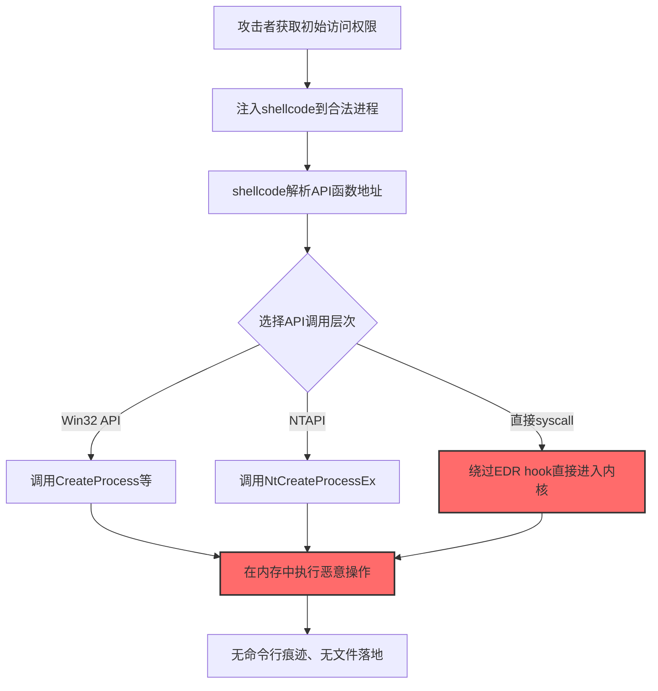
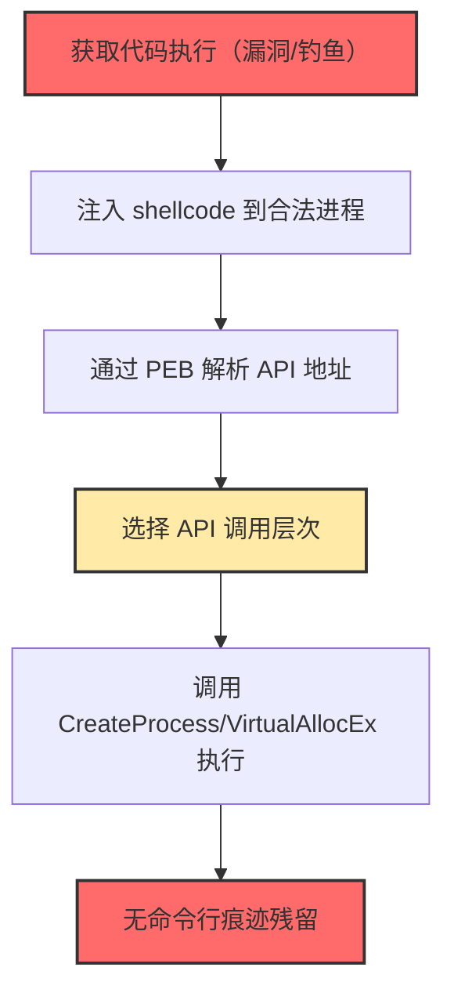

# 原生API (T1106)

## 一句话通俗理解

> **绕过命令行工具，直接用操作系统底层的"原始接口"执行代码——就像不通过前台，直接走员工通道进公司**

## 30秒速查卡

| 维度 | 你需要知道的 |
|------|-------------|
| 这是什么？ | 直接调用操作系统原生 API（Win32/NTAPI/syscall）执行恶意代码，绕过命令行检测 |
| 为什么危险？ | 不产生命令行进程、不落地文件、绕过应用白名单和EDR的进程监控 |
| 谁需要关心？ | 终端安全团队、EDR开发人员、逆向工程师 |
| 你的第一步防御 | 部署基于API行为监控的EDR，而非仅依赖命令行审计 |
| 如果只做一件事 | 监控CreateProcess/CreateRemoteThread等关键API的异常调用 |

## 难度等级

⭐⭐⭐ 高级 - 需要编程基础或深入的系统知识

> **前置知识**：C/C++ 编程基础、Windows API 架构、进程/线程概念、内存管理

## 前置知识检查

**读这个文件需要什么？**

- [ ] 知道什么是"API"（应用程序编程接口，程序调用系统功能的"按钮"）
- [ ] 了解 Windows API 分为 Win32（用户层）和 NTAPI（内核层）两层
- [ ] 知道什么是"系统调用"（syscall），它是用户程序进入内核的唯一入口

## 技术描述

**原生API**（T1106）是 ATT&CK 执行战术下的技术，攻击者直接调用操作系统的原生应用程序编程接口（API）来执行代码，而不是通过命令行工具（如 cmd.exe、powershell.exe）或脚本解释器。三大平台各有原生 API 层：Windows 的 Win32 API 和 NTAPI、Linux 的系统调用（syscall）、macOS 的 Mach API 和 POSIX 层。

> 📡 **打个比方**：操作系统就像一栋大楼，命令行工具（cmd/powershell）是"前台服务"——你告诉前台要什么，前台帮你办。但前台会登记你的请求，有监控。而"原生 API"是大楼的"内部对讲机"——直接呼叫对应部门，不走前台，不留前台记录。攻击者用对讲机直接安排事情，绕过前台的监控。

### 进阶理解

简单来说，程序要执行任何操作（创建进程、读写文件、网络通信），最终都要调用操作系统提供的"接口函数"。这些接口分层次：

- **命令行层**：`cmd.exe /c calc.exe` → 最容易被检测
- **脚本层**：`powershell Start-Process calc` → 次容易检测
- **Win32 API 层**：`CreateProcessA(...)` → 不产生命令行日志
- **NTAPI 层**：`NtCreateProcessEx(...)` → 更底层，绕过用户层 hook
- **syscall 层**：直接 `syscall` 指令 → 绕过所有用户层 hook（最隐蔽）

攻击者编写程序（或 shellcode）直接调用这些底层 API，避免了产生命令行进程、避免了被 PowerShell 日志记录、甚至绕过 EDR 在用户层部署的 hook。

**过渡段：** 不要以为"没有 cmd.exe 就没有执行"——在现代攻击中，命令行只是最表层。攻击者真正的主力是直接调用 API，就像黑客不需要通过"前台"就能操作系统。

### 为什么有效？

这种技术之所以有效，是因为：
1. **无命令行痕迹**：不产生 4688 进程创建日志中的命令行参数
2. **绕过用户层 hook**：EDR 通常在用户层 hook API，直接 syscall 可绕过
3. **内存执行**：shellcode 直接在内存中调用 API，无需落地文件
4. **合法接口**：API 本身是合法的，无法简单封禁

## 真实攻击流程



**步骤详解：**

1. **初始访问** - 攻击者通过漏洞或钓鱼获取代码执行能力
2. **注入 shellcode** - 将 shellcode 注入到合法进程（如 explorer.exe）的内存空间
3. **解析 API 地址** - shellcode 通过 PEB（Process Environment Block）遍历加载的模块，找到所需 API 的地址
4. **选择调用层次** - 根据目标防护决定使用 Win32 API、NTAPI 还是直接 syscall
5. **执行操作** - 调用 `CreateProcess`、`VirtualAllocEx`、`WriteProcessMemory` 等 API 完成攻击
6. **无痕执行** - 整个过程不产生命令行日志、不落地文件

## 攻击流程

### 典型攻击流程

```
获取代码执行 --> 注入shellcode到合法进程 --> PEB解析API地址 --> 选择API层次 --> 调用原生API执行载荷 --> 无命令行痕迹残留
```



**步骤详解：**

1. **获取代码执行**
   - 通俗描述：攻击者通过漏洞利用、钓鱼附件或已有植入物获得在目标系统上的初始代码执行能力
   - 技术细节：利用未修补漏洞（如浏览器 RCE、Office 漏洞）触发 shellcode；或通过已存在的 C2 beacon 跳板执行
   - 常用工具：Cobalt Strike、Metasploit、自定义 shellcode 加载器

2. **注入 shellcode 到合法进程**
   - 通俗描述：将恶意代码注入到 svchost.exe、explorer.exe 等系统合法进程中，规避进程白名单检测
   - 技术细节：使用 `VirtualAllocEx` + `WriteProcessMemory` + `CreateRemoteThread` 经典注入；或使用进程空洞化（Process Hollowing）、线程劫持（Thread Hijacking）等高级技术
   - 常用工具：Cobalt Strike `shinject`、ProcessHollowing 工具集、自定义 C++/Rust 加载器

3. **通过 PEB 解析 API 地址**
   - 通俗描述：shellcode 不依赖 `GetProcAddress`/`LoadLibrary`，而是直接从进程环境块（PEB）中遍历已加载模块列表，定位 ntdll.dll 等核心模块的导出函数
   - 技术细节：通过 `fs:[0x30]`（x86）或 `gs:[0x60]`（x64）访问 TEB→PEB；遍历 `InLoadOrderModuleList` 找到 ntdll，解析其导出表获取 `LdrLoadDll`、`NtAllocateVirtualMemory` 等函数地址
   - 常用工具：手工编写的 shellcode、Metasploit Meterpreter 反射加载器、Donut

4. **选择 API 调用层次**
   - 通俗描述：根据 EDR 监测情况选择调用 Win32 API、NTAPI 或直接 syscall，逐层降低可被 Hook 拦截的概率
   - 技术细节：Win32 API（如 `CreateProcessW`）最易被用户态 Hook 拦截；NTAPI（`NtCreateUserProcess`）需绕过 ntdll Hook；直接 syscall（`syscall; ret` 指令）完全跳过 ntdll，需自行解析 SSDT 调用号
   - 常用工具：SysWhispers2/3、HellsGate、HalosGate、Tartarus' Gate

5. **调用原生 API 执行载荷**
   - 通俗描述：使用 `CreateProcess`、`VirtualAllocEx`、`QueueUserAPC` 等原生 API 在目标进程内分配可执行内存并运行恶意载荷
   - 技术细节：通过 `NtAllocateVirtualMemory` 分配 RWX 内存，写入 payload，然后通过 `NtCreateThreadEx` 或 `RtlCreateUserThread` 创建远程线程执行；或使用 APC 注入到挂起的线程
   - 常用工具：Cobalt Strike BOF、自定义 NTAPI 调用代码、SysWhispers 生成的 C 头文件

6. **无命令行痕迹残留**
   - 通俗描述：由于全程通过 API 调用而非 `cmd.exe`/`powershell.exe`，事件日志中不出现命令行参数，传统命令行审计失效
   - 技术细节：不创建子进程，进程树中无 `cmd.exe` 节点；Sysmon EID 1（ProcessCreate）不记录 API 调用参数；仅能通过 ETW Threat Intelligence Provider 或内核回调捕获底层行为
   - 常用工具：ETW TI（Threat Intelligence）、Sysmon 配置 ImageLoad 事件、EDR 内核驱动

## 真实案例

### 案例1：Cobalt Strike Beacon 直接 syscall 绕过 EDR（2022-2024）

- **时间**：2022-2024年
- **目标**：政府机构、大型企业
- **攻击组织**：多个勒索软件团伙（BlackCat/ALPHV、LockBit）
- **手法**：攻击者使用 Cobalt Strike Beacon 的直接 syscall 模式。Beacon shellcode 注入到合法进程后，不通过 `ntdll.dll` 调用 API（EDR 通常 hook ntdll），而是直接使用 `syscall` 指令进入内核。工具如 SysWhispers、HellsGate 自动生成 syscall stub，动态解析系统调用号，绕过用户层所有 hook
- **影响**：多起勒索软件事件中 EDR 未检测到恶意行为
- **参考链接**：[Pentera Labs - Syscall Analysis](https://www.pentera.io/blog/)

### 案例2：FIN8 使用 Win32 API 部署 Shellcode（2021-2023）

- **时间**：2021-2023年
- **目标**：金融机构、零售企业
- **攻击组织**：FIN8
- **手法**：FIN8 在攻击中部署自定义的 shellcode 植入器，通过 `VirtualAlloc` 分配可执行内存，`WriteProcessMemory` 写入 shellcode，然后通过 `CreateThread` 在目标进程（如 svchost.exe）中执行。整个过程使用 C 语言编写的加载器直接调用 Win32 API，不产生任何命令行活动。植入器通过 `LoadLibraryA` 动态加载所需 API，避免 IAT 中出现可疑导入
- **影响**：在多个目标网络中隐蔽驻留长达数月
- **参考链接**：[Mandiant FIN8 Report](https://www.mandiant.com/resources/blog/fin8-threat-actor)

### 案例3：APT41 使用 NTAPI 绕过用户层监控（2023-2024）

- **时间**：2023-2024年
- **目标**：科技公司、制造业
- **攻击组织**：APT41（Winnti Group）
- **手法**：APT41 在后门程序中直接调用 NTAPI（如 `NtCreateProcessEx`、`NtAllocateVirtualMemory`）而非 Win32 API。由于部分 EDR 仅 hook Win32 层的 `kernel32.dll`，NTAPI 层的 `ntdll.dll` 调用可能未被监控。后门通过手动映射 `ntdll.dll` 到内存（而非使用已加载的副本），避免被 EDR 修改的 hook 版本
- **影响**：在多个目标中绕过 EDR 检测
- **参考链接**：[CrowdStrike APT41 Report](https://www.crowdstrike.com/blog/)

## 红队视角

> ⚠️ **免责声明**：以下内容仅用于合法的安全测试、渗透测试和教育目的。未经授权对他人系统进行测试是违法行为。

### 实战技巧

1. **API 解析**：不使用 `GetProcAddress`（会被 hook），而是遍历 PEB → InMemoryOrderModuleList 找到 kernel32 基址，手动解析导出表
2. **直接 syscall**：使用 SysWhispers2/3 或 HellsGate 技术，动态解析系统调用号，直接 `syscall` 指令
3. **API Hashing**：用哈希值（如 MurmurHash）代替 API 名称字符串，避免字符串扫描
4. **模块复制**：从磁盘重新加载干净的 `ntdll.dll` 副本，覆盖被 EDR hook 的版本

### 常用工具

| 工具名称 | 用途 | 平台 |
| -------- | ---- | ---- |
| SysWhispers3 | 自动生成 syscall stub | Windows |
| HellsGate | 动态系统调用号解析 | Windows |
| Cobalt Strike | 支持 sleep_mask 和 syscall 模式 | Windows |
| Metasploit | 生成 shellcode 并注入 | 全平台 |
| Donut | .NET shellcode 生成器 | Windows |

### 注意事项

- 直接 syscall 技术需要适配不同 Windows 版本的系统调用号
- Windows 10/11 的 ntdll 可能被 PatchGuard 保护
- 新版 EDR 已开始使用内核回调（如 `PsSetCreateProcessNotifyRoutine`）监控 API 调用

## 蓝队视角

### 检测要点

1. **内核回调监控**：使用 `PsSetCreateProcessNotifyRoutine`、`ObRegisterCallbacks` 等内核回调，不受用户层 hook 影响
2. **API 调用序列**：监控异常的 API 调用序列（如 `VirtualAlloc` → `WriteProcessMemory` → `CreateRemoteThread`）
3. **内存扫描**：定期扫描进程内存中的可执行区域，检测 shellcode 特征
4. **syscall 监控**：使用 ETW（Event Tracing for Windows）的内核提供程序监控 syscall 活动

### 监控建议

- 部署支持内核级监控的 EDR（如 Microsoft Defender for Endpoint、CrowdStrike Falcon）
- 启用 ETW 内核日志（`Microsoft-Windows-Kernel-Process`）
- 使用 Sysmon Event ID 8（CreateRemoteThread）和 Event ID 10（ProcessAccess）监控注入行为
- 监控 `ntdll.dll` 的完整性，检测被 EDR patch 的版本是否被恢复

## 避坑指南

**防御者最痛苦的教训**：仅依赖用户层 hook 的 EDR 在面对直接 syscall 攻击时形同虚设。SysWhispers 等工具的出现让"绕过用户层 hook"成为标准操作。必须部署内核级监控能力。

## 检测建议

### 网络层检测

**方法**：监控异常进程的网络外连行为（API 调用产生的网络连接）

```bash
# 监控非常见进程的外连
# 需要结合 EDR 的进程网络关联能力
```

### 主机层检测

**Windows事件ID**：
- Sysmon Event ID 8：CreateRemoteThread（远程线程注入）
- Sysmon Event ID 10：ProcessAccess（进程内存访问）
- ETW Event ID：Microsoft-Windows-Kernel-Process 中的进程/线程创建

**内存扫描**：
- 使用 `Get-Process | Select-Object -ExpandProperty Modules` 检查加载的异常模块
- YARA 规则扫描进程内存中的 shellcode 特征

```powershell
# 检测可疑的远程线程创建
Get-WinEvent -FilterHashtable @{LogName='Microsoft-Windows-Sysmon/Operational'; ID=8} |
    Select-Object TimeCreated, @{N='SourceProcess';E={$_.Properties[0].Value}}, @{N='TargetProcess';E={$_.Properties[1].Value}}
```

### 应用层检测

**用人话说**：这条规则在检测"偷偷在别人进程里开线程"——攻击者把代码注入到一个正常运行的程序（比如 svchost.exe）的内存里，然后用 `CreateRemoteThread` 在那个程序里开一个新线程来执行恶意代码。正常情况下，一个程序不会在另一个不相关的程序里创建线程。如果你看到 notepad.exe 在 svchost.exe 里创建了线程，这百分之百是恶意行为。攻击者这么做是为了让恶意代码"借壳"运行在合法进程中，绕过进程白名单。检测的关键是关注 `CreateRemoteThread` API 的调用——看谁在哪里创建了线程。

**Sigma规则示例**：

```yaml
title: 可疑 CreateRemoteThread - 跨进程注入检测
status: experimental
description: 检测在另一个进程中创建远程线程，可能为代码注入
logsource:
    product: windows
    service: sysmon
detection:
    selection:
        EventID: 8
    filter_legitimate:
        SourceImage|endswith:
            - '\csrss.exe'
            - '\wininit.exe'
            - '\services.exe'
            - '\smss.exe'
    condition: selection and not filter_legitimate
fields:
    - SourceImage
    - TargetImage
    - StartFunction
    - SourceThreadId
falsepositives:
    - 合法的调试器在目标进程中创建线程
    - 某些系统管理工具的行为
level: high
tags:
    - attack.execution
    - attack.t1106
    - attack.t1055
```

```yaml
title: 可疑进程内存访问 - 可能的代码注入
status: experimental
description: 检测进程访问另一个进程内存，可能用于代码注入
logsource:
    product: windows
    service: sysmon
detection:
    selection:
        EventID: 10
        GrantedAccess|contains:
            - '0x1F0FFF'  # PROCESS_ALL_ACCESS
            - '0x0800'     # PROCESS_VM_WRITE
            - '0x0040'     # PROCESS_VM_OPERATION
    filter_system:
        SourceImage|endswith:
            - '\csrss.exe'
            - '\svchost.exe'
    condition: selection and not filter_system
fields:
    - SourceImage
    - TargetImage
    - GrantedAccess
    - CallTrace
level: medium
tags:
    - attack.execution
    - attack.t1106
    - attack.t1055
```

## 缓解措施

### 优先级1：关键措施

**部署内核级 EDR**：选择支持内核回调监控的 EDR，不依赖用户层 hook

```powershell
# 检查 Windows Defender 的内核驱动是否加载
Get-Service | Where-Object { $_.Name -match 'WdNisDrv|MsMpDrv' }
```

### 优先级2：重要措施

**启用 ETW 内核监控**：配置 ETW 内核提供程序，记录底层的进程/线程/内存活动

```powershell
# 启用 ETW 内核进程日志
logman create trace KernelProcess -p Microsoft-Windows-Kernel-Process -o C:\logs\kernel.etl -ets
logman start KernelProcess
```

### 优先级3：建议措施

**内存完整性保护**：启用 Windows 的 Core Isolation / Memory Integrity（HVCI）

```powershell
# 检查 HVCI 状态
(Get-CimInstance -ClassName Win32_DeviceGuard -Namespace root\Microsoft\Windows\DeviceGuard).VirtualizationBasedSecurityStatus
```

## 动手实验

> ⚠️ **所有实验必须在隔离的实验室环境中进行**

### 实验1：理解基本原理（初级）

**目标**：理解 API 调用与命令行的区别

**步骤**：
1. 用 `cmd.exe /c calc.exe` 启动计算器，观察 4688 日志
2. 用 PowerShell `Start-Process calc.exe` 启动，观察日志
3. 编写简单的 C 程序调用 `CreateProcessA` 启动 calc.exe
4. 对比三种方式的日志记录差异

**预期输出**：
```c
// C 程序示例
#include <windows.h>
int main() {
    STARTUPINFOA si = { sizeof(si) };
    PROCESS_INFORMATION pi;
    CreateProcessA(NULL, "calc.exe", NULL, NULL, FALSE, 0, NULL, NULL, &si, &pi);
    return 0;
}
// 注意：命令行日志仍会记录 calc.exe，但父进程是你的程序而非 cmd.exe
```

**学习要点**：理解 API 调用与命令行调用的日志差异

### 实验2：实际操作（中级）

**目标**：使用 SysWhispers 生成直接 syscall 代码

**步骤**：
1. 安装 SysWhispers3
2. 生成 `NtAllocateVirtualMemory` 和 `NtCreateThreadEx` 的 syscall stub
3. 编写 shellcode 加载器
4. 在测试环境运行，观察 EDR 检测情况
5. 对比 Win32 API 版本和 syscall 版本的检测差异

**学习要点**：掌握直接 syscall 技术和 EDR 绕过原理

### 实验3：防御验证（高级）

**目标**：配置 ETW 内核监控检测 API 滥用

**步骤**：
1. 配置 ETW 内核提供程序
2. 编写 ETW 消费者解析内核事件
3. 触发测试 API 调用
4. 验证内核级监控能否检测直接 syscall

**学习要点**：掌握内核级监控技术对抗用户层绕过

## 术语解释

| 术语 | 通俗解释 |
|------|---------|
| **API** | Application Programming Interface，应用程序编程接口，程序调用系统功能的"按钮" |
| **Win32 API** | Windows 用户层 API 集合，如 CreateProcess、WriteFile 等 |
| **NTAPI** | Windows 底层 API，位于 ntdll.dll，是 Win32 API 的底层实现 |
| **syscall** | 系统调用指令，用户程序进入内核的唯一入口，最底层的 API 调用方式 |
| **hook** | 钩子，EDR 在 API 函数入口插入的监控代码，拦截调用 |
| **shellcode** | 直接在内存中执行的机器码，像"裸奔的程序"，没有文件载体 |
| **PEB** | Process Environment Block，进程环境块，包含已加载模块的信息 |
| **ETW** | Event Tracing for Windows，Windows 的事件追踪机制，可监控内核活动 |

## 参考资料

### 📚 官方文档（深入了解）
- [MITRE ATT&CK - Native API (T1106)](https://attack.mitre.org/techniques/T1106/)
- [Microsoft - Windows API Index](https://learn.microsoft.com/en-us/windows/win32/apiindex/windows-api-list)
- [Microsoft - ETW Documentation](https://learn.microsoft.com/en-us/windows/win32/etw/event-tracing-portal)
- [j00ru - Syscall Table](https://j00ru.vexillium.org/syscalls/nt/64/) - Windows 系统调用号参考

### 🔧 工具与资源（动手试试）
- [SysWhispers3](https://github.com/klezVirus/SysWhispers3) - 直接 syscall 代码生成
- [HellsGate](https://github.com/am0nsec/HellsGate) - 动态系统调用号解析
- [Donut](https://github.com/TheWover/donut) - .NET shellcode 生成器
- [Atomic Red Team - T1106](https://github.com/redcanaryco/atomic-red-team/blob/master/atomics/T1106/T1106.md) - API 调用测试用例

### 📰 安全报告（真实攻击）
- [Mandiant - FIN8 Analysis](https://www.mandiant.com/resources/blog/fin8-threat-actor) - FIN8 使用 Win32 API 部署 shellcode
- [CrowdStrike - APT41 Report](https://www.crowdstrike.com/blog/) - APT41 使用 NTAPI 绕过监控
- [Pentera Labs - Direct Syscall Analysis](https://www.pentera.io/blog/) - 直接 syscall 技术分析
