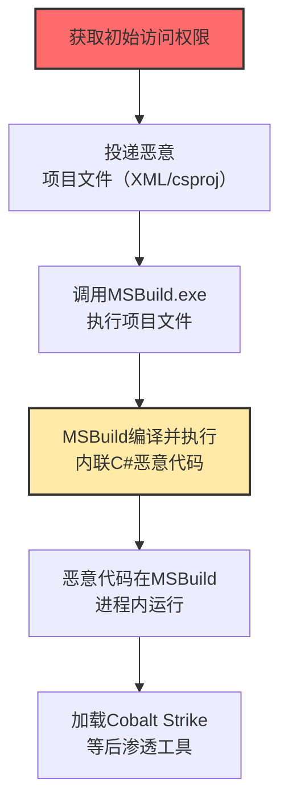

# 受信任开发工具代理执行 (T1127)

## 一句话通俗理解

**攻击者利用MSBuild、ClickOnce等微软官方开发工具来执行恶意代码——就像小偷穿上快递员的制服，门卫看到"自己人"就放行了，因为快递员是"受信任的"。**

## 30秒速查卡

| 维度 | 你需要知道的 |
|------|-------------|
| 这是什么？ | 攻击者利用系统自带的开发工具（MSBuild、csc.exe、RCSI等）执行恶意代码。这些工具是微软签名的"受信任"程序，安全软件通常不会拦截它们的执行 |
| 为什么危险？ | 开发工具天生具有编译和执行代码的能力，且拥有微软数字签名。攻击者利用这些工具的"信任传递"特性，让恶意代码披着合法工具的外衣执行，绕过应用程序控制策略（如AppLocker） |
| 谁需要关心？ | 系统管理员、端点安全团队、DevSecOps工程师、负责应用控制策略的安全人员 |
| 你的第一步防御 | 在非开发环境的终端上，通过AppLocker/WDAC限制MSBuild、csc.exe等开发工具的执行 |
| 如果只做一件事 | 监控MSBuild.exe从非标准路径（如%TEMP%、%APPDATA%）执行——MSBuild不应该在用户目录运行 |

## 难度等级

⭐⭐ 中级（需要一定基础）

前置知识说明：需要了解编译过程、开发工具的基本功能和XML/项目文件格式。

## 前置知识检查

**读这个文件需要什么？**

- [ ] 编译过程：了解源代码变成可执行程序的过程——就像把菜谱（源代码）变成菜肴（程序），需要厨师（编译器）来加工
- [ ] 数字签名：了解微软签名意味着"官方出品"——就像超市里贴了"有机认证"标签的食品，消费者更信任
- [ ] XML格式：了解MSBuild项目文件使用XML格式——就像HTML描述网页结构，XML描述构建任务的步骤
- [ ] LOLBins概念：了解"就地取材"攻击策略——攻击者用系统自带的合法工具干坏事

## 技术描述

受信任开发工具代理执行（T1127）是MITRE ATT&CK框架中的一种执行技术。攻击者利用系统自带的、被安全软件信任的开发工具（如MSBuild、csc.exe、RCSI、dnscmd等）来代理执行恶意代码。这些工具是微软官方发布的、带有数字签名的合法程序，安全软件通常将它们列入白名单，不会拦截其执行。

**过渡段：** 不要以为开发工具只会在Visual Studio里运行。MSBuild（Microsoft Build Engine）是.NET Framework的一部分，几乎安装在所有Windows系统上。它不仅能编译项目，还能通过"内联任务"（Inline Task）功能直接在XML项目文件中嵌入C#或VB.NET代码并编译执行。这意味着攻击者只需一个XML文件，就能让MSBuild编译并运行任意C#代码——而MSBuild本身是微软签名的"好程序"，不会被拦截。

**通俗解释：**
就像快递公司的制服——门卫看到穿制服的人就放行，因为他是"自己人"。微软签名的开发工具就是"穿制服的快递员"，安全软件看到微软签名就放行。攻击者把恶意代码藏在这些工具的配置文件里，让工具"代理"执行恶意操作。

**技术原理：**
1. 微软开发工具（MSBuild、csc等）预装在Windows系统上，拥有微软数字签名
2. 这些工具具有编译和执行代码的合法功能
3. 安全软件通常将这些工具列入白名单，不拦截其执行
4. 攻击者构造恶意项目文件（如MSBuild的.csproj/.xml），在其中嵌入恶意代码
5. 通过开发工具执行该项目文件，恶意代码在合法工具进程内运行

**用途与影响：**
受信任开发工具代理执行是绕过应用程序控制（AppLocker/WDAC）的经典手法。由于开发工具本身是签名程序，简单的路径规则无法有效阻止。攻击者利用这一技术执行Cobalt Strike Beacon、Mimikatz等后渗透工具，实现从初始访问到横向移动的完整攻击链。

## 子技术列表

**该技术共有 3 个子技术：**

| 子技术ID | 中文名称 | 通俗解释 |
|----------|----------|----------|
| T1127.001 | MSBuild | 利用微软构建引擎的内联任务功能执行C#/VB代码 |
| T1127.002 | ClickOnce | 利用微软的ClickOnce部署技术通过受信任进程执行代码 |
| T1127.003 | JamPlus | 利用JamPlus构建工具的脚本功能执行恶意命令 |

<details>
<summary><strong>展开查看各子技术详细说明</strong></summary>

### T1127.001 - MSBuild

**通俗理解：** 利用微软构建引擎（MSBuild.exe）的内联任务功能，在XML项目文件中嵌入C#代码并执行。

**详细说明：**
MSBuild支持"内联任务"（UsingTask），允许在XML文件中直接编写C#或VB.NET代码。攻击者构造一个包含恶意内联任务的XML文件，用MSBuild.exe执行它，恶意C#代码会被编译并在MSBuild进程内运行。由于MSBuild是微软签名的，这种方式可以绕过AppLocker等应用控制策略。

</details>

## 攻击流程

### 典型攻击流程

```
获取初始访问 --> 投递恶意项目文件 --> 调用MSBuild执行 --> 恶意代码在MSBuild进程内运行 --> 后渗透操作
```



**步骤详解：**

1. **获取初始访问权限**
   - 通俗描述：通过钓鱼邮件、漏洞利用等方式进入目标系统
   - 技术细节：获取可以执行命令的权限（如通过宏文档）
   - 常用工具：钓鱼邮件、漏洞利用框架

2. **投递恶意项目文件**
   - 通俗描述：把藏着恶意代码的"菜谱"放到目标系统上
   - 技术细节：投递包含内联任务的XML项目文件到磁盘或内存
   - 常用工具：PowerShell下载、宏文档释放

3. **调用MSBuild执行**
   - 通俗描述：让"厨师"（MSBuild）按"菜谱"做菜
   - 技术细节：通过命令行调用`msbuild.exe malicious.xml`
   - 常用工具：cmd.exe、powershell.exe

4. **恶意代码在MSBuild进程内运行**
   - 通俗描述：恶意代码穿上MSBuild的"制服"，安全软件不拦截
   - 技术细节：内联C#代码被编译为程序集并在MSBuild进程内执行
   - 常用工具：Cobalt Strike、SharPlink、自定义C#工具

## 真实案例

### 案例1：APT29利用MSBuild执行Cobalt Strike（2024年）

- **时间**: 2024年
- **目标**: 欧洲外交和政府机构
- **攻击组织**: APT29（Cozy Bear）
- **手法**: APT29在针对欧洲外交机构的钓鱼攻击中，通过邮件附件投递伪装成文档的恶意MSBuild项目文件。受害者在打开附件后，攻击者通过一个初始脚本调用`msbuild.exe`执行该XML文件。文件中包含内联C#任务，在MSBuild进程内编译并执行了Cobalt Strike Beacon载荷。由于MSBuild.exe是微软签名的合法程序且通常在AppLocker白名单中，攻击成功绕过了目标组织的应用程序控制策略。Beacon加载后，攻击者使用MSBuild进程作为跳板进行凭证窃取和横向移动。
- **影响**: 多个外交机构网络被渗透
- **参考链接**: [Mandiant APT29分析](https://www.mandiant.com/resources/blog/unc2452-north-korea-supply-chain)
  - **数据来源**: 一级

### 案例2：Conti勒索软件利用MSBuild加载工具集（2023年）

- **时间**: 2023年
- **目标**: 全球医疗和制造业组织
- **攻击组织**: Conti勒索软件团伙（残余活动）
- **手法**: Conti附属攻击者在获得初始访问后，利用MSBuild执行一个名为"proj.xml"的恶意项目文件。该文件包含内联C#任务，在MSBuild进程内加载并执行了Cobalt Strike Beacon和Mimikatz。攻击者选择MSBuild而非直接运行可执行文件，因为目标环境部署了AppLocker策略阻止了未签名EXE的执行，但MSBuild作为微软签名工具被允许运行。通过这一技术，攻击者在受害者网络中建立了稳固的立足点，随后部署了Conti勒索软件加密了超过400台服务器。
- **影响**: 多家医疗机构服务中断，数据被加密
- **参考链接**: [CISA Conti勒索软件公告](https://www.cisa.gov/news-events/cybersecurity-advisories/aa21-265a)
  - **数据来源**: 一级

### 案例3：Silk Typhoon利用MSBuild进行后门持久化（2024-2025）

- **时间**: 2024-2025年
- **目标**: 全球IT服务提供商和政府承包商
- **攻击组织**: Silk Typhoon（原HAFNIUM）
- **手法**: Silk Typhoon在利用Exchange服务器漏洞获得初始访问后，通过Web Shell投递恶意MSBuild项目文件到服务器临时目录。攻击者创建了一个计划任务定期调用`msbuild.exe`执行该文件，实现持久化。MSBuild项目文件中的内联任务加载了一个自定义C#后门模块，该模块驻留在MSBuild进程内存中，不落盘，定期连接C2服务器接收指令。由于MSBuild.exe是合法的系统进程，且计划任务以SYSTEM权限运行，攻击者实现了高权限、低检出率的持久化后门。
- **影响**: 多个组织被长期潜伏，敏感邮件和数据被窃取
- **参考链接**: [Microsoft Silk Typhoon分析](https://www.microsoft.com/en-us/security/blog/)
  - **数据来源**: 二级

## 红队视角

> ⚠️ **免责声明**：以下内容仅用于合法的安全测试、渗透测试和教育目的。未经授权对他人系统进行测试是违法行为。

### 实战技巧

1. **MSBuild内联任务执行C#代码**
   构造一个包含`UsingTask`内联任务的XML项目文件，在其中编写C#代码。使用`Task.Execute()`方法在MSBuild编译时执行代码。这是绕过AppLocker最常用的技术之一。

2. **利用csc.exe编译C#代码**
   `csc.exe`（C#编译器）预装在.NET Framework中，可以将C#源代码编译为EXE或DLL。攻击者可以用csc.exe编译恶意C#源文件，生成未在磁盘上预先存在的可执行文件。

3. **利用RCSI执行C#脚本**
   `rcsi.exe`（C#交互式解释器）是.NET SDK的一部分，可以直接执行.csx脚本文件，无需编译。这比MSBuild更轻量，但需要安装.NET SDK。

### 常用工具

| 工具名称 | 用途 | 平台 | 链接 |
|----------|------|------|------|
| MSBuild | 微软构建引擎，执行内联任务 | Windows | 系统自带（.NET Framework） |
| csc.exe | C#编译器，编译恶意源码 | Windows | 系统自带（.NET Framework） |
| RCSI | C#交互式解释器 | Windows | .NET SDK |
| Atomic Red Team | T1127测试用例 | Windows | https://github.com/redcanaryco/atomic-red-team |

### 注意事项

- MSBuild路径在.NET Framework v4和v2下不同，注意选择可用版本
- Windows 10+可能默认安装.NET Core版MSBuild，路径和行为略有不同
- 现代EDR已能检测MSBuild执行内联任务的行为，需关注行为链上下文

## 蓝队视角

### 检测要点

1. **监控MSBuild从非标准路径执行**
   - 日志来源：Sysmon Event ID 1（进程创建）、Event ID 7（镜像加载）
   - 关注字段：命令行参数中的XML文件路径
   - 异常特征：MSBuild从%TEMP%、%APPDATA%等用户目录执行项目文件

2. **监控MSBuild的网络连接**
   - 日志来源：Sysmon Event ID 3（网络连接）
   - 关注字段：MSBuild进程发起的外部网络连接
   - 异常特征：MSBuild进程不应该发起外部网络连接

3. **监控csc.exe的异常使用**
   - 日志来源：Sysmon Event ID 1
   - 关注字段：命令行参数、源文件路径
   - 异常特征：非开发环境中csc.exe被调用

### 监控建议

- 将MSBuild.exe、csc.exe、rcsi.exe加入监控名单
- 监控这些工具的父进程链——正常由Visual Studio或构建服务调用
- 部署应用控制策略，限制开发工具在非开发终端上的执行

## 检测建议

### 网络层检测

**检测方法：** 监控开发工具进程发起的异常网络连接

**用人话说：** MSBuild是编译工具，不应该有网络连接行为。如果MSBuild进程发起了外部HTTP/HTTPS连接，几乎可以确定它被用来执行了恶意载荷（如Cobalt Strike Beacon的C2通信）。

**示例（Snort/Suricata规则）：**
```
alert tcp $HOME_NET any -> $EXTERNAL_NET $HTTP_PORTS (msg:"MSBuild External Network Connection"; flow:to_server; pcre:"/User-Agent\x3a\x20[^\r\n]{0,30}$/"; sid:1000011; rev:1;)
```

### 主机层检测

**检测方法：** 监控MSBuild进程创建和命令行参数

**用人话说：** MSBuild检测的核心是关注"谁调用了MSBuild"和"MSBuild在执行什么文件"。正常情况下MSBuild由Visual Studio或CI/CD系统调用，如果由cmd.exe、powershell.exe或Office程序调用，且执行的是临时目录中的XML文件，极有可能是攻击行为。

**Windows事件ID：**
- Sysmon Event ID 1：进程创建（监控MSBuild.exe的父进程和命令行）
- Sysmon Event ID 3：网络连接（监控MSBuild进程的网络行为）
- Sysmon Event ID 7：镜像加载（监控MSBuild加载的异常DLL）

**具体命令示例：**
```powershell
# 查询MSBuild执行记录
Get-WinEvent -FilterHashtable @{LogName='Microsoft-Windows-Sysmon/Operational'; ID=1} |
  Where-Object { $_.Message -match 'MSBuild\.exe' } |
  Select-Object TimeCreated, Message -First 20

# 检查MSBuild的网络连接
Get-WinEvent -FilterHashtable @{LogName='Microsoft-Windows-Sysmon/Operational'; ID=3} |
  Where-Object { $_.Message -match 'msbuild' }
```

### 应用层检测

**Sigma规则示例：**

**用人话说：** 这条规则检测MSBuild从用户目录执行项目文件的行为——正常开发中MSBuild从项目目录执行，从临时目录或用户目录执行几乎都是攻击行为。

```yaml
title: MSBuild Execution from Suspicious Locations
status: experimental
description: Detects MSBuild.exe executing project files from user-writable directories
logsource:
    product: windows
    category: process_creation
detection:
    selection:
        Image|endswith:
            - '\MSBuild.exe'
            - '\csc.exe'
    suspicious_paths:
        CommandLine|contains:
            - '\Temp\'
            - '\Users\'
            - '\AppData\'
            - 'C:\ProgramData\'
    condition: selection and suspicious_paths
level: high
tags:
    - attack.t1127
    - attack.execution
    - attack.defense_evasion
```

## 缓解措施

### 优先级1：关键措施

**措施名称：** 限制开发工具在非开发终端的执行

**具体实施步骤：**
1. 使用AppLocker或WDAC创建策略，限制MSBuild、csc.exe等开发工具仅在开发环境执行
2. 将开发工具路径加入应用控制策略的拒绝规则
3. 对必须使用MSBuild的场景（如构建服务器），限制可执行的项目文件路径

**配置示例：**
```xml
<!-- AppLocker规则：阻止MSBuild从用户目录执行 -->
<RuleCollection Type="Exe" EnforcementMode="Enabled">
  <FilePathRule Action="Deny" Name="Block MSBuild from User Dir"
    Path="%USERPROFILE%\*\MSBuild.exe" />
</RuleCollection>
```

### 优先级2：重要措施

**措施名称：** 部署AMSI集成

**具体实施步骤：**
1. 确保AMSI（反恶意软件扫描接口）已启用
2. 配置安全软件扫描MSBuild内联任务内容
3. 启用PowerShell脚本块日志联动分析

**措施名称：** 监控开发工具行为

**具体实施步骤：**
1. 部署Sysmon监控MSBuild、csc.exe的执行
2. 设置告警规则，关注非标准父进程和执行路径
3. 定期审计开发工具的使用日志

### 优先级3：建议措施

**措施名称：** 开发工具版本管理

**具体实施步骤：**
1. 在非开发终端移除不必要的.NET SDK和开发工具
2. 使用Windows可选功能管理控制开发工具的安装
3. 定期审计系统上开发工具的分布

### MITRE ATT&CK 缓解措施映射

| 缓解措施ID | 缓解措施名称 | 适用性 | 说明 |
|------------|-------------|--------|------|
| M1022 | 应用程序控制 | 适用 | 通过AppLocker/WDAC限制开发工具执行 |
| M1042 | 禁用功能或服务 | 部分适用 | 在非开发终端移除开发工具 |
| M1038 | 防止恶意软件 | 适用 | 部署EDR检测开发工具滥用行为 |
| M1047 | 审计 | 适用 | 监控开发工具执行日志 |

## 动手实验

> ⚠️ **重要提示**：所有实验必须在隔离的实验室环境中进行，禁止对未授权的真实系统进行测试。

### 实验环境准备

**推荐靶场/实验平台：**

| 平台名称 | 类型 | 难度 | 链接 |
|----------|------|------|------|
| Atomic Red Team | 测试框架 | 初级 | https://github.com/redcanaryco/atomic-red-team |
| Detection Lab | 虚拟靶场 | 中级 | https://github.com/clong/DetectionLab |

**所需工具：**
- MSBuild.exe（系统自带）
- 文本编辑器（编写XML项目文件）
- Sysmon（监控执行行为）

### 实验1：MSBuild内联任务测试（初级）

**实验目标：** 学习MSBuild内联任务的基本原理

**实验步骤：**
1. 创建一个包含内联任务的XML文件：
   ```xml
   <Project xmlns="http://schemas.microsoft.com/developer/msbuild/2003">
     <Target Name="Hello">
       <UsingTask TaskName="HelloTask"
         TaskFactory="CodeTaskFactory"
         AssemblyFile="$(MSBuildToolsPath)\Microsoft.Build.Tasks.v4.0.dll">
         <Task>
           <Code Type="Method" Language="cs">
             public override bool Execute() {
               System.Console.WriteLine("Hello from MSBuild!");
               return true;
             }
           </Code>
         </Task>
       </UsingTask>
       <HelloTask />
     </Target>
   </Project>
   ```
2. 执行：`msbuild test.xml /t:Hello`
3. 观察输出

**预期结果：** 控制台输出"Hello from MSBuild!"

**学习要点：** 理解MSBuild内联任务如何编译和执行C#代码

### 实验2：使用Atomic Red Team测试T1127（中级）

**实验目标：** 使用Atomic Red Team框架测试T1127检测能力

**实验步骤：**
```powershell
# 运行T1127测试用例
Invoke-AtomicTest T1127 -TestNumbers 1
# 检查Sysmon日志中的告警
Get-WinEvent -FilterHashtable @{LogName='Microsoft-Windows-Sysmon/Operational'; ID=1} |
  Where-Object { $_.Message -match 'MSBuild' }
```

**预期结果：** MSBuild执行被Sysmon捕获

### 实验3：绕过AppLocker测试（高级）

**实验目标：** 验证MSBuild是否能绕过AppLocker策略

**实验步骤：**
1. 配置AppLocker阻止所有未签名EXE执行
2. 尝试直接运行恶意EXE（应被阻止）
3. 使用MSBuild执行内联任务加载相同功能代码
4. 验证MSBuild是否能成功执行

**预期结果：** AppLocker阻止直接EXE执行，但MSBuild成功执行内联代码

## 术语解释

| 术语 | 英文原名 | 通俗解释 |
|------|----------|----------|
| MSBuild | Microsoft Build Engine | 微软构建引擎，编译.NET项目的工具，就像厨房里的厨师，按菜谱（项目文件）做菜 |
| 内联任务 | Inline Task | 在XML项目文件中直接编写的代码，就像菜谱里直接写"加入你的秘制酱料" |
| ClickOnce | ClickOnce | 微软的应用部署技术，允许通过点击网页链接安装应用 |
| AppLocker | Application Locker | Windows的应用程序控制功能，像门卫一样检查谁能进谁不能进 |
| LOLBins | Living off the Land Binaries | "就地取材"的合法程序，攻击者用系统自带的工具干坏事 |
| 数字签名 | Digital Signature | 软件的"身份证"，证明该软件来自可信发行者 |
| .NET Framework | .NET Framework | 微软的软件开发平台，包含大量工具和库 |

## 参考资料

### 官方文档

- 📚 [MITRE ATT&CK T1127官方页面](https://attack.mitre.org/techniques/T1127/) - 如果你想深入了解技术细节
- 📚 [MSBuild官方文档](https://docs.microsoft.com/en-us/visualstudio/msbuild/msbuild) - 如果你想深入了解技术细节

### 安全报告

- 📰 [Mandiant APT29分析](https://www.mandiant.com/resources/blog/unc2452-north-korea-supply-chain) - 如果你想了解真实攻击长什么样
- 📰 [CISA Conti勒索软件公告](https://www.cisa.gov/news-events/cybersecurity-advisories/aa21-265a) - 如果你想了解真实攻击长什么样

### 工具与资源

- 🔧 [LOLBAS项目 - MSBuild](https://lolbas-project.github.io/lolbas/Binaries/MSBuild/) - 如果你想动手试试
- 🔧 [Atomic Red Team T1127](https://github.com/redcanaryco/atomic-red-team/blob/master/atomics/T1127/T1127.md) - 如果你想动手试试
- 🔧 [MSBuild内联任务示例](https://docs.microsoft.com/en-us/visualstudio/msbuild/msbuild-inline-tasks) - 如果你想动手试试
