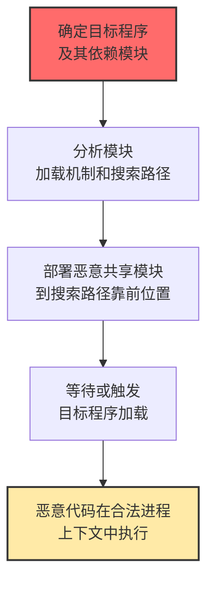

# 共享模块 (T1129)

## 一句话通俗理解

**攻击者通过加载系统共享的代码库（Windows的DLL、Linux的so、macOS的dylib）来执行恶意代码——就像小偷把自己写的假说明书塞进图书馆的公共书架，让别人"自愿"帮他传播。**

## 30秒速查卡

| 维度 | 你需要知道的 |
|------|-------------|
| 这是什么？ | 攻击者利用操作系统加载共享代码库（DLL/so/dylib）的机制，让正常程序在启动时自动加载并执行恶意代码。本质是"搭便车"——借合法程序的身份和权限来运行恶意载荷 |
| 为什么危险？ | 共享模块加载是所有操作系统的基本功能，无法被禁用。恶意代码可以藏在合法程序内部执行，绕过基于进程名的安全检测。2024年XZ Utils后门事件证明这种方式可以渗透进全球核心基础设施 |
| 谁需要关心？ | 软件开发人员、系统管理员、供应链安全团队、负责端点防护的安全运营人员 |
| 你的第一步防御 | 启用Sysmon Event ID 7（镜像加载）日志，监控哪些程序加载了哪些DLL，重点关注从临时目录或用户目录加载的模块 |
| 如果只做一件事 | 监控从非标准路径（如%TEMP%、%APPDATA%、用户家目录）加载的DLL——这是DLL劫持攻击最明显的信号 |

## 难度等级

⭐⭐ 中级（需要一定基础）

前置知识说明：需要了解操作系统如何加载程序和库文件，以及进程内存的基本概念。

## 前置知识检查

**读这个文件需要什么？**

- [ ] 动态链接库（DLL）：了解程序运行时需要"借用"的外部代码包——就像你做饭时去邻居家借调料，而不是自己种全部食材
- [ ] 进程内存空间：理解每个程序有自己的"地盘"——就像每个住户有自己的房间，别人不能随便进，但通过共享模块可以"合法"进入
- [ ] 搜索顺序：了解系统按固定顺序找库文件——就像图书馆按楼层、书架号顺序找书，攻击者只要把假书放在前面的书架上就能先被找到

## 技术描述

共享模块（T1129）是MITRE ATT&CK框架中的一种执行技术。攻击者利用操作系统加载共享代码库的机制，让恶意代码在合法进程的上下文中执行。Windows使用动态链接库（DLL），Linux使用共享对象（.so），macOS使用动态库（.dylib）。这些共享模块包含可被多个程序复用的代码，操作系统在程序启动或运行时会自动加载它们。

**过渡段：** 不要以为共享模块只是"程序加载文件"这么简单。操作系统的模块加载有一套固定流程：程序启动时，系统加载器会按特定顺序在多个目录中搜索所需的库文件。如果攻击者能在搜索路径中靠前的位置放置一个同名的恶意库，系统就会优先加载它——这就是所谓的"搜索顺序劫持"。更隐蔽的方式是直接修改程序配置（如Windows注册表AppInit_DLLs），让系统在启动任何GUI程序时都加载指定的恶意DLL。

**通俗解释：**
就像图书馆的公共书架——所有读者都能从上面取书。操作系统也有"公共书架"（系统目录），程序运行时会从上面"借"代码来用。攻击者把恶意代码伪装成一本"书"放在书架上，程序借书时就会不知不觉地把恶意代码也"读"进去执行。

**技术原理：**
1. 程序启动时，操作系统加载器按固定顺序搜索所需的共享模块
2. Windows搜索顺序：应用程序目录→系统目录→Windows目录→当前目录→PATH路径
3. Linux/macOS依赖LD_LIBRARY_PATH、/etc/ld.so.conf、rpath等配置
4. 攻击者在搜索路径靠前位置放置恶意同名模块，或在配置中指定恶意模块路径
5. 程序加载恶意模块后，恶意代码在程序进程内执行，继承程序的权限和信任

**用途与影响：**
共享模块加载是供应链攻击和持久化攻击的核心技术。攻击者通过篡改共享模块，可以让恶意代码在大量合法程序中执行，实现隐蔽的持久化和权限提升。2024年的XZ Utils后门事件就是通过篡改共享库实现全球级供应链攻击的经典案例。

## 子技术列表

**该技术没有子技术。**

> 注：DLL劫持相关的具体手法（DLL搜索顺序劫持、PATH劫持等）归类在T1574（劫持执行流）的子技术下。T1129侧重于通过正常加载机制执行恶意代码，包括加载恶意库到内存、修改加载配置等行为。

## 攻击流程

### 典型攻击流程

```
确定目标程序 --> 分析模块加载机制 --> 部署恶意共享模块 --> 触发程序加载 --> 恶意代码在合法进程内执行
```



**步骤详解：**

1. **确定目标程序**
   - 通俗描述：找到一个经常运行的合法程序，作为"载体"
   - 技术细节：选择高权限或高频运行的程序，如系统服务、管理工具
   - 常用工具：Process Monitor、Dependencies（DLL分析工具）

2. **分析模块加载机制**
   - 通俗描述：搞清楚目标程序是怎么找"调料"的——从哪个柜子先找
   - 技术细节：分析DLL搜索顺序、rpath配置、LD_LIBRARY_PATH等
   - 常用工具：Process Monitor、ldd、otool

3. **部署恶意共享模块**
   - 通俗描述：把假"书"放到书架上最显眼的位置
   - 技术细节：编译恶意DLL/so/dylib，放置到搜索路径靠前位置
   - 常用工具：Metasploit（msfvenom生成DLL）、自定义编译工具

4. **触发程序加载**
   - 通俗描述：等程序自己来"借书"，或主动触发它启动
   - 技术细节：等待程序自然启动，或通过计划任务、服务重启等方式触发
   - 常用工具：schtasks、sc命令

## 真实案例

### 案例1：XZ Utils后门——全球级供应链攻击（2024年）

- **时间**: 2024年3月
- **目标**: 全球Linux/Unix系统（通过sshd服务）
- **攻击组织**: 身份不明的攻击者（代号"Jia Tan"）
- **手法**: 攻击者长期潜伏在XZ Utils开源项目中，通过社工方式逐步获得维护者权限。他们在liblzma（一个被广泛使用的压缩共享库）的构建过程中注入后门代码。修改后的liblzma.so在被sshd（SSH服务）加载时，会劫持sshd的认证函数，允许攻击者通过预制的密钥绕过SSH认证。后门代码极其隐蔽，使用了复杂的混淆技术，包括在构建脚本中嵌入二进制数据、利用函数指针间接调用等。这个后门差点被发布到各大Linux发行版中，幸被微软工程师Andres Freund在性能测试中发现。
- **影响**: 几乎影响全球所有Linux服务器，如果未被发现，将导致SSH后门级漏洞
- **参考链接**: [Red Hat XZ Utils安全公告](https://www.redhat.com/en/blog/urgent-alert-3528-update-xz-utils-packages-backdoor-vulnerability)
  - **数据来源**: 一级

### 案例2：DLL侧加载攻击在企业环境中的大规模滥用（2024-2025）

- **时间**: 2024-2025年
- **目标**: 全球Windows企业用户
- **攻击组织**: 多个APT组织（包括APT41、Kimsuky等）
- **手法**: 攻击者利用合法程序加载DLL时的搜索顺序弱点，将恶意DLL与合法程序一起打包分发。具体操作是：找到一个有DLL加载缺陷的合法程序（如老旧版本的软件），在同目录下放置恶意DLL。当用户运行合法程序时，系统会先从当前目录加载恶意DLL，而非系统目录中的合法版本。APT41组织在2024年针对东南亚政府机构的攻击中，使用合法的电子签名程序携带恶意版本DLL，绕过了应用程序控制策略。
- **影响**: 大量企业系统被植入后门
- **参考链接**: [Mandiant APT41报告](https://www.mandiant.com/resources/blog/apt41-initiates-global-intrusion-campaign)
  - **数据来源**: 一级

### 案例3：PatchWork组织利用恶意DLL攻击南亚研究机构（2024）

- **时间**: 2024年
- **目标**: 南亚和东南亚的智库、研究机构
- **攻击组织**: PatchWork（APT-C-37）
- **手法**: PatchWork组织通过钓鱼邮件投递包含恶意DLL的压缩包。攻击者利用了一个常见软件的DLL加载缺陷，将恶意DLL命名为该软件依赖的系统库同名文件，放置在软件同目录下。当受害者解压并运行软件时，恶意DLL被优先加载，在合法进程的上下文中执行Shellcode，建立C2连接并窃取文档。攻击者利用合法程序的数字签名和信任关系，成功绕过了终端防护软件的行为检测。
- **影响**: 多个研究机构敏感数据泄露
- **参考链接**: [Cisco Talos PatchWork分析](https://blog.talosintelligence.com/)
  - **数据来源**: 二级

## 红队视角

> ⚠️ **免责声明**：以下内容仅用于合法的安全测试、渗透测试和教育目的。未经授权对他人系统进行测试是违法行为。

### 实战技巧

1. **DLL搜索顺序劫持**
   找到有DLL加载缺陷的合法程序（通常老旧软件或配置不当的程序），在同目录放置恶意同名DLL。使用Process Monitor筛选"Name not found"事件来快速定位可劫持的DLL。

2. **利用AppInit_DLLs注册表键**
   修改`HKLM\SOFTWARE\Microsoft\Windows NT\CurrentVersion\Windows\AppInit_DLLs`注册表键，让系统在每个加载user32.dll的进程中加载指定的DLL。这是一种全局注入方式，但需要管理员权限。

3. **利用LD_PRELOAD（Linux/macOS）**
   在Linux上设置`LD_PRELOAD`环境变量，让目标程序优先加载指定的恶意so文件。可以劫持libc函数实现隐藏进程、文件、网络连接等。

### 常用工具

| 工具名称 | 用途 | 平台 | 链接 |
|----------|------|------|------|
| Process Monitor | 监控DLL加载行为，发现可劫持的模块 | Windows | https://docs.microsoft.com/en-us/sysinternals/downloads/procmon |
| Dependencies | 分析PE文件的DLL依赖关系 | Windows | https://github.com/lucasg/Dependencies |
| msfvenom | 生成恶意DLL载荷 | 跨平台 | https://www.metasploit.com/ |
| DLLHijackTest | DLL劫持测试工具 | Windows | https://github.com/slyd0g/DLLHijackTest |
| ldd | 显示共享库依赖 | Linux | 系统自带 |

### 注意事项

- Windows 10+启用了KnownDLLs保护机制，部分核心系统DLL无法被劫持
- Linux的LD_PRELOAD可被`/etc/ld.so.preload`全局配置替代
- 现代EDR会监控镜像加载事件，需要关注加载路径的合理性

## 蓝队视角

### 检测要点

1. **监控从非标准路径加载的模块**
   - 日志来源：Sysmon Event ID 7（镜像加载）
   - 关注字段：ImageLoaded路径、签名状态
   - 异常特征：从%TEMP%、%APPDATA%、用户家目录加载的DLL

2. **监控AppInit_DLLs注册表修改**
   - 日志来源：Sysmon Event ID 12/13（注册表修改）
   - 关注字段：TargetObject包含AppInit_DLLs
   - 异常特征：任何对该键的修改都值得怀疑

3. **监控同名DLL在不同路径的存在**
   - 日志来源：文件完整性监控（FIM）
   - 关注字段：文件路径、文件哈希
   - 异常特征：系统DLL的同名文件出现在非系统目录

### 监控建议

- 启用Sysmon镜像加载监控（Event ID 7），重点关注非Microsoft签名的模块
- 部署文件完整性监控，跟踪系统目录和程序目录的DLL变化
- 监控LD_PRELOAD和LD_LIBRARY_PATH环境变量的设置
- 使用应用程序控制（AppLocker/WDAC）限制可加载的模块来源

## 检测建议

### 网络层检测

**检测方法：** 监控加载了可疑模块的进程发起的异常网络连接

**具体规则/命令示例：**
```bash
# 监控异常进程的网络外连（加载了可疑DLL的进程发起的C2连接）
# 关注非浏览器进程的HTTP/HTTPS连接
```

**示例（Snort/Suricata规则）：**
```
alert tcp $HOME_NET any -> $EXTERNAL_NET $HTTP_PORTS (msg:"Suspicious DLL-Loaded Process C2"; flow:to_server; content:"POST"; depth:4; pcre:"/User-Agent\x3a\x20[^\r\n]{0,10}$/"; sid:1000010; rev:1;)
```

### 主机层检测

**检测方法：** 监控模块加载事件，识别从非标准路径加载的DLL

**用人话说：** 共享模块检测的核心是识别"不正常的加载行为"——正常程序从系统目录加载微软签名的DLL，攻击者的恶意DLL通常从用户目录、临时目录加载且没有数字签名。关注三个维度：加载路径、签名状态、加载进程。

**Windows事件ID：**
- Sysmon Event ID 7：镜像加载（记录DLL加载事件）
- Sysmon Event ID 12/13：注册表修改（监控AppInit_DLLs）
- 事件ID 4688：进程创建（配合分析进程链）

**具体命令示例：**
```powershell
# 查询Sysmon镜像加载日志，筛选非系统目录加载的DLL
Get-WinEvent -FilterHashtable @{LogName='Microsoft-Windows-Sysmon/Operational'; ID=7} |
  Where-Object { $_.Message -match 'ImageLoaded.*(%TEMP%|%APPDATA%|C:\\Users\\)' } |
  Select-Object -First 20
```

### 应用层检测

**检测方法：** 监控应用程序加载模块的异常行为

**Sigma规则示例：**

**用人话说：** 这条规则检测从用户目录加载DLL的可疑行为——正常程序不应该从用户家目录加载代码库，如果出现这种情况，很可能是DLL侧加载攻击。

```yaml
title: DLL Loaded from Suspicious User Directory
status: experimental
description: Detects DLL loading from user-writable directories, indicating possible DLL hijacking
logsource:
    product: windows
    category: image_load
detection:
    selection:
        ImageLoaded|contains:
            - '\Users\'
            - '\Temp\'
            - '\AppData\'
        Signed: 'false'
    filter_legitimate:
        ImageLoaded|startswith:
            - 'C:\Program Files\'
            - 'C:\Windows\System32\'
    condition: selection and not filter_legitimate
level: high
tags:
    - attack.t1129
    - attack.execution
    - attack.persistence
    - attack.t1574.001
```

## 缓解措施

### 优先级1：关键措施

**措施名称：** 启用模块加载监控

**具体实施步骤：**
1. 部署Sysmon并配置镜像加载监控规则
2. 集中收集Event ID 7日志到SIEM
3. 设置告警规则，监控非标准路径的模块加载

**配置示例：**
```xml
<!-- Sysmon配置：监控镜像加载 -->
<RuleGroup name="NetworkSend" groupRelation="or">
  <ImageLoad onmatch="include">
    <!-- 监控从用户目录加载的未签名DLL -->
    <Rule name="DLL from User Dir" groupRelation="and">
      <ImageLoaded condition="contains">\Users\</ImageLoaded>
      <Signed condition="is">false</Signed>
    </Rule>
  </ImageLoad>
</RuleGroup>
```

### 优先级2：重要措施

**措施名称：** 应用程序控制

**具体实施步骤：**
1. 部署WDAC（Windows Defender Application Control）限制可加载模块
2. 配置代码完整性策略，仅允许签名模块加载
3. 启用DLL规则限制

**措施名称：** 限制AppInit_DLLs

**具体实施步骤：**
1. 通过组策略禁用AppInit_DLLs
2. 设置`HKLM\SOFTWARE\Microsoft\Windows NT\CurrentVersion\Windows\RequireSignedAppInit_DLLs`为1
3. 清空AppInit_DLLs值

### 优先级3：建议措施

**措施名称：** 软件供应链审计

**具体实施步骤：**
1. 对关键软件进行DLL依赖审计
2. 优先使用支持安全加载的软件版本
3. 监控开源依赖库的完整性

### MITRE ATT&CK 缓解措施映射

| 缓解措施ID | 缓解措施名称 | 适用性 | 说明 |
|------------|-------------|--------|------|
| M1042 | 禁用功能或服务 | 部分适用 | 禁用AppInit_DLLs机制 |
| M1022 | 应用程序控制 | 适用 | 使用WDAC/AppLocker限制模块加载 |
| M1038 | 防止恶意软件 | 适用 | 部署EDR检测恶意模块加载 |
| M1047 | 审计 | 适用 | 启用模块加载日志监控 |

## 动手实验

> ⚠️ **重要提示**：所有实验必须在隔离的实验室环境中进行，禁止对未授权的真实系统进行测试。

### 实验环境准备

**推荐靶场/实验平台：**

| 平台名称 | 类型 | 难度 | 链接 |
|----------|------|------|------|
| Detection Lab | 虚拟靶场 | 初级 | https://github.com/clong/DetectionLab |
| Atomic Red Team | 测试框架 | 初级 | https://github.com/redcanaryco/atomic-red-team |

**所需工具：**
- Process Monitor：监控DLL加载行为
- msfvenom：生成测试用恶意DLL
- 一个有DLL加载缺陷的测试程序

**环境搭建：**
```bash
# 安装Sysmon并配置镜像加载监控
# 下载Sysmon: https://docs.microsoft.com/en-us/sysinternals/downloads/sysmon
sysmon.exe -accepteula -i sysmon-config.xml
```

### 实验1：DLL加载行为分析（初级）

**实验目标：** 学习使用Process Monitor分析程序的DLL加载行为

**实验步骤：**
1. 启动Process Monitor，设置筛选器为"Path ends with .dll"
2. 启动一个测试程序（如notepad.exe）
3. 观察加载了哪些DLL，以及从哪些路径加载
4. 尝试找到"Name not found"事件，理解搜索顺序

**预期结果：** 能看到notepad.exe加载的DLL列表和搜索路径顺序

**学习要点：** 理解DLL搜索顺序和加载机制

### 实验2：DLL劫持测试（中级）

**实验目标：** 在实验环境中模拟DLL劫持攻击

**实验步骤：**
1. 使用msfvenom生成一个测试DLL：
   ```bash
   msfvenom -p windows/exec CMD=calc.exe -f dll -o test.dll
   ```
2. 找一个有DLL加载缺陷的测试程序
3. 将恶意DLL放置在程序同目录
4. 运行程序观察是否触发计算器

**预期结果：** 程序加载恶意DLL并执行其中的代码

### 实验3：使用Sysmon检测DLL加载（高级）

**实验目标：** 配置Sysmon检测非标准路径的DLL加载

**实验步骤：**
1. 配置Sysmon镜像加载监控规则
2. 模拟DLL劫持攻击
3. 在SIEM中创建检测规则
4. 验证告警是否触发

**预期结果：** Sysmon成功捕获并告警非标准路径的DLL加载行为

## 术语解释

| 术语 | 英文原名 | 通俗解释 |
|------|----------|----------|
| DLL | Dynamic Link Library | 动态链接库，Windows的共享代码包，就像公共工具箱，多个程序可以共用里面的工具 |
| 共享对象 | Shared Object (.so) | Linux的共享代码库，功能类似Windows的DLL |
| 动态库 | Dynamic Library (.dylib) | macOS的共享代码库 |
| 搜索顺序 | Search Order | 系统查找库文件时的固定顺序，就像图书馆按楼层找书 |
| DLL劫持 | DLL Hijacking | 在搜索路径靠前位置放置恶意DLL，让程序优先加载它 |
| AppInit_DLLs | Application Init DLLs | Windows注册表键，可让系统在每个GUI程序启动时加载指定DLL |
| 侧加载 | Side-Loading | 将恶意DLL与合法程序放在同目录，利用加载顺序缺陷执行 |
| 供应链攻击 | Supply Chain Attack | 通过篡改软件供应链中的组件（如开源库）来分发恶意代码 |

## 参考资料

### 官方文档

- 📚 [MITRE ATT&CK T1129官方页面](https://attack.mitre.org/techniques/T1129/) - 如果你想深入了解技术细节
- 📚 [Microsoft DLL安全文档](https://docs.microsoft.com/en-us/windows/win32/dlls/dynamic-link-library-security) - 如果你想深入了解技术细节

### 安全报告

- 📰 [Red Hat XZ Utils后门公告](https://www.redhat.com/en/blog/urgent-alert-3528-update-xz-utils-packages-backdoor-vulnerability) - 如果你想了解真实攻击长什么样
- 📰 [Mandiant APT41分析](https://www.mandiant.com/resources/blog/apt41-initiates-global-intrusion-campaign) - 如果你想了解真实攻击长什么样

### 工具与资源

- 🔧 [LOLBAS项目](https://lolbas-project.github.io/) - 如果你想动手试试
- 🔧 [Atomic Red Team T1129测试](https://github.com/redcanaryco/atomic-red-team/blob/master/atomics/T1129/T1129.md) - 如果你想动手试试
- 🔧 [Process Monitor](https://docs.microsoft.com/en-us/sysinternals/downloads/procmon) - 如果你想动手试试

### 学习资料

- 📚 [DLL劫持原理与实践](https://attack.mitre.org/techniques/T1574/001/) - 如果你想深入了解技术细节
- 📚 [XZ Utils后门深度分析](https://www.cisecurity.org/advisory/a-critical-vulnerability-discovered-in-xz-utils) - 如果你想深入了解技术细节
