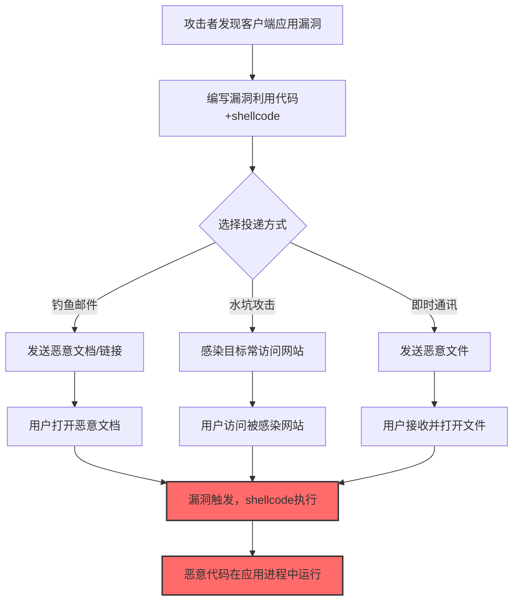
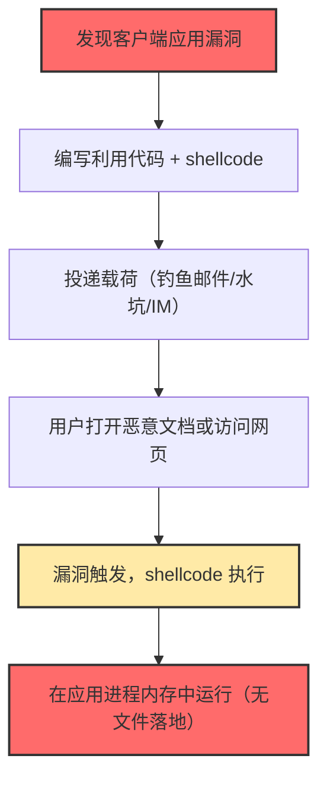

# 客户端漏洞利用执行 (T1203)

## 一句话通俗理解

> **利用你日常用的软件（浏览器、Office、PDF阅读器）的漏洞来执行代码——就像小偷不撬门锁，而是找到墙上的裂缝钻进去**

## 30秒速查卡

| 维度 | 你需要知道的 |
|------|-------------|
| 这是什么？ | 利用客户端应用程序（浏览器/Office/PDF阅读器）的漏洞执行恶意代码 |
| 为什么危险？ | 用户只需打开恶意文件或访问网页就会触发，不需要运行任何程序 |
| 谁需要关心？ | 终端安全团队、IT运维、所有软件用户 |
| 你的第一步防御 | 保持所有客户端软件及时更新补丁 |
| 如果只做一件事 | 启用浏览器和Office的DEP/ASLR等漏洞缓解措施 |

## 难度等级

⭐⭐⭐ 高级 - 需要编程基础或深入的漏洞研究知识

> **前置知识**：内存管理基础、缓冲区溢出原理、应用程序架构、漏洞利用链概念

## 前置知识检查

**读这个文件需要什么？**

- [ ] 知道什么是"软件漏洞"（程序代码中的缺陷，可被利用执行非预期操作）
- [ ] 了解"缓冲区溢出"的基本概念（数据超过程序预设的存储空间，覆盖了其他数据）
- [ ] 知道客户端应用程序包括哪些（浏览器、Office、PDF阅读器、聊天软件等）

## 技术描述

**客户端漏洞利用执行**（T1203）是 ATT&CK 执行战术下的技术，攻击者利用客户端应用程序（如浏览器、Office、PDF阅读器、即时通讯软件）中的漏洞来执行代码。与服务端漏洞利用不同，客户端漏洞利用通常需要用户交互——打开恶意文档、访问恶意网页、点击链接等。

> 📡 **打个比方**：你的房子（电脑）有坚固的门锁（防火墙），小偷从正门进不来。但房子里有一扇窗户（浏览器）有裂缝（漏洞）。小偷只要让你"开窗通风"（访问网页），就能从裂缝钻进来。你以为是自己在开窗，实际上是小偷在利用裂缝。

### 进阶理解

简单来说，客户端漏洞利用的流程是：

1. **漏洞发现** - 研究者在应用程序中发现内存安全漏洞（如缓冲区溢出、UAF、类型混淆）
2. **构造触发器** - 攻击者构造特制的文件（恶意网页、Office文档、PDF）来触发漏洞
3. **编写利用代码** - 编写 shellcode 在触发漏洞后执行，绕过 ASLR/DEP 等保护
4. **投递载荷** - 通过钓鱼邮件、水坑攻击等方式让目标用户打开恶意文件

常见的客户端漏洞类型：
- **浏览器漏洞**：JavaScript 引擎（V8/JSC）漏洞、渲染引擎漏洞、WebAssembly 漏洞
- **Office 漏洞**：Office 公式编辑器漏洞（CVE-2017-11882）、远程代码执行漏洞
- **PDF 阅读器漏洞**：Adobe Reader JavaScript 引擎漏洞、JBIG2 解析器漏洞
- **即时通讯漏洞**：图片解析漏洞（如 WhatsApp CVE-2019-3568）

**过渡段：** 不要以为"我不下载文件就安全了"——现代客户端漏洞利用只需要你访问一个网页。浏览器中的 JavaScript 可以自动触发漏洞，用户完全无感知。

### 为什么有效？

这种技术之所以有效，是因为：
1. **用户交互触发**：钓鱼邮件和水坑攻击可以诱导用户打开恶意内容
2. **绕过网络防护**：漏洞利用在应用进程内部执行，防火墙看不到
3. **高权限执行**：客户端应用通常以当前用户权限运行，漏洞利用继承该权限
4. **零日威胁**：未公开的漏洞（0day）没有补丁，防护极为困难

## 真实攻击流程



**步骤详解：**

1. **发现漏洞** - 攻击者或漏洞经纪人发现客户端应用中的安全漏洞
2. **编写利用** - 编写触发漏洞的文件和利用后执行的 shellcode
3. **选择投递** - 通过钓鱼邮件、水坑攻击或即时通讯投递恶意内容
4. **用户触发** - 用户打开文档、访问网页或接收文件
5. **漏洞执行** - 恶意内容触发应用漏洞，执行 shellcode
6. **代码运行** - shellcode 在应用进程内存中运行，下载后续载荷

## 攻击流程

### 典型攻击流程

```
发现客户端漏洞 --> 编写利用代码+shellcode --> 投递载荷（钓鱼/水坑/IM） --> 用户打开文档或网页 --> 漏洞触发shellcode执行 --> 在应用进程内存中运行
```



**步骤详解：**

1. **发现客户端应用漏洞**
   - 通俗描述：攻击者研究浏览器、Office、PDF 阅读器、即时通讯客户端等常用客户端软件，发现可被利用的内存破坏或逻辑漏洞
   - 技术细节：通过模糊测试（Fuzzing）发现堆溢出、UAF、类型混淆等漏洞；分析补丁差异（Patch Diffing）定位已修复漏洞的利用路径；常见目标包括 Chrome V8、Office Equation Editor、Adobe Reader JavaScript 引擎
   - 常用工具：AFL、libFuzzer、WinDbg、IDA Pro、Ghidra、QEMU

2. **编写利用代码 + shellcode**
   - 通俗描述：根据漏洞类型编写稳定的利用代码，绕过 DEP/ASLR/CFG 等缓解措施，最终执行自定义 shellcode
   - 技术细节：通过 ROP 链绕过 DEP；利用信息泄露漏洞绕过 ASLR；通过 JIT Spray 或 Type Confusion 绕过 CFG；shellcode 通常为 Position-Independent Code（PIC），负责下载第二阶段载荷或直接反射加载 C2 框架
   - 常用工具：pwntools、ROPgadget、Metasploit Framework、自定义 shellcode 生成器

3. **投递载荷**
   - 通俗描述：将构造好的恶意文档或链接通过钓鱼邮件、水坑攻击或即时通讯工具投递给目标用户
   - 技术细节：钓鱼邮件附件为 RTF/DOCX/PDF 嵌入漏洞触发对象；水坑攻击在目标常访问网站注入恶意 JavaScript（如挂马）；IM 投递伪装成正常文件链接；载荷需绕过邮件网关和沙箱检测
   - 常用工具：Microsoft Word/Excel、CVE 特定构造工具（如 unicornscan、RTF 模板注入工具）、EvilGinx、Gophish

4. **用户打开文档或访问网页**
   - 通俗描述：用户被社工手段诱导打开恶意附件或点击链接，触发客户端应用加载恶意内容
   - 技术细节：利用 Office 受信任视图绕过、Mark-of-the-Web（MOTW）规避；浏览器漏洞利用通过 iframe 或重定向链隐藏来源；用户交互可能仅需打开文档，无需点击启用编辑
   - 常用工具：社工模板、伪装的文件图标和扩展名

5. **漏洞触发，shellcode 执行**
   - 通俗描述：客户端应用解析恶意内容时触发漏洞，攻击者利用代码接管控制流，跳转到 shellcode 执行
   - 技术细节：堆喷射（Heap Spray）布局 shellcode；UAF 漏洞通过释放后重用控制虚表指针；漏洞触发后 shellcode 在应用进程上下文执行，继承应用权限和完整性级别
   - 常用工具：Metasploit、Cobalt Strike、自定义 Stage 0 shellcode

6. **在应用进程内存中运行**
   - 通俗描述：shellcode 在浏览器或 Office 进程内存中运行，反射加载 C2 框架，全程无文件落地，传统基于文件的检测难以发现
   - 技术细节：使用 Reflective DLL Injection 加载 C2 beacon；进程内存中执行，不写入磁盘；通过进程注入或线程劫持持久化；防御方需依赖内存扫描、ETW 或行为分析
   - 常用工具：Cobalt Strike、Meterpreter、Donut、Sliver

## 真实案例

### 案例1：ScarCruft 利用 IE 漏洞水坑攻击（2022-2023）

- **时间**：2022-2023年
- **目标**：韩国智库、媒体机构、脱北者组织
- **攻击组织**：ScarCruft（APT37，Reaper，朝鲜）
- **手法**：ScarCruft 入侵了目标常访问的韩国新闻网站，在网页中植入利用 Internet Explorer Trident 引擎漏洞（CVE-2022-41128）的代码。当目标用户使用 IE 或内嵌 IE 控件的浏览器访问网站时，漏洞触发后执行 shellcode，下载 RCKit 后门。整个过程用户只需访问网页，无需点击任何内容
- **影响**：多个目标组织被植入后门
- **参考链接**：[Volexity ScarCruft Analysis](https://www.volexity.com/blog/2022/)

### 案例2：APT28 利用 Office 公式编辑器漏洞（2022-2024）

- **时间**：2022-2024年
- **目标**：欧洲政府机构、北约相关组织
- **攻击组织**：APT28（Fancy Bear，俄罗斯 GRU）
- **手法**：APT28 在钓鱼邮件中发送包含 CVE-2017-11882（Office 公式编辑器漏洞）的 Word 文档。尽管该漏洞已有补丁，但许多目标系统未及时更新。文档打开后，公式编辑器进程（EQNEDT32.EXE）触发缓冲区溢出，执行 shellcode 下载 Fancy Bear 的后门。攻击者利用该"老漏洞"是因为目标环境的补丁管理存在缺口
- **影响**：多个欧洲政府机构被入侵
- **参考链接**：[Mandiant APT28 Report](https://www.mandiant.com/resources/blog/fancy-bear)

### 案例3：NSO Group Pegasus 利用 WhatsApp 漏洞（2019）

- **时间**：2019年
- **目标**：记者、律师、人权活动家
- **攻击组织**：NSO Group（商业间谍软件供应商）
- **手法**：NSO Group 利用 WhatsApp 语音通话功能中的缓冲区溢出漏洞（CVE-2019-3568）。攻击者向目标发起 WhatsApp 语音通话，目标手机即使不接听，WhatsApp 在处理来电时的 SRTCP 解析也会触发漏洞，执行 Pegasus 间谍软件。整个攻击过程"零点击"——目标甚至不需要任何操作，只要手机开着 WhatsApp 就会被入侵
- **影响**：超过 1400 台设备被 Pegasus 感染
- **参考链接**：[Citizen Lab Pegasus Report](https://citizenlab.ca/2019/10/)

## 红队视角

> ⚠️ **免责声明**：以下内容仅用于合法的安全测试、渗透测试和教育目的。未经授权对他人系统进行测试是违法行为。

### 实战技巧

1. **漏洞链组合**：信息泄露漏洞（绕过 ASLR）+ 内存破坏漏洞（执行代码），组合使用
2. **触发器伪装**：将恶意网页伪装成新闻文章，提高用户访问概率
3. **漏洞利用框架**：使用 Metasploit、Core Impact 等框架内置的浏览器/Office exploit 模块
4. **沙箱逃逸**：利用浏览器沙箱漏洞从渲染进程逃逸到浏览器主进程

### 常用工具

| 工具名称 | 用途 | 平台 |
| -------- | ---- | ---- |
| Metasploit Browser Exploits | 浏览器漏洞利用模块 | 全平台 |
| BeEF | 浏览器利用框架 | 全平台 |
| Empire | 含客户端漏洞利用模块 | Windows |
| Core Impact | 商业渗透测试框架 | 全平台 |
| Canvas | 商业漏洞利用框架 | 全平台 |

### 注意事项

- 客户端漏洞利用通常依赖特定版本的应用程序，需要确认目标版本
- 沙箱和 EDR 可能检测到漏洞利用行为模式
- 零日漏洞利用成本极高，通常只用于高价值目标

## 蓝队视角

### 检测要点

1. **异常子进程创建**：监控客户端应用（浏览器/Office/PDF阅读器）创建异常子进程
2. **应用崩溃监控**：频繁的应用崩溃可能是漏洞利用尝试的迹象
3. **内存保护告警**：DEP/CFG/CET 等保护机制触发告警
4. **异常网络连接**：客户端应用在访问文档后立即发起到未知IP的连接

### 监控建议

- 部署 Sysmon 监控客户端应用的子进程创建
- 启用 Windows Defender Exploit Guard（含 DEP/ASLR/CFG 保护）
- 监控应用程序崩溃日志（Windows 事件 1000/1001）
- EDR 监控异常的内存分配和执行模式

## 避坑指南

**防御者最痛苦的教训**：依赖"补丁打全了就安全"的假设。零日漏洞（0day）在补丁发布前就已经被利用。必须部署行为检测（如子进程监控），不能仅依赖补丁管理。

## 检测建议

### 网络层检测

**方法**：监控客户端应用在打开文档/访问网页后发起的异常网络连接

```bash
# 检测浏览器/Office 进程的外连行为
# 正常浏览器外连是预期的，但 Office 打开文档后立即外连是可疑的
```

### 主机层检测

**Windows事件ID**：
- 事件ID 4688：进程创建（监控客户端应用的子进程）
- 事件ID 1000/1001：应用程序崩溃（可能是漏洞利用尝试）
- Sysmon Event ID 1：进程创建（含父进程信息）
- Sysmon Event ID 8：CreateRemoteThread（注入检测）

```powershell
# 检测 Office 进程创建可疑子进程
Get-WinEvent -FilterHashtable @{LogName='Microsoft-Windows-Sysmon/Operational'; ID=1} |
    Where-Object { 
        $_.Message -match 'WINWORD.EXE|EXCEL.EXE|OUTLOOK.EXE|AcroRd32.exe' -and 
        $_.Message -match 'cmd.exe|powershell.exe|wscript.exe|rundll32.exe'
    }
```

### 应用层检测

**用人话说**：这条规则在检测"客户端软件突然生出了命令行程序"——正常情况下，你用 Word 写文档，Word 不会去启动 cmd.exe 或 powershell.exe。如果你发现 Word/Excel/Acrobat 的子进程是命令行工具，几乎可以确定是漏洞利用——攻击者的 shellcode 在应用进程内执行后，启动了命令行来下载后续载荷。另外也要关注应用崩溃——如果某个应用突然崩溃然后立即有网络外连，可能是漏洞利用"第一次没成功，触发了崩溃但仍然执行了部分代码"。

**Sigma规则示例**：

```yaml
title: 客户端应用创建可疑子进程 - 漏洞利用检测
status: experimental
description: 检测浏览器/Office/PDF阅读器创建命令行子进程，可能为漏洞利用
logsource:
    product: windows
    category: process_creation
detection:
    selection_client_parent:
        ParentImage|endswith:
            - '\WINWORD.EXE'
            - '\EXCEL.EXE'
            - '\POWERPNT.EXE'
            - '\OUTLOOK.EXE'
            - '\AcroRd32.exe'
            - '\Acrobat.exe'
            - '\chrome.exe'
            - '\firefox.exe'
            - '\msedge.exe'
            - '\iexplore.exe'
    selection_suspicious_child:
        Image|endswith:
            - '\cmd.exe'
            - '\powershell.exe'
            - '\wscript.exe'
            - '\cscript.exe'
            - '\mshta.exe'
            - '\rundll32.exe'
            - '\regsvr32.exe'
    condition: selection_client_parent and selection_suspicious_child
fields:
    - ParentImage
    - Image
    - CommandLine
    - User
falsepositives:
    - 浏览器启动下载工具（应建立白名单）
    - Office 加载项正常调用（罕见）
level: critical
tags:
    - attack.execution
    - attack.t1203
    - attack.t1068
```

```yaml
title: 应用程序异常崩溃后伴随可疑网络连接
status: experimental
description: 检测应用崩溃后短时间内出现的可疑网络连接，可能为漏洞利用
logsource:
    product: windows
    service: application
detection:
    selection_crash:
        EventID: 1000
        FaultingApplication|endswith:
            - '\WINWORD.EXE'
            - '\EXCEL.EXE'
            - '\AcroRd32.exe'
            - '\chrome.exe'
    timeframe: 5m
    condition: selection_crash
fields:
    - FaultingApplication
    - ExceptionCode
    - TimeCreated
level: medium
tags:
    - attack.execution
    - attack.t1203
```

## 缓解措施

### 优先级1：关键措施

**及时更新补丁**：建立自动化的补丁管理流程，确保所有客户端应用及时更新

```powershell
# 检查已安装的 Office 更新
Get-WmiObject -Class Win32_QuickFixEngineering | Where-Object { $_.HotFixID -match 'KB' } | Sort-Object InstalledOn -Descending
# 检查浏览器版本
(Get-Item "C:\Program Files\Google\Chrome\Application\chrome.exe").VersionInfo.ProductVersion
```

### 优先级2：重要措施

**启用漏洞缓解措施**：配置 DEP/ASLR/CFG 等保护

```powershell
# 启用 Windows Defender Exploit Guard
Set-MpPreference -EnableNetworkProtection $true
# 配置进程缓解措施（示例：为 Office 启用所有保护）
ProcessMitigations\Get-ProcessMitigation -Name winword.exe
```

### 优先级3：建议措施

**应用沙箱隔离**：使用 Windows Sandbox 或浏览器沙箱隔离不可信内容

```powershell
# 启用 Windows Sandbox 功能
Enable-WindowsOptionalFeature -FeatureName 'Containers-DisposableClientVM' -All -Online
```

## 动手实验

> ⚠️ **所有实验必须在隔离的实验室环境中进行**

### 实验1：理解基本原理（初级）

**目标**：理解客户端漏洞利用的概念

**步骤**：
1. 在实验环境中安装旧版浏览器（有已知漏洞的版本）
2. 使用 Metasploit 的 browser_exploit 模块
3. 访问恶意页面观察漏洞触发
4. 检查进程创建日志

**预期输出**：
```
# Metasploit 应显示
[*] Sending exploit to client
[*] Delivering payload...
[*] Meterpreter session opened
# Sysmon 日志显示浏览器创建子进程
```

**学习要点**：理解漏洞利用的触发和执行机制

### 实验2：实际操作（中级）

**目标**：模拟 Office 文档漏洞利用

**步骤**：
1. 使用 Metasploit 的 office_word_macro 模块
2. 生成恶意 Word 文档
3. 在未打补丁的虚拟机中打开
4. 观察子进程创建和网络连接
5. 编写 Sigma 检测规则

**学习要点**：掌握 Office 漏洞利用检测

### 实验3：防御验证（高级）

**目标**：验证漏洞缓解措施有效性

**步骤**：
1. 配置 Windows Defender Exploit Guard
2. 为 Office 启用 DEP/CFG/ASLR
3. 重复实验2的漏洞利用
4. 验证缓解措施是否阻止了利用
5. 分析 Exploit Guard 日志

**学习要点**：掌握漏洞缓解措施配置和验证

## 术语解释

| 术语 | 通俗解释 |
|------|---------|
| **客户端应用** | 用户日常使用的软件，如浏览器、Office、PDF阅读器 |
| **漏洞** | 程序代码中的缺陷，像墙上的"裂缝"，可以被利用入侵 |
| **Shellcode** | 漏洞触发后执行的机器码，像"钻进裂缝后的行动指令" |
| **ASLR** | 地址空间布局随机化，让攻击者猜不透代码在内存的位置 |
| **DEP** | 数据执行保护，防止在数据区域执行代码 |
| **沙箱** | 应用隔离机制，即使应用被攻破也无法影响系统其他部分 |
| **水坑攻击** | 入侵目标常访问的网站，在网站中植入漏洞利用代码 |
| **零点击** | 用户无需任何操作，仅接收数据就触发漏洞的攻击方式 |

## 参考资料

### 📚 官方文档（深入了解）
- [MITRE ATT&CK - Exploitation for Client Execution (T1203)](https://attack.mitre.org/techniques/T1203/)
- [Microsoft - Exploit Protection](https://learn.microsoft.com/en-us/microsoft-365/security/defender-endpoint/exploit-protection-reference)
- [Microsoft - Attack Surface Reduction](https://learn.microsoft.com/en-us/microsoft-365/security/defender-endpoint/attack-surface-reduction)

### 🔧 工具与资源（动手试试）
- [Atomic Red Team - T1203](https://github.com/redcanaryco/atomic-red-team/blob/master/atomics/T1203/T1203.md) - 客户端漏洞利用测试用例
- [Metasploit Framework](https://www.metasploit.com/) - 含浏览器和Office漏洞利用模块
- [BeEF](https://github.com/beefproject/beef) - 浏览器利用框架

### 📰 安全报告（真实攻击）
- [Volexity - ScarCruft IE Exploit](https://www.volexity.com/blog/2022/) - ScarCruft IE 水坑攻击
- [Mandiant - APT28 Analysis](https://www.mandiant.com/resources/blog/fancy-bear) - APT28 Office 漏洞利用
- [Citizen Lab - Pegasus WhatsApp](https://citizenlab.ca/2019/10/) - NSO Group WhatsApp 零点击攻击
