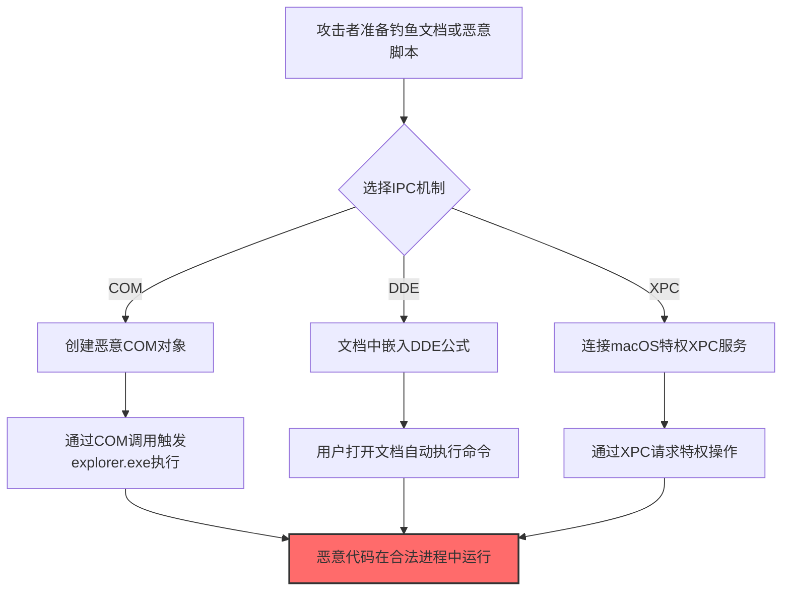
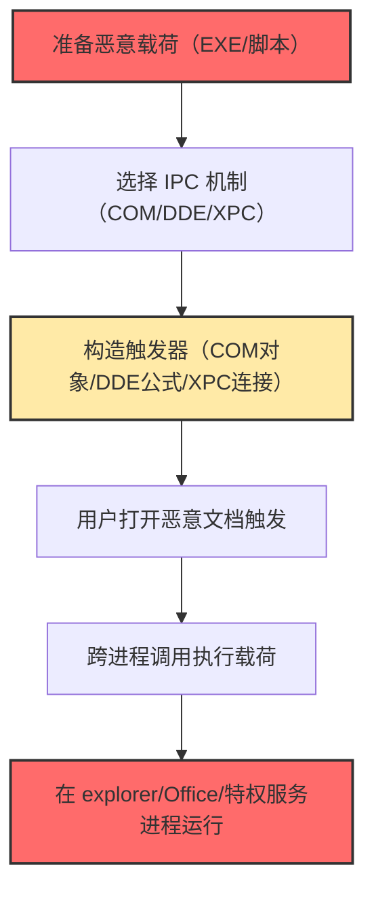

# 进程间通信 (T1559)

## 一句话通俗理解

> **借助操作系统自带的"进程间通信管道"在别的程序里执行代码——就像借着快递公司的送货渠道偷偷运私货**

## 30秒速查卡

| 维度 | 你需要知道的 |
|------|-------------|
| 这是什么？ | 利用 COM/DDE/XPC 等进程间通信机制在其他进程中执行恶意代码 |
| 为什么危险？ | 代码在合法进程中执行，绕过应用白名单和进程信誉检测 |
| 谁需要关心？ | 终端安全团队、应用开发人员、Office管理员 |
| 你的第一步防御 | 禁用 Office DDE、限制 COM 对象注册、监控异常 IPC 调用 |
| 如果只做一件事 | 在 Office 中禁用 DDE 自动执行 |

## 难度等级

⭐⭐ 中级 - 需要理解操作系统 IPC 机制和进程边界概念

> **前置知识**：进程概念、Windows COM 架构、Office 文档格式、macOS XPC 框架

## 前置知识检查

**读这个文件需要什么？**

- [ ] 知道什么是"进程"（正在运行的程序，有自己的内存空间）
- [ ] 了解进程之间不能直接访问对方内存，需要通过 IPC 通信
- [ ] 知道 Office 文档可以包含"链接"和"嵌入对象"

## 技术描述

**进程间通信**（T1559）是 ATT&CK 执行战术下的技术，攻击者利用操作系统内置的进程间通信（IPC）机制来执行恶意代码。三大平台各有 IPC 机制：Windows 的 COM（Component Object Model）和 DDE（Dynamic Data Exchange）、macOS 的 XPC（Cross-Process Communication）。

> 📡 **打个比方**：每个运行的程序就像一栋独立的大楼，各自有门禁。进程间通信就是楼与楼之间的"快递通道"——楼A可以发包裹给楼B，楼B收到后打开执行。攻击者利用这个合法通道，把恶意"包裹"通过它投递给高权限的程序，让收件程序替攻击者干活。

### 进阶理解

简单来说，操作系统为了安全，给每个进程划了独立的内存空间——进程A不能直接读写进程B的内存。但有时候进程之间需要协作（比如 Excel 要从 Word 获取数据），操作系统就提供了"官方通信渠道"：

- **Windows COM**：组件对象模型，允许一个进程创建和调用另一个进程的对象
- **Windows DDE**：动态数据交换，Office 文档可以通过它让程序执行命令
- **macOS XPC**：轻量级 IPC，常用于特权服务和无特权进程之间的通信

攻击者利用这些机制时，恶意代码不是自己直接运行，而是"委托"给一个合法进程（如 explorer.exe、svchost.exe）去执行。由于这些进程是受信任的，安全软件往往不会拦截。

### 为什么有效？

这种技术之所以有效，是因为：
1. **借用合法进程**：恶意代码在 explorer.exe 或 Office 进程中执行，绕过应用白名单
2. **无需落地文件**：COM 对象和 DDE 命令可以直接在内存中执行，不需要写入磁盘
3. **跨权限边界**：通过 IPC 可以从低权限进程向高权限服务发送命令
4. **文档层面触发**：DDE 可以通过钓鱼文档触发，用户只需打开文档

## 子技术列表

| 子技术ID | 中文名称 | 通俗解释 |
|----------|----------|----------|
| T1559.001 | Component Object Model | 利用 Windows COM 在 explorer.exe 等合法进程中执行代码 |
| T1559.002 | Dynamic Data Exchange | 利用 Office DDE 在不启用宏的情况下执行命令 |
| T1559.003 | XPC Services | 利用 macOS XPC 连接特权服务执行代码 |

## 真实攻击流程



**步骤详解：**

1. **准备载荷** - 攻击者选择目标 IPC 机制，准备对应的载荷格式
2. **选择机制** - COM（Windows 横向）、DDE（Office 钓鱼）、XPC（macOS 提权）
3. **构造触发器** - 创建 COM 对象/嵌入 DDE 公式/连接 XPC 服务
4. **触发执行** - 用户打开文档或脚本运行触发 IPC 调用
5. **合法进程执行** - 恶意代码在 explorer.exe/Office 进程/特权服务中运行
6. **绕过防护** - 由于在受信任进程中执行，绕过应用白名单和信誉检测

## 攻击流程

### 典型攻击流程

```
准备载荷 --> 选择 IPC 机制 --> 构造触发器 --> 用户打开文档触发 --> 跨进程调用执行 --> 在 explorer/Office/特权服务进程运行
```



**步骤详解：**

1. **准备恶意载荷**
   - 通俗描述：攻击者准备好要在目标系统上执行的恶意可执行文件、PowerShell 脚本或 shellcode
   - 技术细节：载荷通常为 C2 beacon、勒索软件或横向移动工具；需考虑载荷的体积和兼容性（如 32/64 位）；载荷可托管在远程服务器或嵌入文档中
   - 常用工具：Cobalt Strike、Metasploit、自定义 C++/C# 载荷

2. **选择 IPC 机制**
   - 通俗描述：根据目标环境选择合适的进程间通信机制，如 Windows COM、DDE 或 macOS XPC
   - 技术细节：COM 适用于 Windows，可调用 WMI、Office 对象模型；DDE 适用于 Office 文档自动化；XPC 适用于 macOS 系统服务和特权进程；选择依据是目标进程的权限和可达性
   - 常用工具：COM/DCOM、Office DDE、macOS XPC Services、PyOleCb

3. **构造触发器**
   - 通俗描述：构造能触发 IPC 调用的载体，如包含 COM 对象的文档、DDE 公式或 XPC 连接代码
   - 技术细节：COM 文档嵌入 `Equation.3` 或 `Shell.Explorer.1` 对象；DDE 公式 `=cmd|/c calc.exe!A1`；XPC 通过 NSXPCConnection 连接到特权服务（如 blued、mdworker）
   - 常用工具：Microsoft Office、RTF 文档构造工具、macOS XPC 模板项目

4. **用户打开文档触发**
   - 通俗描述：用户通过钓鱼或共享文档打开包含 IPC 触发器的恶意文档，触发跨进程调用
   - 技术细节：Office 文档可能提示"启用内容"或"更新链接"，用户同意后触发；某些 COM 对象无需用户交互即可自动激活；DDE 默认在 Office 中启用
   - 常用工具：社工邮件、共享盘投放、IM 文件传输

5. **跨进程调用执行载荷**
   - 通俗描述：通过 IPC 机制在另一个进程中执行恶意命令，绕过当前应用沙箱或权限限制
   - 技术细节：COM 调用通过 `CoCreateInstance` 在 surrogated 进程中执行；DDE 通过 `DDEExecute` 在 WINWORD.EXE 子进程中执行；XPC 通过 Mach 消息跨进程调用特权服务方法
   - 常用工具：COM Moniker（`new:000209FF-0000-0000-C000-000000000046`）、DDE 协议、XPC 服务接口

6. **在 explorer/Office/特权服务进程运行**
   - 通俗描述：恶意代码最终在 explorer.exe、Office 应用或特权系统服务进程的上下文中运行，继承这些进程的权限
   - 技术细节：COM 调用常在 dllhost.exe（DCOM 代理）或 explorer.exe 中执行；DDE 在 Office 进程中执行；XPC 在特权服务进程中执行，可能获得 root 权限；防御方需监控异常的子进程创建和 IPC 流量
   - 常用工具：Sysmon EID 1（监控 explorer.exe/Office 子进程）、Process Monitor、ESlogger（macOS）

## 真实案例

### 案例1：FIN7 利用 DDE 进行无宏攻击（2017-2018）

- **时间**：2017-2018年
- **目标**：餐饮企业、零售商
- **攻击组织**：FIN7（又名 Carbanak Group）
- **手法**：FIN7 在钓鱼邮件中发送 Word 文档，文档中嵌入了 DDE 公式 `=cmd /c calc.exe`（实际载荷为下载器）。用户打开文档时，Word 会弹出"是否更新链接"提示，用户点击"是"后命令被执行。整个过程不需要启用宏，绕过了传统的宏安全检测
- **影响**：攻击了超过 100 家美国企业，窃取了数百万张信用卡信息
- **参考链接**：[US-CERT FIN7 Report](https://www.cisa.gov/news-events/cybersecurity-advisories/aa18-261a)

### 案例2：APT29 利用 COM 横向移动（2020）

- **时间**：2020年
- **目标**：美国政府机构、智库
- **攻击组织**：APT29（Cozy Bear，俄罗斯 SVR）
- **手法**：在 SolarWinds 供应链攻击的后续阶段，APT29 使用 COM 对象（`MMC20.Application`）通过 WMI 在远程主机上执行命令。攻击者创建 COM 对象后调用 `Document.ActiveView.ExecuteShellCommand` 方法，在目标主机上执行任意命令，整个过程在 WMI 服务上下文中运行
- **影响**：通过该技术横向移动到多个政府机构网络
- **参考链接**：[CISA SolarWinds Advisory](https://www.cisa.gov/news-events/cybersecurity-advisories/aa21-148a)

### 案例3：EagleEye 利用 macOS XPC 提权（2021-2022）

- **时间**：2021-2022年
- **目标**：macOS 用户
- **攻击组织**：EagleEye 相关攻击组
- **手法**：利用 macOS 上 `userhelperd` 服务的 XPC 连接漏洞，攻击者从普通用户进程通过 XPC 向特权服务发送请求，绕过 GUI 界面直接执行需要 root 权限的操作。攻击者构造恶意的 XPC 消息，利用 `NSXPCConnection` 连接到 `com.apple.userhelperd`，通过权限校验缺陷实现提权执行
- **影响**：在多台 macOS 设备上获得 root 权限
- **参考链接**：[Apple Security Updates](https://support.apple.com/en-us/HT201294)

## 红队视角

> ⚠️ **免责声明**：以下内容仅用于合法的安全测试、渗透测试和教育目的。未经授权对他人系统进行测试是违法行为。

### 实战技巧

1. **DDE 无宏攻击**：在 Word 中用 `Ctrl+F9` 插入域代码，输入 DDE 公式，绕过宏安全
2. **COM 劫持**：修改 HKCU 中的 COM 对象注册表项，让合法程序加载恶意 DLL
3. **MMC20.Application**：通过 COM 调用 MMC 管理控制台，在远程主机执行命令
4. **XPC 审计**：使用 `xpcproxy` 审计 macOS XPC 服务的权限校验逻辑

### 常用工具

| 工具名称 | 用途 | 平台 |
| -------- | ---- | ---- |
| COMRaider | COM 对象模糊测试工具 | Windows |
| OleViewDotNet | COM 对象浏览和测试 | Windows |
| Invoke-DDE | PowerShell DDE 攻击脚本 | Windows |
| xpwn | macOS XPC 漏洞研究工具 | macOS |
| Atomic Red Team | IPC 测试用例 | 全平台 |

### 注意事项

- DDE 攻击在 Office 2019+ 默认被禁用，需要目标使用旧版本或未配置防护
- COM 对象调用会留下 WMI 事件日志
- macOS XPC 服务有严格的沙箱限制，需要找到校验漏洞

## 蓝队视角

### 检测要点

1. **DDE 检测**：监控 Office 进程（WINWORD.EXE/EXCEL.EXE）创建 cmd.exe/powershell.exe
2. **COM 检测**：监控 WMI 事件（事件 ID 4648）和 COM 对象创建
3. **XPC 检测**：使用 `eslogger` 监控 macOS XPC 连接事件

### 监控建议

- 启用 PowerShell 日志（Script Block Logging 事件 ID 4104）
- 部署 Sysmon 监控 Office 进程创建子进程
- macOS 上部署 `eslogger` 监控 XPC 相关的 endpoint security 事件

## 避坑指南

**防御者最痛苦的教训**：只检测宏代码而忽略 DDE。DDE 攻击不需要启用宏，传统的"禁用宏"策略对它无效。必须单独配置 Office 的 DDE 防护策略。

## 检测建议

### 网络层检测

**方法**：监控 Office 进程发起的异常网络连接（DDE 执行后下载后续载荷）

```bash
# 检测 Word/Excel 进程的外连行为
# 正常 Office 不应该发起 raw TCP 连接
```

### 主机层检测

**Windows事件ID**：
- 事件ID 4688：进程创建（监控 Office 创建 cmd/powershell）
- Sysmon Event ID 1：进程创建（含父进程信息）
- Sysmon Event ID 8：CreateRemoteThread（COM 注入检测）
- Sysmon Event ID 17/18：管道事件（COM 通信管道）

**macOS日志**：
- `/var/log/system.log`：XPC 服务日志
- Endpoint Security Framework：XPC 连接事件

```bash
# 检测 Office 进程创建子进程
# 通过 Sysmon 日志查询
Get-WinEvent -FilterHashtable @{LogName='Microsoft-Windows-Sysmon/Operational'; ID=1} | 
    Where-Object { $_.Message -match 'WINWORD.EXE|EXCEL.EXE|POWERPNT.EXE' -and $_.Message -match 'cmd.exe|powershell.exe|wscript.exe' }
```

### 应用层检测

**用人话说**：这条规则在检测"Office 程序偷偷启动命令行"——正常情况下你用 Word 写文档，Word 不应该去启动 cmd.exe 或 powershell.exe。如果发现 Word/Excel 的子进程是命令行工具，几乎可以确定是 DDE 或 COM 攻击在搞鬼。攻击者用 DDE 公式 `=cmd /c` 让 Word 去执行命令，或者通过 COM 对象让 Office 去启动恶意程序。这个模式非常明确：Office → 命令行 = 高危。

**Sigma规则示例**：

```yaml
title: Office 进程创建可疑子进程（DDE/COM 攻击）
status: experimental
description: 检测 Word/Excel/PowerPoint 创建命令行子进程，可能为 DDE 或 COM 攻击
logsource:
    product: windows
    category: process_creation
detection:
    selection_office_parent:
        ParentImage|endswith:
            - '\WINWORD.EXE'
            - '\EXCEL.EXE'
            - '\POWERPNT.EXE'
            - '\OUTLOOK.EXE'
    selection_suspicious_child:
        Image|endswith:
            - '\cmd.exe'
            - '\powershell.exe'
            - '\wscript.exe'
            - '\cscript.exe'
            - '\mshta.exe'
            - '\rundll32.exe'
    condition: selection_office_parent and selection_suspicious_child
fields:
    - ParentImage
    - Image
    - CommandLine
    - User
falsepositives:
    - Office 加载项正常调用命令行工具（罕见）
level: high
tags:
    - attack.execution
    - attack.t1559
    - attack.t1559.002
```

```yaml
title: 可疑 COM 对象 - MMC20.Application 远程执行
status: experimental
description: 检测通过 MMC20.Application COM 对象远程执行命令
logsource:
    product: windows
    service: security
detection:
    selection:
        EventID: 4688
        CommandLine|contains:
            - 'MMC20.Application'
            - 'ExecuteShellCommand'
    condition: selection
fields:
    - CommandLine
    - SubjectUserName
    - TargetUserName
level: high
tags:
    - attack.execution
    - attack.t1559.001
    - attack.lateral_movement
```

## 缓解措施

### 优先级1：关键措施

**禁用 Office DDE**：通过组策略禁用 DDE 自动执行

```registry
# 禁用 Word DDE
[HKEY_CURRENT_USER\Software\Microsoft\Office\<version>\Word\Security\AllowDDE]
"AllowDDE"=dword:00000000

# 禁用 Excel DDE
[HKEY_CURRENT_USER\Software\Microsoft\Office\<version>\Excel\Security\AllowDDE]
"AllowDDE"=dword:00000000
```

### 优先级2：重要措施

**限制 COM 对象**：通过软件限制策略（SRP）或 AppLocker 限制 COM 对象的执行

```powershell
# AppLocker 规则示例：限制 COM 对象
# 路径：计算机配置 → 策略 → 应用程序控制策略 → AppLocker
```

### 优先级3：建议措施

**macOS XPC 加固**：启用 macOS 的 System Integrity Protection (SIP)，确保 XPC 服务签名验证

```bash
# 检查 SIP 状态
csrutil status
# 应输出: System Integrity Protection status: enabled.
```

## 动手实验

> ⚠️ **所有实验必须在隔离的实验室环境中进行**

### 实验1：理解基本原理（初级）

**目标**：理解 DDE 攻击原理

**步骤**：
1. 在 Word 中按 `Ctrl+F9` 插入域代码
2. 输入 `DDEAUTO c:\\windows\\system32\\cmd.exe "/k calc.exe"`
3. 保存并重新打开文档
4. 观察 calc.exe 是否被启动
5. 检查事件日志中的进程创建记录

**预期输出**：
```
# 应看到 WINWORD.exe 创建 cmd.exe，cmd.exe 创建 calc.exe
EventID 4688: Process cmd.exe created by WINWORD.EXE
```

**学习要点**：理解 DDE 触发机制和父子进程关系

### 实验2：实际操作（中级）

**目标**：模拟 COM 横向移动

**步骤**：
1. 在测试环境部署两台 Windows 主机
2. 使用 PowerShell 创建 MMC20.Application COM 对象
3. 调用 ExecuteShellCommand 执行远程命令
4. 在目标主机检查 WMI 和安全日志
5. 编写 Sigma 规则检测该行为

**学习要点**：掌握 COM 横向移动技术和检测方法

### 实验3：防御验证（高级）

**目标**：验证 macOS XPC 检测规则

**步骤**：
1. 在 macOS 上部署 eslogger
2. 编写 XPC 连接监控规则
3. 触发测试 XPC 连接
4. 验证告警是否生成

**学习要点**：掌握 macOS Endpoint Security Framework 使用

## 术语解释

| 术语 | 通俗解释 |
|------|---------|
| **IPC** | Inter-Process Communication，进程间通信，程序之间"交流"的官方渠道 |
| **COM** | Component Object Model，Windows 的组件系统，像"标准化的零件接口" |
| **DDE** | Dynamic Data Exchange，Office 的动态数据交换，让文档"远程控制"程序 |
| **XPC** | macOS 的轻量级 IPC 机制，用于进程间通信和权限分离 |
| **CLSID** | COM 对象的唯一标识符，像"身份证号" |
| **MMC20.Application** | 管理控制台 COM 对象，可被用于远程执行命令 |

## 参考资料

### 📚 官方文档（深入了解）
- [MITRE ATT&CK - Inter-Process Communication (T1559)](https://attack.mitre.org/techniques/T1559/)
- [MITRE ATT&CK - Component Object Model (T1559.001)](https://attack.mitre.org/techniques/T1559/001/)
- [MITRE ATT&CK - Dynamic Data Exchange (T1559.002)](https://attack.mitre.org/techniques/T1559/002/)
- [Microsoft - COM Documentation](https://learn.microsoft.com/en-us/windows/win32/com/component-object-model--com--portal)
- [Apple - XPC Services](https://developer.apple.com/documentation/xpc)

### 🔧 工具与资源（动手试试）
- [Atomic Red Team - T1559.002](https://github.com/redcanaryco/atomic-red-team/blob/master/atomics/T1559.002/T1559.002.md) - DDE 测试用例
- [COMRaider](https://github.com/nccgroup/COMRaider) - COM 对象模糊测试
- [OleViewDotNet](https://github.com/leoloobeek/OleViewDotNet) - COM 对象浏览

### 📰 安全报告（真实攻击）
- [US-CERT FIN7 Advisory](https://www.cisa.gov/news-events/cybersecurity-advisories/aa18-261a) - FIN7 DDE 攻击
- [CISA SolarWinds Advisory](https://www.cisa.gov/news-events/cybersecurity-advisories/aa21-148a) - APT29 COM 横向移动
- [Apple Security Updates](https://support.apple.com/en-us/HT201294) - macOS XPC 漏洞修复
