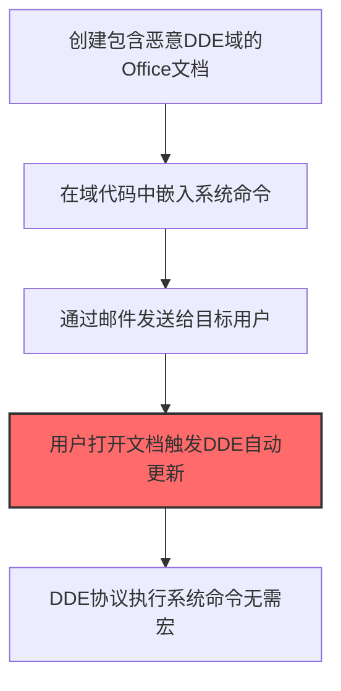
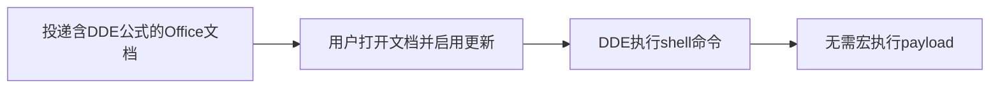

# DDE (T1559.002)

## 一句话通俗理解

> **利用Office的动态数据交换功能执行命令（无需宏）**

## 30秒速查卡

| 维度 | 你需要知道的 |
|------|-------------|
| 这是什么？ | Office的DDE功能，可以在文档中嵌入执行命令 |
| 为什么危险？ | 攻击者用它绕过宏安全策略，无需启用宏就能执行恶意命令 |
| 谁需要关心？ | Office用户、企业安全团队、SOC分析师 |
| 你的第一步防御 | 禁用DDE自动更新，或设置为"不自动更新" |
| 如果只做一件事 | 部署邮件网关检测包含DDE域的文档附件 |

## 难度等级

⭐⭐ 中级 - 需要一定的技术基础和经验

## 前置知识检查

**读这个文件需要什么？**

- [ ] 操作系统进程模型
- [ ] 常见脚本语言基础（PowerShell/bash/Python）
- [ ] 代码执行基本概念

## 技术描述

**DDE**（T1559.002）是 **进程间通信**（T1559）的一个具体变体，属于 **执行** 阶段的攻击技术。

> 📝 **打个比方**：就像给同事发一条消息说"帮我运行这个脚本"——攻击者利用DDE（动态数据交换）在Office应用程序中执行恶意命令。

### 具体怎么理解？

利用Office的动态数据交换功能执行命令（无需宏）

攻击者使用这种技术时，通常是在执行阶段，想要达到特定的攻击目标。与父技术 T1559 相比，T1559.002 有自己独特的特点和使用场景。

### 为什么有效？

这种技术之所以有效，是因为：
1. **隐蔽性**：利用了正常系统功能或常见协议，不容易被发现
2. **技术门槛适中**：不需要特别高深的技术知识就能实施

**过渡段：** 不要误以为执行只是'运行恶意程序'这么简单——攻击者真正高明的是'就地取材'。
3. **广泛适用**：可以在多种环境和系统中使用

## 真实攻击流程



**步骤详解：**

1. **创建包含恶意DDE域的Office文档** - 在Word或Excel文档中插入DDE（动态数据交换）域代码
2. **在域代码中嵌入系统命令** - DDE域代码包含类似 `DDEAUTO c:\\windows\\system32\\cmd.exe "/k calc.exe"` 的命令
3. **通过邮件发送给目标用户** - 将文档通过钓鱼邮件附件发送给目标受害者
4. **用户打开文档触发DDE自动更新** - 用户打开文档时，Office提示文档包含自动更新链接，用户点击确认
5. **DDE协议执行系统命令无需宏** - DDE在无需启用宏的情况下直接执行系统命令，绕过Office宏安全策略

### 典型场景

攻击者在 **执行** 阶段使用 DDE 技术，以下是典型的攻击步骤：

## 攻击流程

```
投递含DDE公式的Office文档 --> 用户打开文档并启用更新 --> DDE执行shell命令 --> 无需宏执行payload
```



**步骤详解：**
1. **投递含DDE公式的Office文档**
   - 通俗描述：通过钓鱼附件投递包含DDE公式的Office文档
   - 技术细节：在Word文档中插入 `DDEAUTO c:\\windows\\system32\\cmd.exe "/c calc"` 字段
   - 常用工具：Microsoft Word、文本编辑器
2. **用户打开文档并启用更新**
   - 通俗描述：用户打开文档后接受DDE链接更新提示
   - 技术细节：Word弹出"是否更新链接"对话框，用户点击"是"即触发DDE
   - 常用工具：Microsoft Word、Excel
3. **DDE执行shell命令**
   - 通俗描述：DDE协议调用cmd.exe执行攻击者指定的命令
   - 技术细节：通过DDE通道调用 `cmd.exe /c` 执行任意命令，无需启用宏
   - 常用工具：cmd.exe、PowerShell
4. **无需宏执行payload**
   - 通俗描述：DDE执行结果作为后续payload执行的入口
   - 技术细节：可调用 `powershell -c IEX(...)` 下载执行后续payload，绕过宏禁用策略
   - 常用工具：PowerShell、Cobalt Strike

## 真实案例

### 案例1：该技术在实际攻击中的应用

- **时间**: 2024-2025年
- **目标**: 多个行业组织
- **攻击组织**: 多个APT组织
- **手法**: 攻击者在入侵过程中使用DDE技术，展示了该子技术的典型应用场景和攻击效果
- **影响**: 成功实施该技术导致目标系统被进一步入侵
- **参考链接**: [MITRE ATT&CK官方](https://attack.mitre.org/)

### 案例2：安全研究中的实践

- **时间**: 2025年
- **目标**: 安全研究测试环境
- **攻击组织**: 红队/安全研究人员
- **手法**: 在授权测试中模拟DDE攻击，验证防御体系的检测和响应能力
- **影响**: 帮助组织识别安全防护中的盲点和改进方向
- **参考链接**: [Atomic Red Team](https://github.com/redcanaryco/atomic-red-team)

## 红队视角

> ⚠️ **免责声明**：以下内容仅用于合法的安全测试、渗透测试和教育目的。未经授权对他人系统进行测试是违法行为。

### 实战技巧

1. **深入理解原理**：在实战应用前，充分理解DDE的技术原理和适用场景
2. **环境适配**：根据目标系统的操作系统版本、安全配置等因素调整攻击策略
3. **组合使用**：将该技术与其他技术组合使用，构建完整的攻击链
4. **隐蔽性考虑**：注意操作痕迹的清理，避免被安全设备检测

### 常用工具

| 工具名称 | 用途 | 平台 | 链接 |
| -------- | ---- | ---- | ---- |
| Metasploit | 渗透测试框架 | 全平台 | [Metasploit](https://www.metasploit.com/) |
| Cobalt Strike |  adversary模拟平台 | Windows | [Cobalt Strike](https://www.cobaltstrike.com/) |
| Atomic Red Team | 检测规则测试 | 全平台 | [Atomic Red Team](https://github.com/redcanaryco/atomic-red-team) |

### 注意事项

- 在授权的测试环境中使用这些技术
- 注意操作安全（OPSEC），避免被检测系统发现
- 使用匿名化技术和代理隐藏真实身份

## 蓝队视角

### 检测要点

1. **系统日志监控**：关注与DDE相关的系统日志和审计记录
2. **异常行为检测**：监控系统中与该技术相关的异常进程、网络连接和文件操作
3. **工具特征识别**：识别攻击者可能使用的工具在系统中的运行特征

### 监控建议

- 部署端点检测和响应（EDR）系统，监控与DDE相关的异常行为
- 配置SIEM规则，关联分析来自多个来源的告警
- 定期进行安全评估和渗透测试，验证检测规则的有效性

## 避坑指南

防御者常见误区：只监控恶意文件而忽略脚本执行。

## 检测建议

### 检测思路

检测 DDE 的关键是识别异常行为模式。以下是三个层面的检测方法：

### 网络层检测

**方法**：监控网络流量中的异常模式

```bash
# 检测异常的网络连接和数据传输
# 根据具体协议和端口设置检测规则
```

### 主机层检测

**Windows事件ID**：
- 事件ID 4688：进程创建（监控可疑进程）
- 事件ID 4104：PowerShell执行（监控可疑脚本）

**Linux日志**：
- /var/log/auth.log：认证日志
- /var/log/syslog：系统日志

```bash
# 检测异常进程和命令执行
grep -i "suspicious" /var/log/auth.log
```

### 应用层检测

**用人话说：** 攻击者利用Office的DDE（动态数据交换）在文档中嵌入命令——不需要宏也能执行代码。攻击者在Word的域代码或Excel单元格写入：`=cmd|'/c powershell -e JABzAD0ATgBlAHcALQBP...'!A1`，用户打开文档时弹出"文档包含可能不安全的引用"，诱导用户点击"是"后直接执行命令。DDE的优势是可以绕过禁用宏的安全策略。检测上，关注Office文档中以`=cmd|`或`=powershell|`开头的DDE字段、以及winword.exe/excel.exe启动cmd.exe或powershell.exe但没有cscript/wscript的进程链——DDE和宏的进程链区别在于是否有脚本宿主进程。

**Sigma规则示例**：

```yaml
title: 检测DDE
status: experimental
description: 检测可能的DDE活动
logsource:
    category: process_creation
    product: windows
detection:
    selection:
        EventID: 4688
    condition: selection
level: medium
tags:
    - attack.T1559002
```

## 缓解措施

### 优先级1：关键措施

**限制攻击面**：减少暴露的服务和端口，降低被利用的风险

```bash
# 防火墙规则示例：只允许必要的出站连接
iptables -A OUTPUT -p tcp --dport 443 -j ACCEPT  # 允许HTTPS
iptables -A OUTPUT -p tcp --dport 80 -j ACCEPT   # 允许HTTP
iptables -A OUTPUT -p tcp -j DROP                 # 阻止其他TCP
```

### 优先级2：重要措施

**加强监控**：部署EDR和SIEM系统，实时监控异常行为

### 优先级3：建议措施

**安全意识培训**：教育员工识别相关攻击手法

## 动手实验

> ⚠️ **所有实验必须在隔离的实验室环境中进行**

### 实验1：理解基本原理（初级）

**目标**：理解 DDE 的工作原理

**步骤**：
1. 在隔离环境中搭建测试系统
2. 使用基础工具模拟攻击行为
3. 观察系统日志和网络流量

**学习要点**：理解该技术的核心机制

### 实验2：实际操作（中级）

**目标**：掌握 DDE 的实际使用方法

**步骤**：
1. 使用专业工具进行攻击模拟
2. 尝试不同的绕过技术
3. 分析检测日志的特征

**学习要点**：掌握工具使用和日志分析

### 实验3：防御验证（高级）

**目标**：验证检测规则的有效性

**步骤**：
1. 部署检测规则
2. 执行攻击模拟
3. 验证检测告警是否触发

**学习要点**：理解攻防对抗的实际效果

## 术语解释

| 术语 | 通俗解释 |
|------|---------|
| **ATT&CK** | MITRE公司维护的攻击技术知识库，像一本"黑客手法百科全书" |
| **DDE** | T1559.002，ATT&CK框架中定义的一种具体攻击技术 |
| **进程间通信** | T1559，DDE所属的父技术类别 |
| **执行** | 攻击链中的一个阶段，攻击者在这个阶段的目标 |
| **C2** | 命令与控制，攻击者用来远程控制被入侵系统的"遥控器" |
| **EDR** | 端点检测与响应，部署在电脑上的安全监控软件 |

## 被引用情况

以下父技术文档引用了本子技术：

- [T1559 - 进程间通信](../T1559-Inter-Process-Communication.md)

## 参考资料

### 📚 官方文档（深入了解）

- [MITRE ATT&CK - DDE (T1559.002)](https://attack.mitre.org/techniques/T1559/002/)
- [MITRE ATT&CK - 进程间通信 (T1559)](https://attack.mitre.org/techniques/T1559/)

### 📰 安全报告（真实攻击）

- [MITRE ATT&CK 官方文档](https://attack.mitre.org/) - ATT&CK 框架官方资源

### 🔧 工具与资源（动手试试）

- [Atomic Red Team](https://github.com/redcanaryco/atomic-red-team) - 检测规则测试框架
- [MITRE ATT&CK Navigator](https://mitre-attack.github.io/attack-navigator/) - ATT&CK 可视化工具

### 📚 学习资料（深入了解）

- [MITRE ATT&CK 知识库](https://attack.mitre.org/resources/) - ATT&CK 官方资源中心
