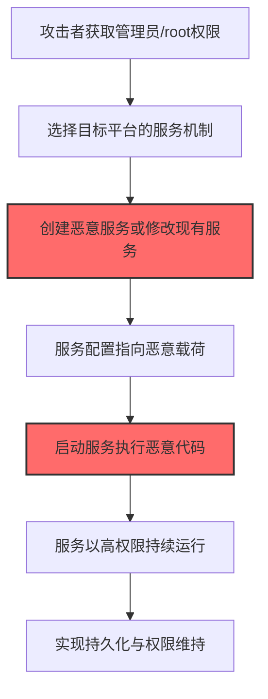
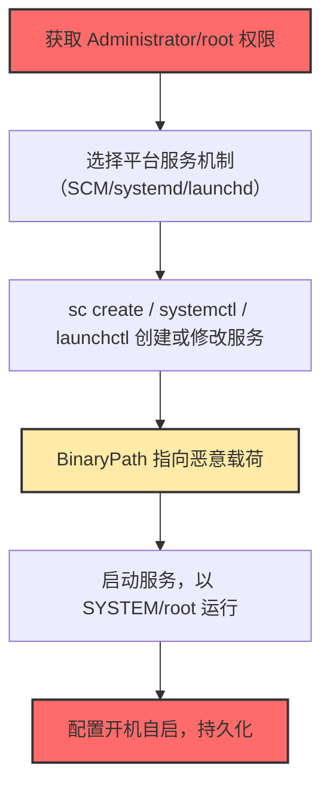

# 系统服务 (T1569)

## 一句话通俗理解

> **把恶意代码伪装成"系统服务"让它开机自启——就像给小偷办了张正式员工工牌，光明正大进公司**

## 30秒速查卡

| 维度 | 你需要知道的 |
|------|-------------|
| 这是什么？ | 利用操作系统的服务管理机制（Windows服务/macOS launchd/Linux systemd）执行恶意代码 |
| 为什么危险？ | 服务以高权限运行、开机自启、混在正常服务中难以发现 |
| 谁需要关心？ | 系统管理员、终端安全团队、运维工程师 |
| 你的第一步防御 | 定期审计服务列表，关注新建服务和路径异常的服务 |
| 如果只做一件事 | 监控服务创建事件（Windows 7045/4697，Linux systemd unit创建） |

## 难度等级

⭐⭐ 中级 - 需要操作系统服务管理基础和权限提升知识

> **前置知识**：Windows服务/SCM概念、Linux systemd/init、macOS launchd、服务权限模型

## 前置知识检查

**读这个文件需要什么？**

- [ ] 知道什么是"系统服务"（后台运行的程序，开机自启）
- [ ] 了解 Windows 服务管理器（services.msc）或 Linux systemd
- [ ] 知道服务通常以 SYSTEM/root 等高权限运行

## 技术描述

**系统服务**（T1569）是 ATT&CK 执行战术下的技术，攻击者利用操作系统内置的服务管理机制来执行恶意代码。三大平台各有服务系统：Windows 的 SCM（Service Control Manager）、macOS 的 launchd、Linux 的 systemd/sysvinit。

> 📡 **打个比方**：操作系统就像一栋办公楼，"服务"就是楼里的正式员工——有工牌、有门禁卡、每天自动来上班。攻击者把恶意代码伪装成"新员工"注册进去，从此它就能光明正大地在公司里干活，还能享受最高级别的门禁权限。

### 进阶理解

简单来说，程序要运行需要有人"启动"它。而"服务"是一种特殊的程序——它由操作系统自动启动、通常以最高权限运行、并且在后台持续运行。攻击者要做的事情就是：

1. **创建一个新服务**，让它指向恶意程序
2. **修改已有服务**，把正常服务的执行路径改成恶意程序
3. **利用服务配置**，通过服务参数传递恶意命令

在 Windows 上，攻击者用 `sc create`、`sc config` 或 PowerShell 的 `New-Service` 创建服务，服务二进制路径（BINARY_PATH_NAME）指向恶意 EXE/DLL。在 Linux 上，攻击者在 `/etc/systemd/system/` 或 `/lib/systemd/system/` 下创建 `.service` 文件。在 macOS 上，攻击者在 `/Library/LaunchDaemons/` 或 `~/Library/LaunchAgents/` 下创建 `.plist` 文件。

### 为什么有效？

这种技术之所以有效，是因为：
1. **权限高**：Windows 服务默认以 LocalSystem 运行，Linux 服务以 root 运行
2. **持久化**：服务开机自启，重启后仍然存活
3. **隐蔽性**：系统里几十上百个服务，多一个不容易被发现
4. **合法工具**：使用操作系统自带的命令，不会被杀毒软件标记为恶意

## 子技术列表

| 子技术ID | 中文名称 | 通俗解释 |
|----------|----------|----------|
| T1569.001 | Launchctl | macOS 的服务管理工具，用 `launchctl load` 加载恶意 plist |
| T1569.002 | Service Execution | Windows 的服务执行，用 `sc create` 或 `net start` 运行恶意服务 |
| T1569.009 | Cloud Service | 云平台服务（AWS Lambda/Azure Functions）被用于执行恶意代码 |

## 真实攻击流程



**步骤详解：**

1. **获取权限** - 攻击者已通过其他手段获得 Administrator/root 权限
2. **选择平台** - 根据目标操作系统选择对应的服务机制（SCM/systemd/launchd）
3. **创建/修改服务** - 用 `sc create`、`systemctl` 或 `launchctl` 注册新服务或篡改现有服务
4. **指向载荷** - 将服务的 BINARY_PATH_NAME 或 ExecStart 指向恶意文件
5. **启动执行** - 启动服务，恶意代码以 SYSTEM/root 权限运行
6. **持久维持** - 服务设置开机自启，重启后自动恢复

## 攻击流程

### 典型攻击流程

```
获取 Administrator/root 权限 --> 选择平台服务机制 --> 创建或修改服务 --> 配置 BinaryPath 指向载荷 --> 启动服务 --> 开机自启持久化
```



**步骤详解：**

1. **获取 Administrator/root 权限**
   - 通俗描述：攻击者通过漏洞利用、凭证窃取或提权漏洞获得本地管理员或 root 权限，这是创建系统服务的前提
   - 技术细节：Windows 通过 UAC 绕过或 `SeDebugPrivilege` 提权；Linux 通过 sudo 误配置或 SUID 二进制提权；macOS 通过 SIPC 漏洞或管理员凭证
   - 常用工具：Mimikatz、LinPEAS、BeRoot、漏洞利用框架

2. **选择平台服务机制**
   - 通俗描述：根据目标操作系统选择合适的服务管理机制：Windows SCM、Linux systemd、macOS launchd
   - 技术细节：Windows SCM 通过 `sc.exe` 或注册表 `HKLM\SYSTEM\CurrentControlSet\Services\` 管理；Linux systemd 通过 `.service` 单元文件位于 `/etc/systemd/system/`；macOS launchd 通过 `.plist` 文件位于 `/Library/LaunchDaemons/` 或 `/Library/LaunchAgents/`
   - 常用工具：sc.exe、systemctl、launchctl、PowerShell New-Service

3. **创建或修改服务**
   - 通俗描述：创建一个新服务或修改现有合法服务的配置，使其指向恶意载荷
   - 技术细节：Windows `sc create EvilSvc binPath= "C:\Temp\evil.exe"`；Linux 编写 `/etc/systemd/system/evil.service`；macOS 创建 `/Library/LaunchDaemons/com.evil.plist`；修改现有服务可继承合法服务的权限和描述
   - 常用工具：sc.exe、PowerShell Service 模块、systemctl、launchctl、vim/nano（编辑配置文件）

4. **配置 BinaryPath 指向载荷**
   - 通俗描述：将服务的可执行路径（BinaryPath/ExecStart/ProgramArguments）配置为攻击者控制的恶意文件路径
   - 技术细节：Windows 设置 `ImagePath` 注册表值；Linux 设置 `ExecStart=/tmp/evil`；macOS 设置 `<key>ProgramArguments</key><string>/tmp/evil</string>`；载荷路径通常选择临时目录或系统目录以混淆视听
   - 常用工具：reg.exe、PowerShell Set-ItemProperty、文本编辑器

5. **启动服务**
   - 通俗描述：手动启动服务或等待系统重启后自动启动，服务以 SYSTEM（Windows）或 root（Linux/macOS）权限运行
   - 技术细节：Windows `sc start EvilSvc`；Linux `systemctl start evil`；macOS `launchctl load com.evil.plist`；服务运行在独立的服务会话（Session 0）中，无用户界面
   - 常用工具：sc.exe、systemctl、launchctl

6. **开机自启持久化**
   - 通俗描述：将服务启动类型配置为自动（Auto Start），确保系统重启后服务自动运行，实现持久化
   - 技术细节：Windows 设置 `Start=Auto`（注册表 `Start=2`）；Linux 设置 `[Install] WantedBy=multi-user.target` 并 `systemctl enable`；macOS 设置 `RunAtLoad=true`；防御方需监控服务创建和修改事件
   - 常用工具：sc.exe config、systemctl enable、launchctl bootstrap

## 真实案例

### 案例1：Lazarus Group 利用 Windows 服务部署恶意软件（2022-2023）

- **时间**：2022-2023年
- **目标**：加密货币交易所、金融科技公司
- **攻击组织**：Lazarus Group（朝鲜APT）
- **手法**：攻击者通过钓鱼邮件获取初始访问后，使用 `sc create` 创建名为 "WindowsDefenderService" 的伪装服务，BINARY_PATH 指向 `%PROGRAMDATA%\Microsoft\Windows\Defender\wdboot.exe" -s` 的恶意程序。服务以 LocalSystem 权限运行，实现持久化
- **影响**：多台服务器被长期控制，加密货币资产被盗
- **参考链接**：[Mandiant Lazarus Analysis](https://www.mandiant.com/resources/blog/lazarus-manifesto)

### 案例2：XorDdos 利用 systemd 服务持久化（2021-2023）

- **时间**：2021-2023年
- **目标**：Linux 服务器和 IoT 设备
- **攻击组织**：XorDdos 运营团队
- **手法**：XorDdos 恶意软件在 `/etc/systemd/system/` 下创建名为 `system-cleanup.service` 的 systemd unit 文件，ExecStart 指向 `/usr/bin/system-cleanup`（实际为恶意二进制）。通过 `systemctl enable` 设置开机自启，服务以 root 运行执行 DDoS 攻击
- **影响**：大量 Linux 服务器沦为 DDoS 僵尸节点
- **参考链接**：[Microsoft XorDdos Report](https://www.microsoft.com/en-us/security/blog/2021/05/25/microsoft-finds-new-elevated-linux-malware-xorddos/)

### 案例3：Shlayer 利用 macOS LaunchAgents 持久化（2019-2022）

- **时间**：2019-2022年
- **目标**：macOS 用户
- **攻击组织**：Shlayer 运营团队
- **手法**：Shlayer 通过伪造的 Adobe Flash 更新提示诱导用户下载安装后，在 `~/Library/LaunchAgents/com.apple.updater.plist` 创建 LaunchAgent，ProgramArguments 指向恶意脚本。使用 `launchctl load` 加载后实现开机自启，持续投放广告软件和挖矿程序
- **影响**：成为 macOS 上最广泛的恶意软件之一
- **参考链接**：[Kaspersky Shlayer Report](https://securelist.com/ksb-2022-2023-2024-mac-os-malware/108989/)

## 红队视角

> ⚠️ **免责声明**：以下内容仅用于合法的安全测试、渗透测试和教育目的。未经授权对他人系统进行测试是违法行为。

### 实战技巧

1. **服务命名伪装**：取一个像系统服务的名字（如 "MicrosoftTelemetryService"），减少被人工巡检发现的概率
2. **修改而非创建**：找一个已停用的服务，修改其 BINARY_PATH 而不是新建服务，避免触发"新服务创建"告警
3. **利用服务恢复策略**：设置 ServiceRecoveryAction 为"运行程序"，即使服务被删除也能重新执行
4. **DLL 服务**：Windows 支持 `svchost.exe -k` 加载 DLL 形式的服务，比 EXE 服务更隐蔽

### 常用工具

| 工具名称 | 用途 | 平台 |
| -------- | ---- | ---- |
| sc.exe | Windows 服务管理命令行工具 | Windows |
| PsExec | Sysinternals 工具，可远程创建服务 | Windows |
| New-Service | PowerShell cmdlet 创建服务 | Windows |
| systemctl | Linux systemd 服务管理 | Linux |
| launchctl | macOS launchd 服务管理 | macOS |
| Empire | PowerShell 后渗透框架，内置服务执行模块 | Windows |

### 注意事项

- 创建服务需要 Administrator/root 权限
- Windows 事件 ID 7045 会记录新服务创建，注意清理日志
- macOS 的 LaunchDaemon 需要放在 `/Library/LaunchDaemons/`，文件属主必须是 root

## 蓝队视角

### 检测要点

1. **服务创建监控**：Windows 事件 ID 7045（服务创建）、4697（服务安装）；Linux 监控 `/etc/systemd/system/` 文件创建
2. **服务路径异常**：服务 BINARY_PATH 指向临时目录、用户目录、或非标准路径
3. **服务名伪装**：与合法服务名相似但有细微差异（如 "WindowsDefenderService" vs "WinDefend"）
4. **服务配置变更**：已有服务的 BINARY_PATH 被修改

### 监控建议

- 启用 Windows 服务安装审计策略（Advanced Audit Policy → System → Audit Security System Extension）
- 使用 Sysmon Event ID 6（驱动/服务加载）监控服务相关活动
- 在 Linux 上部署 auditd 规则监控 systemd unit 文件变更
- EDR 监控 `sc.exe`、`systemctl`、`launchctl` 命令的异常使用

## 避坑指南

**防御者最痛苦的教训**：只监控服务创建（7045）而忽略服务修改（7040）。攻击者可以先停止一个冷门服务，修改其路径后再启动——这样不会触发 7045 告警。

## 检测建议

### 网络层检测

**方法**：监控新服务的外连行为，服务进程发起异常网络连接

```bash
# 检测新创建服务的外连行为
# 需要结合主机日志关联服务创建时间和网络连接时间
```

### 主机层检测

**Windows事件ID**：
- 事件ID 7045：服务安装（关键检测点）
- 事件ID 4697：服务安装（安全日志版本）
- 事件ID 7040：服务配置变更
- Sysmon Event ID 6：驱动/服务加载

**Linux日志**：
- auditd 监控 `/etc/systemd/system/` 目录
- `journalctl -u <service>` 查看服务日志

```bash
# auditd 规则：监控 systemd unit 文件变更
auditctl -w /etc/systemd/system/ -p wa -k systemd_unit_change
auditctl -w /lib/systemd/system/ -p wa -k systemd_unit_change
```

### 应用层检测

**用人话说**：这条规则在检测"偷偷创建新服务"——攻击者拿到管理员权限后，用 `sc create` 创建一个服务，名字伪装成系统服务（如"MicrosoftTelemetry"），但路径指向 `%TEMP%` 或 `%APPDATA%` 下的恶意程序。正常系统服务不会从临时目录启动，所以只要看到服务路径包含 temp/appdata/users，基本就是恶意的。另外也要关注服务名与已知系统服务的细微差异（多一个字母、拼写错误等）。

**Sigma规则示例**：

```yaml
title: 可疑服务创建 - 路径异常
status: experimental
description: 检测从临时目录或用户目录创建的Windows服务
logsource:
    product: windows
    service: system
detection:
    selection_service_create:
        EventID: 7045
    filter_legitimate_path:
        ImagePath|contains:
            - 'C:\Windows\System32\'
            - 'C:\Windows\SysWOW64\'
            - 'C:\Program Files\'
    filter_null:
        ImagePath: null
    condition: selection_service_create and not filter_legitimate_path and not filter_null
fields:
    - ServiceName
    - ImagePath
    - ServiceType
    - AccountName
falsepositives:
    - 合法软件安装时创建的服务
level: high
tags:
    - attack.execution
    - attack.t1569
    - attack.t1569.002
```

```yaml
title: 可疑服务名称伪装
status: experimental
description: 检测伪装成系统服务的恶意服务名称
logsource:
    product: windows
    service: system
detection:
    selection:
        EventID: 7045
    suspicious_names:
        ServiceName|contains:
            - 'Microsoft'
            - 'Windows'
            - 'Defender'
            - 'Update'
            - 'Telemetry'
    filter_known:
        ServiceName:
            - 'WinDefend'
            - 'Microsoft Defender Antivirus Service'
            - 'wuauserv'
    condition: selection and suspicious_names and not filter_known
fields:
    - ServiceName
    - ImagePath
level: medium
tags:
    - attack.execution
    - attack.t1569
```

## 缓解措施

### 优先级1：关键措施

**限制服务创建权限**：通过组策略限制普通管理员创建服务的权限，仅允许特定组操作 SCM

```powershell
# 组策略：计算机配置 → Windows设置 → 安全设置 → 本地策略 → 用户权限分配
# "创建全局对象"和"以服务方式登录"只授权给必要的账户
```

### 优先级2：重要措施

**服务基线审计**：建立合法服务清单，定期对比当前服务列表与基线的差异

```powershell
# 导出当前服务列表
Get-Service | Select-Object Name, DisplayName, Status, StartType | Export-Csv service_baseline.csv
# 定期对比
Compare-Object (Import-Csv service_baseline.csv) (Get-Service | Select-Object Name, DisplayName, Status, StartType) -Property Name
```

### 优先级3：建议措施

**EDR 规则覆盖**：配置 EDR 规则监控 `sc.exe create`、`sc.exe config`、`New-Service` 等命令的执行

## 动手实验

> ⚠️ **所有实验必须在隔离的实验室环境中进行**

### 实验1：理解基本原理（初级）

**目标**：理解 Windows 服务的创建和管理

**步骤**：
1. 打开 `services.msc` 查看现有服务
2. 用 `sc query` 列出命令行下的服务
3. 创建一个测试服务：`sc create TestService binPath= "C:\Windows\System32\notepad.exe"`
4. 启动并观察：`sc start TestService`
5. 清理：`sc delete TestService`

**预期输出**：
```
[SC] CreateService SUCCESS
[SC] StartService SUCCESS
[SC] DeleteService SUCCESS
```

**学习要点**：理解服务的创建/启动/删除流程，观察事件日志 7045

### 实验2：实际操作（中级）

**目标**：模拟攻击者利用服务执行 Payload

**步骤**：
1. 用 msfvenom 生成测试 payload
2. 创建服务指向 payload
3. 在事件查看器中观察 7045 事件
4. 编写 Sigma 规则检测该行为
5. 测试规则有效性

**学习要点**：掌握攻击者手法和检测规则编写

### 实验3：防御验证（高级）

**目标**：在 Linux 上部署 systemd 服务监控

**步骤**：
1. 配置 auditd 规则监控 `/etc/systemd/system/`
2. 创建一个测试 `.service` 文件
3. 使用 `ausearch` 检索审计日志
4. 编写 alerting 脚本

**学习要点**：掌握 Linux 上的服务变更监控

## 术语解释

| 术语 | 通俗解释 |
|------|---------|
| **SCM** | Service Control Manager，Windows 的服务管理器，像公司的"人事部"管理所有服务"员工" |
| **systemd** | Linux 的服务管理器，类似 SCM 但更现代 |
| **launchd** | macOS 的服务管理器，用 plist 文件描述服务 |
| **BINARY_PATH_NAME** | Windows 服务的"可执行文件路径"，告诉系统去哪找这个服务的程序 |
| **LaunchAgent** | macOS 的用户级服务，登录后启动 |
| **LaunchDaemon** | macOS 的系统级服务，开机就启动，以 root 运行 |
| **LocalSystem** | Windows 最高权限账户，服务默认运行身份 |

## 参考资料

### 📚 官方文档（深入了解）
- [MITRE ATT&CK - System Services (T1569)](https://attack.mitre.org/techniques/T1569/)
- [MITRE ATT&CK - Service Execution (T1569.002)](https://attack.mitre.org/techniques/T1569/002/)
- [Microsoft - Service Control Manager](https://learn.microsoft.com/en-us/windows/win32/services/service-control-manager)
- [systemd Documentation](https://systemd.io/)

### 🔧 工具与资源（动手试试）
- [Atomic Red Team - T1569.002](https://github.com/redcanaryco/atomic-red-team/blob/master/atomics/T1569.002/T1569.002.md) - 服务执行测试用例
- [Sysinternals PsExec](https://learn.microsoft.com/en-us/sysinternals/downloads/psexec) - 远程服务管理工具
- [Sigma Rules - Service Creation](https://github.com/SigmaHQ/sigma/tree/master/rules/windows/builtin) - 服务创建检测规则

### 📰 安全报告（真实攻击）
- [Microsoft - XorDdos Linux Malware](https://www.microsoft.com/en-us/security/blog/2021/05/25/microsoft-finds-new-elevated-linux-malware-xorddos/)
- [Mandiant - Lazarus Group Analysis](https://www.mandiant.com/resources/blog/lazarus-manifesto)
- [Kaspersky - macOS Malware Report](https://securelist.com/ksb-2022-2023-2024-mac-os-malware/108989/)
