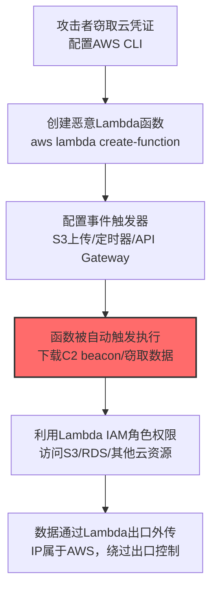
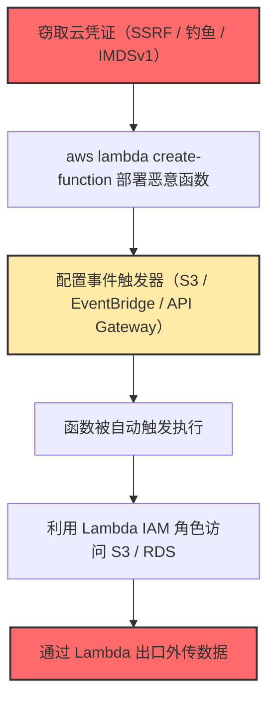

# 无服务器执行 (T1648)

## 一句话通俗理解

> **攻击者在云上部署恶意"云函数"（AWS Lambda/Azure Functions），利用云平台的算力帮你跑恶意代码，还按你的账单收费**

## 30秒速查卡

| 维度 | 你需要知道的 |
|------|-------------|
| 这是什么？ | 滥用Serverless计算服务（AWS Lambda/Azure Functions/GCP Cloud Functions）执行恶意代码 |
| 为什么危险？ | 云函数运行在云平台基础设施上，无传统服务器痕迹，可绕过主机安全检测，且能持久化 |
| 谁需要关心？ | 云运维团队、安全运维团队、云成本管理团队 |
| 你的第一步防御 | 监控云函数创建和修改事件，对Serverless部署设置审批流程 |
| 如果只做一件事 | 在CloudTrail/Activity Log中监控CreateFunction/UpdateFunctionConfiguration等API调用 |

## 难度等级

⭐⭐ 中级：需要了解Serverless架构、云函数部署流程、IAM权限配置。前置知识：云平台基础、Lambda/Functions概念、JSON配置

## 前置知识检查

**读这个文件需要什么？**

- [ ] Serverless/FaaS（函数即服务）概念
- [ ] AWS Lambda / Azure Functions / GCP Cloud Functions基本使用
- [ ] 云平台IAM权限模型
- [ ] 事件驱动架构概念（S3事件触发、API Gateway触发等）

## 技术描述

**无服务器执行**（T1648）是MITRE ATT&CK框架中**执行**战术下的一种技术，攻击者通过在Serverless计算平台上部署和运行恶意函数来执行代码，利用云平台的基础设施运行恶意载荷。

> 📡 **打个比方**：Serverless就像外卖平台的"共享厨房"——你不需要自己开店（买服务器），只需上传菜单（部署函数），平台帮你做菜（执行代码），还按订单量收费。攻击者入侵你的外卖账号后，往共享厨房上传了一份"特殊菜单"（恶意函数），每次有人下单（事件触发），平台就帮攻击者"做菜"（执行恶意代码），最后账单寄给你。

### 具体怎么理解？

主流Serverless平台：

- **AWS Lambda**：最流行的FaaS平台，支持Python/Node.js/Java/Go等运行时，可被S3、API Gateway、CloudWatch Events等触发
- **Azure Functions**：微软Azure的FaaS服务，支持C#/Python/JavaScript等
- **Google Cloud Functions**：GCP的FaaS服务，支持Node.js/Python/Go等

**过渡段：** 理解了Serverless是什么后，我们来看攻击者为什么喜欢用它——因为它天然隐蔽，没有传统服务器痕迹。

攻击者利用Serverless的主要方式：
1. **部署恶意函数**：创建Lambda函数作为C2中继或后门，绑定到S3事件、定时触发器等实现持久化
2. **修改现有函数**：向已有合法Lambda函数注入恶意代码，劫持正常业务函数执行
3. **加密挖矿**：部署计算密集型Lambda函数进行加密货币挖矿（受限于Lambda执行时间上限15分钟）
4. **数据中转**：部署Lambda作为数据渗出中继，从内部系统收集数据后通过HTTPS外传

### 为什么有效？

这种技术之所以有效，是因为：
1. **无主机痕迹**：函数在云平台托管的容器中运行，不留传统主机日志
2. **合法外衣**：Lambda部署是正常云操作，难以区分正常函数和恶意函数
3. **自动触发**：绑定到S3上传、定时器等事件后可自动执行，无需攻击者手动触发
4. **网络出口**：Lambda函数的网络出口IP属于AWS，可绕过基于IP的出口控制

## 真实攻击流程



**步骤详解：**

1. **窃取云凭证** - 攻击者通过SSRF、钓鱼或凭证窃取获取AWS/Azure凭证，配置到CLI
2. **创建恶意函数** - 使用`aws lambda create-function`部署包含恶意代码的Lambda函数，通常伪装成"日志处理"或"备份"功能
3. **配置事件触发器** - 绑定S3事件（文件上传触发）、EventBridge定时器（定期触发）、或API Gateway（HTTP请求触发）
4. **自动执行** - 函数被事件触发后自动执行，运行C2 beacon、扫描内网、或窃取数据
5. **利用IAM角色** - Lambda函数绑定的IAM角色通常有S3/RDS访问权限，攻击者利用这些权限横向渗透

## 攻击流程

### 典型攻击流程

```
窃取云凭证 --> 部署恶意 Lambda/Functions --> 配置事件触发器 --> 函数自动触发执行 --> 利用 IAM 角色访问云资源 --> 通过函数出口外传数据
```



**步骤详解：**

1. **窃取云凭证**
   - 通俗描述：攻击者通过 SSRF 漏洞访问云元数据服务、钓鱼获取凭证或从泄露的配置文件中提取 AWS Access Key
   - 技术细节：利用 IMDSv1（Instance Metadata Service v1）通过 `curl http://169.254.169.254/latest/meta-data/iam/security-credentials/` 获取临时凭证；从 GitHub 泄露、`.aws/credentials` 文件、环境变量中提取长期凭证
   - 常用工具：SSRF 漏洞利用工具、AWS IMDS 探测工具、truffleHog、GitLeaks

2. **部署恶意 Lambda/Functions**
   - 通俗描述：使用窃取的凭证部署恶意 Lambda 函数或 Azure Functions，函数代码包含攻击者想要的恶意逻辑
   - 技术细节：`aws lambda create-function --function-name evil --runtime python3.8 --role arn:aws:iam::xxx:role/lambda-role --zip-file fileb://evil.zip --handler lambda_function.handler`；Azure 通过 `az functionapp create` 创建 Functions 并部署代码包
   - 常用工具：aws CLI lambda 命令、az CLI、Serverless Framework、AWS SDK

3. **配置事件触发器**
   - 通俗描述：为恶意函数配置事件触发器，使其在特定事件（如文件上传、定时任务、API 调用）发生时自动执行
   - 技术细节：S3 触发器：`aws lambda add-permission` + S3 事件通知配置；EventBridge 定时规则：`aws events put-rule` + `put-targets`；API Gateway：创建 REST API 并将 Lambda 设为后端
   - 常用工具：aws CLI events/s3/apigateway 命令、aws SDK、Terraform

4. **函数被自动触发执行**
   - 通俗描述：当配置的事件发生时（如用户上传文件到 S3、定时器到达、API 被调用），Lambda 函数自动被云平台触发执行
   - 技术细节：Lambda 执行环境为 AWS 管理的沙箱，函数代码在 `runtime` 用户下执行；函数执行日志默认记录到 CloudWatch Logs；函数可并发执行，单次执行最长 15 分钟
   - 常用工具：AWS Lambda 运行时、CloudWatch Logs（防御侧）

5. **利用 Lambda IAM 角色访问云资源**
   - 通俗描述：Lambda 函数继承其关联的 IAM 执行角色权限，可访问该角色授权的所有 AWS 资源
   - 技术细节：通过 `boto3` 调用 AWS API 访问 S3 存储桶、RDS 数据库、Secrets Manager 等；如果 IAM 角色权限过宽（如 `*` 资源 `*` 操作），可访问账号下所有资源；可调用 `sts:GetCallerIdentity` 确认身份
   - 常用工具：boto3、aws CLI（在函数内调用）、Pacu（AWS 攻击框架）

6. **通过 Lambda 出口外传数据**
   - 通俗描述：利用 Lambda 函数的出站网络访问能力，将窃取的数据外传到攻击者控制的服务器
   - 技术细节：Lambda 默认可访问公网，可通过 HTTPS POST 将数据发送到 C2；可使用 `requests` 库或 `urllib`；数据可先压缩或加密以规避网络检测；Lambda 出站 IP 为 AWS IP 段，难以封禁
   - 常用工具：Python requests、curl、自定义加密工具、C2 服务器

## 真实案例

### 案例1：TeamTNT利用Lambda加密挖矿（2021年）

- **时间**：2021年
- **目标**：AWS环境中的Lambda函数
- **攻击组织**：TeamTNT（加密劫持团伙）
- **手法**：TeamTNT从被入侵的EC2实例中窃取AWS凭证后，部署Lambda函数进行加密货币挖矿。函数利用Lambda的15分钟执行时间限制，通过EventBridge定时器每15分钟重新触发，实现持续挖矿
- **影响**：受害者云账单激增，但传统主机安全工具无法检测（因为代码运行在Lambda而非EC2）
- **参考链接**：[Cado Security TeamTNT Lambda分析](https://www.cadosecurity.com/teamtnt-deploying-malicious-aws-lambda-functions/)

### 案例2：SCATTERED SPIDER通过Lambda持久化（2023年）

- **时间**：2023年
- **目标**：企业AWS环境
- **攻击组织**：Scattered Spider（UNC3944）
- **手法**：在入侵AWS环境后，Scattered Spider部署了一个名为"backup-utility"的恶意Lambda函数，绑定到S3 PutObject事件。每当有新文件上传到S3存储桶，函数自动触发并将文件副本发送到攻击者控制的服务器
- **影响**：持续窃取S3数据数周，直到通过CloudTrail日志审计发现异常Lambda函数
- **参考链接****：[CrowdStrike Scattered Spider云攻击分析](https://www.crowdstrike.com/blog/scattered-spider-attempts-to-overcome-mfa/)

### 案例3：Legion Lambda扫描攻击（2022-2023年）

- **时间**：2022年-2023年
- **目标**：配置错误的AWS环境
- **攻击组织**：Legion（商品化恶意软件）
- **手法**：Legion利用窃取的AWS凭证部署Lambda函数，扫描内部网络中的SSH和数据库服务，收集凭证后横向移动。函数代码中还包含发送垃圾邮件的功能
- **影响**：多个组织的内部网络结构泄露，部分数据库凭证被窃取
- **参考链接**：[SentinelOne Legion分析](https://www.sentinelone.com/labs/legion-cloud-botnet/)

## 红队视角

> ⚠️ **免责声明**：以下内容仅用于合法的安全测试、渗透测试和教育目的。未经授权对他人系统进行测试是违法行为。

### 实战技巧

1. **Lambda C2中继**：部署Lambda函数作为C2中继——Lambda接收HTTPS请求，将命令转发到内部系统，结果通过Lambda出口回传，利用AWS IP绕过出口控制
2. **S3事件劫持**：修改现有Lambda函数的事件触发器，使其同时绑定到攻击者的S3存储桶，实现数据镜像
3. **Layer注入**：创建包含恶意代码的Lambda Layer，然后将其添加到目标Lambda函数——函数加载Layer时自动执行恶意代码
4. **环境变量注入**：修改Lambda函数的环境变量，注入`PYTHONSTARTUP`等变量指向恶意脚本

### 常用工具

| 工令名称 | 用途 | 平台 | 说明 |
| -------- | ---- | ---- | ---- |
| aws CLI | Lambda管理 | AWS | 创建/修改/触发Lambda函数 |
| Serverless Framework | Serverless部署 | 跨云 | Serverless应用部署框架 |
| Lambda Layer | 代码共享层 | AWS | Lambda依赖层，可被注入恶意代码 |

### 注意事项

- Lambda函数有15分钟执行时间限制，长时间任务需要拆分
- Lambda并发数有默认限制（1000），大规模操作需申请提升
- Lambda日志默认存入CloudWatch Logs，注意清理痕迹

## 蓝队视角

### 检测要点

1. **函数创建/修改监控**：监控`CreateFunction`、`UpdateFunctionCode`、`UpdateFunctionConfiguration`等API调用
2. **异常触发模式**：监控非业务时间的Lambda调用、异常高频率调用
3. **函数行为分析**：监控Lambda函数的网络外联、IAM角色使用情况

### 监控建议

- 在CloudTrail中监控所有Lambda API调用，设置告警
- 使用GuardDuty检测异常Lambda行为（如Lambda函数连接已知恶意IP）
- 监控CloudWatch Logs中Lambda函数的输出日志，检测可疑命令执行
- 审计Lambda函数绑定的IAM角色权限，确保最小权限

## 避坑指南

防御者最痛苦的教训：**Lambda函数绑定了过度宽松的IAM角色**。Lambda函数通常需要访问S3或DynamoDB，但如果角色被赋予`*`通配符权限，攻击者部署的恶意Lambda可访问所有云资源。务必为每个Lambda函数创建专用最小权限角色。

## 检测建议

### 网络层检测

**方法**：监控Lambda函数的网络出口流量

```bash
# AWS CloudTrail日志分析：检测Lambda函数创建/修改
# CloudWatch Logs Insights查询
fields @timestamp, eventName, requestParameters.functionName, userIdentity.arn
| filter eventName in ["CreateFunction", "UpdateFunctionCode", "UpdateFunctionConfiguration"]
| sort @timestamp desc

# 检测Lambda函数连接异常IP
# GuardDuty finding类型: Execution:Lambda/MaliciousActivity
```

### 主机层检测

**方法**：Serverless无传统主机层，通过CloudTrail和CloudWatch Logs监控

```bash
# 监控Lambda函数的环境变量修改（可能注入恶意配置）
aws lambda list-functions --query 'Functions[?Environment.Variables].[FunctionName, Environment.Variables]' --output table

# 检测Lambda Layer创建和绑定
aws lambda list-layers
aws lambda list-functions --query 'Functions[?Layers].[FunctionName, Layers]' --output table
```

### 应用层检测

**用人话说：** 这条规则在检测云环境中可疑的Serverless函数部署——正常情况下Lambda函数部署是一个有计划的开发行为，如果CloudTrail日志中突然出现`CreateFunction`调用，且函数名看起来像"backup-utility"、"log-processor"这类通用名字，部署者不是开发团队而是某个IAM角色，大概率是攻击者在部署后门函数。2021年TeamTNT就是通过部署Lambda函数来挖矿，因为代码运行在AWS Lambda而非传统服务器上，主机的EDR完全检测不到。检测的关键信号是：非开发人员创建Lambda函数、函数绑定到S3事件或定时器、函数的IAM角色有高权限。

**Sigma规则示例（AWS Lambda函数创建监控 - CloudTrail事件）：**

```yaml
title: 检测可疑AWS Lambda函数创建
status: experimental
description: 检测通过AWS CLI/API创建Lambda函数，可能为攻击者部署后门函数
logsource:
    product: aws
    service: cloudtrail
detection:
    selection_create:
        eventName:
            - 'CreateFunction'
            - 'UpdateFunctionCode'
            - 'UpdateFunctionConfiguration'
            - 'CreateFunctionUrlConfig'
    filter_legitimate:
        userIdentity.type: 'AssumedRole'
        requestParameters.role|contains: 'lambda-deploy-role'
    condition: selection_create and not filter_legitimate
fields:
    - eventName
    - requestParameters.functionName
    - userIdentity.arn
    - sourceIPAddress
    - userAgent
falsepositives:
    - 合法的Lambda部署（需通过CI/CD管道验证）
level: medium
tags:
    - attack.execution
    - attack.t1648
    - attack.persistence
```

## 缓解措施

### 优先级1：关键措施

**最小权限Lambda角色**：为每个Lambda函数创建专用IAM角色，仅授予所需最小权限

```bash
# 创建最小权限Lambda角色
aws iam create-role --role-name lambda-minimal-role --assume-role-policy-document file://trust-policy.json
aws iam attach-role-policy --role-name lambda-minimal-role --policy-arn arn:aws:iam::aws:policy/AWSLambdaBasicExecutionRole
```

### 优先级2：重要措施

**部署审批流程**：对Lambda函数部署设置审批流程，仅允许CI/CD管道部署

```bash
# 使用AWS Config Rules检测未经授权的Lambda部署
# 规则：仅允许特定CI/CD角色的Lambda创建操作
aws config put-config-rule --config-rule file://lambda-deployment-rule.json
```

### 优先级3：建议措施

**启用GuardDuty**：启用AWS GuardDuty检测异常Lambda行为

## 动手实验

> ⚠️ **所有实验必须在隔离的实验室环境中进行**

### 实验1：理解Lambda部署（初级）

**目标**：掌握AWS Lambda基本部署

**步骤**：
1. 创建一个简单的Python Lambda函数
2. 使用`aws lambda create-function`部署
3. 使用`aws lambda invoke`手动触发

**预期输出**：
```json
{"statusCode": 200, "body": "\"Hello from Lambda!\""}
```

**学习要点**：理解Lambda函数部署和执行流程

### 实验2：事件触发实验（中级）

**目标**：理解Lambda事件触发机制

**步骤**：
1. 创建S3存储桶和Lambda函数
2. 配置S3 PutObject事件触发Lambda
3. 上传文件到S3，观察Lambda自动触发

**预期输出**：CloudWatch Logs中出现Lambda函数的执行日志

**学习要点**：理解事件驱动架构和攻击者如何利用自动触发

### 实验3：防御验证（高级）

**目标**：部署Lambda监控规则，验证检测效果

**步骤**：
1. 配置CloudTrail和CloudWatch Alarms监控CreateFunction事件
2. 部署测试Lambda函数
3. 验证告警是否触发

**预期输出**：CloudWatch触发"Lambda函数创建"告警

**学习要点**：掌握Serverless审计和告警配置

## 术语解释

| 术语 | 通俗解释 |
|------|---------|
| **Serverless** | 无服务器架构，不需要管理服务器，代码直接在云平台运行 |
| **FaaS** | 函数即服务，Serverless的一种形式，按函数调用次数计费 |
| **AWS Lambda** | AWS的Serverless计算服务，代码在云平台托管的容器中运行 |
| **触发器** | Trigger，触发Lambda函数执行的事件源（如S3上传、定时器、HTTP请求） |
| **Lambda Layer** | Lambda代码共享层，可被多个函数引用，可能被注入恶意代码 |
| **IAM角色** | Lambda函数绑定的身份角色，决定了函数能访问哪些云资源 |
| **Cold Start** | 冷启动，Lambda函数首次调用时的初始化延迟 |

## 参考资料

### 📚 官方文档（深入了解）

- [MITRE ATT&CK - Serverless Execution (T1648)](https://attack.mitre.org/techniques/T1648/)
- [AWS Lambda文档](https://docs.aws.amazon.com/lambda/) - AWS官方Lambda文档
- [Azure Functions文档](https://learn.microsoft.com/en-us/azure/azure-functions/) - Azure官方Functions文档
- [Google Cloud Functions文档](https://cloud.google.com/functions/docs) - GCP官方Cloud Functions文档

### 📰 安全报告（真实攻击）

- [Cado Security - TeamTNT Lambda分析](https://www.cadosecurity.com/teamtnt-deploying-malicious-aws-lambda-functions/) - 2021年TeamTNT利用Lambda挖矿
- [CrowdStrike - Scattered Spider云攻击](https://www.crowdstrike.com/blog/scattered-spider-attempts-to-overcome-mfa/) - 2023年Lambda持久化攻击
- [SentinelOne - Legion分析](https://www.sentinelone.com/labs/legion-cloud-botnet/) - 2022-2023年Lambda扫描攻击

### 🔧 工具与资源（动手试试）

- [Serverless Framework](https://www.serverless.com/) - Serverless应用部署框架
- [AWS SAM](https://aws.amazon.com/serverless/sam/) - AWS Serverless应用模型
- [Atomic Red Team](https://github.com/redcanaryco/atomic-red-team) - 检测规则测试框架

### 📚 学习资料（深入了解）

- [AWS安全最佳实践](https://aws.amazon.com/security/security-learning/) - AWS安全学习资源
- [MITRE ATT&CK for Cloud](https://attack.mitre.org/matrices/enterprise/cloud/) - 云环境ATT&CK矩阵
