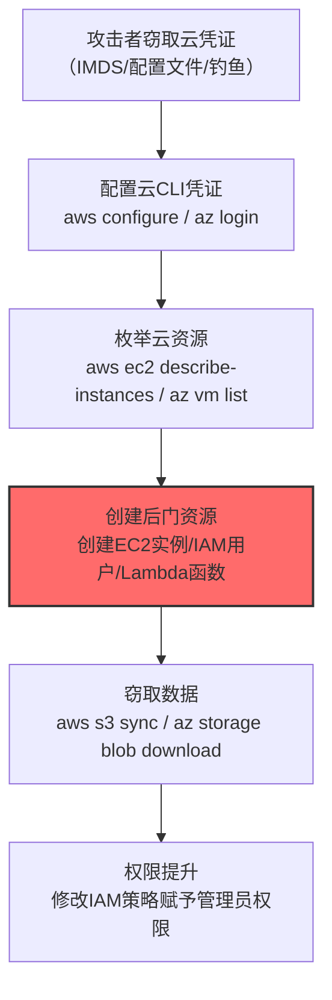
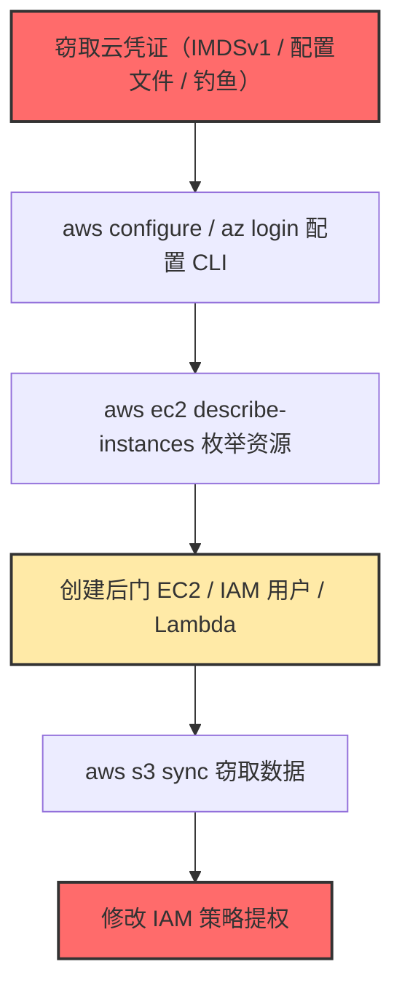

# 云管理命令 (T1651)

## 一句话通俗理解

> **攻击者用云平台自带的管理命令行工具（AWS CLI/Azure CLI/gcloud）在你的云上执行操作，就像用你家的万能钥匙开了所有门**

## 30秒速查卡

| 维度 | 你需要知道的 |
|------|-------------|
| 这是什么？ | 利用云平台管理CLI（aws/az/gcloud）和API执行恶意操作，操控云基础设施 |
| 为什么危险？ | 云管理命令可直接控制虚拟机、存储、数据库、IAM等所有云资源，一旦被利用可造成全云环境沦陷 |
| 谁需要关心？ | 云运维团队、安全运维团队、云架构师 |
| 你的第一步防御 | 启用云平台审计日志（AWS CloudTrail/Azure Activity Log/GCP Audit Logs），监控所有API调用 |
| 如果只做一件事 | 实施最小权限IAM策略，确保没有凭证拥有管理员级别的"通配符"权限 |

## 难度等级

⭐⭐ 中级：需要了解云平台IAM权限模型、云管理CLI使用、云API调用。前置知识：AWS/Azure/GCP基础知识、JSON策略语法、命令行操作

## 前置知识检查

**读这个文件需要什么？**

- [ ] 云平台基础概念（IaaS/PaaS/SaaS）
- [ ] AWS IAM / Azure RBAC / GCP IAM权限模型
- [ ] 云管理CLI基本使用（aws/az/gcloud命令）
- [ ] JSON格式（IAM策略用JSON定义）

## 技术描述

**云管理命令**（T1651）是MITRE ATT&CK框架中**执行**战术下的一种技术，攻击者通过云平台提供的管理命令行工具和API，在云环境中执行恶意操作，包括创建/删除资源、窃取数据、提升权限等。

> 📡 **打个比方**：想象云平台是一座大型商场，每个云服务（EC2虚拟机、S3存储桶、RDS数据库）是一个商铺。正常情况下，物业经理（云管理员）用万能钥匙管理所有商铺。AWS CLI/Azure CLI/gcloud就是这把万能钥匙的数字版本——攻击者一旦拿到它，就能进入任何商铺，开店关店、搬走货物、甚至换了门锁。问题不在钥匙本身，而在于谁手里有钥匙。

### 具体怎么理解？

主流云平台都提供了命令行管理工具：

- **AWS CLI**（`aws`命令）：管理EC2、S3、RDS、Lambda等所有AWS服务
- **Azure CLI**（`az`命令）：管理VM、Storage、SQL Database、Functions等Azure服务
- **Google Cloud SDK**（`gcloud`命令）：管理Compute Engine、Cloud Storage、Cloud SQL等GCP服务

这些工具通过云平台API操作资源，认证方式包括：
- **访问密钥**（AWS Access Key + Secret Key）
- **服务主体**（Azure Service Principal）
- **服务账号密钥**（GCP Service Account Key）

**过渡段：** 理解了云管理CLI是什么后，我们来看攻击者怎么拿到它——通常是通过钓鱼、漏洞利用或从被入侵的实例中窃取凭证。

攻击者利用云管理命令的常见方式：
1. **凭证窃取后操作**：从被入侵的EC2实例元数据服务（IMDS）窃取IAM角色凭证，用AWS CLI操控云资源
2. **创建后门资源**：创建带有SSH公钥的EC2实例、创建后门IAM用户、创建Lambda函数作为持久化
3. **数据窃取**：修改S3存储桶策略使其公开可读，或直接用`aws s3 sync`下载所有数据
4. **权限提升**：修改IAM策略给自己赋予AdministratorAccess

### 为什么有效？

这种技术之所以有效，是因为：
1. **合法工具**：云管理CLI是官方工具，不会被杀毒软件标记
2. **高权限**：窃取的凭证通常拥有较高权限，可操控整个云环境
3. **审计盲区**：如果未启用CloudTrail等审计日志，所有操作无迹可寻
4. **跨区域影响**：一个区域的凭证可用于操控所有区域的资源

## 真实攻击流程



**步骤详解：**

1. **窃取云凭证** - 攻击者通过SSRF漏洞访问EC2实例元数据服务（IMDSv1）获取IAM角色凭证，或从配置文件（~/.aws/credentials）、环境变量中窃取凭证
2. **配置CLI** - 使用`aws configure`配置窃取的Access Key，或使用`az login --service-principal`登录Azure
3. **枚举资源** - 执行`aws ec2 describe-instances`、`aws s3 ls`、`az resource list`等命令枚举云资源
4. **创建后门** - 创建带有攻击者SSH公钥的EC2实例、创建后门IAM用户、或部署Lambda函数作为持久化C2
5. **窃取数据** - 修改S3存储桶策略使其公开可读，或直接`aws s3 sync s3://bucket ./local`下载所有数据

## 攻击流程

### 典型攻击流程

```
窃取云凭证 --> 配置云 CLI --> 枚举云资源 --> 创建后门资源 --> 窃取数据 --> 修改 IAM 策略提权
```



**步骤详解：**

1. **窃取云凭证**
   - 通俗描述：攻击者通过 SSRF 访问云实例元数据服务、窃取本地配置文件或钓鱼获取云平台访问凭证
   - 技术细节：AWS 通过 IMDSv1 获取临时 STS 凭证；从 `~/.aws/credentials`、`~/.azure/azureProfile.json`、`~/.config/gcloud/credentials.db` 提取长期凭证；通过 OAuth 钓鱼获取 Azure 刷新令牌
   - 常用工具：SSRF 探测工具、Mimikatz（云凭证提取）、truffleHog、CloudSploit

2. **配置云 CLI**
   - 通俗描述：使用窃取的凭证配置 AWS CLI、Azure CLI 或 gcloud CLI，获得对云平台的命令行管理能力
   - 技术细节：`aws configure` 输入 Access Key ID、Secret Access Key、默认区域；Azure 通过 `az login --service-principal` 或使用刷新令牌；gcloud 通过 `gcloud auth activate-service-account`；配置后可执行所有授权的 API 调用
   - 常用工具：aws CLI、az CLI、gcloud CLI、Cloud Shell

3. **枚举云资源**
   - 通俗描述：使用云 CLI 枚举当前账号下的所有云资源，识别高价值目标（数据库、存储桶、密钥管理服务）
   - 技术细节：`aws ec2 describe-instances`、`aws s3 ls`、`aws rds describe-db-instances`、`aws secretsmanager list-secrets`；Azure 通过 `az resource list`；GCP 通过 `gcloud compute instances list`
   - 常用工具：aws CLI、az CLI、gcloud CLI、Pacu、CloudMapper

4. **创建后门资源**
   - 通俗描述：在云环境中创建后门 EC2 实例、IAM 用户或 Lambda 函数，作为持久化访问通道
   - 技术细节：`aws ec2 run-instances` 创建带 SSH 密钥的 EC2；`aws iam create-user` + `attach-user-policy` 创建管理员用户；`aws lambda create-function` 部署后门函数；后门资源看似合法，混在正常资源中难以发现
   - 常用工具：aws CLI、Terraform、CloudFormation、Pacu

5. **窃取数据**
   - 通俗描述：使用云 CLI 批量下载 S3 存储桶、RDS 数据库快照或 EBS 卷中的数据
   - 技术细节：`aws s3 sync s3://bucket ./local` 批量下载 S3 对象；`aws rds create-db-snapshot` + `restore-db-instance-from-db-snapshot` 复制数据库；`aws ec2 create-snapshot` 创建 EBS 快照后挂载到攻击者实例
   - 常用工具：aws s3 CLI、aws rds CLI、aws ec2 CLI、rclone

6. **修改 IAM 策略提权**
   - 通俗描述：通过修改 IAM 策略或附加管理员策略到当前用户，实现权限提升到账号管理员
   - 技术细节：`aws iam put-user-policy` 为当前用户附加 `AdministratorAccess`；利用 IAM 误配置（如 `iam:PassRole` + `lambda:CreateFunction`）实现提权；通过 `sts:AssumeRole` 切换到更高权限角色
   - 常用工具：aws iam CLI、Pacu（iam_privesc_scan 模块）、CloudGoat

## 真实案例

### 案例1：Capital One数据泄露（2019年）

- **时间**：2019年3月-7月
- **目标**：Capital One银行（美国第八大银行）
- **攻击组织**：前AWS工程师（个人行为）
- **手法**：利用SSRF漏洞访问EC2实例元数据服务（IMDSv1），窃取WAF角色的IAM凭证。使用AWS CLI执行`aws s3 sync`下载了超过1亿条客户数据，存储到攻击者自己的S3存储桶
- **影响**：1.06亿信用卡申请数据泄露，罚款1.9亿美元
- **参考链接**：[美国司法部起诉书](https://www.justice.gov/usao-wdwa/pr/tech-company-software-engineer-charged-hacking-capital-one)

### 案例2：TeamTNT加密劫持攻击（2020-2023年）

- **时间**：2020年-2023年
- **目标**：云环境中的Linux服务器和Kubernetes集群
- **攻击组织**：TeamTNT（加密劫持团伙）
- **手法**：利用暴露的Docker API和配置错误的Redis服务器入侵云实例，从IMDS窃取AWS凭证后使用AWS CLI创建更多EC2实例用于挖矿。还使用`aws s3 sync`窃取受害者的S3数据
- **影响**：数千台云实例被感染，挖矿造成巨额云账单
- **参考链接**：[Aqua Security TeamTNT报告](https://blog.aquasec.com/teamtnt-cryptojacking-watchdog-aws)

### 案例3：SCATTERED SPIDER云环境攻击（2022-2023年）

- **时间**：2022年-2023年
- **目标**：多家大型企业的云环境（特别是Azure AD）
- **攻击组织**：Scattered Spider（又称0KTASPUS、UNC3944）
- **手法**：通过钓鱼和MFA疲劳攻击获取管理员账户凭证，使用Azure CLI（`az`命令）和Microsoft Graph API操控Azure AD。创建后门服务主体、修改条件访问策略、注册恶意应用程序获取持久化
- **影响**：MGM度假村、Caesars娱乐等企业云环境被入侵，MGM停业数天损失1亿美元
- **参考链接**：[CrowdStrike Scattered Spider分析](https://www.crowdstrike.com/blog/scattered-spider-attempts-to-overcome-mfa/)

## 红队视角

> ⚠️ **免责声明**：以下内容仅用于合法的安全测试、渗透测试和教育目的。未经授权对他人系统进行测试是违法行为。

### 实战技巧

1. **IMDSv1凭证窃取**：通过SSRF漏洞访问`http://169.254.169.254/latest/meta-data/iam/security-credentials/`获取EC2实例的IAM角色凭证
2. **后门IAM用户**：`aws iam create-user --user-name backup`创建后门用户，然后`aws iam attach-user-policy --user-name backup --policy-arn arn:aws:iam::aws:policy/AdministratorAccess`赋予管理员权限
3. **Lambda持久化**：部署Lambda函数作为C2中继：`aws lambda create-function --function-name backdoor --runtime python3.9 --role <role> --handler index.lambda_handler --zip-file fileb://backdoor.zip`
4. **SSRF到云元数据**：利用Web应用的SSRF漏洞访问云元数据服务窃取凭证

### 常用工具

| 巋令名称 | 用途 | 平台 | 说明 |
| -------- | ---- | ---- | ---- |
| aws CLI | AWS管理 | AWS | AWS官方命令行工具 |
| az CLI | Azure管理 | Azure | Azure官方命令行工具 |
| gcloud | GCP管理 | GCP | Google Cloud官方SDK |
| Pacu | AWS攻击框架 | AWS | 专为AWS红队设计的攻击框架 |
| CloudSploit | 云配置扫描 | 跨云 | 开源云安全配置扫描工具 |

### 注意事项

- 确保测试凭证仅用于授权范围
- 云API调用有速率限制，大规模操作需注意限流
- 创建后门资源测试后务必清理，避免产生持续费用

## 蓝队视角

### 检测要点

1. **API调用审计**：启用并监控AWS CloudTrail、Azure Activity Log、GCP Audit Logs
2. **异常API调用**：检测来自异常IP、异常地理位置、异常时间段的API调用
3. **高危操作监控**：监控IAM策略修改、用户创建、安全组修改、S3策略变更等高危操作

### 监控建议

- 确保CloudTrail覆盖所有区域并启用日志文件完整性验证
- 配置CloudWatch Alarms对高危API调用实时告警（如`DeleteTrail`、`PutBucketAcl`）
- 使用AWS Config Rules监控配置合规性
- 实施GuardDuty检测异常API调用模式
- 监控IMDS访问——EC2实例中访问169.254.169.254的非预期进程

## 避坑指南

防御者最痛苦的教训：**使用长期有效的Access Key而非临时凭证**。长期Access Key一旦泄露可在数月内被持续利用而不被发现。务必使用IAM角色+临时凭证（STS）替代长期Access Key，并启用IMDSv2防止凭证窃取。

## 检测建议

### 网络层检测

**方法**：监控云API端点的调用源

```bash
# AWS CloudTrail日志分析：检测异常IP的API调用
# 在CloudWatch Logs Insights中查询
fields @timestamp, eventName, sourceIPAddress, userIdentity.arn
| filter sourceIPAddress not like /10\./ and sourceIPAddress not like /192\.168\./
| sort @timestamp desc
| limit 100

# 检测非AWS IP的API调用
aws cloudtrail lookup-events --lookup-attributes AttributeKey=IPAddress,AttributeValue=<suspicious_ip>
```

### 主机层检测

**方法**：监控EC2实例中的IMDS访问和CLI工具执行

```bash
# 检测访问IMDS的可疑进程
# 监控对169.254.169.254的HTTP请求
ss -tlnp | grep 169.254.169.254

# 检测AWS CLI执行
auditctl -w /usr/bin/aws -p x -k aws_cli_execution
# 查看审计日志
ausearch -k aws_cli_execution
```

### 应用层检测

**用人话说：** 这条规则在检测云环境中的异常API调用——攻击者窃取云凭证后会通过AWS CLI或API执行大量操作，比如创建新用户、修改权限策略、下载S3数据等。这些操作在CloudTrail日志中会留下记录。2023年Scattered Spider就是通过Azure CLI创建后门服务主体来维持对受害者云环境的访问。检测的关键信号是：来自异常IP的API调用、非工作时间的高权限操作、突然创建的IAM用户或服务主体、S3存储桶策略被修改为公开可读。

**Sigma规则示例（AWS异常IAM操作检测 - CloudTrail事件）：**

```yaml
title: 检测AWS异常IAM操作（可能为攻击者创建后门）
status: experimental
description: 检测通过AWS CLI/API创建IAM用户或修改权限策略的可疑操作
logsource:
    product: aws
    service: cloudtrail
detection:
    selection_events:
        eventName:
            - 'CreateUser'
            - 'CreateAccessKey'
            - 'AttachUserPolicy'
            - 'PutUserPolicy'
            - 'CreatePolicy'
            - 'CreatePolicyVersion'
    selection_admin:
        requestParameters|contains:
            - 'AdministratorAccess'
            - 'arn:aws:iam::aws:policy/AdministratorAccess'
            - 'Action": "*'
            - 'Resource": "*"'
    condition: selection_events and selection_admin
fields:
    - eventName
    - userIdentity.arn
    - sourceIPAddress
    - userAgent
    - requestParameters
falsepositives:
    - 合法的IAM管理操作（需通过变更管理流程验证）
level: high
tags:
    - attack.execution
    - attack.t1651
    - attack.persistence
    - attack.privilege_escalation
```

## 缓解措施

### 优先级1：关键措施

**最小权限IAM策略**：确保所有IAM角色和用户遵循最小权限原则，避免使用`Action: "*", Resource: "*"`通配符权限

```bash
# AWS IAM策略分析：检测过度宽松的策略
aws iam get-account-authorization-details --filter Policies
# 使用IAM Access Analyzer检测过度权限
aws accessanalyzer start-policy-analysis --policy-document file://policy.json
```

### 优先级2：重要措施

**启用IMDSv2**：强制使用IMDSv2（需Token认证），防止SSRF窃取凭证

```bash
# 在EC2实例上启用IMDSv2（需要停止实例）
aws ec2 modify-instance-metadata-options \
    --instance-id i-1234567890abcdef0 \
    --http-tokens required \
    --http-endpoint enabled
```

### 优先级3：建议措施

**使用临时凭证**：用STS临时凭证替代长期Access Key，设置短过期时间

```bash
# 使用STS获取临时凭证（最长1小时）
aws sts get-session-token --duration-seconds 3600
```

## 动手实验

> ⚠️ **所有实验必须在隔离的实验室环境中进行**

### 实验1：理解云CLI操作（初级）

**目标**：掌握AWS CLI基本操作

**步骤**：
1. 安装AWS CLI并配置测试凭证
2. 执行`aws s3 ls`列出S3存储桶
3. 执行`aws ec2 describe-instances`查看EC2实例

**预期输出**：
```
2024-01-01 12:00:00 my-test-bucket
{
    "Reservations": []
}
```

**学习要点**：理解云CLI如何通过API操作云资源

### 实验2：IAM策略分析实验（中级）

**目标**：识别过度宽松的IAM策略

**步骤**：
1. 使用`aws iam get-account-authorization-details`导出所有IAM策略
2. 分析哪些策略包含`Action: "*"`通配符
3. 使用IAM Access Analyzer检测资源越权

**预期输出**：列出所有包含通配符权限的策略

**学习要点**：掌握IAM策略审计方法

### 实验3：防御验证（高级）

**目标**：部署CloudTrail监控，验证检测效果

**步骤**：
1. 启用AWS CloudTrail全区域日志记录
2. 配置CloudWatch Alarm对`CreateUser`等高危事件告警
3. 执行模拟攻击（创建测试IAM用户）
4. 验证告警是否触发

**预期输出**：CloudWatch触发"IAM用户创建"告警

**学习要点**：掌握云环境审计和告警配置

## 术语解释

| 术语 | 通俗解释 |
|------|---------|
| **AWS CLI** | AWS命令行工具，通过命令操作AWS云服务 |
| **IAM** | 身份和访问管理，云平台的权限管理系统，控制谁能做什么 |
| **IMDS** | 实例元数据服务，EC2实例访问自身元数据和IAM凭证的服务 |
| **CloudTrail** | AWS的API调用审计服务，记录所有AWS API操作 |
| **访问密钥** | Access Key，AWS的长期凭证，由Access Key ID和Secret Key组成 |
| **STS** | 安全令牌服务，颁发临时凭证替代长期访问密钥 |
| **服务主体** | Azure中的服务账号，用于应用程序认证 |
| **GuardDuty** | AWS的威胁检测服务，自动检测异常API调用 |

## 参考资料

### 📚 官方文档（深入了解）

- [MITRE ATT&CK - Cloud Administration Command (T1651)](https://attack.mitre.org/techniques/T1651/)
- [AWS CLI文档](https://docs.aws.amazon.com/cli/) - AWS官方CLI文档
- [Azure CLI文档](https://learn.microsoft.com/en-us/cli/azure/) - Azure官方CLI文档
- [Google Cloud SDK文档](https://cloud.google.com/sdk/docs) - GCP官方SDK文档

### 📰 安全报告（真实攻击）

- [Capital One数据泄露 - 司法部](https://www.justice.gov/usao-wdwa/pr/tech-company-software-engineer-charged-hacking-capital-one) - 2019年通过IMDS窃取AWS凭证
- [Aqua Security - TeamTNT分析](https://blog.aquasec.com/teamtnt-cryptojacking-watchdog-aws) - 2020-2023年云加密劫持
- [CrowdStrike - Scattered Spider](https://www.crowdstrike.com/blog/scattered-spider-attempts-to-overcome-mfa/) - 2022-2023年Azure AD攻击

### 🔧 工具与资源（动手试试）

- [Pacu](https://github.com/RhinoSecurityLabs/pacu) - AWS攻击框架
- [CloudSploit](https://github.com/aquasecurity/cloudsploit) - 云安全配置扫描
- [AWS IAM Access Analyzer](https://aws.amazon.com/iam/features/analyze-access/) - IAM权限分析工具

### 📚 学习资料（深入了解）

- [AWS安全最佳实践](https://aws.amazon.com/security/security-learning/) - AWS安全学习资源
- [MITRE ATT&CK for Cloud](https://attack.mitre.org/matrices/enterprise/cloud/) - 云环境ATT&CK矩阵
