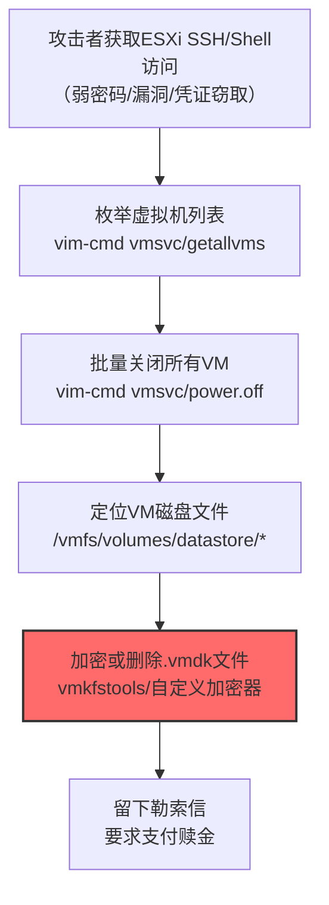
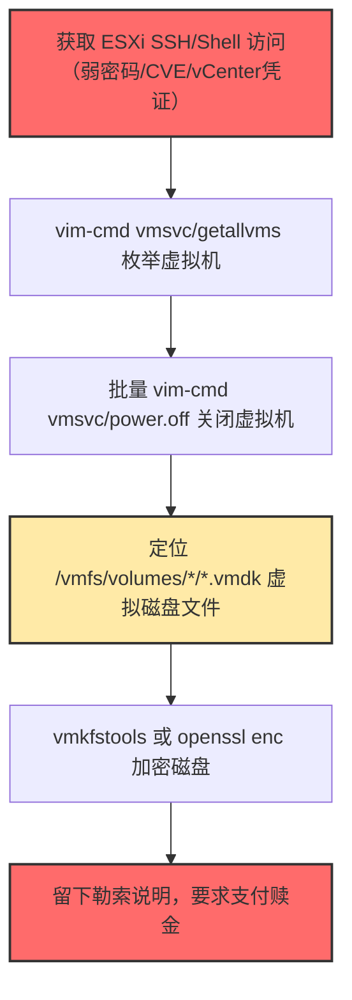

# ESXi管理命令 (T1675)

## 一句话通俗理解

> **攻击者用VMware ESXi自带的管原生命令在虚拟化平台上执行任意代码，就像拿到了虚拟机王国的"总开关"**

## 30秒速查卡

| 维度 | 你需要知道的 |
|------|-------------|
| 这是什么？ | 利用ESXi管理命令（vim-cmd、esxcli、vsish）在VMware虚拟化平台上执行恶意操作 |
| 为什么危险？ | ESXi是所有虚拟机的宿主机，一旦被控制可窃取/加密所有VM磁盘文件，造成全虚拟化环境瘫痪 |
| 谁需要关心？ | 虚拟化管理员、安全运维团队、基础设施架构师 |
| 你的第一步防御 | 禁用ESXi Shell和SSH，仅通过vCenter API管理，启用锁定模式（Lockdown Mode） |
| 如果只做一件事 | 确认ESXi主机的SSH端口（22）不对内部网络开放，仅限跳板机访问 |

## 难度等级

⭐⭐ 中级：需要了解VMware vSphere虚拟化平台、ESXi主机管理、vim-cmd/esxcli命令语法。前置知识：Linux命令行基础、虚拟化概念

## 前置知识检查

**读这个文件需要什么？**

- [ ] VMware vSphere虚拟化基础概念（ESXi、vCenter、虚拟机）
- [ ] Linux命令行基础（ESXi基于定制Linux内核）
- [ ] SSH远程登录操作
- [ ] 虚拟机磁盘文件格式（.vmdk、.vmx）

## 技术描述

**ESXi管理命令**（T1675）是MITRE ATT&CK框架中**执行**战术下的一种技术，攻击者通过ESXi提供的命令行管理工具（vim-cmd、esxcli、vsish等）在ESXi主机上执行命令，操控虚拟机生命周期或窃取虚拟机数据。

> 📡 **打个比方**：ESXi就像一栋公寓楼，每个虚拟机是一个房间。正常情况下，物业管理员（vCenter）通过管理台统一管理所有房间。但ESXi还留了一个"后门钥匙"（SSH/ESXi Shell），拿到钥匙的人可以直接进入楼栋控制室，用万能开关控制每个房间的电、门锁、甚至把房间的家具搬走。攻击者要做的就是拿到这把钥匙。

### 具体怎么理解？

VMware ESXi是裸金属hypervisor，直接运行在物理服务器上，承载所有虚拟机。ESXi提供了多个命令行管理接口：

- **vim-cmd**：ESXi内置的vSphere API命令行工具，可以注册/注销/启停/快照虚拟机
- **esxcli**：ESXi系统管理命令，管理网络、存储、硬件、防火墙等
- **vsish**：ESXi内核信息系统（VMkernel System Information Helper），可读写内核变量
- **vmkfstools**：虚拟机磁盘管理工具，可克隆、转换、删除.vmdk文件

**过渡段：** 理解了ESXi管理命令是什么后，我们来看攻击者具体怎么利用——他们通常先通过SSH弱密码、漏洞利用或凭证窃取获取ESXi Shell访问权限，然后使用上述命令执行恶意操作。

攻击者利用ESXi管理命令的常见方式：
1. **勒索加密VM磁盘**：使用`vim-cmd vmsvc/power.off`关闭所有VM，然后用`vmkfstools`或加密工具加密.vmdk文件
2. **窃取VM数据**：使用`vmkfstools -i`克隆虚拟机磁盘到本地，然后外传
3. **创建后门VM**：注册一个恶意虚拟机作为持久化后门
4. **禁用安全功能**：使用`esxcli network firewall`修改ESXi防火墙规则开放后门端口

### 为什么有效？

这种技术之所以有效，是因为：
1. **合法工具滥用**：vim-cmd/esxcli是ESXi自带的管理工具，不会被杀毒软件检测
2. **极高权限**：ESXi Shell以root权限运行，可操控所有虚拟机
3. **集中化破坏**：一台ESXi主机承载数十台VM，攻击一次可影响整个业务系统
4. **取证困难**：ESXi日志默认存储在内存中（scratch分区），重启后可能丢失

## 真实攻击流程



**步骤详解：**

1. **获取ESXi访问权限** - 攻击者通过SSH暴力破解、利用ESXi已知漏洞（如CVE-2021-21974 OpenSLP堆溢出）、或从被入侵的vCenter窃取ESXi凭证
2. **枚举虚拟机** - 使用`vim-cmd vmsvc/getallvms`列出所有虚拟机及其VMID、配置文件路径
3. **关闭虚拟机** - 批量执行`vim-cmd vmsvc/power.off <vmid>`关闭所有运行中的VM，防止文件被锁定
4. **定位磁盘文件** - 遍历`/vmfs/volumes/*/`目录，定位所有.vmdk虚拟机磁盘文件
5. **加密磁盘** - 使用自定义加密器或`openssl enc`对.vmdk文件加密，或直接删除后留下勒索信

## 攻击流程

### 典型攻击流程

```
获取 ESXi 访问权限 --> 枚举虚拟机 --> 批量关闭虚拟机 --> 定位虚拟磁盘文件 --> 加密虚拟磁盘 --> 留下勒索说明
```



**步骤详解：**

1. **获取 ESXi 访问权限**
   - 通俗描述：攻击者通过弱密码暴力破解、已知漏洞（如 CVE-2021-21974 OpenSLP 堆溢出）或窃取的 vCenter 凭证获得 ESXi 主机的 SSH 或 Shell 访问权限
   - 技术细节：ESXi 默认开放 22（SSH）、443（vSphere API）、427（SLP）等端口；CVE-2021-21974 可实现未授权 RCE；vCenter 凭证可从配置文件或 Active Directory 同步中窃取；直接物理访问主机控制台（DCUI）也可获得 root Shell
   - 常用工具：Hydra（SSH 爆破）、CVE-2021-21974 POC、vSphere Client、DCUI 控制台

2. **枚举虚拟机**
   - 通俗描述：使用 `vim-cmd` 命令枚举 ESXi 主机上运行的所有虚拟机，识别高价值目标
   - 技术细节：`vim-cmd vmsvc/getallvms` 列出所有注册的虚拟机及其 ID、名称、配置文件路径、操作系统；也可使用 `esxcli vm process list` 查看正在运行的虚拟机进程；通过 vSphere API（pyVmomi）可批量查询多台 ESXi 主机
   - 常用工具：vim-cmd、esxcli、pyVmomi、PowerCLI

3. **批量关闭虚拟机**
   - 通俗描述：使用 `vim-cmd` 批量关闭所有虚拟机，确保虚拟磁盘文件不被占用，便于后续加密
   - 技术细节：`vim-cmd vmsvc/power.off <vmid>` 强制关闭指定虚拟机（相当于拔电源）；可编写 shell 脚本 `for vmid in $(vim-cmd vmsvc/getallvms | awk '{print $1}'); do vim-cmd vmsvc/power.off $vmid; done` 批量关闭；也可使用 `esxcli vm process kill` 杀死虚拟机进程
   - 常用工具：vim-cmd、esxcli、bash 脚本、PowerCLI

4. **定位虚拟磁盘文件**
   - 通俗描述：在 VMFS 数据存储中定位虚拟机的 `.vmdk` 虚拟磁盘文件，这些文件包含虚拟机的所有数据
   - 技术细节：虚拟磁盘文件通常位于 `/vmfs/volumes/<datastore>/<vmname>/<vmname>.vmdk`；使用 `find /vmfs/volumes -name "*.vmdk" -type f` 查找；`.vmdk` 包含描述符（文本）和 `-flat.vmdk`（实际数据）两个文件
   - 常用工具：find、ls、vmkfstools、esxcli

5. **加密虚拟磁盘**
   - 通俗描述：使用 `vmkfstools` 或 `openssl enc` 对虚拟磁盘文件进行加密，使虚拟机无法启动
   - 技术细节：`vmkfstools` 不直接支持加密，但可通过 `openssl enc -aes-256-cbc -in file.vmdk -out file.vmdk.encrypted -k password` 加密；也可重命名 `.vmdk` 文件后写入加密数据；加密后原始数据不可访问，虚拟机无法启动
   - 常用工具：openssl、vmkfstools、自定义加密脚本

6. **留下勒索说明**
   - 通俗描述：在数据存储根目录或每个虚拟机目录下留下勒索说明文件，要求支付加密货币赎金
   - 技术细节：创建 `HOW_TO_RECOVER.txt` 或类似文件，包含赎金地址、联系邮箱、解密验证方式；部分勒索软件会修改 `.vmx` 配置文件显示勒索信息；勒索说明通常多语言版本
   - 常用工具：文本编辑器、自定义脚本

## 真实案例

### 案例1：ESXiArgs勒索软件攻击（2023年）

- **时间**：2023年2月-2023年6月
- **目标**：全球数千台暴露在公网的ESXi主机
- **攻击组织**：ESXiArgs（未归因）
- **手法**：利用CVE-2021-21974（OpenSLP堆溢出漏洞）获取ESXi权限，使用`vim-cmd`批量关闭VM，然后加密.vmdk、.vmx、.nvram文件，留下勒索信要求支付比特币
- **影响**：法国、美国、德国等多国组织受影响，超5000台ESXi主机被加密
- **参考链接**：[CISA ESXiArgs安全公告](https://www.cisa.gov/news-events/alerts/2023/02/06/cisa-responds-ransomware-activity-against-esxi-servers)

### 案例2：UNC2447/SILK TYPHOON勒索攻击（2021年）

- **时间**：2021年3月
- **目标**：VMware vCenter服务器及ESXi主机
- **攻击组织**：UNC2447（后归因为SILK TYPHOON，疑似中国背景APT）
- **手法**：利用CVE-2021-21985（vCenter Server远程代码执行漏洞）获取vCenter权限，通过vCenter管理API下发命令到ESXi主机，执行加密操作
- **影响**：多家企业和政府机构的虚拟化环境被加密
- **参考链接**：[Mandiant UNC2447分析报告](https://www.mandiant.com/resources/blog/unc2447-not-so-slick)

### 案例3：Babuk Locker ESXi版勒索软件（2021年）

- **时间**：2021年3月
- **目标**：企业ESXi虚拟化环境
- **攻击组织**：Babuk Locker（勒索软件团伙）
- **手法**：发布专门针对ESXi的勒索软件变种，使用`vim-cmd vmsvc/power.off`关闭所有VM后加密.vmdk文件。该变种是首批专门针对ESXi的勒索软件之一
- **影响**：多家企业虚拟化环境被加密，Babuk源码后续泄露催生了多个变种
- **参考链接**：[Trend Micro ESXi勒索分析](https://www.trendmicro.com/en_us/research/21/c/babuk-locker-the-first-ransomware-fully-targeting-esxi.html)

## 红队视角

> ⚠️ **免责声明**：以下内容仅用于合法的安全测试、渗透测试和教育目的。未经授权对他人系统进行测试是违法行为。

### 实战技巧

1. **vim-cmd批量操作**：使用`for vmid in $(vim-cmd vmsvc/getallvms | awk 'NR>1{print $1}'); do vim-cmd vmsvc/power.off $vmid; done`批量关闭所有VM
2. **vmkfstools克隆窃取**：使用`vmkfstools -i source.vmdk -d thin /tmp/copy.vmdk`克隆VM磁盘到临时目录后外传
3. **禁用ESXi防火墙**：`esxcli network firewall set --enabled=false`关闭防火墙以便后续C2通信
4. **vsish内核信息提取**：使用`vsish -e get /system/uuid`获取主机UUID，或`vsish -e cat /net/tcpip/instances/*/ipv4/addr`获取网络配置

### 常用工具

| 工具名称 | 用途 | 说明 |
| -------- | ---- | ---- |
| vim-cmd | ESXi虚拟机管理 | ESXi内置，注册/注销/启停/快照VM |
| esxcli | ESXi系统管理 | 管理网络/存储/防火墙/硬件 |
| vsish | 内核信息读写 | 读写VMkernel内核变量 |
| vmkfstools | 虚拟磁盘管理 | 克隆/转换/删除.vmdk文件 |
| sshpass | SSH自动化 | 非交互式SSH密码认证（红队常用） |

### 注意事项

- ESXi命令行基于BusyBox，部分Linux命令语法略有不同
- ESXi Shell默认5分钟超时自动登出，需注意操作效率
- vsish操作有内核崩溃风险，在生产环境务必谨慎

## 蓝队视角

### 检测要点

1. **SSH/Shell访问监控**：监控ESXi主机的SSH登录事件、ESXi Shell启用事件
2. **命令执行审计**：监控vim-cmd/esxcli命令的执行，特别是批量power off操作
3. **虚拟机异常操作**：监控短时间内大量VM被关闭、磁盘文件被修改的事件

### 监控建议

- 启用ESXi高级日志（`esxcli system syslog config set --loghost=...`），将日志发送到SIEM
- 监控`/var/run/log/hostd.log`（ESXi主机守护进程日志）和`/var/run/log/shell.log`（ESXi Shell日志）
- 配置SIEM规则：单台ESXi主机5分钟内超过3台VM被power off即告警
- 定期审计ESXi用户列表和SSH授权密钥

## 避坑指南

防御者最痛苦的教训：**ESXi主机SSH端口对内网完全开放**。一旦攻击者拿到任意一台内网机器，就能扫描攻击ESXi的SSH。务必将ESXi SSH限制为仅跳板机可访问，或完全禁用SSH仅用vCenter API管理。

## 检测建议

### 网络层检测

**方法**：监控ESXi主机SSH（22端口）和HTTPS（443端口）的访问源

```bash
# 检测非跳板机IP访问ESXi SSH端口
# 在ESXi防火墙日志中查找
grep "ssh" /var/run/log/hostd.log | grep -v "jump_host_ip"

# 监控ESXi防火墙规则变更
esxcli network firewall ruleset list | grep -E "sshServer|shell"
```

### 主机层检测

**方法**：监控ESXi Shell命令执行

```bash
# ESXi Shell日志路径
cat /var/run/log/shell.log  # ESXi Shell操作日志
cat /var/run/log/hostd.log  # 主机守护进程日志

# 检测批量VM关闭操作
grep "vim-cmd vmsvc/power.off" /var/run/log/shell.log
grep "powerOff" /var/run/log/vmkernel.log
```

### 应用层检测

**用人话说：** 这条规则在检测ESXi主机上的异常管理命令执行——攻击者入侵ESXi后通常会执行`vim-cmd vmsvc/power.off`批量关闭虚拟机，然后加密磁盘文件。你的ESXi Shell日志里如果突然出现连续的power off命令，或者出现`vmkfstools`对大量.vmdk文件的操作，几乎可以确认正在遭受勒索攻击。ESXiArgs勒索软件就是用这套流程在2023年加密了全球5000多台ESXi主机。

**Sigma规则示例（ESXi批量VM关闭检测）：**

```yaml
title: 检测ESXi主机批量虚拟机关闭操作
status: experimental
description: 检测短时间内大量VM被power off，可能为勒索软件攻击前兆
logsource:
    product: vmware
    service: esxi_shell
detection:
    selection_poweroff:
        message|contains:
            - 'vim-cmd vmsvc/power.off'
            - 'powerOff'
    timeframe: 5m
    condition: selection_poweroff | count() > 3
fields:
    - hostname
    - user
    - command
    - src_ip
falsepositives:
    - 计划内维护（需提前在工单系统备案）
level: high
tags:
    - attack.execution
    - attack.t1675
    - attack.impact
```

## 缓解措施

### 优先级1：关键措施

**启用ESXi锁定模式**：禁用ESXi Shell和SSH的直接访问，所有管理通过vCenter API进行

```bash
# 通过vCenter启用锁定模式
# vSphere Client → 主机 → 配置 → 系统 → 锁定模式 → 启用

# 或通过ESXi命令行启用（启用前确保有vCenter管理路径）
esxcli system settings advanced set -o /Misc/ConfiguredLockdown -i 1
```

### 优先级2：重要措施

**限制SSH访问**：如果必须使用SSH，仅允许跳板机IP访问，并使用密钥认证

```bash
# ESXi防火墙限制SSH源IP
esxcli network firewall ruleset set --ruleset-id=sshServer --allowed-all=false
esxcli network firewall ruleset allowedip add --ruleset-id=sshServer --ip=10.0.0.100
```

### 优先级3：建议措施

**定期补丁更新**：及时安装ESXi安全补丁，修复已知漏洞（如CVE-2021-21974 OpenSLP漏洞）

## 动手实验

> ⚠️ **所有实验必须在隔离的实验室环境中进行**

### 实验1：理解ESXi管理命令（初级）

**目标**：掌握vim-cmd基本操作

**步骤**：
1. 通过SSH登录实验室ESXi主机
2. 执行`vim-cmd vmsvc/getallvms`列出所有虚拟机
3. 执行`vim-cmd vmsvc/power.get <vmid>`查看某VM电源状态

**预期输出**：
```
Vmid      Name            File                          Guest OS
1      test-vm    [datastore1] test-vm/test-vm.vmx    ubuntu64Guest
Retrieved runtime info
Powered on
```

**学习要点**：理解vim-cmd是ESXi虚拟机管理的核心命令

### 实验2：ESXi安全配置审计（中级）

**目标**：审计ESXi主机安全配置

**步骤**：
1. 检查SSH和ESXi Shell状态：`esxcli system settings advanced list -o /UserVars/ESXiShellTimeOut`
2. 检查防火墙规则：`esxcli network firewall ruleset list`
3. 检查锁定模式状态：`esxcli system settings advanced list -o /Misc/ConfiguredLockdown`

**预期输出**：显示各安全配置项当前值

**学习要点**：掌握ESXi安全审计方法

### 实验3：防御验证（高级）

**目标**：部署ESXi日志监控，验证检测效果

**步骤**：
1. 配置ESXi syslog转发到SIEM：`esxcli system syslog config set --loghost=tcp://siem.local:514`
2. 执行模拟攻击命令（批量power off测试VM）
3. 在SIEM中验证告警是否触发

**预期输出**：SIEM中出现"批量VM关闭"告警

**学习要点**：掌握ESXi日志监控和告警配置

## 术语解释

| 术语 | 通俗解释 |
|------|---------|
| **ESXi** | VMware的裸金属hypervisor，直接运行在物理服务器上承载虚拟机，就像公寓楼的地基 |
| **vCenter** | VMware虚拟化集中管理平台，管理多台ESXi主机，就像物业管理中心 |
| **vim-cmd** | ESXi内置的虚拟机管理命令行工具，可以启停/快照/注册虚拟机 |
| **esxcli** | ESXi系统管理命令行工具，管理网络/存储/防火墙等系统配置 |
| **.vmdk** | VMware虚拟机磁盘文件格式，一个虚拟机的硬盘就是一个.vmdk文件 |
| **VMFS** | VMware虚拟机文件系统，ESXi用来存储虚拟机文件的集群文件系统 |
| **锁定模式** | Lockdown Mode，禁用ESXi Shell和SSH直接访问的安全模式 |

## 参考资料

### 📚 官方文档（深入了解）

- [MITRE ATT&CK - ESXi Administration Command (T1675)](https://attack.mitre.org/techniques/T1675/)
- [VMware ESXi文档](https://docs.vmware.com/en/VMware-vSphere/ESXi.html) - ESXi官方文档
- [VMware安全加固指南](https://core.vmware.com/vmware-vsphere-7-security-technical-note) - vSphere安全配置指南

### 📰 安全报告（真实攻击）

- [CISA - ESXiArgs勒索软件分析](https://www.cisa.gov/news-events/alerts/2023/02/06/cisa-responds-ransomware-activity-against-esxi-servers) - 2023年ESXiArgs攻击分析
- [Mandiant - UNC2447分析](https://www.mandiant.com/resources/blog/unc2447-not-so-slick) - 2021年vCenter漏洞利用攻击ESXi
- [Trend Micro - Babuk ESXi勒索](https://www.trendmicro.com/en_us/research/21/c/babuk-locker-the-first-ransomware-fully-targeting-esxi.html) - 2021年首个ESXi专用勒索软件

### 🔧 工具与资源（动手试试）

- [ESXi CLI参考](https://developer.vmware.com/docs/17443/) - VMware官方CLI文档
- [VMware PowerCLI](https://developer.vmware.com/powercli) - PowerShell管理VMware环境
- [Atomic Red Team](https://github.com/redcanaryco/atomic-red-team) - 检测规则测试框架

### 📚 学习资料（深入了解）

- [VMware vSphere安全指南](https://core.vmware.com/security) - VMware安全最佳实践
- [MITRE ATT&CK for Cloud](https://attack.mitre.org/matrices/enterprise/cloud/) - 云环境ATT&CK矩阵
