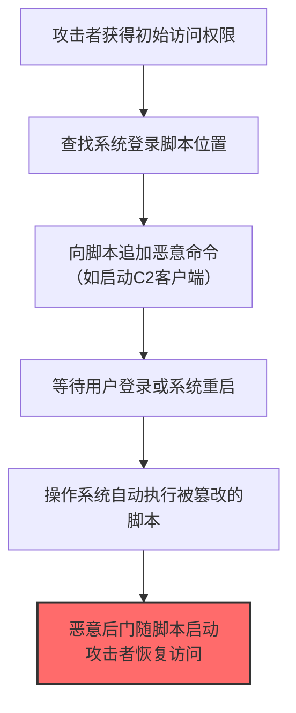

# 启动或登录初始化脚本 (T1037)

## 一句话通俗理解

> 攻击者在每次用户开机或登录时自动运行的脚本里塞入恶意代码，让后门随开机自动复活。

## 30秒速查卡

| 维度 | 你需要知道的 |
|------|-------------|
| 这是什么？ | 修改系统开机或用户登录时自动执行的脚本，植入持久化后门 |
| 为什么危险？ | 每次有用户登录就会触发，攻击者无需主动运行即可保持访问，且容易扩散到所有域用户 |
| 谁需要关心？ | 域管理员、系统管理员、安全运维团队 |
| 你的第一步防御 | 监控登录脚本文件和组策略登录脚本配置的任何变更 |
| 如果只做一件事 | 对域控制器上的Netlogon共享目录启用文件完整性监控 |

## 难度等级

⭐⭐ 中级（需要一定基础）

## 前置知识检查

**读这个文件需要什么？**

- [ ] 了解操作系统启动流程（开机时发生了什么）
- [ ] 知道什么是登录脚本、shell配置文件
- [ ] 了解Windows域环境和组策略（GPO）基础

## 技术描述

启动或登录初始化脚本（T1037）是MITRE ATT&CK框架中的一种持久化技术。

**通俗解释：**

想象一下公司的前台每天上班第一件事就是按流程检查所有门窗。攻击者偷偷改了前台的"上班检查清单"，在最后一行加了一条"把后门钥匙放在花盆下"。这样每天前台一上班，就会自动执行这条指令——前台不知道，老板也不知道。

操作系统和应用程序在启动或用户登录时，会自动执行一组预定义的脚本（比如Windows的登录脚本、Linux的.bashrc、macOS的loginhook）。攻击者修改这些脚本，把恶意命令加进去，就能让后门在每次开机或登录时自动运行。

**技术原理：**

1. **定位脚本位置**：攻击者找到系统启动或用户登录时自动执行的脚本文件
2. **修改脚本内容**：在脚本中追加恶意命令（如启动后门程序、连接C2服务器、添加计划任务）
3. **等待触发**：下次系统重启或用户登录时，操作系统自动执行被篡改的脚本
4. **维持访问**：恶意代码获得执行机会，重新建立攻击者的访问通道

**用途与影响：**

这种技术广泛用于APT组织的长期潜伏。它的可怕之处在于"被动触发"——攻击者修改完脚本就可以潜伏等待，不需要主动攻击。在域环境中，修改域控制器的登录脚本可以一次影响所有域用户，危害极大。著名案例中，FIN7、APT29等组织都曾利用登录脚本实现跨多台主机的快速持久化。

## 子技术列表

**该技术共有 5 个子技术：**

| 子技术ID | 中文名称 | 通俗解释 |
|----------|----------|----------|
| T1037.001 | 登录脚本（Windows） | 在Windows组策略或注册表中的登录脚本里塞入恶意命令 |
| T1037.002 | 登录脚本（Mac） | 利用macOS的Login Hook机制在用户登录时执行恶意代码 |
| T1037.003 | 登录脚本（Linux） | 修改.bashrc、.profile等shell配置文件植入后门 |
| T1037.004 | 登录脚本（网络） | 修改域控制器上分发的网络登录脚本，影响所有域用户 |
| T1037.005 | 登录脚本（跨平台） | 利用Python/PowerShell等跨平台脚本实现多平台持久化 |

## 攻击流程

### 典型攻击流程

```
获取初始访问 --> 定位登录脚本 --> 追加恶意命令 --> 等待用户登录 --> 后门自动执行
```



**步骤详解：**

1. **获取初始访问权限**
   - 通俗描述：攻击者已通过钓鱼、漏洞利用等方式进入目标系统
   - 技术细节：通常已获得普通用户或管理员权限
   - 常用工具：Cobalt Strike、Empire

2. **查找登录脚本位置**
   - 通俗描述：找到系统启动时自动执行的脚本文件
   - 技术细节：Windows查看`HKLM\SOFTWARE\Microsoft\Windows NT\CurrentVersion\Winlogon`；Linux查看`/etc/profile`、`~/.bashrc`
   - 常用工具：reg query、cat、find

3. **追加恶意命令**
   - 通俗描述：在脚本末尾悄悄加入一行启动后门的命令
   - 技术细节：使用echo追加或脚本修改工具，保持原脚本功能不变
   - 常用工具：PowerShell、Bash

4. **等待触发**
   - 通俗描述：攻击者什么也不用做，等用户下次登录就行
   - 技术细节：域环境中可能影响数百个用户的登录会话

5. **后门自动执行**
   - 通俗描述：用户一登录，后门就跟着起来了
   - 技术细节：后门进程继承用户权限，可能触发更多横向移动

## 真实案例

### 案例1：FIN7针对餐饮业的持久化攻击

- **时间**: 2017-2018年
- **目标**: 美国餐饮连锁企业（如Arby's、Chili's）
- **攻击组织**: FIN7（又称Carbanak Group）
- **手法**: FIN7在入侵目标网络后，通过修改Windows域登录脚本实现快速扩散持久化。他们将恶意PowerShell命令注入到域组策略的登录脚本中，每当任何域用户登录到域内工作站时，脚本会自动下载并执行第二阶段载荷。这种方式让FIN7在数小时内就感染了整个域内的数十台工作站，而无需逐台入侵。
- **影响**: 导致多家餐饮企业支付系统数据泄露，预计影响超过1500万张信用卡
- **参考链接**: [US DOJ FIN7 Indictment](https://www.justice.gov/opa/pr/five-members-sophisticated-cyber-criminal-group-indicted-widespread-hacking-and-bank-fraud)
   - **数据来源**: 一级

### 案例2：APT29（Cozy Bear）的macOS Login Hook持久化

- **时间**: 2019年
- **目标**: 欧洲外交机构和智库组织
- **攻击组织**: APT29（俄罗斯对外情报局SVR背景）
- **手法**: APT29在针对macOS用户的钓鱼攻击中，利用T1037.002子技术——修改macOS的Login Hook机制。他们在`/var/root/.tcshrc`和系统级Login Hook中植入持久化代码，每当任何用户登录时，脚本会静默启动一个反向Shell连接到APT29的C2服务器。由于Login Hook以root权限运行，攻击者获得了系统级持久化访问。
- **影响**: 攻击者保持对受害macOS系统的长期访问达数月之久
- **参考链接**: [CrowdStrike APT29 Analysis](https://www.crowdstrike.com/blog/bears-midst-intrusion-discernment/)
   - **数据来源**: 二级

### 案例3：Rocke团伙利用Linux Shell配置挖矿持久化

- **时间**: 2018-2019年
- **目标**: Linux服务器和云环境
- **攻击组织**: Rocke（加密货币挖矿团伙）
- **手法**: Rocke团伙在入侵Linux服务器后，通过修改`/etc/profile`和`/etc/bash.bashrc`实现持久化。他们在这些全局shell配置文件中添加了一行隐蔽的下载命令，每当任何用户登录系统启动shell时，就会从C2服务器下载最新的挖矿程序版本。即使管理员删除了挖矿进程，只要有新用户登录，挖矿程序就会重新部署。
- **影响**: 大量服务器CPU资源被占用，部分服务器因过热而宕机
- **参考链接**: [Trend Micro Rocke Group Analysis](https://www.trendmicro.com/en_us/research/19/a/rocke-group-evolution-continued-targeting-cryptocat.html)
   - **数据来源**: 二级

## 红队视角

> ⚠️ **免责声明**：以下内容仅用于合法的安全测试、渗透测试和教育目的。未经授权对他人系统进行测试是违法行为。

### 实战技巧

1. **域环境优先攻击Netlogon**
   在Windows域环境中，修改`\\DC\NETLOGON\`目录下的登录脚本影响范围最大，一次修改可覆盖所有域用户

2. **保持脚本原功能不变**
   修改登录脚本时务必保留原有命令的功能，否则用户会发现登录异常。最佳做法是在脚本末尾追加，而非替换

3. **利用跨平台脚本**
   使用Python或PowerShell编写的跨平台登录脚本（T1037.005）可以在混合环境中同时感染Windows和Linux系统

### 常用工具

| 工具名称 | 用途 | 平台 | 链接 |
|----------|------|------|------|
| PowerSploit | PowerShell持久化模块，可修改登录脚本 | Windows | [PowerSploit](https://github.com/PowerShellMafia/PowerSploit) |
| Empire | 后渗透框架，内置登录脚本持久化模块 | Windows/Linux | [Empire](https://github.com/BC-SECURITY/Empire) |
| Atomic Red Team | T1037原子测试用例 | 全平台 | [Atomic Red Team T1037](https://github.com/redcanaryco/atomic-red-team/tree/master/atomics/T1037) |

### 注意事项

- 修改域登录脚本需要域管理员权限，操作需谨慎
- 登录脚本中的错误可能导致用户无法正常登录，引发快速发现
- 在Windows中，组策略登录脚本的执行可能有延迟，不适合需要立即触发的场景

## 蓝队视角

### 检测要点

1. **登录脚本文件变更监控**
   - 日志来源：Windows文件审计日志、Linux auditd、macOS Endpoint Security
   - 关注字段：文件路径、修改时间、修改者进程
   - 异常特征：登录脚本文件被非预期进程修改

2. **组策略登录脚本配置变更**
   - 日志来源：Windows事件日志
   - 关注字段：Event ID 5136（目录服务对象修改）、GPO脚本路径
   - 异常特征：GPO中的登录脚本路径被修改为新位置

3. **Shell配置文件异常修改**
   - 日志来源：Linux auditd、文件完整性监控（FIM）
   - 关注字段：/etc/profile、/etc/bashrc、~/.bashrc、~/.profile
   - 异常特征：全局shell配置文件被普通用户或未知进程修改

### 监控建议

- 对域控制器NETLOGON和SYSVOL共享启用文件审计
- 部署文件完整性监控（FIM）工具，监控所有登录脚本文件
- 在Linux上配置auditd规则监控`/etc/profile`、`/etc/bash.bashrc`等全局配置

## 避坑指南

**防御者最痛苦的教训：** 只关注了本地登录脚本，忘了域组策略登录脚本。在一次事件响应中，蓝队清除了所有工作站的本地持久化，但域GPO中的登录脚本不断重新感染所有机器。教训是：**持久化清理必须从域控制器开始**。

## 检测建议

### 网络层检测

**用人话说：** 登录脚本触发后门时，通常会有C2回连流量。关键信号是：大量不同主机在用户登录时间段（如早上8-9点）同时向同一个外部IP发起连接——这很可能是域登录脚本中的后门被批量触发。

```bash
# 检测早晨登录时段的异常批量外连
awk '$3 ~ /^08:/' proxy.log | awk '{print $5}' | sort | uniq -c | sort -rn | head -20
```

### 主机层检测

**Windows事件ID：**
- 事件ID 5136：目录服务对象修改（监控GPO登录脚本路径变更）
- 事件ID 4663：对象访问尝试（监控NETLOGON目录文件修改）

**Linux日志：**
- auditd日志：监控/etc/profile等文件写入
- /var/log/auth.log：监控用户登录后的命令执行

```bash
# 用auditd监控全局shell配置文件
auditctl -w /etc/profile -p wa -k shell_config_modify
auditctl -w /etc/bash.bashrc -p wa -k shell_config_modify
ausearch -k shell_config_modify
```

### 应用层检测

**Sigma规则示例：**

```yaml
title: 检测Windows域登录脚本被修改
status: experimental
description: 监控域控制器上NETLOGON共享中的登录脚本文件修改
logsource:
    product: windows
    service: security
detection:
    selection:
        EventID: 4663
        ObjectName|contains: 'NETLOGON'
        AccessMask: '0x2'
    condition: selection
level: high
tags:
    - attack.persistence
    - attack.t1037
    - attack.t1037.004
```

## 缓解措施

### 优先级1：关键措施

**限制登录脚本修改权限**

**具体实施步骤：**
1. 将NETLOGON和SYSVOL共享的写权限限制为仅Domain Admins
2. 对登录脚本文件启用NTFS审计
3. 定期检查GPO登录脚本配置

```powershell
# 检查NETLOGON共享权限
Get-SmbShare -Name NETLOGON | Select-Object -ExpandProperty PresetPathAcl
```

### 优先级2：重要措施

**部署文件完整性监控**

对以下关键路径部署FIM：
- `\\domain\NETLOGON\*.bat`、`*.cmd`、`*.ps1`
- `/etc/profile`、`/etc/bash.bashrc`、`/etc/profile.d/`
- macOS的`/var/root/.tcshrc`、Login Hook配置

### 优先级3：建议措施

**限制shell配置文件权限**

```bash
# Linux: 限制全局shell配置文件权限
chmod 644 /etc/profile /etc/bash.bashrc
chown root:root /etc/profile /etc/bash.bashrc
```

### MITRE ATT&CK 缓解措施映射

| 缓解措施ID | 缓解措施名称 | 适用性 | 说明 |
|------------|-------------|--------|------|
| M1018 | 账户管理 | 部分适用 | 限制可修改登录脚本的管理员账户数量 |
| M1022 | 限制文件和目录权限 | 适用 | 限制登录脚本文件和目录的写权限 |

## 动手实验

> ⚠️ **所有实验必须在隔离的实验室环境中进行**

### 实验1：观察Windows登录脚本执行（初级）

**实验目标：** 理解登录脚本在用户登录时如何自动执行

**实验步骤：**
1. 在Windows测试机上创建一个测试用户
2. 在`HKCU\Environment`中设置`UserInitMprLogonScript`为`echo "logged in" > C:\temp\login_test.txt`
3. 注销并重新登录
4. 检查C:\temp\login_test.txt是否存在

**预期结果：** 登录后文件自动创建，证明脚本被执行

### 实验2：Linux .bashrc持久化（中级）

**实验目标：** 在Linux环境中通过修改.bashrc实现持久化

**实验步骤：**
1. 编辑测试用户的`~/.bashrc`，在末尾添加`echo "backdoor triggered" >> /tmp/persistence.log`
2. 新开一个终端会话
3. 查看/tmp/persistence.log

**预期结果：** 每次打开新shell都会追加日志

### 实验3：使用Atomic Red Team执行T1037测试（高级）

**实验目标：** 使用ART自动化测试T1037.001

**实验步骤：**
1. 安装Atomic Red Team
2. 执行`Invoke-AtomicTest T1037.001`
3. 观察并分析检测日志

**预期结果：** 测试用例修改登录脚本并验证执行

## 术语解释

| 术语 | 英文原名 | 通俗解释 |
|------|----------|----------|
| 登录脚本 | Logon Script | 用户登录时操作系统自动执行的脚本文件，就像公司给每个新到岗员工的"入职操作清单" |
| 组策略 | Group Policy (GPO) | Windows域中集中管理配置的机制，像公司发的统一操作手册，所有员工必须遵守 |
| Shell配置文件 | Shell Configuration File | Linux/macOS中每次打开命令行时自动加载的配置，像你办公桌抽屉里每次上班都会翻开的备忘录 |
| Login Hook | Login Hook | macOS中用户登录时自动执行的程序，类似Windows登录脚本但机制不同 |
| NETLOGON共享 | NETLOGON Share | 域控制器上的特殊共享目录，存放所有域用户登录时使用的脚本 |

## 参考资料

### 📚 官方文档（深入了解）

- [MITRE ATT&CK - Boot or Logon Initialization Scripts (T1037)](https://attack.mitre.org/techniques/T1037/)
- [MITRE ATT&CK - Logon Script (Windows) (T1037.001)](https://attack.mitre.org/techniques/T1037/001/)
- [Microsoft文档 - 组策略登录脚本](https://docs.microsoft.com/en-us/previous-versions/windows/it-pro/windows-server-2012-r2-and-2012/cc739085)

### 📰 安全报告（真实攻击）

- [US DOJ FIN7起诉书](https://www.justice.gov/opa/pr/five-members-sophisticated-cyber-criminal-group-indicted-widespread-hacking-and-bank-fraud) - FIN7利用域登录脚本扩散持久化的官方记录
- [CrowdStrike APT29分析](https://www.crowdstrike.com/blog/bears-midst-intrusion-discernment/) - APT29在macOS上使用Login Hook的案例分析

### 🔧 工具与资源（动手试试）

- [Atomic Red Team T1037](https://github.com/redcanaryco/atomic-red-team/tree/master/atomics/T1037) - T1037原子测试用例
- [Sysinternals Autoruns](https://docs.microsoft.com/en-us/sysinternals/downloads/autoruns) - 查看所有自动启动位置

## 版本历史

| 版本 | 日期 | 变更内容 | 变更人 | 审核人 |
|------|------|----------|--------|--------|
| v1.0 | 2026-07-10 | 初始入库，修复跨战术污染问题 | ATTCK知识库维护团队 | - |
