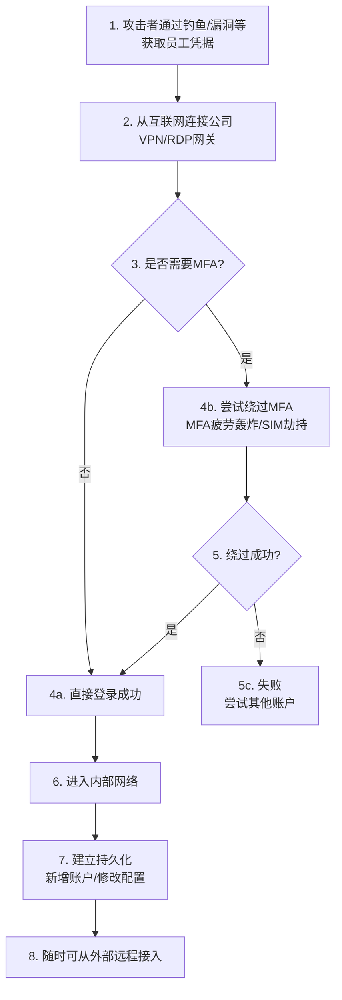

# 外部远程服务 (T1133)

## 一句话通俗理解

> **攻击者窃取或盗用你公司VPN/远程桌面的"通行证"——以后想进就进，就像配了把你家大门的钥匙**

## 30秒速查卡

| 维度 | 你需要知道的 |
|------|-------------|
| 这是什么？ | 攻击者利用合法的远程访问服务（VPN、RDP、SSH、Citrix等）凭据或会话，从外部持续接入内部网络 |
| 为什么危险？ | 远程服务流量加密、走合法通道，防火墙和IDS很难区分攻击者和合法用户 |
| 谁需要关心？ | 网络安全运维、VPN/远程访问管理员、IAM（身份访问管理）团队 |
| 你的第一步防御 | 对所有远程访问强制启用MFA（多因素认证），监控异常登录地理位置和时段 |
| 如果只做一件事 | 在VPN/RDP网关上启用MFA，这是阻断被盗凭据最有效的一步 |

## 难度等级

⭐⭐ 中级：需要获取有效凭据或会话令牌，但不需要漏洞利用

## 前置知识检查

读这个文件前，你需要了解：
- **VPN（虚拟专用网络）**：通过加密通道从外部安全接入内部网络的技术，员工远程办公常用
- **RDP（远程桌面协议）**：Windows 远程桌面连接协议，允许图形化远程操控电脑
- **SSH（安全外壳协议）**：Linux/Unix 服务器远程管理的事实标准协议
- **MFA（多因素认证）**：登录时除了密码还要求第二个验证（手机验证码、硬件令牌等），大幅提高安全性
- **会话令牌（Session Token）**：登录成功后服务器发放的"通行证"，持有它就可免密码再次进入

## 技术描述

想象一下：你公司有个大门，员工凭工牌刷卡进。攻击者怎么进去？两种方式：一是偷一张员工的工牌（窃取凭据），二是趁员工开门时跟着混进去（劫持会话）。公司VPN、远程桌面这些"远程大门"也是同理——攻击者拿到合法用户的账号密码，或者劫持了已建立的远程会话，就能从互联网上堂而皇之地接入你的内部网络，而且看起来和正常员工远程办公一模一样。

攻击者利用外部远程服务实现持久化的方式：

1. **凭据窃取后登录VPN/RDP**：通过钓鱼、凭据转储等手段获取员工账号密码，直接登录公司VPN或RDP，获得内部网络访问权
2. **会话令牌窃取**：窃取用户登录后的 session cookie/token，无需密码即可重放会话（如窃取 VPN session cookie）
3. **新增远程访问账户**：在 compromised 系统上创建新账户并加入远程访问用户组，留一个"后门账户"
4. **修改远程服务配置**：开启RDP服务、添加VPN客户端配置、修改SSH配置允许密钥登录
5. **利用SaaS远程访问**：通过被劫持的云服务账户（如 Azure AD、Okta）访问企业SaaS应用

类比和技术之间的过渡：就像小偷拿到了你家WiFi密码，以后随时能连上你家网络。他在你家网络里干什么，你家的路由器日志看起来就是"有个设备连上了"——和你的手机连上没区别。在企业环境，VPN/RDP 网关就是"路由器"，攻击者用合法凭据连上后，流量加密、走合法通道，极难区分。

## 子技术列表

本技术暂无子技术。

## 攻击流程



### 该技术特有的步骤说明

1. **凭据获取**：钓鱼邮件、凭据转储、密码喷洒、暗网购买
2. **远程服务识别**：扫描公司公网IP，发现开放的VPN/RDP/SSH/Citrix 端口
3. **登录尝试**：使用获取的凭据登录，处理MFA挑战
4. **会话维持**：登录后修改会话超时设置，或设置"记住此设备"
5. **持久化加固**：创建新账户、添加SSH公钥、修改RDP配置允许的连接数
6. **痕迹清理**：清除登录日志（如有权限）、配置自动登出绕过

## 真实案例

### 案例1：SolarWinds 供应链攻击中 APT29 利用 SAML 令牌持久接入（2020年）

- **时间**：2020年3月首次入侵，2020年12月被发现
- **目标**：美国政府机构、Fortune 500企业（约18,000个组织受影响）
- **攻击组织**：APT29 / Cozy Bear（俄罗斯 SVR 情报机构背景）
- **手法**：APT29 通过 SolarWinds 供应链攻击入侵后，利用窃取的 SAML 令牌签名密钥（Golden SAML攻击）伪造任意用户的身份令牌，无需密码和MFA即可访问受害组织的 Office 365、Azure AD、VPN 等 SaaS 服务。这种"令牌伪造"方式产生的登录记录看起来完全合法，因为令牌签名是真实的。攻击者可随时生成新令牌接入，实现长期持久化
- **数据来源**：一手厂商报告（FireEye/Mandiant、Microsoft MSTIC、CISA紧急警报 AA21-076A）

### 案例2：Lapsus$ 团伙利用被盗凭据入侵企业VPN（2021-2022年）

- **时间**：2021年12月至2022年3月
- **目标**：NVIDIA、Samsung、Microsoft、Okta、Ubisoft 等大型科技公司
- **攻击组织**：Lapsus$（又名 DEV-0537，主要由青少年组成的攻击团伙）
- **手法**：Lapsus$ 通过多种方式获取企业员工凭据：在 Telegram/RaidForums 购买泄露凭据、通过 RedLine 等信息窃取木马获取、社工帮助台重置密码。获取凭据后直接登录目标企业的VPN，进入内部网络。针对MFA，采用"MFA疲劳轰炸"——反复触发推送通知直到用户不耐烦点击同意，或通过社工获取MFA验证码。进入后窃取源代码和数据
- **数据来源**：一手厂商报告（Microsoft MSTIC、Okta 安全事件报告、CISA 警报）

### 案例3：勒索软件团伙通过 RDP 暴力破解持久化（2019-2023年持续）

- **时间**：2019年至今持续活跃
- **目标**：暴露RDP端口的中小企业、医院、政府机构
- **攻击组织**：多个勒索软件团伙（Ryuk/Conti、LockBit、BlackCat 等）
- **手法**：勒索团伙通过扫描公网开放的 RDP 端口（3389），使用购买的凭据或暴力破解获取登录权限。成功登录后，部署勒索软件前先建立持久化：创建新管理员账户、修改 RDP 配置允许多会话、安装后门。即使管理员更改了被泄露的密码，攻击者仍可通过新创建的账户随时 RDP 接入
- **数据来源**：一手厂商报告（Coveware 季度勒索软件报告、FBI/CISA 联合警报 AA21-131A、Sophos 事件响应报告）

## 红队视角

### 可持续利用手段

1. **多账户冗余**：创建多个远程访问账户，删除一个还有其他
2. **SSH公钥持久化**：在 `~/.ssh/authorized_keys` 添加攻击者公钥，即使密码更改仍可登录
3. **VPN配置文件持久化**：在终端上安装VPN客户端配置，配置自动连接
4. **会话保活**：修改远程桌面会话超时配置，使会话永不超时

### 攻击技术可复制性分析

| 维度 | 评分 | 说明 |
|------|------|------|
| 实现难度 | 低 | 只需有效凭据，无需漏洞利用 |
| 检测绕过 | 高 | 流量加密、走合法通道，难区分 |
| 持久化效果 | 高 | 只要凭据/账户不被发现，可长期接入 |
| 复制成本 | 低 | 凭据可在暗网购买 |

## 蓝队视角

### 检测建议

**用人话说**：远程服务登录本身是正常行为，你不能禁止员工VPN办公。要发现攻击者，得看"异常模式"——比如某员工平时都在北京VPN登录，突然从俄罗斯IP登录了；或者凌晨3点登录了从未在此时段登录过的账户；或者一个账户同时从两个不同地理位置登录。这些"不符合用户习惯"的登录行为就是重点怀疑对象。

#### 主机层检测

```yaml
# Sigma规则：检测RDP异常登录
title: 异常RDP登录检测
id: 9f012345-6789-0123-abcd-ef9012345678
status: experimental
description: 检测RDP登录的异常模式，包括非工作时间、异常源IP、新账户登录
logsource:
    product: windows
    service: security
detection:
    selection:
        EventID: 4624  # 成功登录
        LogonType: 10  # RemoteInteractive (RDP)
    filter_normal:
        IpAddress|cidr:
            - '10.0.0.0/8'  # 内网IP（排除）
            - '172.16.0.0/12'
            - '192.168.0.0/16'
    condition: selection and not filter_normal
falsepositives:
    - 合法的远程办公
    - 外部IT外包服务
level: medium
```

```yaml
# Sigma规则：检测SSH authorized_keys被修改
title: SSH authorized_keys 修改检测
id: a0123456-7890-1234-abcd-ef0123456789
status: experimental
description: 检测SSH authorized_keys文件被修改，可能添加攻击者公钥
logsource:
    product: linux
    category: file_create
detection:
    selection:
        TargetFilename|contains: '.ssh/authorized_keys'
    condition: selection
falsepositives:
    - 管理员添加合法SSH密钥
    - 自动化部署工具
level: medium
```

**系统命令检测**：

```powershell
# 检查RDP登录历史（Windows）
Get-WinEvent -FilterHashtable @{LogName='Security'; Id=4624; StartTime=(Get-Date).AddDays(-30)} |
  Where-Object {$_.Properties[8].Value -eq 10} |  # LogonType=10 (RDP)
  Select-Object TimeCreated,
    @{N='User';E={$_.Properties[5].Value}},
    @{N='SourceIP';E={$_.Properties[18].Value}}

# 检查远程桌面用户组成员
Get-LocalGroupMember -Group "Remote Desktop Users"
net localgroup "Remote Desktop Users"

# 检查RDP配置
reg query "HKLM\SYSTEM\CurrentControlSet\Control\Terminal Server" /v fDenyTSConnections
# 0=启用RDP, 1=禁用RDP

# 检查新创建的账户
Get-LocalUser | Where-Object {$_.CreationTime -gt (Get-Date).AddDays(-7)}
```

```bash
# 检查SSH登录历史
last -i | head -50  # -i 显示IP而非主机名
grep 'Accepted' /var/log/auth.log | tail -50

# 检查authorized_keys
find / -name authorized_keys -exec ls -la {} \; 2>/dev/null
for user_home in /home/* /root; do
  if [ -f "$user_home/.ssh/authorized_keys" ]; then
    echo "=== $user_home ==="
    cat "$user_home/.ssh/authorized_keys"
  fi
done

# 检查SSH配置
grep -E 'PermitRootLogin|PasswordAuthentication|AllowUsers' /etc/ssh/sshd_config
```

#### 网络层检测

- **异常地理位置登录**：监控VPN/RDP登录源IP的地理位置，与用户历史习惯对比
- **异常时段登录**：监控非工作时间（如凌晨）的远程登录
- **并发会话检测**：同一账户同时从不同IP登录
- **新设备登录**：首次从某设备/IP登录的账户
- **流量模式异常**：VPN连接后大量内部横向扫描流量

#### 应用层检测

- VPN/RDP网关日志分析：登录成功率、失败次数、会话时长
- IAM 系统监控：新增远程访问账户、权限变更
- SSO（单点登录）监控：异常 SAML/OAuth 令牌签发

### 防御改进措施

1. **强制MFA**：对所有远程访问强制启用MFA，这是最有效的防御
2. **VPN访问最小权限**：VPN用户只分配必要的内网网段访问权
3. **登录行为分析（UEBA）**：基于用户历史行为建立基线，检测异常登录
4. **RDP网关**：不直接暴露RDP端口，通过RD Gateway/RDP代理访问
5. **会话超时**：配置合理的会话超时，避免长时间空闲连接
6. **凭据监控**：监控暗网泄露的企业凭据

### 应急响应优化

- 发现异常远程登录时，立即禁用相关账户
- 检查账户是否被添加到远程访问组
- 检查 `authorized_keys`、RDP配置、VPN客户端配置
- 审查近期所有远程登录日志，确认攻击时间线

## 避坑指南

### 容易踩的坑

1. **只看登录成功不看失败**：大量失败的登录（暴力破解尝试）也是重要信号，即使最终成功
2. **忽视合法服务的滥用**：VPN/RDP本身是合法工具，不能简单封禁，要基于行为分析
3. **MFA不是万能的**：MFA疲劳轰炸、SIM劫持、MFA中间人代理都能绕过MFA
4. **只监控外部登录不监控内部**：攻击者通过VPN进入后，内部横向移动也可能用RDP/SSH

### 本技术特有的注意事项

- SAML/OAuth 令牌劫持（如 Golden SAML）可绕过MFA，需监控令牌签发异常
- 远程访问服务的配置文件（如 `/etc/ssh/sshd_config`、RDP注册表）被篡改是持久化信号
- VPN分隧道（split tunneling）配置可能让攻击者同时访问企业网和互联网，增加风险

## 检测建议

### 网络层

- **异常地理位置登录**：监控VPN/RDP登录源IP地理位置
- **异常时段登录**：非工作时间的远程登录
- **并发会话**：同一账户多IP同时登录
- **流量模式**：VPN连接后的横向扫描流量

### 主机层

- **Windows EventID 4624（LogonType=10）**：RDP成功登录
- **Windows EventID 4625（LogonType=10）**：RDP登录失败（暴力破解）
- **Linux /var/log/auth.log**：SSH登录记录
- **文件监控**：`authorized_keys`、`sshd_config` 变更

### 应用层

- VPN/RDP网关日志分析
- IAM/SSO 系统监控
- SAML/OAuth 令牌签发监控

### Sigma 规则

见上方"蓝队视角→检测建议"中的两条 Sigma 规则。

## 缓解措施

| 缓解措施 | 类型 | 效果 | 实施建议 |
|---------|------|------|---------|
| 强制MFA | 预防 | 高 | 所有远程访问强制MFA |
| VPN最小权限 | 预防 | 中 | 限制VPN访问的内网范围 |
| RD Gateway | 预防 | 中 | 不直接暴露RDP端口 |
| 登录行为分析 | 检测 | 高 | UEBA 检测异常登录 |
| 会话超时 | 预防 | 中 | 配置合理超时 |
| 暗网凭据监控 | 检测 | 中 | 监控泄露的企业凭据 |

## 动手实验

### 实验目标

理解外部远程服务持久化原理，体验凭据登录和会话维持

### 实验步骤

```bash
# 实验环境：两台虚拟机（攻击机 + 目标机），目标机开启SSH

# === 目标机配置 ===
# 1. 确保SSH服务运行
sudo systemctl status sshd

# === 模拟攻击者操作 ===

# 2. 使用窃取的凭据登录（实验用自己创建的测试账户）
ssh testuser@<目标机IP>

# 3. 建立持久化：添加SSH公钥
# 在攻击机生成密钥对
ssh-keygen -t rsa -b 4096 -f ~/.tmp/persistence_key -N ""

# 4. 将公钥添加到目标机
ssh-copy-id -i ~/.tmp/persistence_key.pub testuser@<目标机IP>
# 或手动：echo "公钥内容" >> ~/.ssh/authorized_keys

# 5. 验证持久化：用密钥免密登录
ssh -i ~/.tmp/persistence_key testuser@<目标机IP>

# 6. 模拟"密码更改后仍可访问"
# 在目标机执行：passwd testuser（改密码）
# 攻击者用密钥仍可登录：ssh -i ~/.tmp/persistence_key testuser@<目标机IP>

# === 蓝队检测 ===
# 7. 检查 authorized_keys
cat ~/.ssh/authorized_keys  # 发现未知公钥
# 8. 检查登录日志
last -i | grep testuser
```

### 预期输出

```
# 步骤5：用密钥免密登录成功
testuser@target:~$  # 无需输入密码即登录

# 步骤6：密码更改后密钥仍有效
testuser@target:~$  # 证明持久化成功

# 步骤7：发现未知公钥
ssh-rsa AAAAB3NzaC1yc2E... attacker_key  # 这是攻击者添加的
```

### 工具说明

| 工具 | 用途 | 说明 |
|------|------|------|
| ssh-keygen | 生成SSH密钥对 | 创建持久化密钥 |
| ssh-copy-id | 部署SSH公钥 | 快速添加公钥到目标 |
| RDP Wrapper | RDP配置修改 | Windows RDP持久化 |
| OpenVPN | VPN客户端配置 | VPN持久化 |
| Evilginx2 | MFA中间人代理 | 针对MFA的钓鱼工具（红队用） |

## 术语解释

| 术语 | 通俗解释 |
|------|---------|
| VPN | 虚拟专用网络，从外部安全接入内部网络的加密通道 |
| RDP | 远程桌面协议，Windows 图形化远程控制 |
| SSH | 安全外壳协议，Linux 远程管理标准 |
| MFA | 多因素认证，密码+第二验证（手机码/令牌） |
| 会话令牌（Session Token） | 登录后的"通行证"，持有即可免密码再进 |
| SAML | 安全断言标记语言，SSO 用的身份令牌标准 |
| MFA疲劳轰炸 | 反复触发MFA推送通知直到用户不耐烦点同意 |
| Golden SAML | 用窃取的签名密钥伪造任意用户身份令牌 |

## 参考资料

### 📚 如果你想深入了解

- [MITRE ATT&CK T1133 官方页面](https://attack.mitre.org/techniques/T1133/) — 官方技术定义
- [CISA 远程访问安全指南](https://www.cisa.gov/) — VPN/RDP 加固建议
- [NIST SP 800-46 远程访问指南](https://csrc.nist.gov/) — 企业远程访问安全标准

### 🔧 如果你想动手试试

- [SSH 密钥认证教程](https://www.ssh.com/academy/ssh/keygen) — SSH 公钥认证配置
- [Windows RDP 配置](https://learn.microsoft.com/zh-cn/windows-server/remote/remote-desktop-services/) — RDP 服务配置

### 🎯 真实攻击参考

- [SolarWinds 分析 - FireEye](https://www.mandiant.com/) — 搜索 "Golden SAML" 了解 SAML 令牌劫持
- [Lapsus$ 攻击分析 - Microsoft](https://www.microsoft.com/en-us/wdsi) — 搜索 "DEV-0537 Lapsus"
- [CISA AA21-131A 勒索软件RDP](https://www.cisa.gov/news-events/cybersecurity-advisories/aa21-131a) — RDP 暴力破解勒索软件警报

## 版本历史

| 版本 | 日期 | 变更说明 |
|------|------|---------|
| v1.0 | 2026-07-10 | 初始版本，基于 MITRE ATT&CK v19 和 v3.0 写作风格指南编写 |
