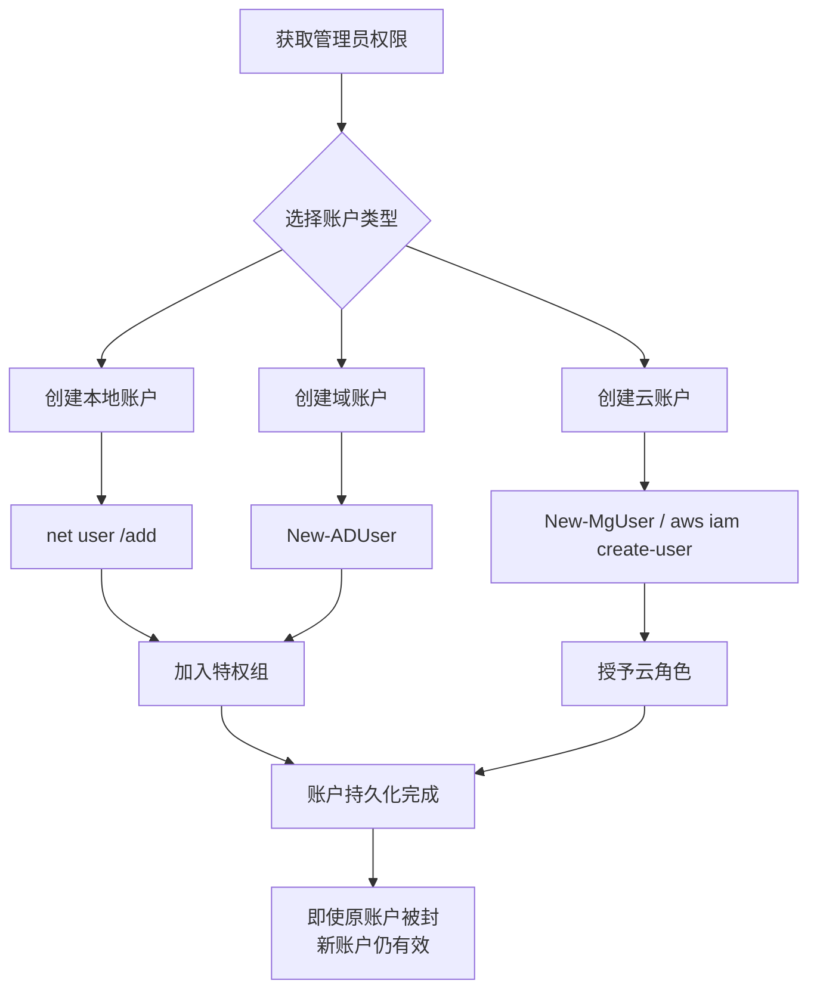

# T1136 - 创建账户

## 一句话通俗理解

最直接的持久化方式——攻击者在你系统里办一张"新员工卡"，以后随时刷这张卡进来，你改了原账户密码也没用，因为新账户还活着。

## 30秒速查卡

| 维度 | 你需要知道的 |
|------|-------------|
| 这是什么？ | 攻击者在系统/域/云平台创建新账户实现持久化 |
| 为什么危险？ | 新账户完全合法，系统视为正常用户，即使发现入侵也容易被遗漏 |
| 谁需要关心？ | 系统管理员、IAM 运维、云平台管理员 |
| 你的第一步防御 | 监控所有账户创建事件，特别是非工作时间和非常规来源 |
| 如果只做一件事 | 启用账户创建审计（Windows EventID 4720），配置告警 |

## 难度等级

⭐ 初级：会用 `net user` 或 `adduser` 命令即可，无需任何高级知识

## 前置知识检查

读这个文件前，你需要知道：
- **账户**：系统识别用户身份的记录，有用户名和密码
- **net user 命令**：Windows 创建账户的命令行工具
- **adduser/useradd**：Linux 创建账户的命令行工具
- **云账户**：Azure AD / AWS IAM 中的用户身份

## 技术描述

### 场景引入

想象你管一栋宿舍楼，楼里住了 100 个学生。某天小偷溜进来，不是偷东西，而是跑去宿管办公室，伪造了一张学生证，名字叫"张三丰"，宿舍号填了空房 305。

从此小偷每天拿着"张三丰"的学生证大摇大摆进出宿舍楼——宿管一看"张三丰"是注册学生，直接放行。即使某天你发现宿舍被偷、换了所有门锁，"张三丰"这张证依然有效，因为他根本不是"被偷的人"，他是"新注册的学生"。

这就是创建账户持久化的精髓：**不偷现有身份，而是创造全新身份。**

### 通俗比喻

| 账户类型 | 比喻 | 攻击者怎么用 |
|---------|------|-------------|
| 本地账户 | "办张宿舍楼门禁卡" | `net user` 创建，加入管理员组 |
| 域账户 | "办张全校通学生证" | 在域控创建，全域有效 |
| 云账户 | "注册个云平台账号" | Azure AD / AWS IAM 创建 |
| 服务账户 | "申请个机器人服务卡" | 创建服务账户，命名伪装正常 |
| 隐藏账户 | "办张隐形卡" | 用户名加 `$` 结尾，net user 不显示 |

### 进阶理解

创建账户是最简单直接的持久化方式——不需要修改系统组件、不需要利用漏洞、不需要特殊权限（本地用户权限即可创建本地账户）。攻击者创建的账户完全合法，系统审计日志记录的是"账户创建"而非"入侵行为"。

**关键策略：**
- **命名伪装**：用 `backup-svc`、`monitoring`、`update-agent` 等看似正常的服务账户名
- **隐藏账户**：Windows 中用户名加 `$` 结尾（如 `backdoor$`），`net user` 不显示但可正常登录
- **高权限**：创建后立即加入 Administrators / Domain Admins 组
- **多平台冗余**：同时在本地、域、云创建账户，即使一处被发现仍有其他入口
- **休眠策略**：创建后不立即使用，长期"休眠"降低被行为分析发现的风险

## 子技术列表

T1136 有 3 个子技术：

| 子技术 ID | 名称 | 简述 |
|----------|------|------|
| T1136.001 | Local Account | 创建本地账户 |
| T1136.002 | Domain Account | 创建域账户 |
| T1136.003 | Cloud Account | 创建云账户 |

**详写 T1136.001 Local Account：**

最常见的子技术。攻击者在单机上用 `net user <用户名> <密码> /add` 创建本地账户，再用 `net localgroup Administrators <用户名> /add` 提升权限。本地账户只需本地管理员权限，不需要域管理员。

**T1136.003 Cloud Account：**

攻击者在 Azure AD / AWS IAM 中创建新账户。云账户的优势在于：可远程创建、无需接触目标主机、权限可即时生效。攻击者常用 `New-MgUser`（Azure AD）或 `aws iam create-user`（AWS）创建账户，然后授予高权限角色。

## 攻击流程



## 真实案例

### 案例1：Hafnium 在 Exchange 攻击中创建后门账户
- **时间**：2021 年 3 月
- **目标**：全球 3 万+ Exchange 服务器（ProxyLogon 漏洞 CVE-2021-26855）
- **攻击组织**：Hafnium（中国背景 APT）
- **手法**：利用 ProxyLogon 漏洞获取 SYSTEM 权限后，用 `net user` 创建名为 `securityupdate` 的账户，加入 `Administrators` 和 `Exchange Servers` 组。命名伪装成安全更新，管理员难以察觉。即使漏洞被修补，后门账户依然有效
- **数据来源**：Microsoft MSTIC + Volexity 报告（一手厂商报告）

### 案例2：LAPSUS$ 在攻击中创建云账户
- **时间**：2022 年
- **目标**：NVIDIA、Samsung、Okta 等企业
- **攻击组织**：Lapsus$（青少年黑客组织）
- **手法**：窃取管理员凭证后，在 Azure AD 中用 `New-MgUser` 创建后门服务账户，命名为 `backup-sync`，授予 Global Administrator 角色。云账户创建不留主机痕迹，且管理员很少审计云账户列表
- **数据来源**：Microsoft MSTIC + NVIDIA 官方声明（一手官方文档）

### 案例3：Rocke 组织在 Linux 挖矿中创建持久化账户
- **时间**：2018-2019 年
- **目标**：暴露 SSH 服务的 Linux 服务器
- **攻击组织**：Rocke（加密货币挖矿组织）
- **手法**：暴力破解弱密码 SSH 后，用 `useradd -r -s /bin/bash` 创建系统级账户 `sysguard`，加入 `wheel` 组获得 sudo 权限。系统级账户（`-r`）在 `/etc/passwd` 中 UID < 1000，伪装成系统服务账户
- **数据来源**：Trend Micro / Palo Alto Unit 42 报告（一手厂商报告）

## 红队视角

### 可持续利用性分析

| 维度 | 评估 | 说明 |
|------|------|------|
| 隐蔽性 | 中 | 账户在用户列表中可见，但命名伪装可降低发现率 |
| 持久性 | 极高 | 账户不被删除则永久有效 |
| 可移植性 | 极高 | 所有操作系统和云平台都支持 |
| 检测难度 | 低 | 账户创建有明确审计事件 |

### 红队可复制性

```cmd
:: Windows：创建隐藏后门账户
net user backdoor$ P@ssw0rd2026! /add /active:yes
net localgroup Administrators backdoor$ /add

:: Windows：创建服务账户伪装
net user backup-svc S3cur3P@ss! /add /fullname:"Backup Service" /comment:"System backup service"
net localgroup Administrators backup-svc /add

:: Linux：创建系统级账户
useradd -r -m -s /bin/bash sysguard
echo "sysguard:S3cur3P@ss!" | chpasswd
usermod -aG wheel sysguard  # CentOS/RHEL
usermod -aG sudo sysguard   # Ubuntu/Debian

:: Azure AD：创建云账户
Connect-MgGraph -Scopes "User.ReadWrite.All"
New-MgUser -DisplayName "Backup Sync" -UserPrincipalName "backup-sync@tenant.onmicrosoft.com" -PasswordProfile @{Password="S3cur3P@ss!2026"; ForceChangePasswordNextSignIn=$false} -AccountEnabled
```

## 蓝队视角

### 用人话说检测

账户创建检测的核心是**审计"新建账户"事件**——正常运维中账户创建频率低且可预测，任何异常时间、异常来源的账户创建都是高危信号。重点关注：非工作时间创建、命名异常（伪装服务名）、创建后立即加特权组。

### Sigma 规则

```yaml
title: 检测可疑账户创建
id: 6f3c8e7a-2b1d-4e9c-8f5a-3d7b4c2a1e8f
status: stable
description: 监控账户创建事件，关注非工作时间和命名异常
logsource:
    product: windows
    service: security
detection:
    selection_create:
        EventID: 4720
    filter_system:
        SubjectUserName|endswith: '$'
    suspicious_naming:
        TargetUserName|contains:
            - 'backup'
            - 'update'
            - 'sync'
            - 'monitor'
            - 'service'
            - 'admin'
    condition: selection_create and not filter_system
falsepositives:
    - 合法的运维账户创建（需工单审批）
level: medium
```

### 命令行检测

```powershell
# 查询最近 7 天创建的账户
Get-WinEvent -FilterHashtable @{LogName='Security'; Id=4720; StartTime=(Get-Date).AddDays(-7)} |
  Select-Object TimeCreated, @{N='Creator';E={$_.Properties[4].Value}}, @{N='NewUser';E={$_.Properties[0].Value}}

# 查询所有本地账户（包括隐藏的 $ 结尾账户）
Get-WmiObject Win32_UserAccount | Select-Object Name, SID, Disabled

# 查询 $ 结尾的隐藏账户
Get-WmiObject Win32_UserAccount | Where-Object {$_.Name -like '*$'} | Select-Object Name, SID

# Azure AD：查询最近创建的云账户
Get-MgUser -Filter "createdDateTime ge $(Get-Date).AddDays(-7)" -Property DisplayName, UserPrincipalName, CreatedDateTime
```

```bash
# Linux：查询最近创建的账户
grep useradd /var/log/auth.log | tail -20

# 查询系统级账户（UID < 1000，排除已知系统账户）
awk -F: '$3 < 1000 && $3 != 0 {print $1, $3}' /etc/passwd | grep -v -E '^(bin|daemon|mail|ftp|http|nobody|dbus|polkitd|systemd)'

# 查询有 sudo 权限的账户
grep -E '^.{14}NOPASSWD|wheel|sudo' /etc/sudoers /etc/sudoers.d/* 2>/dev/null
```

### 关键事件 ID

| EventID | 含义 | 重点关注 |
|---------|------|---------|
| 4720 | 用户账户创建 | 非工作时间、命名异常 |
| 4722 | 用户账户启用 | 之前禁用的账户被启用 |
| 4732 | 加入本地安全组 | 新账户加入 Administrators |
| 4728 | 加入全局安全组 | 新账户加入 Domain Admins |

### 网络层检测
- 云 API 调用 `CreateUser` 的异常来源 IP
- LDAP 协议的 `AddUser` 请求异常

## 避坑指南

| 坑 | 说明 | 正确做法 |
|----|------|---------|
| 只看 net user 列表 | `$` 结尾账户不显示 | 用 WMI 或 Get-LocalUser 查询 |
| 忽略云账户 | 云账户创建不留主机痕迹 | 审计云平台账户创建日志 |
| 忽略系统级账户 | Linux `-r` 账户伪装系统服务 | 审计 UID < 1000 的新账户 |
| 只看创建不看加组 | 创建后立即加特权组才是高危 | 关联 4720 和 4732 事件 |
| 忽略命名伪装 | `backup-svc` 听起来正常 | 维护合法服务账户白名单 |
| 忘记检查休眠账户 | 创建后长期不用的账户更危险 | 关注创建后从未登录的账户 |

## 检测建议

### 主机层
- **Windows 安全日志**：EventID 4720/4722/4732/4728
- **Linux**：`/var/log/auth.log` 中的 useradd 事件
- **云平台**：Azure AD Audit Logs、AWS CloudTrail `iam:CreateUser`

### 应用层
- **账户生命周期管理**：所有账户创建需工单审批
- **特权账户审计**：定期审计 Administrators / Domain Admins 成员
- **云账户审计**：定期导出云平台账户列表对比基线

### 网络层
- 云 API `CreateUser` 调用的异常来源
- LDAP 协议的账户创建请求

## 缓解措施

| 措施 | 实施方式 | 效果 |
|------|---------|------|
| 账户创建审批流程 | 所有账户创建需工单+审批 | 阻止未授权创建 |
| 账户生命周期管理 | 自动化离职/禁用流程 | 减少休眠账户 |
| 特权账户限制 | 严格控制 Administrators 组成员 | 降低新账户特权风险 |
| 云账户审计 | 定期审计 Azure AD / IAM 账户 | 发现异常云账户 |
| 隐藏账户检测 | 定期用 WMI 扫描 `$` 结尾账户 | 发现隐藏后门 |
| 命名规范 | 强制服务账户命名前缀（如 `svc-`） | 识别非规范命名 |

## 动手实验

### 实验1：观察隐藏账户创建

```cmd
:: 1. 创建隐藏账户
net user hidden$ Test123!@# /add

:: 2. 用 net user 查看（看不到 hidden$）
net user

:: 3. 用 wmic 查看（能看到）
wmic useraccount where "name='hidden$'" get name,sid

:: 4. 加入管理员组
net localgroup Administrators hidden$ /add

:: 5. 清理
net user hidden$ /delete
```

**预期输出**：`net user` 不显示 `hidden$`，但 `wmic useraccount` 显示，证明隐藏账户有效。

### 实验2：检测账户创建事件

```powershell
# 1. 启用账户管理审计
auditpol /set /subcategory:"User Account Management" /success:enable

# 2. 创建测试账户
net user testdetect Test123!@# /add

# 3. 查询事件日志
Get-WinEvent -FilterHashtable @{LogName='Security'; Id=4720; StartTime=(Get-Date).AddMinutes(-5)} |
  Select-Object TimeCreated, @{N='Creator';E={$_.Properties[4].Value}}, @{N='NewUser';E={$_.Properties[0].Value}}

# 4. 清理
net user testdetect /delete
```

**预期输出**：事件日志记录账户创建，包含创建者、新账户名、时间——这是检测的核心依据。

### 专用工具

| 工具 | 用途 | 特点 |
|------|------|------|
| Purple Knight | AD 安全评估 | 检测后门账户 |
| PingCastle | AD 安全评分 | 识别异常账户 |
| Azure AD Audit Reports | 云账户审计 | Azure AD 账户创建日志 |
| AWS IAM Access Analyzer | AWS 账户审计 | 检测异常 IAM 账户 |

## 术语解释

| 术语 | 通俗解释 |
|------|---------|
| 创建账户 | 在系统中新建用户身份 |
| 隐藏账户 | 用户名加 `$` 结尾，net user 不显示 |
| 系统级账户 | Linux 中 UID < 1000 的账户，伪装系统服务 |
| 服务账户 | 用于运行服务的账户，常被攻击者伪装 |
| 休眠账户 | 创建后长期不用的账户 |
| 账户生命周期 | 从创建到禁用/删除的全过程 |

## 参考资料

### 深入了解
- 📚 [MITRE ATT&CK T1136](https://attack.mitre.org/techniques/T1136/) —— 官方技术页面
- 📚 [MITRE ATT&CK T1136.001 Local Account](https://attack.mitre.org/techniques/T1136/001/)
- 📚 [MITRE ATT&CK T1136.003 Cloud Account](https://attack.mitre.org/techniques/T1136/003/)

### 动手试试
- 🔧 [Purple Knight](https://www.purpleknights.com/) —— AD 安全评估
- 🔧 [Azure AD Audit Logs](https://learn.microsoft.com/azure/active-directory/reports-monitoring/) —— 云账户审计

### 真实攻击
- 🎯 Microsoft MSTIC Hafnium 报告 —— Exchange 后门账户创建
- 🎯 Microsoft MSTIC Lapsus$ 报告 —— 云账户创建
- 🎯 Trend Micro Rocke 报告 —— Linux 系统级账户

## 版本历史

| 版本 | 日期 | 变更 |
|------|------|------|
| v3.1 | 2026-07-10 | 重写为持久化战术正确内容，修复跨战术污染 |
| v3.0 | 2026-06-15 | 初版 v3.0 风格 |
