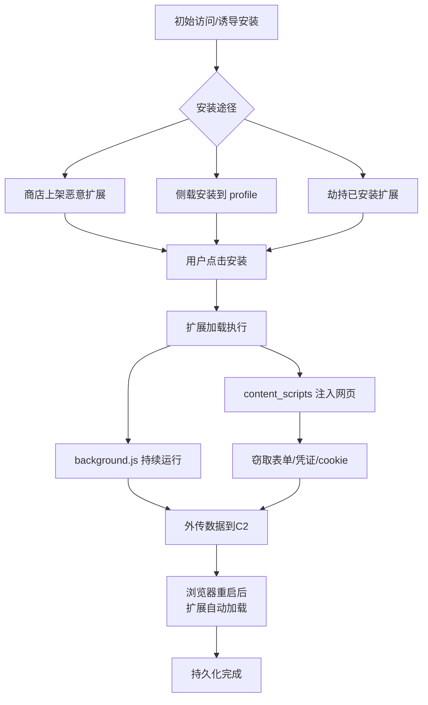

# T1176 - 软件扩展

## 一句话通俗理解

浏览器扩展就像给人配了副"隐形眼镜"——戴上后看到的世界（网页内容、输入的密码、点击的链接）全都能被眼镜背后的人看到，而用户自己毫无察觉。

## 30秒速查卡

| 维度 | 你需要知道的 |
|------|-------------|
| 这是什么？ | 攻击者安装恶意浏览器扩展实现持久化和数据窃取 |
| 为什么危险？ | 扩展能访问所有网页内容、拦截表单、注入代码，且权限一旦授予长期有效 |
| 谁需要关心？ | 终端用户、企业 IT 管理员、浏览器安全团队 |
| 你的第一步防御 | 禁用扩展商店外安装，定期审计已安装扩展列表 |
| 如果只做一件事 | 启用浏览器扩展安装策略（Chrome Enterprise Policy）禁止未签名扩展 |

## 难度等级

⭐⭐ 中级：需要了解浏览器扩展机制和 manifest.json 结构，无需编程基础

## 前置知识检查

读这个文件前，你需要知道：
- **浏览器扩展**：浏览器的小程序，能修改网页内容、拦截请求、读取标签页
- **manifest.json**：扩展的配置文件，声明权限和入口脚本
- **扩展权限**：`activeTab`、`cookies`、`webRequest`、`<all_urls>` 等权限级别
- **扩展商店**：Chrome Web Store / Firefox Add-ons，扩展可从商店或外部安装

## 技术描述

### 场景引入

想象你每天戴着别人送的眼镜上班。这副眼镜特别清楚，你还挺喜欢。但你不知道的是——眼镜里藏了个微型摄像头，你看到的一切（屏幕上的报表、客户名单、登录密码）都被实时传给送礼的人。

这就是恶意浏览器扩展的运作方式。用户安装后，扩展就像"寄生"在浏览器里，每次打开网页它都能读到内容，每次输入密码它都能记录下来——而用户觉得浏览器一切正常。

### 通俗比喻

| 扩展能力 | 比喻 | 攻击者怎么用 |
|---------|------|-------------|
| `<all_urls>` 权限 | "能看所有网页" | 窃取所有网站的登录凭证 |
| `cookies` 权限 | "能读饼干盒" | 偷取会话 cookie 绕过 MFA |
| `webRequest` 权限 | "能拦截快递" | 修改网页请求、注入恶意脚本 |
| `nativeMessaging` 权限 | "能打电话给本机程序" | 调用本地恶意可执行文件 |
| 后台脚本 | "7×24 值班员" | 持续运行，即使用户不操作 |

### 进阶理解

浏览器扩展是基于 WebExtensions API 的标准化插件，运行在浏览器进程内。其核心配置文件 `manifest.json` 声明了扩展需要的权限和入口脚本。浏览器一旦加载扩展，就会按 manifest 的声明执行脚本——而扩展权限一旦用户确认授予，就会**长期有效**，这就是持久化的基础。

**攻击者利用扩展持久化的关键手法：**
- **伪装合法扩展**：命名"广告拦截""PDF转换"等，诱导用户安装
- **商店上架恶意扩展**：Chrome Web Store 审核不严时上架，获得大量用户
- **侧载安装**：通过恶意软件静默安装扩展到浏览器配置目录
- **劫持合法扩展**：收购已上架的流行扩展，通过更新植入恶意代码

**扩展持久化的隐蔽性：**
- 扩展运行在浏览器进程内，不创建独立进程
- 文件存储在浏览器 profile 目录，管理员很少审计
- 权限授予后无需再次确认
- 浏览器重启后扩展自动加载

## 子技术列表

T1176 有 2 个子技术：

| 子技术 ID | 名称 | 简述 |
|----------|------|------|
| T1176.001 | Browser Extensions | 恶意浏览器扩展（Chrome/Firefox/Edge） |
| T1176.002 | Atlassian Cloud 程序 | 针对 Atlassian 云产品的恶意插件 |

**详写 T1176.001 Browser Extensions：**

这是最主流的子技术。攻击者创建包含恶意 `content_scripts` 和 `background.js` 的扩展，通过商店上架或侧载安装。content_scripts 注入到用户访问的每个网页，可读取 DOM 内容（包括表单中的密码）；background.js 持续运行，可发起网络请求外传数据。

典型恶意 manifest.json：
```json
{
  "manifest_version": 3,
  "name": "Ad Blocker Pro",
  "permissions": ["<all_urls>", "cookies", "webRequest"],
  "background": { "service_worker": "bg.js" },
  "content_scripts": [{ "matches": ["<all_urls>"], "js": ["steal.js"] }]
}
```

## 攻击流程



## 真实案例

### 案例1：DataSpii 恶意 Chrome 扩展大规模数据泄露
- **时间**：2019 年 6-7 月
- **目标**：全球 Chrome 用户（通过 71 个恶意扩展影响数百万人）
- **攻击组织**：DataSpii 运营团伙（数据经纪犯罪）
- **手法**：上架名为 "Hover Zoom""SpeakIt!" 等看似实用的扩展，获取 `<all_urls>` 权限后，将用户访问的所有网页 URL 和内容外传到攻击者服务器。部分扩展先以正常功能运营数月积累用户，再通过更新植入恶意代码。泄露数据包含企业内部链接、个人信息
- **数据来源**：KrebsOnSecurity 调查报告 + Cisco Talos 分析（一手厂商报告）

### 案例2：GalComm 恶意扩展集群
- **时间**：2020 年 5 月
- **目标**：Chrome Web Store 用户
- **攻击组织**：GalComm 扩展运营团伙（疑似印度背景）
- **手法**：在 Chrome Web Store 上架 111 个恶意扩展，伪装成"翻译工具""截图工具"等。累计下载量超 60 万次。扩展窃取浏览器 cookie、凭证，并利用 `nativeMessaging` 权限调用本地恶意可执行文件，实现浏览器-系统双重持久化
- **数据来源**：Awake Security 报告（一手厂商报告）

### 案例3：Mimus 恶意扩展劫持 Edge 浏览器
- **时间**：2022-2023 年
- **目标**：中国企业用户（通过钓鱼邮件投放）
- **攻击组织**：Kimsuky（朝鲜背景APT，疑似基于代码中的韩语痕迹及奇安信溯源分析）
- **手法**：通过钓鱼邮件诱导用户安装"Office 文档预览"扩展，扩展获取 `cookies` 和 `webRequest` 权限后，劫持用户登录的企业邮箱和 OA 系统会话。利用 Edge 的 `ExtensionInstallForcelist` 策略实现企业级强制安装持久化
- **数据来源**：奇安信威胁情报中心报告（一手厂商报告）

## 红队视角

### 可持续利用性分析

| 维度 | 评估 | 说明 |
|------|------|------|
| 隐蔽性 | 高 | 扩展运行在浏览器内，无独立进程，管理员难审计 |
| 持久性 | 高 | 浏览器重启自动加载，用户很少检查扩展列表 |
| 可移植性 | 极高 | Chrome/Firefox/Edge 全平台支持 |
| 检测难度 | 中 | manifest.json 可审计，但商店扩展更新难监控 |

### 红队可复制性

```bash
# Chrome 扩展目录（Windows）
%LOCALAPPDATA%\Google\Chrome\User Data\Default\Extensions\
# macOS
~/Library/Application Support/Google/Chrome/Default/Extensions/

# 侧载安装扩展（需开发者模式）
# 1. 创建扩展目录，放入 manifest.json + 脚本
# 2. chrome://extensions 加载已解压的扩展

# 企业策略强制安装（需管理员权限）
# Windows 注册表
reg add "HKLM\SOFTWARE\Policies\Google\Chrome\ExtensionInstallForcelist" /v 1 /t REG_SZ /d "扩展ID;https://更新URL" /f
```

## 蓝队视角

### 用人话说检测

扩展检测的核心是**审计"装了哪些扩展"和"扩展有哪些权限"**。正常用户装的扩展屈指可数，且权限可预测——任何新增扩展或权限异常的扩展都值得怀疑。重点关注 `<all_urls>`、`cookies`、`nativeMessaging` 这三个高危权限。

### Sigma 规则

```yaml
title: 检测浏览器扩展强制安装策略变更
id: 5c8e3f7a-2b6d-4e9a-8f3c-5d7b4c2a1e8f
status: stable
description: 监控 Chrome/Edge ExtensionInstallForcelist 策略的注册表修改
logsource:
    product: windows
    category: registry_event
detection:
    selection_key:
        TargetObject|contains:
            - 'Policies\Google\Chrome\ExtensionInstallForcelist'
            - 'Policies\Microsoft\Edge\ExtensionInstallForcelist'
    condition: selection_key
falsepositives:
    - 企业 IT 部署合法扩展
level: high
```

### 命令行检测

```bash
# Chrome 扩展列表（Windows）
Get-ChildItem "$env:LOCALAPPDATA\Google\Chrome\User Data\Default\Extensions" -Directory

# 读取每个扩展的 manifest.json
Get-ChildItem "$env:LOCALAPPDATA\Google\Chrome\User Data\Default\Extensions\*\*\manifest.json" | ForEach-Object { Get-Content $_.FullName | ConvertFrom-Json | Select-Object name, version, permissions }

# 检查企业强制安装策略
reg query "HKLM\SOFTWARE\Policies\Google\Chrome\ExtensionInstallForcelist"

# Firefox 扩展
Get-ChildItem "$env:APPDATA\Mozilla\Firefox\Profiles\*\extensions" -Filter *.xpi

# macOS Chrome 扩展
ls ~/Library/Application\ Support/Google/Chrome/Default/Extensions/
```

### 关键审计点

| 审计项 | 关注点 |
|--------|--------|
| 扩展数量 | 用户机器扩展数异常增多 |
| 高危权限 | `<all_urls>`、`cookies`、`nativeMessaging`、`webRequest` |
| 非商店来源 | 开发者模式加载的未签名扩展 |
| 更新行为 | 扩展更新后权限突然增加 |
| 网络外连 | 扩展后台脚本连接非 Google CDN 的域名 |

### 网络层检测
- 监控浏览器扩展的后台脚本发起的外连请求
- 关注非主流域名的 POST 请求（数据外传特征）

## 避坑指南

| 坑 | 说明 | 正确做法 |
|----|------|---------|
| 只查商店扩展 | 侧载安装的扩展不在商店列表 | 扫描浏览器 profile 目录的 Extensions 文件夹 |
| 忽略扩展更新 | 攻击者通过更新植入恶意代码 | 监控扩展版本变更和权限变化 |
| 忽略 nativeMessaging | 此权限可调用本地可执行文件 | 重点审计 nativeMessaging 权限的扩展 |
| 只看 Chrome | Edge/Firefox 同样可被利用 | 覆盖所有主流浏览器 |
| 忘记企业策略 | ExtensionInstallForcelist 可强制安装 | 审计注册表策略项 |

## 检测建议

### 主机层
- **扩展目录扫描**：定期枚举浏览器 Extensions 目录
- **manifest.json 审计**：解析每个扩展的权限声明
- **注册表策略监控**：监控 ExtensionInstallForcelist 变更
- **EDR**：监控浏览器进程的异常子进程创建（nativeMessaging 调用）

### 应用层
- **浏览器扩展策略**：Chrome Enterprise Policy 强制白名单
- **扩展商店审计**：定期导出企业用户已安装扩展清单

### 网络层
- 监控浏览器扩展发起的异常外连
- 关注 C2 通信的 POST 请求模式

## 缓解措施

| 措施 | 实施方式 | 效果 |
|------|---------|------|
| 扩展白名单策略 | Chrome Enterprise Policy `ExtensionInstallAllowlist` | 仅允许批准的扩展 |
| 禁用开发者模式 | 组策略 `DeveloperToolsAvailability=2` | 阻止侧载安装 |
| 权限最小化 | 扩展商店审核限制 `<all_urls>` 滥用 | 降低扩展权限 |
| 扩展定期审计 | 每月导出扩展清单对比基线 | 发现异常新增 |
| 禁用 nativeMessaging | 组策略 `NativeMessagingUserLevelHosts=false` | 阻止扩展调用本地程序 |
| 浏览器隔离 | 用浏览器隔离技术（如 Chrome Browser Cloud Management） | 扩展无法接触真实系统 |

## 动手实验

### 实验1：观察扩展权限和加载行为

```bash
# 1. 打开 Chrome，访问 chrome://extensions
# 2. 开启开发者模式
# 3. 创建测试扩展目录 C:\temp\test_ext

# 4. 创建 manifest.json
cat > C:\temp\test_ext\manifest.json << 'EOF'
{
  "manifest_version": 3,
  "name": "Test Persist",
  "version": "1.0",
  "permissions": ["activeTab"],
  "content_scripts": [{ "matches": ["<all_urls>"], "js": ["content.js"] }]
}
EOF

# 5. 创建 content.js
cat > C:\temp\test_ext\content.js << 'EOF'
console.log("扩展已加载，当前页面：" + window.location.href);
EOF

# 6. 在 chrome://extensions 点击"加载已解压的扩展程序"
# 7. 访问任意网页，按 F12 查看 Console

# 8. 清理：在 chrome://extensions 移除扩展，删除 C:\temp\test_ext
```

**预期输出**：每个网页的 Console 输出"扩展已加载，当前页面：..."，证明 content_script 注入成功。

### 实验2：审计已安装扩展权限

```powershell
# 导出所有 Chrome 扩展及权限
$extPath = "$env:LOCALAPPDATA\Google\Chrome\User Data\Default\Extensions"
Get-ChildItem $extPath -Directory | ForEach-Object {
    $manifest = Get-ChildItem "$($_.FullName)\*\manifest.json" -ErrorAction SilentlyContinue | Select-Object -First 1
    if ($manifest) {
        $json = Get-Content $manifest.FullName | ConvertFrom-Json
        [PSCustomObject]@{
            Name = $json.name
            Version = $json.version
            Permissions = ($json.permissions -join ", ")
            HostPermissions = ($json.host_permissions -join ", ")
        }
    }
} | Format-Table -AutoSize
```

**预期输出**：列出所有已安装扩展的名称、版本、权限，便于发现高危权限扩展。

### 专用工具

| 工具 | 用途 | 特点 |
|------|------|------|
| chrome://extensions | 浏览器内置 | 查看和管理扩展 |
| ExtAnalysis | 扩展安全分析 | 解析 manifest、检测恶意行为 |
| CRX Inspector | CRX 包分析 | 逆向商店扩展 |
| Chrome Extension Source Viewer | 商店扩展源码查看 | 在线分析商店扩展代码 |

## 术语解释

| 术语 | 通俗解释 |
|------|---------|
| 浏览器扩展 | 浏览器的小程序，能修改网页和浏览器行为 |
| manifest.json | 扩展的配置文件，声明权限和入口脚本 |
| content_scripts | 注入到网页中执行的脚本 |
| background.js | 扩展的后台持续运行脚本 |
| `<all_urls>` 权限 | 可访问所有网页内容的高危权限 |
| nativeMessaging | 扩展与本地程序通信的能力 |
| 侧载安装 | 不通过商店直接安装扩展 |

## 参考资料

### 深入了解
- 📚 [MITRE ATT&CK T1176](https://attack.mitre.org/techniques/T1176/) —— 官方技术页面
- 📚 [Chrome 扩展开发文档](https://developer.chrome.com/docs/extensions/) —— 扩展机制详解
- 📚 [Chrome Enterprise Policy](https://chromeenterprise.google/policies/) —— 企业扩展管理策略

### 动手试试
- 🔧 [ExtAnalysis](https://github.com/r0oth3x49/ExtAnalysis) —— 扩展安全分析工具
- 🔧 [Chrome Extension Source Viewer](https://chrome.google.com/webstore/detail/chrome-extension-source-v/jifpbeccnghkjeaalbbjmodiffmgedin) —— 商店扩展源码查看

### 真实攻击
- 🎯 KrebsOnSecurity DataSpii 报告 —— 71 个恶意扩展大规模泄露
- 🎯 Awake Security GalComm 报告 —— 111 个恶意扩展集群
- 🎯 奇安信 Mimus 报告 —— Edge 扩展企业强制安装

## 版本历史

| 版本 | 日期 | 变更 |
|------|------|------|
| v3.1 | 2026-07-10 | 重写为持久化战术正确内容，修复跨战术污染 |
| v3.0 | 2026-06-15 | 初版 v3.0 风格 |
