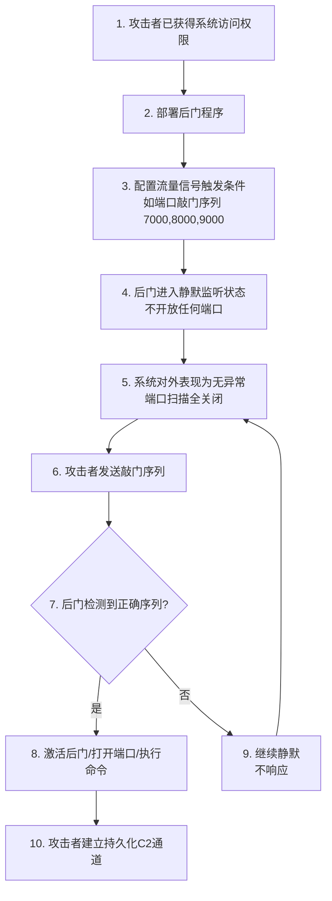

# 流量信号 (T1205)

## 一句话通俗理解

> **攻击者给后门装了个"暗号门"——只有听到特定的网络敲门节奏，门才会打开，别人敲门它装作不在家**

## 30秒速查卡

| 维度 | 你需要知道的 |
|------|-------------|
| 这是什么？ | 攻击者部署的后门只在对特定网络数据包序列（端口敲门）做出响应时才激活，平时完全静默 |
| 为什么危险？ | 后门端口平时完全关闭，端口扫描看不出任何异常；攻击者掌握"暗号"可随时唤醒后门 |
| 谁需要关心？ | 网络安全运维、防火墙管理员、渗透测试人员、IDS/IPS 运营人员 |
| 你的第一步防御 | 监控防火墙规则的动态变更和监听原始套接字（raw socket）的进程 |
| 如果只做一件事 | 在网络边界部署 IDS 检测端口敲门模式（短时间内对多个端口的连接尝试序列） |

## 难度等级

⭐⭐⭐⭐ 高级：需要网络协议栈、防火墙配置、原始套接字编程和隐蔽通信设计的深入知识

## 前置知识检查

读这个文件前，你需要了解：
- **端口敲门（Port Knocking）**：通过按特定顺序访问一系列关闭的端口来"解锁"某个服务的机制，就像用摩斯密码敲门
- **原始套接字（Raw Socket）**：直接读写网络层数据包的套接字类型，可绕过 TCP/IP 协议栈直接处理数据包
- **PCAP（Packet Capture）**：数据包捕获库，后门常用它监听网络流量寻找"暗号"
- **隐蔽监听**：后门不调用 `bind()` 绑定端口，而是用 raw socket 或 PCAP 被动监听，端口扫描工具看不到
- **TCP SYN 半开扫描**：发送 SYN 包但不完成三次握手，常用于端口敲门信号

## 技术描述

想象一下：你是个间谍，在敌人后方开了个秘密联络点。为了不被发现，你的门平时是锁死的，从外面看就是个废弃仓库。但你有套暗号——比如"先敲3下、停顿、再敲2下、停顿、敲1下"，门才会打开。网络上的"流量信号"就是这套暗号机制：后门平时完全静默，端口扫描、网络探测都看不出任何破绽，只有当攻击者发送特定序列的网络包（端口敲门）时，后门才会"开门"接收命令。

流量信号有两种主要实现方式：

**方式一：端口敲门（Port Knocking）**
攻击者在系统上部署一个监听程序，它不开放任何端口，而是通过 raw socket 或 PCAP 被动监听所有到达的网络流量。当检测到特定的端口访问序列（如先访问 7000 → 8000 → 9000 端口），就触发动作：修改防火墙规则打开后门端口，或直接激活后门。

**方式二：数据包内容信号**
后门监听所有流量，但不看端口序列，而是看数据包内容中的特定标记。比如某个 TCP 包的特定字段（序列号、窗口大小、紧急指针）被设为约定的值，或者 ICMP 包的 payload 包含特定字符串，就触发激活。

类比和技术之间的过渡：就像特工电影里"在报纸上刊登特定广告词作为接头暗号"，只有看到暗号的人才知道行动，其他人看同一份报纸只觉得是普通广告。在系统层面，端口敲门通过 `iptables` + `knockd` 实现，或通过后门程序内置 PCAP 监听实现。

## 子技术列表

| 子技术 ID | 子技术名称 | 简要说明 |
|-----------|-----------|---------|
| T1205.001 | 端口敲门（Port Knocking） | 通过特定端口访问序列触发后门激活 |
| T1205.002 | 套接字过滤器（Socket Filters） | 后门用 BPF/套接字过滤器只响应特定特征的数据包 |

## 攻击流程



### 该技术特有的步骤说明

1. **部署监听程序**：安装 `knockd` 或后门内置 PCAP 监听
2. **配置敲门序列**：编辑 `/etc/knockd.conf` 配置触发序列和动作：
   ```
   [openSSH]
   sequence = 7000,8000,9000
   seq_timeout = 15
   tcpflags = syn
   start_command = /sbin/iptables -A INPUT -s %IP% --dport 22 -j ACCEPT
   ```
3. **被动监听**：后门程序用 `libpcap` 或 raw socket 监听网卡，不调用 `bind()`
4. **序列匹配**：检测到 SYN 包到达 7000 → 8000 → 9000 端口（15秒内），匹配成功
5. **触发动作**：执行预设命令（打开防火墙端口、启动反向 shell、下载并执行 payload）

## 真实案例

### 案例1： cd00r 隐蔽后门（2002年首次公开）

- **时间**：2002年公开发布，概念验证性后门
- **目标**：Linux 服务器
- **攻击组织**：作者 FX（Phrack杂志贡献者，概念验证性发布）
- **手法**：cd00r 是最早公开的"无端口后门"之一。它使用 libpcap 监听网卡，不开放任何监听端口。当检测到特定序列的 SYN 包到达约定端口（默认是多个高端口的特定组合）时，cd00r 激活并连接攻击者 C2。由于不调用 `bind()`，`netstat` 和 `ss` 看不到任何监听，nmap 扫描也找不到开放端口
- **数据来源**：一手公开文档（phrack 杂志、cd00r 源码 README）

### 案例2：adore-ng rootkit 的端口敲门后门（2003-2010年活跃）

- **时间**：2003年首次出现，持续活跃至2010年代
- **目标**：Linux 服务器
- **攻击组织**：adore-ng 由 Team TESO 开发（同时被多个针对性攻击者使用，包括针对Linux服务器的针对性入侵行动）
- **手法**：adore-ng 内核 rootkit 集成了端口敲门功能。它在内核态 hook 网络协议栈，监听特定序列的 TCP 包。当检测到约定的"魔法包"（特定端口+特定序列号组合），内核模块会在内存中激活后门 shell，通过已存在的网络连接返回。由于 hook 在内核态，用户态的 netstat/ss 完全看不到
- **数据来源**：一手厂商报告（SANS Institute adore-ng 分析报告）

### 案例3：Linux 服务器 SSH 后门 + knockd 持久化（2020-2023年多起事件）

- **时间**：2020-2023年间多起被报道
- **目标**：暴露在公网的 Linux 服务器（特别是未及时打补丁的）
- **攻击组织**：TeamTNT（挖矿团伙）、FIN7（金融犯罪组织，曾使用Linux持久化技术）、WatchDog 挖矿团伙
- **手法**：攻击者入侵 Linux 服务器后，安装 `knockd` 并配置端口敲门序列。SSH 服务配置为只监听 127.0.0.1，外部无法直接访问。攻击者需要先用 `knock` 客户端发送敲门序列（如 7000,8000,9000），knockd 检测到后修改 iptables 规则临时开放 22 端口给攻击者 IP，15秒后自动关闭。这种方式让 SSH 后门在非攻击时段完全不可见
- **数据来源**：一手厂商报告（CISA 多份联合警报、CrowdStrike 事件响应报告）

## 红队视角

### 可持续利用手段

1. **多级敲门 + 时间窗口**：设置复杂的多级敲门序列+时间窗口，即使敲门序列泄露，时间窗口外也无法触发
2. **加密敲门**：敲门包内容用加密载荷，而非简单端口序列。即使被 IDS 捕获也无法识别
3. **ICMP/TCP/UDP 混合信号**：敲门序列跨协议（如 ICMP + TCP + UDP），IDS 难以关联
4. **内核态实现**：将监听逻辑放入内核模块，用户态工具完全不可见

### 攻击技术可复制性分析

| 维度 | 评分 | 说明 |
|------|------|------|
| 实现难度 | 中高 | 需要网络编程和防火墙配置知识 |
| 检测绕过 | 高 | 平时完全静默，传统端口扫描无效 |
| 持久化效果 | 高 | 只要后门不被发现，可长期潜伏 |
| 复制成本 | 中 | knockd 等工具开源可用，但隐蔽实现需开发 |

## 蓝队视角

### 检测建议

**用人话说**：端口敲门后门平时完全静默，你不能指望用端口扫描发现它。要发现它，得从两个角度入手：一是看"谁在监听原始网络流量"——正常程序很少需要 raw socket，如果发现非系统进程在用 PCAP 监听网卡，高度可疑；二是看"有没有端口敲门模式"——如果某个 IP 在短时间内对多个连续端口发起 SYN 扫描，且这些端口都关闭，这很可能是敲门尝试。

#### 主机层检测

```yaml
# Sigma规则：检测 knockd 进程运行
title: 检测 knockd 端口敲门守护进程
id: 5e6f7890-1234-5678-abcd-ef5678901234
status: experimental
description: 检测 knockd 端口敲门守护进程运行，可能被用于后门持久化
logsource:
    product: linux
    category: process_creation
detection:
    selection:
        Image|endswith:
            - '/knockd'
            - '/knock'
    condition: selection
falsepositives:
    - 合法的端口敲门部署（少见）
    - 安全测试工具
level: high
```

```yaml
# Sigma规则：检测非系统进程使用 raw socket（Linux auditd）
title: 可疑 Raw Socket 使用
id: 6f789012-3456-7890-abcd-ef6789012345
status: experimental
description: 检测非系统进程创建 raw socket，可能用于隐蔽监听后门
logsource:
    product: linux
    category: syscalls
detection:
    selection:
        syscall: socket
        a0: 3  # AF_PACKET
        a1: 3  # SOCK_RAW
    filter_system:
        exe|startswith:
            - '/usr/sbin/'
            - '/usr/bin/tcpdump'
            - '/usr/bin/tshark'
    condition: selection and not filter_system
falsepositives:
    - 网络监控工具（tcpdump, tshark）
    - IDS/IPS 进程
level: high
```

**系统命令检测**：

```bash
# 检查是否安装了 knockd
which knockd knock 2>/dev/null
dpkg -l | grep -i knock  # Debian/Ubuntu
rpm -qa | grep -i knock  # RHEL/CentOS

# 检查 knockd 配置
cat /etc/knockd.conf 2>/dev/null

# 检查使用 raw socket / PCAP 的进程
lsof -i raw
ps aux | grep -E 'tcpdump|pcap|libpcap'

# 检查 iptables 规则中是否有动态添加的痕迹
iptables -L -n -v | grep -i "recent"
# 端口敲门常用 iptables recent 模块实现

# 检查内核模块（rootkit 级后门）
lsmod | grep -iE 'adore|knock|backdoor'
```

#### 网络层检测

- **IDS 规则检测端口敲门模式**：监控短时间内对多个连续关闭端口的 SYN 尝试
  ```
  # Suricata/Snort 规则示例：检测端口敲门模式
  alert tcp $EXTERNAL_NET any -> $HOME_NET [7000,8000,9000] (
    msg:"Possible port knocking sequence"; 
    flags:S; 
    flow:stateless; 
    threshold:type threshold, track by_src, count 3, seconds 15;
    sid:1000001; rev:1;
  )
  ```
- **异常协议组合检测**：监控同一源 IP 短时间内发送 ICMP + TCP + UDP 多协议包的模式
- **流量基线分析**：建立正常网络流量基线，检测"对大量关闭端口的探测"模式

#### 应用层检测

- 监控防火墙规则配置文件变更（`/etc/iptables/rules.v4`、`firewalld` 配置）
- 监控 `iptables`/`firewall-cmd` 命令的异常调用
- 监控新安装的网络监听类软件包

### 防御改进措施

1. **出站默认拒绝**：即使后门被敲门激活，如果出站连接被默认拒绝，C2 通道也建立不起来
2. **网络分段**：限制服务器之间的横向连接，减少后门敲门的有效范围
3. **主机防火墙加固**：配置 iptables/nftables 日志，记录所有 DROP 的包
4. **内核完整性检查**：定期检查内核模块列表，使用 `rkhunter`、`chkrootkit` 检测 rootkit 级后门
5. **网络流量全量记录**：使用全流量录制（如 Zeek/Suricata + PCAP 存储），事后可分析

### 应急响应优化

- 怀疑流量信号后门时，优先用 `lsof -i raw` 和 `ps aux | grep pcap` 查找监听进程
- 检查 `/etc/knockd.conf`、`/etc/iptables/` 配置
- 用 `tcpdump` 抓包分析是否有异常的端口探测模式
- 内核态后门需用内存取证工具（Volatility）分析

## 避坑指南

### 容易踩的坑

1. **只扫端口就放心**：端口扫描全关闭不等于安全，后门可能用 raw socket 静默监听
2. **忽视内核态实现**：用户态工具（netstat/ss/lsof）看不到内核态后门，必须用内存取证
3. **误判合法端口敲门**：少数企业确实部署 knockd 增强安全，要先确认是否为已知合法配置
4. **敲门序列可被嗅探**：如果敲门序列未加密，网络中间人可嗅探到序列，IDS 部署在关键路径可捕获

### 本技术特有的注意事项

- 流量信号常与 rootkit 配合——内核态实现完全绕过用户态检测
- 端口敲门工具（knockd）本身是双刃剑，既可用于防御也可用于攻击
- 加密敲门（如 fwknop）比简单端口序列更难检测，需关注数据包内容特征

## 检测建议

### 网络层

- **IDS 端口敲门模式检测**：Suricata/Snort 规则检测短时间多端口 SYN 序列
- **全流量分析**：Zeek 记录所有连接尝试，事后分析异常探测模式
- **协议异常检测**：监控跨协议（ICMP+TCP+UDP）的异常组合包

### 主机层

- **Linux auditd**：监控 `socket(AF_PACKET, SOCK_RAW)` 系统调用
- **进程监控**：检测 `knockd`、`fwknop` 等工具运行
- **iptables recent 模块监控**：检查是否有端口敲门规则
- **内核模块审计**：定期 `lsmod` 对比基线

### 应用层

- 防火墙规则配置文件完整性监控
- 软件包安装监控（新安装网络监听类软件）

### Sigma 规则

见上方"蓝队视角→检测建议"中的两条 Sigma 规则。

## 缓解措施

| 缓解措施 | 类型 | 效果 | 实施建议 |
|---------|------|------|---------|
| 出站默认拒绝 | 预防 | 高 | 即使后门激活也无法建立 C2 |
| 网络分段 | 预防 | 中 | 限制敲门信号传播范围 |
| 主机防火墙日志 | 检测 | 中 | 记录所有 DROP 包用于分析 |
| 内核完整性检查 | 检测 | 中 | rkhunter/chkrootkit 定期扫描 |
| 全流量录制 | 检测 | 高 | 事后可追溯分析敲门行为 |
| 进程白名单 | 预防 | 中 | 限制可运行的网络监听程序 |

## 动手实验

### 实验目标

理解端口敲门原理，体验"暗号门"的隐蔽性和触发机制

### 实验步骤

```bash
# 实验环境：两台 Linux 虚拟机（攻击机 + 目标机）

# === 目标机配置 ===

# 1. 安装 knockd
sudo apt install knockd -y

# 2. 配置敲门序列（编辑 /etc/knockd.conf）
sudo tee /etc/knockd.conf > /dev/null <<'EOF'
[openSSH]
sequence = 7000,8000,9000
seq_timeout = 15
tcpflags = syn
start_command = /sbin/iptables -I INPUT -s %IP% -p tcp --dport 22 -j ACCEPT

[closeSSH]
sequence = 9000,8000,7000
seq_timeout = 15
tcpflags = syn
start_command = /sbin/iptables -D INPUT -s %IP% -p tcp --dport 22 -j ACCEPT
EOF

# 3. 配置 iptables 默认拒绝 SSH
sudo iptables -A INPUT -p tcp --dport 22 -j DROP

# 4. 启动 knockd
sudo systemctl start knockd

# 5. 验证：从攻击机扫描，22 端口应该是关闭的
# 在攻击机执行：nmap -p 22 <目标机IP>  → 应该是 filtered/closed

# === 攻击机敲门 ===

# 6. 安装 knock 客户端
sudo apt install knockd -y  # 包含 knock 客户端

# 7. 发送敲门序列
knock <目标机IP> 7000 8000 9000

# 8. 验证：现在 22 端口应该可达
ssh user@<目标机IP>  # 可以连接了

# 9. 关门
knock <目标机IP> 9000 8000 7000

# 10. 验证：22 端口再次关闭
```

### 预期输出

```
# 步骤5：敲门前扫描
PORT    STATE    SERVICE
22/tcp  filtered ssh

# 步骤7：敲门
# （knock 命令无输出表示成功发送）

# 步骤8：敲门后可 SSH 连接
user@target:~$   # 成功登录

# 步骤10：关门后再次扫描
PORT    STATE    SERVICE
22/tcp  filtered ssh
```

### 工具说明

| 工具 | 用途 | 说明 |
|------|------|------|
| knockd | 端口敲门服务端 | 最常用的端口敲门实现 |
| knock | 端口敲门客户端 | 配合 knockd 使用 |
| fwknop | 加密端口敲门 | SPA（Single Packet Authorization）更安全 |
| cd00r | 概念验证隐蔽后门 | 最早的无端口后门之一 |
| nmap | 端口扫描 | 验证敲门前后端口状态 |

## 术语解释

| 术语 | 通俗解释 |
|------|---------|
| 端口敲门（Port Knocking） | 通过特定端口访问序列"解锁"服务的暗号机制 |
| 原始套接字（Raw Socket） | 直接读写网络层数据包的套接字，可绕过协议栈 |
| PCAP | 数据包捕获库，后门用它监听网卡流量 |
| SYN 包 | TCP 三次握手的第一个包，端口敲门常用 SYN 触发 |
| BPF | 伯克利数据包过滤器，内核态过滤数据包 |
| SPA | 单包授权，fwknop 的加密敲门方式 |
| iptables recent 模块 | 记录近期连接源 IP 的模块，可用于实现端口敲门 |

## 参考资料

### 📚 如果你想深入了解

- [MITRE ATT&CK T1205 官方页面](https://attack.mitre.org/techniques/T1205/) — 官方技术定义
- [knockd 官方文档](http://www.zeroflux.org/projects/knock) — 端口敲门工具
- [fwknop 项目](https://www.cipherdyne.org/fwknop/) — 加密单包授权工具

### 🔧 如果你想动手试试

- [Port Knocking 教程 - DigitalOcean](https://www.digitalocean.com/community/tutorials) — knockd 配置实战
- [cd00r 源码分析](http://phrack.org/) — phrack 杂志原始文章

### 🎯 真实攻击参考

- [adore-ng rootkit 分析 - SANS](https://www.sans.org/) — 内核态端口敲门后门案例
- [CISA Linux 服务器加固指南](https://www.cisa.gov/) — 包含端口敲门防护建议

## 版本历史

| 版本 | 日期 | 变更说明 |
|------|------|---------|
| v1.0 | 2026-07-10 | 初始版本，基于 MITRE ATT&CK v19 和 v3.0 写作风格指南编写 |
